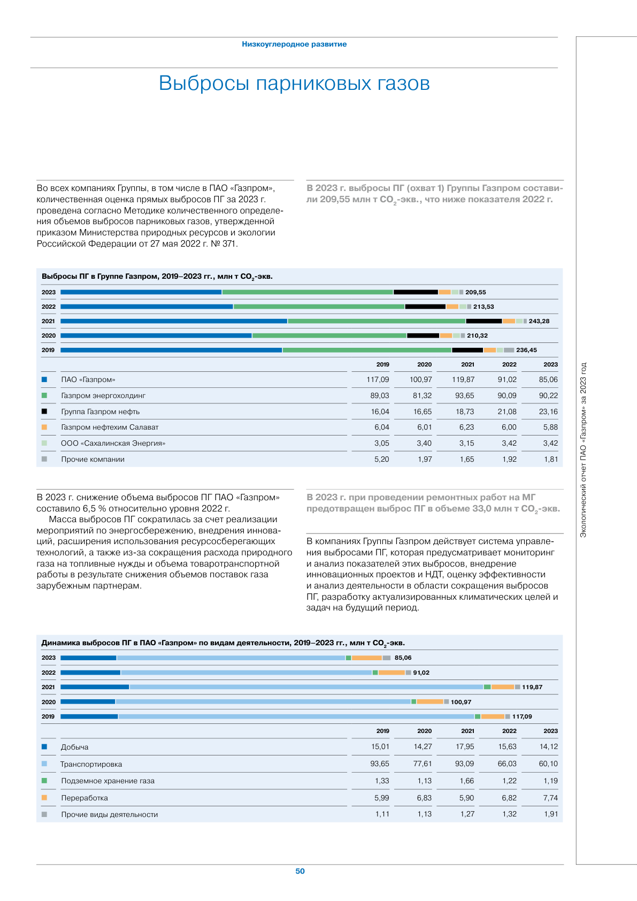

<!-- pdf_page: 52 -->

# Низкоуглеродное развитие

## Выбросы парниковых газов

Во всех компаниях Группы, в том числе в ПАО «Газпром», количественная оценка прямых выбросов ПГ за 2023 г. проведена согласно Методике количественного определения объемов выбросов парниковых газов, утвержденной приказом Министерства природных ресурсов и экологии Российской Федерации от 27 мая 2022 г. № 371.

**В 2023 г. выбросы ПГ (охват 1) Группы Газпром составили 209,55 млн т СО₂-экв., что ниже показателя 2022 г.**

**Выбросы ПГ в Группе Газпром, 2019–2023 гг., млн т СО₂-экв.**

| | 2019 | 2020 | 2021 | 2022 | 2023 |
|---|---|---|---|---|---|
| ПАО «Газпром» | 117,09 | 100,97 | 119,87 | 91,02 | 85,06 |
| Газпром энергохолдинг | 89,03 | 81,32 | 93,65 | 90,09 | 90,22 |
| Группа Газпром нефть | 16,04 | 16,65 | 18,73 | 21,08 | 23,16 |
| Газпром нефтехим Салават | 6,04 | 6,01 | 6,23 | 6,00 | 5,88 |
| ООО «Сахалинская Энергия» | 3,05 | 3,40 | 3,15 | 3,42 | 3,42 |
| Прочие компании | 5,20 | 1,97 | 1,65 | 1,92 | 1,81 |

В 2023 г. снижение объема выбросов ПГ ПАО «Газпром» составило 6,5 % относительно уровня 2022 г.

Масса выбросов ПГ сократилась за счет реализации мероприятий по энергосбережению, внедрения инноваций, расширения использования ресурсосберегающих технологий, а также из-за сокращения расхода природного газа на топливные нужды и объема товаротранспортной работы в результате снижения объемов поставок газа зарубежным партнерам.

**В 2023 г. при проведении ремонтных работ на МГ предотвращен выброс ПГ в объеме 33,0 млн т СО₂-экв.**

В компаниях Группы Газпром действует система управления выбросами ПГ, которая предусматривает мониторинг и анализ показателей этих выбросов, внедрение инновационных проектов и НДТ, оценку эффективности и анализ деятельности в области сокращения выбросов ПГ, разработку актуализированных климатических целей и задач на будущий период.

**Динамика выбросов ПГ в ПАО «Газпром» по видам деятельности, 2019–2023 гг., млн т СО₂-экв.**

| | 2019 | 2020 | 2021 | 2022 | 2023 |
|---|---|---|---|---|---|
| Добыча | 15,01 | 14,27 | 17,95 | 15,63 | 14,12 |
| Транспортировка | 93,65 | 77,61 | 93,09 | 66,03 | 60,10 |
| Подземное хранение газа | 1,33 | 1,13 | 1,66 | 1,22 | 1,19 |
| Переработка | 5,99 | 6,83 | 5,90 | 6,82 | 7,74 |
| Прочие виды деятельности | 1,11 | 1,13 | 1,27 | 1,32 | 1,91 |

Экологический отчет ПАО «Газпром» за 2023 год

50

