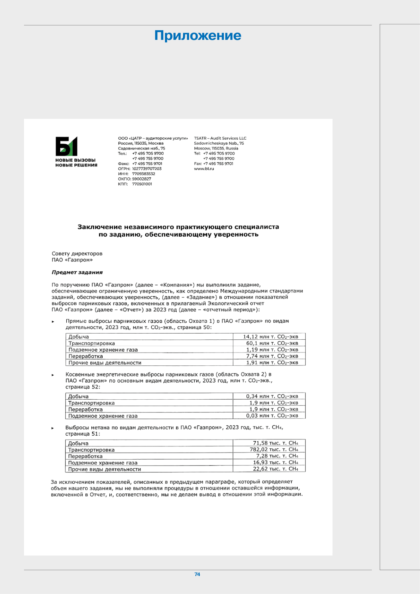

<!-- pdf_page: 76 -->

# Приложение

**Б1**
НОВЫЕ ВЫЗОВЫ
НОВЫЕ РЕШЕНИЯ

ООО «ЦАТР – аудиторские услуги»
Россия, 115035, Москва
Садовническая наб., 75
Тел.: +7 495 705 9700
+7 495 755 9700
Факс: +7 495 755 9701
ОГРН: 1027739707203
ИНН: 7709383532
ОКПО: 59002827
КПП: 770501001

TSATR – Audit Services LLC
Sadovnicheskaya Nab., 75
Moscow, 115035, Russia
Tel: +7 495 705 9700
+7 495 755 9700
Fax: +7 495 755 9701
www.bl.ru

## Заключение независимого практикующего специалиста по заданию, обеспечивающему уверенность

Совету директоров
ПАО «Газпром»

**Предмет задания**

По поручению ПАО «Газпром» (далее – «Компания») мы выполнили задание, обеспечивающее ограниченную уверенность, как определено Международными стандартами заданий, обеспечивающих уверенность, (далее – «Задание») в отношении показателей выбросов парниковых газов, включенных в прилагаемый Экологический отчет ПАО «Газпром» (далее – «Отчет») за 2023 год (далее – «отчетный период»):

- Прямые выбросы парниковых газов (область Охвата 1) в ПАО «Газпром» по видам деятельности, 2023 год, млн т. CO₂-экв., страница 50:

| | |
|---|---|
| Добыча | 14,12 млн т. CO₂-экв |
| Транспортировка | 60,1 млн т. CO₂-экв |
| Подземное хранение газа | 1,19 млн т. CO₂-экв |
| Переработка | 7,74 млн т. CO₂-экв |
| Прочие виды деятельности | 1,91 млн т. CO₂-экв |

- Косвенные энергетические выбросы парниковых газов (область Охвата 2) в ПАО «Газпром» по основным видам деятельности, 2023 год, млн т. CO₂-экв., страница 52:

| | |
|---|---|
| Добыча | 0,34 млн т. CO₂-экв |
| Транспортировка | 1,9 млн т. CO₂-экв |
| Переработка | 1,9 млн т. CO₂-экв |
| Подземное хранение газа | 0,03 млн т. CO₂-экв |

- Выбросы метана по видам деятельности в ПАО «Газпром», 2023 год, тыс. т. CH₄, страница 51:

| | |
|---|---|
| Добыча | 71,58 тыс. т. CH₄ |
| Транспортировка | 782,02 тыс. т. CH₄ |
| Переработка | 7,28 тыс. т. CH₄ |
| Подземное хранение газа | 16,93 тыс. т. CH₄ |
| Прочие виды деятельности | 22,62 тыс. т. CH₄ |

За исключением показателей, описанных в предыдущем параграфе, который определяет объем нашего задания, мы не выполняли процедуры в отношении оставшейся информации, включенной в Отчет, и, соответственно, мы не делаем вывод в отношении этой информации.

74

