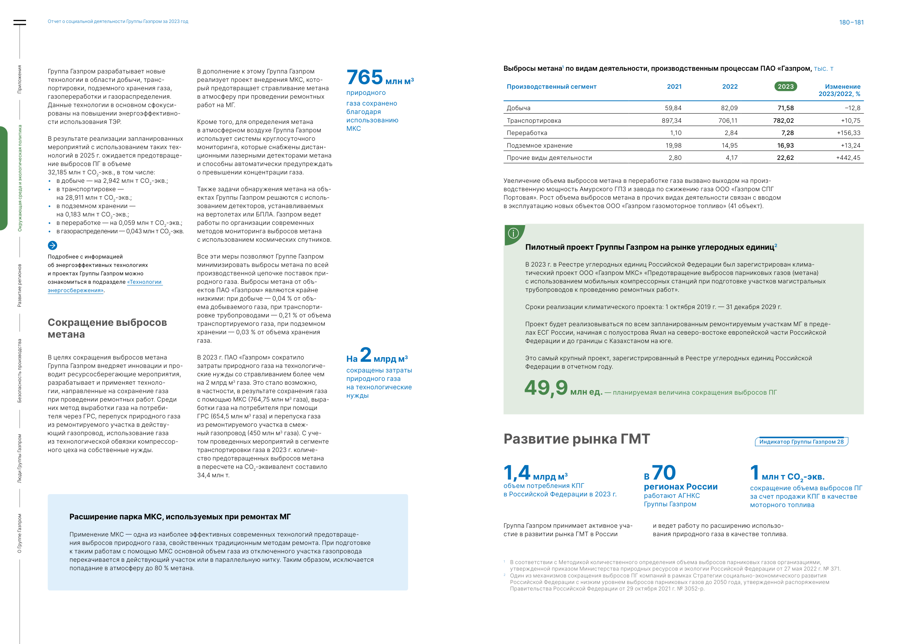

<!-- pdf_page: 92 -->

Отчет о социальной деятельности Группы Газпром за 2023 год

180–181

Группа Газпром разрабатывает новые технологии в области добычи, транспортировки, подземного хранения газа, газопереработки и газораспределения. Данные технологии в основном сфокусированы на повышении энергоэффективности использования ТЭР.

В результате реализации запланированных мероприятий с использованием таких технологий в 2025 г. ожидается предотвращение выбросов ПГ в объеме 32,185 млн т СО2-экв., в том числе:
• в добыче — на 2,942 млн т СО2-экв.;
• в транспортировке — на 28,911 млн т СО2-экв.;
• в подземном хранении — на 0,183 млн т СО2-экв.;
• в переработке — на 0,059 млн т СО2-экв.;
• в газораспределении — 0,043 млн т СО2-экв.

Подробнее с информацией об энергоэффективных технологиях и проектах Группы Газпром можно ознакомиться в подразделе «Технологии энергосбережения».

В дополнение к этому Группа Газпром реализует проект внедрения МКС, который предотвращает стравливание метана в атмосферу при проведении ремонтных работ на МГ.

Кроме того, для определения метана в атмосферном воздухе Группа Газпром использует системы круглосуточного мониторинга, которые снабжены дистанционными лазерными детекторами метана и способны автоматически предупреждать о превышении концентрации газа.

Также задачи обнаружения метана на объектах Группы Газпром решаются с использованием детекторов, устанавливаемых на вертолетах или БПЛА. Газпром ведет работы по организации современных методов мониторинга выбросов метана с использованием космических спутников.

765 млн м3
природного газа сохранено благодаря использованию МКС

Все эти меры позволяют Группе Газпром минимизировать выбросы метана по всей производственной цепочке поставок природного газа. Выбросы метана от объектов ПАО «Газпром» являются крайне низкими: при добыче — 0,04 % от объема добываемого газа, при транспортировке трубопроводами — 0,21 % от объема транспортируемого газа, при подземном хранении — 0,03 % от объема хранения газа.

В 2023 г. ПАО «Газпром» сократило затраты природного газа на технологические нужды со стравливанием более чем на 2 млрд м3 газа. Это стало возможно, в частности, в результате сохранения газа с помощью МКС (764,75 млн м3 газа), выработки газа на потребителя при помощи ГРС (654,5 млн м3 газа) и перепуска газа из ремонтируемого участка в смежный газопровод (450 млн м3 газа). С учетом проведенных мероприятий в сегменте транспортировки газа в 2023 г. количество предотвращенных выбросов метана в пересчете на СО2-эквивалент составило 34,4 млн т.

Сокращение выбросов метана

В целях сокращения выбросов метана Группа Газпром внедряет инновации и проводит ресурсосберегающие мероприятия, разрабатывает и применяет технологии, направленные на сохранение газа при проведении ремонтных работ. Среди них метод выработки газа на потребителя через ГРС, перепуск природного газа из ремонтируемого участка в действующий газопровод, использование газа из технологической обвязки компрессорного цеха на собственные нужды.

На 2 млрд м3
сокращены затраты природного газа на технологические нужды

Расширение парка МКС, используемых при ремонтах МГ

Применение МКС — одна из наиболее эффективных современных технологий предотвращения выбросов природного газа, свойственных традиционным методам ремонта. При подготовке к таким работам с помощью МКС основной объем газа из отключенного участка газопровода перекачивается в действующий участок или в параллельную нитку. Таким образом, исключается попадание в атмосферу до 80 % метана.

Выбросы метана1 по видам деятельности, производственным процессам ПАО «Газпром, тыс. т

| Производственный сегмент | 2021 | 2022 | 2023 | Изменение 2023/2022, % |
|---|---|---|---|---|
| Добыча | 59,84 | 82,09 | 71,58 | –12,8 |
| Транспортировка | 897,34 | 706,11 | 782,02 | +10,75 |
| Переработка | 1,10 | 2,84 | 7,28 | +156,33 |
| Подземное хранение | 19,98 | 14,95 | 16,93 | +13,24 |
| Прочие виды деятельности | 2,80 | 4,17 | 22,62 | +442,45 |

Увеличение объема выбросов метана в переработке газа вызвано выходом на производственную мощность Амурского ГПЗ и завода по сжижению газа ООО «Газпром СПГ Портовая». Рост объема выбросов метана в прочих видах деятельности связан с вводом в эксплуатацию новых объектов ООО «Газпром газомоторное топливо» (41 объект).

Пилотный проект Группы Газпром на рынке углеродных единиц2

В 2023 г. в Реестре углеродных единиц Российской Федерации был зарегистрирован климатический проект ООО «Газпром МКС» «Предотвращение выбросов парниковых газов (метана) с использованием мобильных компрессорных станций при подготовке участков магистральных трубопроводов к проведению ремонтных работ».

Сроки реализации климатического проекта: 1 октября 2019 г. — 31 декабря 2029 г.

Проект будет реализовываться по всем запланированным ремонтируемым участкам МГ в пределах ЕСГ России, начиная с полуострова Ямал на северо-востоке европейской части Российской Федерации и до границы с Казахстаном на юге.

Это самый крупный проект, зарегистрированный в Реестре углеродных единиц Российской Федерации в отчетном году.

49,9 млн ед. — планируемая величина сокращения выбросов ПГ

Развитие рынка ГМТ

Индикатор Группы Газпром 28

1,4 млрд м3
объем потребления КПГ в Российской Федерации в 2023 г.

В 70 регионах России работают АГНКС Группы Газпром

1 млн т CO2-экв.
сокращение объема выбросов ПГ за счет продажи КПГ в качестве моторного топлива

Группа Газпром принимает активное участие в развитии рынка ГМТ в России и ведет работу по расширению использования природного газа в качестве топлива.

1 В соответствии с Методикой количественного определения объема выбросов парниковых газов организациями, утвержденной приказом Министерства природных ресурсов и экологии Российской Федерации от 27 мая 2022 г. № 371.

2 Один из механизмов сокращения выбросов ПГ компаний в рамках Стратегии социально-экономического развития Российской Федерации с низким уровнем выбросов парниковых газов до 2050 года, утвержденной распоряжением Правительства Российской Федерации от 29 октября 2021 г. № 3052-р.

Безопасность производства
Развитие регионов
Окружающая среда и экологическая политика
Приложения
Люди Группы Газпром
О Группе Газпром

