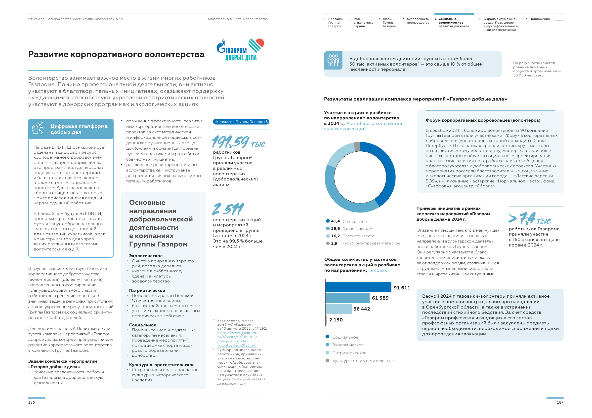

<!-- pdf_page: 95 -->

Отчет о социальной деятельности Группы Газпром за 2024 г.
Благотворительность и волонтерство

# Развитие корпоративного волонтерства

Волонтерство занимает важное место в жизни многих работников Газпрома. Помимо профессиональной деятельности, они активно участвуют в благотворительных инициативах, оказывают поддержку нуждающимся, способствуют укреплению патриотических ценностей, участвуют в донорских программах и экологических акциях.

## Цифровая платформа добрых дел

На базе ЕПВ ГИД функционирует отдельный цифровой ресурс корпоративного добровольчества — «Газпром добрые дела». Это пространство, где персонал подключается к волонтерским и благотворительным акциям, а также важным социальным проектам. Здесь размещаются сборы и инициативы, к которым может присоединиться каждый неравнодушный работник.

В ближайшем будущем ЕПВ ГИД продолжит развиваться: планируется запуск образовательных курсов, системы достижений для мотивации участников, а также инструментов для управления различными аспектами волонтерских акций.

В Группе Газпром действует Политика корпоративного добровольчества (волонтерства)¹ (далее — Политика), направленная на формирование культуры добровольного участия работников в решении социально значимых задач в регионах присутствия, а также укрепление репутации компаний Группы Газпром как социально ориентированных работодателей.

Для достижения целей Политики реализуется комплекс мероприятий «Газпром добрые дела», который предусматривает развитие корпоративного волонтерства в компаниях Группы Газпром.

**Задачи комплекса мероприятий «Газпром добрые дела»**
• Усиление вовлеченности работников Газпрома в добровольческую деятельность;
• повышение эффективности реализуемых корпоративными волонтерами проектов за счет методической и информационной поддержки, создания коммуникационных площадок (онлайн и офлайн) для обмена лучшими практиками и разработки совместных инициатив;
• расширение роли корпоративного волонтерства как инструмента для развития личных навыков и компетенций работников.

**Индикатор Группы Газпром ⁸**

191,59 тыс. работников Группы Газпром² приняли участие в различных волонтерских (добровольческих) акциях

2 511 волонтерских акций и мероприятий проведено в Группе Газпром в 2024 г. Это на 99,3 % больше, чем в 2023 г.

### Основные направления добровольческой деятельности в компаниях Группы Газпром

**Экологическое**
• Очистка природных территорий, посадка деревьев;
• участие в субботниках, сдача макулатуры;
• зооволонтерство.

**Патриотическое**
• Помощь ветеранам Великой Отечественной войны;
• благоустройство памятных мест;
• участие в акциях, посвященных историческим событиям.

**Социальное**
• Помощь социально уязвимым категориям населения;
• проведение мероприятий по поддержке спорта и здорового образа жизни;
• донорство.

**Культурно-просветительское**
• Сохранение и восстановление культурно-исторического наследия.

¹ Утверждена приказом ПАО «Газпром» от 10 августа 2023 г. № 292: https://www.gazprom.ru/f/posts/57/969815/policy-corporate-volunteering-2023.pdf
² Суммарная численность работников, принявших участие во всех волонтерских (добровольческих) акциях (например, если один человек принял участие в двух таких акциях, то он учитывается дважды, и т. д.).

В добровольческом движении Группы Газпром более 50 тыс. активных волонтеров³ — это свыше 10 % от общей численности персонала.

³ По результатам анкетирования дочерних обществ и организаций — 50 050 человек.

## Результаты реализации комплекса мероприятий «Газпром добрые дела»

**Участие в акциях в разбивке по направлениям волонтерства в 2024 г., % от общего количества участников акций**

| % | Направление |
|---|---|
| 41,4 | Социальное |
| 39,6 | Экологическое |
| 16,2 | Патриотическое |
| 2,9 | Культурно-просветительское |

**Общее количество участников волонтерских акций в разбивке по направлениям, человек**

| Человек | Направление |
|---|---|
| 91 611 | Социальное |
| 61 389 | Экологическое |
| 36 442 | Патриотическое |
| 2 150 | Культурно-просветительское |

### Форум корпоративных добровольцев (волонтеров)

В декабре 2024 г. более 200 волонтеров из 90 компаний Группы Газпром стали участниками I Форума корпоративных добровольцев (волонтеров), который проходил в Санкт-Петербурге. В его рамках прошли лекции, круглые столы по патриотическому волонтерству, мастер-классы и общение с экспертами в области социального проектирования, практические занятия по отработке навыков общения с благополучателями добровольческих проектов. Участники мероприятия посетили благотворительные, социальные и экологические организации города — «Детские деревни SOS», инклюзивные мастерские «Нормальное место», фонд «Суворов» и экоцентр «Сборка».

### Примеры инициатив в рамках комплекса мероприятий «Газпром добрые дела» в 2024 г.

Оказание помощи тем, кто в ней нуждается, остается одним из ключевых направлений волонтерской деятельности работников Группы Газпром. Они регулярно участвуют в благотворительных инициативах и оказывают поддержку людям, столкнувшимся с трудными жизненными обстоятельствами и чрезвычайными ситуациями.

> 7,4 тыс. работников Газпрома приняли участие в 160 акциях по сдаче крови в 2024 г.

Весной 2024 г. газовики-волонтеры приняли активное участие в помощи пострадавшим при наводнении в Оренбургской области, а также в устранении последствий стихийного бедствия. За счет средств «Газпром профсоюза» и входящих в его состав профсоюзных организаций были закуплены предметы первой необходимости, необходимое снаряжение и лодки для проведения эвакуации.

186
187

