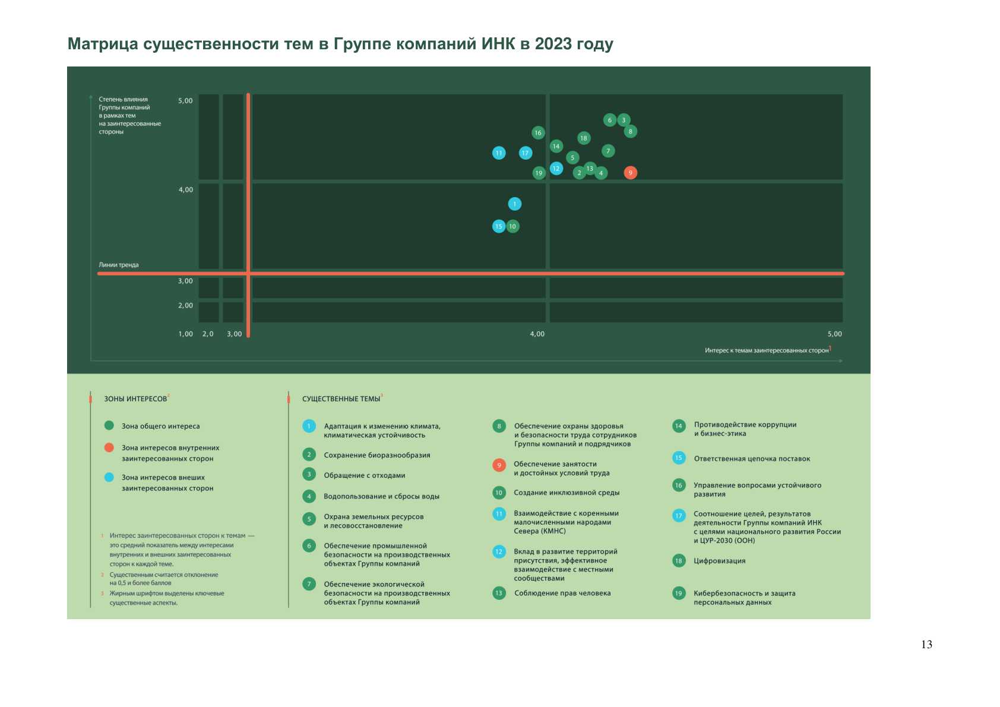

<!-- pdf_page: 13 -->

# Матрица существенности тем в Группе компаний ИНК в 2023 году

**Матрица (ось Y — «Степень влияния Группы компаний в рамках тем на заинтересованные стороны»; ось X — «Интерес к темам заинтересованных сторон¹»; «Линии тренда»):**

| Степень влияния |  |
|---|---|
| 5,00 | 6, 3, 8, 16, 18, 14, 7, 11, 17, 5, 19, 12, 2, 13, 4, 9 |
| 4,00 | 1 |
| — | 15, 10 |
| 3,00 | (линия тренда) |
| 2,00 |  |
| 1,00 |  |

Шкала интереса: 1,00 · 2,0 · 3,00 · 4,00 · 5,00

**ЗОНЫ ИНТЕРЕСОВ²**

- 🟢 Зона общего интереса
- 🔴 Зона интересов внутренних заинтересованных сторон
- 🔵 Зона интересов внешних заинтересованных сторон

**СУЩЕСТВЕННЫЕ ТЕМЫ³**

1. Адаптация к изменению климата, климатическая устойчивость
2. Сохранение биоразнообразия
3. Обращение с отходами
4. Водопользование и сбросы воды
5. Охрана земельных ресурсов и лесовосстановление
6. Обеспечение промышленной безопасности на производственных объектах Группы компаний
7. Обеспечение экологической безопасности на производственных объектах Группы компаний
8. Обеспечение охраны здоровья и безопасности труда сотрудников Группы компаний и подрядчиков
9. Обеспечение занятости и достойных условий труда
10. Создание инклюзивной среды
11. Взаимодействие с коренными малочисленными народами Севера (КМНС)
12. Вклад в развитие территорий присутствия, эффективное взаимодействие с местными сообществами
13. Соблюдение прав человека
14. Противодействие коррупции и бизнес-этика
15. Ответственная цепочка поставок
16. Управление вопросами устойчивого развития
17. Соотношение целей, результатов деятельности Группы компаний ИНК с целями национального развития России и ЦУР-2030 (ООН)
18. Цифровизация
19. Кибербезопасность и защита персональных данных

**Примечания:**

1. Интерес заинтересованных сторон к темам — это средний показатель между интересами внутренних и внешних заинтересованных сторон к каждой теме.
2. Существенным считается отклонение на 0,5 и более баллов
3. Жирным шрифтом выделены ключевые существенные аспекты.

13

