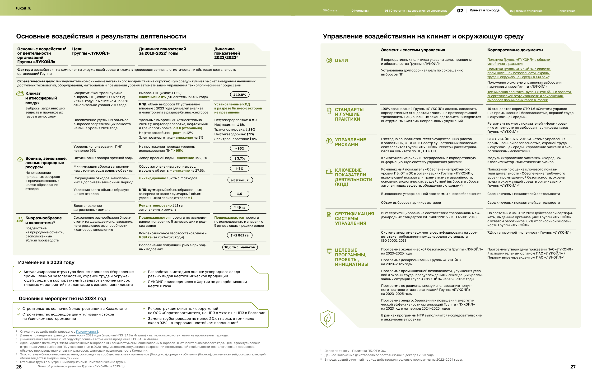

<!-- pdf_page: 15 -->

# Основные воздействия и результаты деятельности

## Основные воздействия и результаты деятельности

| Основные воздействия¹ от деятельности организаций Группы «ЛУКОЙЛ» | Цели Группы «ЛУКОЙЛ» | Динамика показателей за 2019–2022² годы | Динамика показателей 2023/2022³ |
|---|---|---|---|
| **Факторы воздействия на компоненты окружающей среды и климат: производственная, логистическая и сбытовая деятельность организаций Группы** | | | |
| **Стратегическая цель:** последовательное снижение негативного воздействия на окружающую среду и климат за счет внедрения наилучших доступных технологий, оборудования, материалов и повышения уровня автоматизации управления технологическими процессами | | | |
| **Климат и атмосферный воздух** Выбросы загрязняющих веществ и парниковых газов в атмосферу | Сократить⁴ контролируемые выбросы ПГ (Охват 1 + Охват 2) к 2030 году не менее чем на 20% относительно уровня 2017 года | Выбросы ПГ (Охваты 1 + 2): снижение на 8% (относительно 2017 года) | ↓10,8% |
| | | КПД: объем выбросов ПГ установлен впервые с 2023 года для целей анализа и мониторинга в разрезе бизнес-секторов | Установленные КПД в разрезе бизнес-секторов не превышены |
| | Обеспечение удельных объемов выбросов загрязняющих веществ не выше уровня 2020 года | Удельные выбросы ЗВ (относительно 2020 г.): нефтепереработка, нефтехимия и транспортировка: Δ = 0 (стабильно) Нефтегазодобыча – рост на 12% Электроэнергетика – снижение на 3% | Нефтепереработка: Δ = 0 Нефтехимия: ↓6% Транспортировка: ↓29% Нефтегазодобыча: ↑9% Электроэнергетика: ↑5% |
| | Уровень использования ПНГ не менее 95% | На протяжении периода уровень использования ПНГ > 95% | > 95% |
| **Водные, земельные, лесные природные ресурсы** Использование природных ресурсов в производственных целях; образование отходов | Оптимизация забора пресной воды | Забор пресной воды – снижение на 2,8% | ↓3,7% |
| | Минимизация сброса загрязненных сточных вод в водные объекты | Сброс загрязненных сточных вод в водные объекты – снижение на 27,6% | ↓5% |
| | Сокращение отходов, накопленных в доприватизационный период | Ликвидировано 182 тыс. т отходов | ↓89 тыс. т |
| | Удаление всего объема образующихся отходов | КПД: суммарный объем образованных за период отходов / суммарный объем удаленных за период отходов = 1 | 1,0 |
| | Восстановление загрязненных земель | Рекультивировано 221 га загрязненных земель | ↑49 га |
| **Биоразнообразие и экосистемы⁵** Воздействие на природные объекты, расположенные вблизи производств | Сохранение разнообразия биосистем и их щадящее использование, не угрожающее их способности к самовосстановлению | Поддерживаются проекты по исследованию и спасению 5 исчезающих и редких видов | Поддерживаются проекты по исследованию и спасению 5 исчезающих и редких видов |
| | | Компенсационное лесовосстановление – 6 391 га (за 2021–2023 годы) | ↑+2 861 га |
| | Восполнение популяций рыб в природных водоемах | | 10,6 тыс. мальков |

## Изменения в 2023 году

- Актуализирована структура бизнес-процесса «Управление промышленной безопасностью, охраной труда и окружающей среды», в корпоративный стандарт включен список типовых мероприятий по адаптации к изменениям климата
- Разработана методика оценки углеродного следа разных видов нефтехимической продукции
- ЛУКОЙЛ присоединился к Хартии по декарбонизации нефти и газа

## Основные мероприятия на 2024 год

- Строительство солнечной электростанции в Казахстане
- Строительство водоводов для утилизации стоков на Усинском месторождении
- Реконструкция очистных сооружений на ООО «Саратоворгсинтез», на НПЗ в Ухте и на НПЗ в Болгарии
- Замена трубопроводов не менее 2% от парка, в том числе около 93% – в коррозионностойком исполнении⁶

¹ Описание воздействий приведено в Приложении 3.
² Данные приведены в границах отчетности 2022 года (включая НПЗ ISAB в Италии) и являются консистентными на протяжении периода.
³ Динамика показателей в 2023 году обусловлена в том числе продажей НПЗ ISAB в Италии.
⁴ Здесь и далее по тексту Отчета «сокращение выбросов ПГ» означает уменьшение валовых выбросов ПГ относительно базового года. Цель сформулирована в границах учета выбросов ПГ, утвержденных в 2020 году, исходя из допущения о сохранении относительной стабильности технологических процессов, объемов производства и внешних факторов, влияющих на деятельность Компании.
⁵ Экосистема – биологическая система, состоящая из сообщества живых организмов (биоценоз), среды их обитания (биотоп), системы связей, осуществляющей обмен веществ и энергии между ними.
⁶ Стальные трубы с внутренним покрытием и неметаллические трубы.

26

---

# Управление воздействиями на климат и окружающую среду

| | Элементы системы управления | Корпоративные документы |
|---|---|---|
| **ЦЕЛИ** | В корпоративных политиках указаны цели, принципы и обязательства Группы «ЛУКОЙЛ» Установлена долгосрочная цель по сокращению выбросов ПГ | Политика Группы «ЛУКОЙЛ» в области устойчивого развития Политика Группы «ЛУКОЙЛ» в области промышленной безопасности, охраны труда и окружающей среды в XXI веке¹ Положение о системе управления выбросами парниковых газов Группы «ЛУКОЙЛ» Техническая политика Группы «ЛУКОЙЛ» в области энергетической эффективности и сокращения выбросов парниковых газов в России |
| **СТАНДАРТЫ И ЛУЧШИЕ ПРАКТИКИ** | 100% организаций Группы «ЛУКОЙЛ» должны следовать корпоративным стандартам в части, не противоречащей требованиям национальных законодательств. Внедряются инструменты Системы непрерывных улучшений | 16 стандартов серии СТО 1.6 «Система управления промышленной безопасностью, охраной труда и окружающей среды». Регламент по учету показателей и формированию отчетности по выбросам парниковых газов Группы «ЛУКОЙЛ» |
| **УПРАВЛЕНИЕ РИСКАМИ** | Ежегодно обновляются Реестр существенных рисков в области ПБ, ОТ и ОС и Реестр существенных экологических аспектов Группы «ЛУКОЙЛ». Реестры рассматриваются на Комитете по ПБ, ОТ и ОС. Климатические риски интегрированы в корпоративную информационную систему управления рисками | СТО ЛУКОЙЛ 1.6.6–2019 «Система управления промышленной безопасностью, охраной труда и окружающей среды. Управление рисками и экологическими аспектами». Модуль «Управление рисками». Очередь 2» Классификатор климатических рисков |
| **КЛЮЧЕВЫЕ ПОКАЗАТЕЛИ ДЕЯТЕЛЬНОСТИ (КПД)** | Комплексный показатель «Обеспечение требуемого уровня ПБ, ОТ и ОС в организациях Группы «ЛУКОЙЛ», включающий показатели травматизма и аварийности, основных экологических воздействий (выбросы и сбросы загрязняющих веществ, обращение с отходами) | Положение по оценке ключевого показателя деятельности «Обеспечение требуемого уровня промышленной безопасности, охраны труда и окружающей среды в организациях Группы «ЛУКОЙЛ»² |
| | Выполнение утвержденной программы энергосбережения | Свод ключевых показателей деятельности |
| | Объем выбросов парниковых газов | Свод ключевых показателей деятельности |
| **СЕРТИФИКАЦИЯ СИСТЕМЫ УПРАВЛЕНИЯ** | ИСУ сертифицирована на соответствие требованиям международных стандартов ISO 14001:2015 и ISO 45001:2018 | По состоянию на 31.12.2023 действовали сертификаты, выданные организациям Группы «ЛУКОЙЛ» с охватом работников: 82% от списочной численности Группы «ЛУКОЙЛ» |
| | Система энергоменеджмента сертифицирована на соответствие требованиям международного стандарта ISO 50001:2018 | 71% от списочной численности Группы «ЛУКОЙЛ» |
| **ЦЕЛЕВЫЕ ПРОГРАММЫ, ПРОЕКТЫ, ИНИЦИАТИВЫ** | Программа экологической безопасности Группы «ЛУКОЙЛ» на 2023–2025 годы Программа декарбонизации Группы «ЛУКОЙЛ» на 2023–2025 годы Программа промышленной безопасности, улучшения условий и охраны труда, предупреждения и ликвидации чрезвычайных ситуаций Группы «ЛУКОЙЛ» на 2023–2025 годы Программа по рациональному использованию попутного нефтяного газа организаций Группы «ЛУКОЙЛ» на 2023–2025 годы Программа энергосбережения и повышения энергетической эффективности организаций Группы «ЛУКОЙЛ» на 2023 год и на период 2024–2025 годов В рамках программы НТР выполняются исследовательские и инженерные проекты | Программы утверждены приказами ПАО «ЛУКОЙЛ» / исполнительным органом ПАО «ЛУКОЙЛ» / Первым вице-президентом ПАО «ЛУКОЙЛ»³ |

¹ Далее по тексту – Политика ПБ, ОТ и ОС.
² Данное Положение действовало по состоянию на 31 декабря 2023 года.
³ В предыдущий отчетный период действовали целевые программы на 2022–2024 годы.

27

