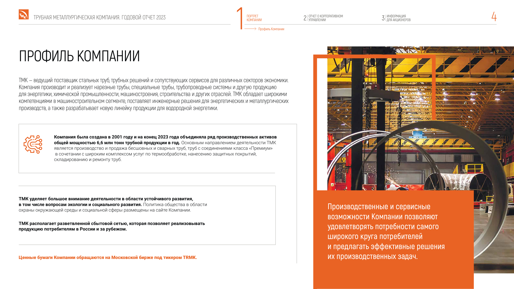

<!-- pdf_page: 4 -->

ТРУБНАЯ МЕТАЛЛУРГИЧЕСКАЯ КОМПАНИЯ. ГОДОВОЙ ОТЧЕТ 2023

1 ПОРТРЕТ КОМПАНИИ → Профиль Компании | 2 ОТЧЕТ О КОРПОРАТИВНОМ УПРАВЛЕНИИ | 3 ИНФОРМАЦИЯ ДЛЯ АКЦИОНЕРОВ | 4

# ПРОФИЛЬ КОМПАНИИ

ТМК — ведущий поставщик стальных труб, трубных решений и сопутствующих сервисов для различных секторов экономики. Компания производит и реализует нарезные трубы, специальные трубы, трубопроводные системы и другую продукцию для энергетики, химической промышленности, машиностроения, строительства и других отраслей. ТМК обладает широкими компетенциями в машиностроительном сегменте, поставляет инженерные решения для энергетических и металлургических производств, а также разрабатывает новую линейку продукции для водородной энергетики.

**Компания была создана в 2001 году и на конец 2023 года объединяла ряд производственных активов общей мощностью 6,6 млн тонн трубной продукции в год.** Основным направлением деятельности ТМК является производство и продажа бесшовных и сварных труб, труб с соединениями класса «Премиум» в сочетании с широким комплексом услуг по термообработке, нанесению защитных покрытий, складированию и ремонту труб.

**ТМК уделяет большое внимание деятельности в области устойчивого развития, в том числе вопросам экологии и социального развития.** Политика общества в области охраны окружающей среды и социальной сферы размещены на сайте Компании.

**ТМК располагает разветвленной сбытовой сетью, которая позволяет реализовывать продукцию потребителям в России и за рубежом.**

**Ценные бумаги Компании обращаются на Московской бирже под тикером TRMK.**

Производственные и сервисные возможности Компании позволяют удовлетворять потребности самого широкого круга потребителей и предлагать эффективные решения их производственных задач.

