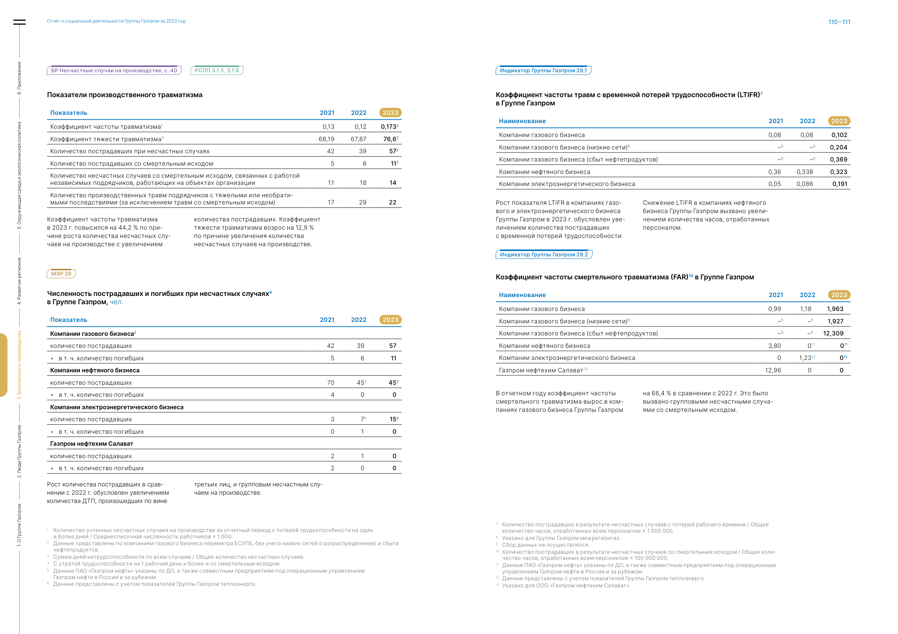

<!-- pdf_page: 57 -->

Отчет о социальной деятельности Группы Газпром за 2023 год

110 – 111

БР Несчастные случаи на производстве, с. 40
РСПП 3.1.5, 3.1.6

### Показатели производственного травматизма

| Показатель | 2021 | 2022 | 2023 |
|---|---|---|---|
| Коэффициент частоты травматизма¹ | 0,13 | 0,12 | 0,173² |
| Коэффициент тяжести травматизма³ | 68,19 | 67,87 | 76,6² |
| Количество пострадавших при несчастных случаях | 42 | 39 | 57² |
| Количество пострадавших со смертельным исходом | 5 | 6 | 11² |
| Количество несчастных случаев со смертельным исходом, связанных с работой независимых подрядчиков, работающих на объектах организации | 11 | 18 | 14 |
| Количество производственных травм подрядчиков с тяжелыми или необратимыми последствиями (за исключением травм со смертельным исходом) | 17 | 29 | 22 |

Коэффициент частоты травматизма в 2023 г. повысился на 44,2 % по причине роста количества несчастных случаев на производстве с увеличением количества пострадавших. Коэффициент тяжести травматизма возрос на 12,9 % по причине увеличения количества несчастных случаев на производстве.

МЭР 29

### Численность пострадавших и погибших при несчастных случаях⁴ в Группе Газпром, чел.

| Показатель | 2021 | 2022 | 2023 |
|---|---|---|---|
| **Компании газового бизнеса**² | | | |
| количество пострадавших | 42 | 39 | 57 |
| • в т. ч. количество погибших | 5 | 6 | 11 |
| **Компании нефтяного бизнеса** | | | |
| количество пострадавших | 70 | 45⁵ | 45⁵ |
| • в т. ч. количество погибших | 4 | 0 | 0 |
| **Компании электроэнергетического бизнеса** | | | |
| количество пострадавших | 3 | 7⁶ | 15⁶ |
| • в т. ч. количество погибших | 0 | 1 | 0 |
| **Газпром нефтехим Салават** | | | |
| количество пострадавших | 2 | 1 | 0 |
| • в т. ч. количество погибших | 2 | 0 | 0 |

Рост количества пострадавших в сравнении с 2022 г. обусловлен увеличением количества ДТП, произошедших по вине третьих лиц, и групповым несчастным случаем на производстве.

¹ Количество учтенных несчастных случаев на производстве за отчетный период с потерей трудоспособности на один и более дней / Среднесписочная численность работников × 1 000.
² Данные представлены по компаниям газового бизнеса периметра ЕСУПБ, без учета низких сетей (газораспределение) и сбыта нефтепродуктов.
³ Сумма дней нетрудоспособности по всем случаям / Общее количество несчастных случаев.
⁴ С утратой трудоспособности на 1 рабочий день и более и со смертельным исходом.
⁵ Данные ПАО «Газпром нефть» указаны по ДО, а также совместным предприятиям под операционным управлением Газпром нефти в России и за рубежом.
⁶ Данные представлены с учетом показателей Группы Газпром теплоэнерго.

---

Индикатор Группы Газпром 29.1

### Коэффициент частоты травм с временной потерей трудоспособности (LTIFR)⁷ в Группе Газпром

| Наименование | 2021 | 2022 | 2023 |
|---|---|---|---|
| Компании газового бизнеса | 0,08 | 0,08 | 0,102 |
| Компании газового бизнеса (низкие сети)⁸ | –⁹ | –⁹ | 0,204 |
| Компании газового бизнеса (сбыт нефтепродуктов) | –⁹ | –⁹ | 0,369 |
| Компании нефтяного бизнеса | 0,36 | 0,338 | 0,323 |
| Компании электроэнергетического бизнеса | 0,05 | 0,086 | 0,191 |

Рост показателя LTIFR в компаниях газового и электроэнергетического бизнеса Группы Газпром в 2023 г. обусловлен увеличением количества пострадавших с временной потерей трудоспособности. Снижение LTIFR в компаниях нефтяного бизнеса Группы Газпром вызвано увеличением количества часов, отработанных персоналом.

Индикатор Группы Газпром 29.2

### Коэффициент частоты смертельного травматизма (FAR)¹⁰ в Группе Газпром

| Наименование | 2021 | 2022 | 2023 |
|---|---|---|---|
| Компании газового бизнеса | 0,99 | 1,18 | 1,963 |
| Компании газового бизнеса (низкие сети)⁸ | –⁹ | –⁹ | 1,927 |
| Компании газового бизнеса (сбыт нефтепродуктов) | –⁹ | – ⁹ | 12,309 |
| Компании нефтяного бизнеса | 3,80 | 0¹¹ | 0¹¹ |
| Компании электроэнергетического бизнеса | 0 | 1,23¹² | 0¹² |
| Газпром нефтехим Салават¹³ | 12,96 | 0 | 0 |

В отчетном году коэффициент частоты смертельного травматизма вырос в компаниях газового бизнеса Группы Газпром на 66,4 % в сравнении с 2022 г. Это было вызвано групповыми несчастными случаями со смертельным исходом.

⁷ Количество пострадавших в результате несчастных случаев с потерей рабочего времени / Общее количество часов, отработанных всем персоналом × 1 000 000.
⁸ Указано для Группы Газпром межрегионгаз.
⁹ Сбор данных не осуществлялся.
¹⁰ Количество пострадавших в результате несчастных случаев со смертельным исходом / Общее количество часов, отработанных всем персоналом × 100 000 000.
¹¹ Данные ПАО «Газпром нефть» указаны по ДО, а также совместным предприятиям под операционным управлением Газпром нефти в России и за рубежом.
¹² Данные представлены с учетом показателей Группы Газпром теплоэнерго.
¹³ Указано для ООО «Газпром нефтехим Салават».

3. Безопасность производства
4. Развитие регионов
5. Окружающая среда и экологическая политика
6. Приложения
2. Люди Группы Газпром
1. О Группе Газпром

