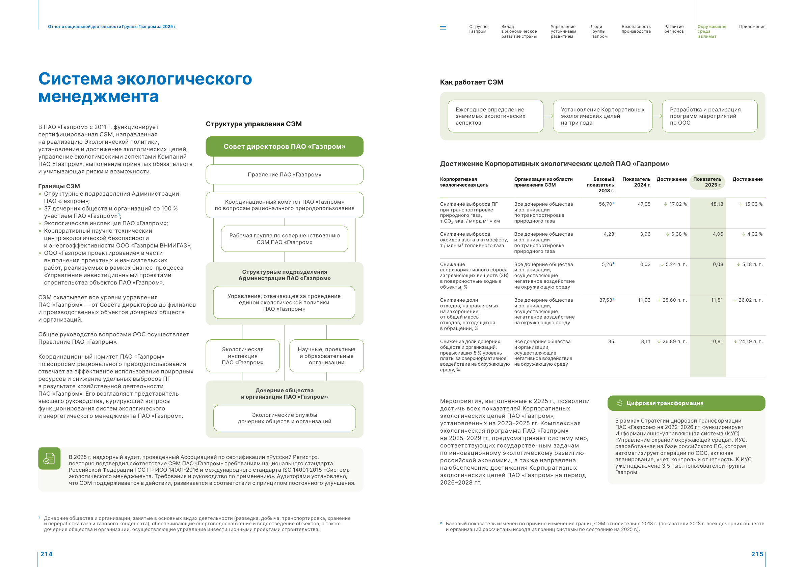

<!-- pdf_page: 109 -->

Отчет о социальной деятельности Группы Газпром за 2025 г.

О Группе Газпром
Вклад в экономическое развитие страны
Управление устойчивым развитием
Люди Группы Газпром
Безопасность производства
Развитие регионов
Окружающая среда и климат
Приложения

# Система экологического менеджмента

В ПАО «Газпром» с 2011 г. функционирует сертифицированная СЭМ, направленная на реализацию Экологической политики, установление и достижение экологических целей, управление экологическими аспектами Компаний ПАО «Газпром», выполнение принятых обязательств и учитывающая риски и возможности.

**Границы СЭМ**
* Структурные подразделения Администрации ПАО «Газпром»;
* 37 дочерних обществ и организаций со 100 % участием ПАО «Газпром»¹;
* Экологическая инспекция ПАО «Газпром»;
* Корпоративный научно-технический центр экологической безопасности и энергоэффективности ООО «Газпром ВНИИГАЗ»;
* ООО «Газпром проектирование» в части выполнения проектных и изыскательских работ, реализуемых в рамках бизнес-процесса «Управление инвестиционными проектами строительства объектов ПАО «Газпром».

СЭМ охватывает все уровни управления ПАО «Газпром» — от Совета директоров до филиалов и производственных объектов дочерних обществ и организаций.

Общее руководство вопросами ООС осуществляет Правление ПАО «Газпром».

Координационный комитет ПАО «Газпром» по вопросам рационального природопользования отвечает за эффективное использование природных ресурсов и снижение удельных выбросов ПГ в результате хозяйственной деятельности ПАО «Газпром». Его возглавляет представитель высшего руководства, курирующий вопросы функционирования систем экологического и энергетического менеджмента ПАО «Газпром».

В 2025 г. надзорный аудит, проведенный Ассоциацией по сертификации «Русский Регистр», повторно подтвердил соответствие СЭМ ПАО «Газпром» требованиям национального стандарта Российской Федерации ГОСТ Р ИСО 14001-2016 и международного стандарта ISO 14001:2015 «Система экологического менеджмента. Требования и руководство по применению». Аудиторами установлено, что СЭМ поддерживается в действии, развивается в соответствии с принципом постоянного улучшения.

**Структура управления СЭМ**

Совет директоров ПАО «Газпром»
↓
Правление ПАО «Газпром»
↓
Координационный комитет ПАО «Газпром» по вопросам рационального природопользования
↓
Рабочая группа по совершенствованию СЭМ ПАО «Газпром»
↓
**Структурные подразделения Администрации ПАО «Газпром»**
Управление, отвечающее за проведение единой экологической политики ПАО «Газпром»
↓
Экологическая инспекция ПАО «Газпром»  |  Научные, проектные и образовательные организации
↓
**Дочерние общества и организации ПАО «Газпром»**
Экологические службы дочерних обществ и организаций

¹ Дочерние общества и организации, занятые в основных видах деятельности (разведка, добыча, транспортировка, хранение и переработка газа и газового конденсата), обеспечивающие энерговодоснабжение и водоотведение объектов, а также дочерние общества и организации, осуществляющие управление инвестиционными проектами строительства.

214

---

**Как работает СЭМ**

Ежегодное определение значимых экологических аспектов  →  Установление Корпоративных экологических целей на три года  →  Разработка и реализация программ мероприятий по ООС

### Достижение Корпоративных экологических целей ПАО «Газпром»

| Корпоративная экологическая цель | Организации из области применения СЭМ | Базовый показатель 2018 г. | Показатель 2024 г. | Достижение | Показатель 2025 г. | Достижение |
|---|---|---|---|---|---|---|
| Снижение выбросов ПГ при транспортировке природного газа, т СО₂-экв. / млрд м³ • км | Все дочерние общества и организации по транспортировке природного газа | 56,70² | 47,05 | ↓ 17,02 % | 48,18 | ↓ 15,03 % |
| Снижение выбросов оксидов азота в атмосферу, т / млн м³ топливного газа | Все дочерние общества и организации по транспортировке природного газа | 4,23 | 3,96 | ↓ 6,38 % | 4,06 | ↓ 4,02 % |
| Снижение сверхнормативного сброса загрязняющих веществ (ЗВ) в поверхностные водные объекты, % | Все дочерние общества и организации, осуществляющие негативное воздействие на окружающую среду | 5,26² | 0,02 | ↓ 5,24 п. п. | 0,08 | ↓ 5,18 п. п. |
| Снижение доли отходов, направляемых на захоронение, от общей массы отходов, находящихся в обращении, % | Все дочерние общества и организации, осуществляющие негативное воздействие на окружающую среду | 37,53² | 11,93 | ↓ 25,60 п. п. | 11,51 | ↓ 26,02 п. п. |
| Снижение доли дочерних обществ и организаций, превысивших 5 % уровень платы за сверхнормативное воздействие на окружающую среду, % | Все дочерние общества и организации, осуществляющие негативное воздействие на окружающую среду | 35 | 8,11 | ↓ 26,89 п. п. | 10,81 | ↓ 24,19 п. п. |

Мероприятия, выполненные в 2025 г., позволили достичь всех показателей Корпоративных экологических целей ПАО «Газпром», установленных на 2023–2025 гг. Комплексная экологическая программа ПАО «Газпром» на 2025–2029 гг. предусматривает систему мер, соответствующих государственным задачам по инновационному экологическому развитию российской экономики, а также направлена на обеспечение достижения Корпоративных экологических целей ПАО «Газпром» на период 2026–2028 гг.

**Цифровая трансформация**

В рамках Стратегии цифровой трансформации ПАО «Газпром» на 2022–2026 гг. функционирует Информационно-управляющая система (ИУС) «Управление охраной окружающей среды». ИУС, разработанная на базе российского ПО, которая автоматизирует операции по ООС, включая планирование, учет, контроль и отчетность. К ИУС уже подключено 3,5 тыс. пользователей Группы Газпром.

² Базовый показатель изменен по причине изменения границ СЭМ относительно 2018 г. (показатели 2018 г. всех дочерних обществ и организаций рассчитаны исходя из границ системы по состоянию на 2025 г.).

215

