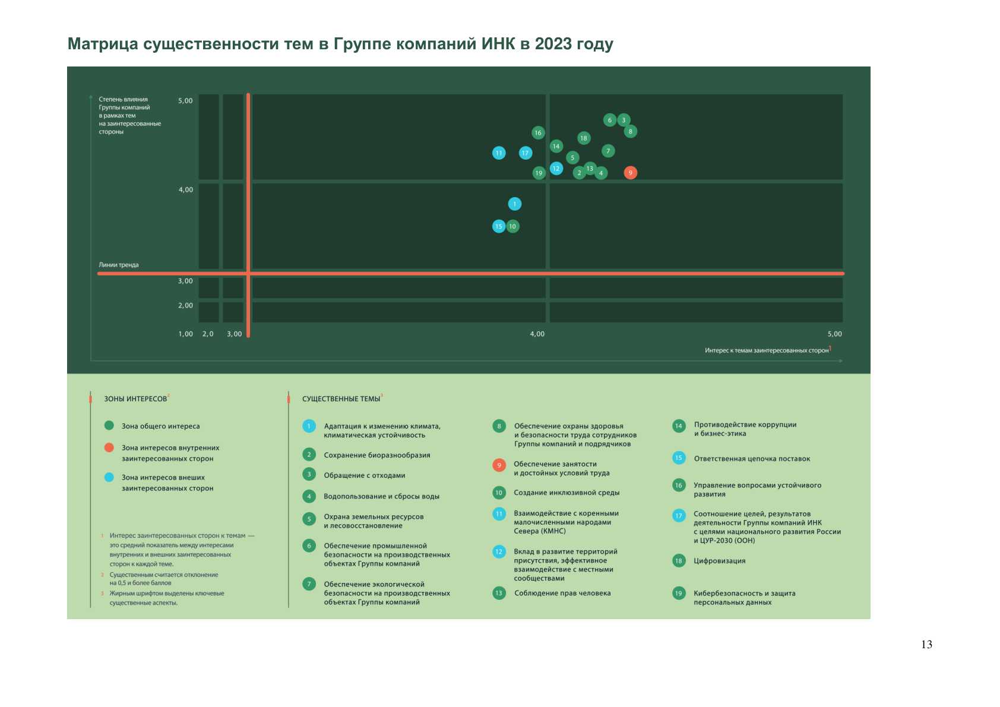

<!-- pdf_page: 13 -->

# Матрица существенности тем в Группе компаний ИНК в 2023 году

*Техническое описание графики: матрица существенности. Вертикальная ось — «Степень влияния Группы компаний в рамках тем на заинтересованные стороны», подписи шкалы: 1,00; 2,00; 3,00; 4,00; 5,00. Горизонтальная ось — «Интерес к темам заинтересованных сторон¹», подписи шкалы: 1,00; 2,0; 3,00; 4,00; 5,00. Подпись «Линии тренда» относится к двум оранжевым линиям; отдельные точные числовые значения этих линий на рисунке не подписаны.*

*Техническая транскрипция связи цвета точек и номеров тем:*

- Зона общего интереса (зелёные точки): 2, 3, 4, 5, 6, 7, 8, 10, 13, 14, 16, 18, 19
- Зона интересов внутренних заинтересованных сторон (красная точка): 9
- Зона интересов внешних заинтересованных сторон (голубые точки): 1, 11, 12, 15, 17

*Ограничение переноса: точные координаты точек по осям в источнике не подписаны и не определены. Расположение точек доступно на изображении исходной страницы; приведённые номера не являются значениями координат.*

**ЗОНЫ ИНТЕРЕСОВ²**

- Зона общего интереса
- Зона интересов внутренних заинтересованных сторон
- Зона интересов внешних заинтересованных сторон

**СУЩЕСТВЕННЫЕ ТЕМЫ³**

1. Адаптация к изменению климата, климатическая устойчивость
2. Сохранение биоразнообразия
3. Обращение с отходами
4. Водопользование и сбросы воды
5. Охрана земельных ресурсов и лесовосстановление
6. Обеспечение промышленной безопасности на производственных объектах Группы компаний
7. Обеспечение экологической безопасности на производственных объектах Группы компаний
8. Обеспечение охраны здоровья и безопасности труда сотрудников Группы компаний и подрядчиков
9. Обеспечение занятости и достойных условий труда
10. Создание инклюзивной среды
11. Взаимодействие с коренными малочисленными народами Севера (КМНС)
12. Вклад в развитие территорий присутствия, эффективное взаимодействие с местными сообществами
13. Соблюдение прав человека
14. Противодействие коррупции и бизнес-этика
15. Ответственная цепочка поставок
16. Управление вопросами устойчивого развития
17. Соотношение целей, результатов деятельности Группы компаний ИНК с целями национального развития России и ЦУР-2030 (ООН)
18. Цифровизация
19. Кибербезопасность и защита персональных данных

---

¹ Интерес заинтересованных сторон к темам — это средний показатель между интересами внутренних и внешних заинтересованных сторон к каждой теме.

² Существенным считается отклонение на 0,5 и более баллов

³ Жирным шрифтом выделены ключевые существенные аспекты.

13

