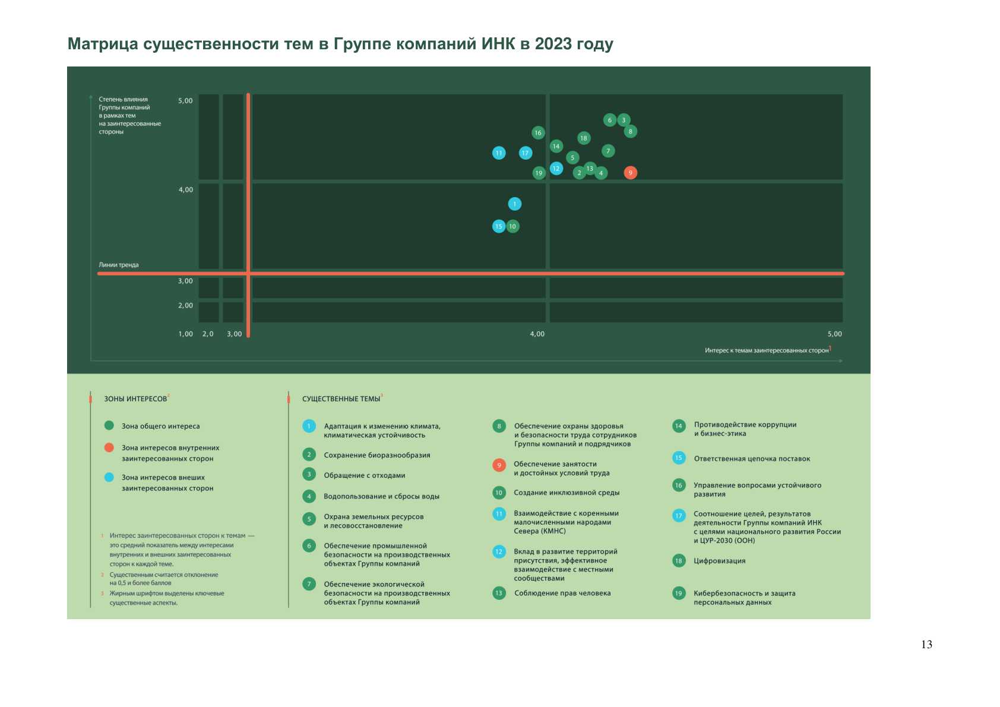

<!-- pdf_page: 13 -->

# Матрица существенности тем в Группе компаний ИНК в 2023 году

*График (матрица существенности): оси — «Степень влияния Группы компаний в рамках тем на заинтересованные стороны» (вертикальная, 1,00–5,00) и «Интерес к темам заинтересованных сторон¹» (горизонтальная, 2,0–5,00). Линии тренда отмечены на уровне 3,00 по обеим осям. Нумерованные точки (1–19) распределены по зонам интересов: общий интерес — зелёные, интересы внутренних сторон — красные, интересы внешних сторон — голубые.*

**ЗОНЫ ИНТЕРЕСОВ²**

- Зона общего интереса
- Зона интересов внутренних заинтересованных сторон
- Зона интересов внешних заинтересованных сторон

**СУЩЕСТВЕННЫЕ ТЕМЫ³**

1. Адаптация к изменению климата, климатическая устойчивость
2. Сохранение биоразнообразия
3. Обращение с отходами
4. Водопользование и сбросы воды
5. Охрана земельных ресурсов и лесовосстановление
6. Обеспечение промышленной безопасности на производственных объектах Группы компаний
7. Обеспечение экологической безопасности на производственных объектах Группы компаний
8. Обеспечение охраны здоровья и безопасности труда сотрудников Группы компаний и подрядчиков
9. Обеспечение занятости и достойных условий труда
10. Создание инклюзивной среды
11. Взаимодействие с коренными малочисленными народами Севера (КМНС)
12. Вклад в развитие территорий присутствия, эффективное взаимодействие с местными сообществами
13. Соблюдение прав человека
14. Противодействие коррупции и бизнес-этика
15. Ответственная цепочка поставок
16. Управление вопросами устойчивого развития
17. Соотношение целей, результатов деятельности Группы компаний ИНК с целями национального развития России и ЦУР-2030 (ООН)
18. Цифровизация
19. Кибербезопасность и защита персональных данных

---

¹ Интерес заинтересованных сторон к темам — это средний показатель между интересами внутренних и внешних заинтересованных сторон к каждой теме.

² Существенным считается отклонение на 0,5 и более баллов

³ Жирным шрифтом выделены ключевые существенные аспекты.

13

