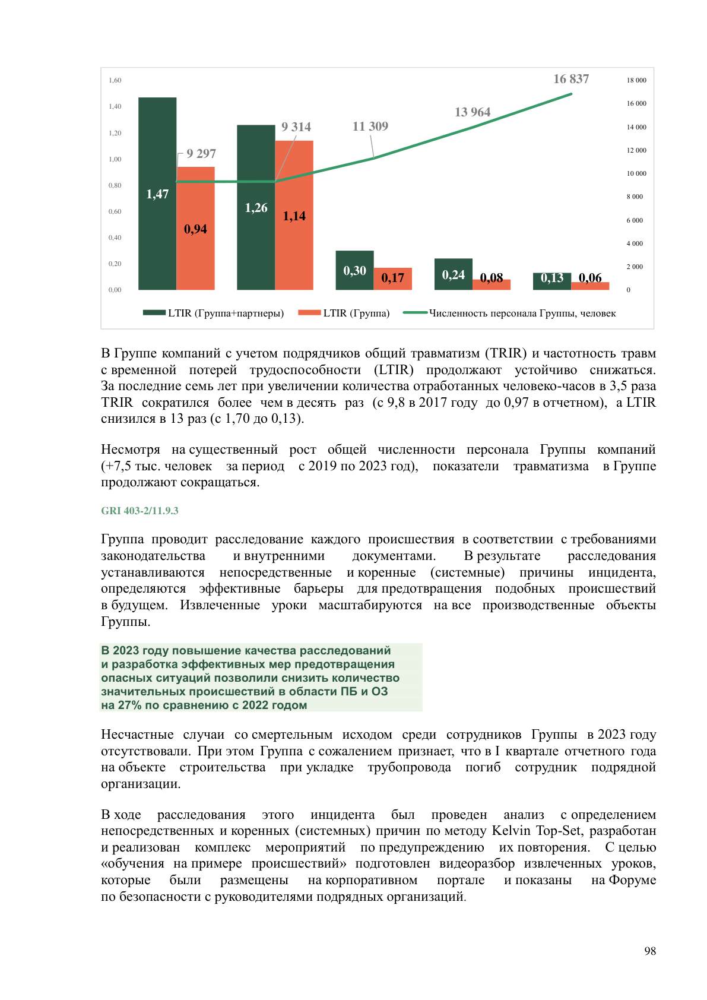

<!-- pdf_page: 98 -->

Диаграмма (комбинированная: столбцы и линейный график). Левая ось (0,00–1,60) — показатели LTIR; правая ось (0–18 000) — численность персонала Группы, человек.

| Показатель | 1-я группа | 2-я группа | 3-я группа | 4-я группа | 5-я группа |
|---|---|---|---|---|---|
| LTIR (Группа+партнеры) | 1,47 | 1,26 | 0,30 | 0,24 | 0,13 |
| LTIR (Группа) | 0,94 | 1,14 | 0,17 | 0,08 | 0,06 |
| Численность персонала Группы, человек | 9 297 | 9 314 | 11 309 | 13 964 | 16 837 |

Легенда: LTIR (Группа+партнеры); LTIR (Группа); Численность персонала Группы, человек.

В Группе компаний с учетом подрядчиков общий травматизм (TRIR) и частотность травм с временной потерей трудоспособности (LTIR) продолжают устойчиво снижаться. За последние семь лет при увеличении количества отработанных человеко-часов в 3,5 раза TRIR сократился более чем в десять раз (с 9,8 в 2017 году до 0,97 в отчетном), а LTIR снизился в 13 раз (с 1,70 до 0,13).

Несмотря на существенный рост общей численности персонала Группы компаний (+7,5 тыс. человек за период с 2019 по 2023 год), показатели травматизма в Группе продолжают сокращаться.

GRI 403-2/11.9.3

Группа проводит расследование каждого происшествия в соответствии с требованиями законодательства и внутренними документами. В результате расследования устанавливаются непосредственные и коренные (системные) причины инцидента, определяются эффективные барьеры для предотвращения подобных происшествий в будущем. Извлеченные уроки масштабируются на все производственные объекты Группы.

В 2023 году повышение качества расследований и разработка эффективных мер предотвращения опасных ситуаций позволили снизить количество значительных происшествий в области ПБ и ОЗ на 27% по сравнению с 2022 годом

Несчастные случаи со смертельным исходом среди сотрудников Группы в 2023 году отсутствовали. При этом Группа с сожалением признает, что в I квартале отчетного года на объекте строительства при укладке трубопровода погиб сотрудник подрядной организации.

В ходе расследования этого инцидента был проведен анализ с определением непосредственных и коренных (системных) причин по методу Kelvin Top-Set, разработан и реализован комплекс мероприятий по предупреждению их повторения. С целью «обучения на примере происшествий» подготовлен видеоразбор извлеченных уроков, которые были размещены на корпоративном портале и показаны на Форуме по безопасности с руководителями подрядных организаций.

98

