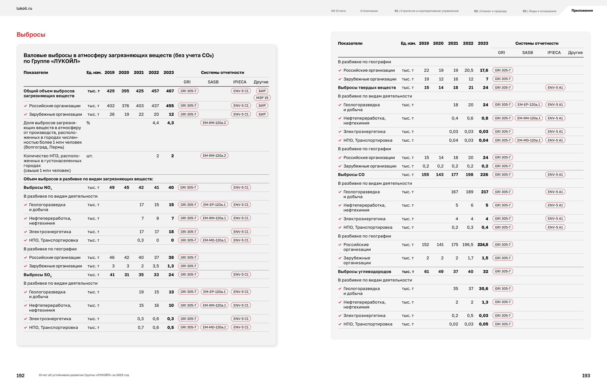

<!-- pdf_page: 98 -->

lukoil.ru

06 Отчете | О Компании | 01 | Стратегия и корпоративное управление | 02 | Климат и природа | 03 | Люди и отношения | Приложения

# Выбросы

## Валовые выбросы в атмосферу загрязняющих веществ (без учета CO2) по Группе «ЛУКОЙЛ»

| Показатели | Ед. изм. | 2019 | 2020 | 2021 | 2022 | 2023 | Системы отчетности GRI | SASB | IPIECA | Другие |
|---|---|---|---|---|---|---|---|---|---|---|
| **Общий объем выбросов загрязняющих веществ** | тыс. т | 429 | 395 | 425 | 457 | **467** | GRI 305-7 | | ENV-5 C1 | БИР; МЭР 19 |
| ✓ Российские организации | тыс. т | 402 | 376 | 403 | 437 | **455** | GRI 305-7 | | ENV-5 C1 | БИР |
| ✓ Зарубежные организации | тыс. т | 26 | 19 | 22 | 20 | **12** | GRI 305-7 | | ENV-5 C1 | БИР |
| Доля выбросов загрязняющих веществ в атмосферу от производств, расположенных в городах численностью более 1 млн человек (Волгоград, Пермь) | % | | | 4,4 | **4,3** | | | EM-RM-120a.2 | | |
| Количество НПЗ, расположенных в густонаселенных городах (свыше 1 млн человек) | шт. | | | 2 | **2** | | | EM-RM-120a.2 | | |

**Объем выбросов в разбивке по видам загрязняющих веществ:**

| Показатели | Ед. изм. | 2019 | 2020 | 2021 | 2022 | 2023 | Системы отчетности GRI | SASB | IPIECA | Другие |
|---|---|---|---|---|---|---|---|---|---|---|
| **Выбросы NOx** | тыс. т | **49** | **45** | **42** | **41** | **40** | GRI 305-7 | | ENV-5 C1 | |
| В разбивке по видам деятельности | | | | | | | | | | |
| ✓ Геологоразведка и добыча | тыс. т | | | 17 | 15 | **15** | GRI 305-7 | EM-EP-120a.1 | ENV-5 C1 | |
| ✓ Нефтепереработка, нефтехимия | тыс. т | | | 7 | 9 | **7** | GRI 305-7 | EM-RM-120a.1 | ENV-5 C1 | |
| ✓ Электроэнергетика | тыс. т | | | 17 | 17 | **18** | GRI 305-7 | | ENV-5 C1 | |
| ✓ НПО, Транспортировка | тыс. т | | | 0,3 | 0 | **0** | GRI 305-7 | EM-MD-120a.1 | ENV-5 C1 | |
| В разбивке по географии | | | | | | | | | | |
| ✓ Российские организации | тыс. т | 46 | 42 | 40 | 37 | **38** | GRI 305-7 | | | |
| ✓ Зарубежные организации | тыс. т | 3 | 3 | 2 | 3,5 | **1,3** | GRI 305-7 | | | |
| **Выбросы SO2** | тыс. т | **41** | **31** | **35** | **33** | **24** | GRI 305-7 | | ENV-5 C1 | |
| В разбивке по видам деятельности | | | | | | | | | | |
| ✓ Геологоразведка и добыча | тыс. т | | | 19 | 15 | **13** | GRI 305-7 | EM-EP-120a.1 | ENV-5 C1 | |
| ✓ Нефтепереработка, нефтехимия | тыс. т | | | 15 | 16 | **10** | GRI 305-7 | EM-RM-120a.1 | ENV-5 C1 | |
| ✓ Электроэнергетика | тыс. т | | | 0,3 | 0,6 | **0,3** | GRI 305-7 | | ENV-5 C1 | |
| ✓ НПО, Транспортировка | тыс. т | | | 0,7 | 0,6 | **0,5** | GRI 305-7 | EM-MD-120a.1 | ENV-5 C1 | |

## Продолжение таблицы (правая колонка)

| Показатели | Ед. изм. | 2019 | 2020 | 2021 | 2022 | 2023 | Системы отчетности GRI | SASB | IPIECA | Другие |
|---|---|---|---|---|---|---|---|---|---|---|
| В разбивке по географии | | | | | | | | | | |
| ✓ Российские организации | тыс. т | 22 | 19 | 19 | 20,5 | **17,6** | GRI 305-7 | | | |
| ✓ Зарубежные организации | тыс. т | 19 | 12 | 16 | 12 | **7** | GRI 305-7 | | | |
| **Выбросы твердых веществ** | тыс. т | **15** | **14** | **18** | **21** | **24** | GRI 305-7 | | ENV-5 A1 | |
| В разбивке по видам деятельности | | | | | | | | | | |
| ✓ Геологоразведка и добыча | тыс. т | | | 18 | 20 | **24** | GRI 305-7 | EM-EP-120a.1 | ENV-5 A1 | |
| ✓ Нефтепереработка, нефтехимия | тыс. т | | | 0,4 | 0,6 | **0,8** | GRI 305-7 | EM-RM-120a.1 | ENV-5 A1 | |
| ✓ Электроэнергетика | тыс. т | | | 0,03 | 0,03 | **0,03** | GRI 305-7 | | ENV-5 A1 | |
| ✓ НПО, Транспортировка | тыс. т | | | 0,04 | 0,03 | **0,04** | GRI 305-7 | EM-MD-120a.1 | ENV-5 A1 | |
| В разбивке по географии | | | | | | | | | | |
| ✓ Российские организации | тыс. т | 15 | 14 | 18 | 20 | **24** | GRI 305-7 | | | |
| ✓ Зарубежные организации | тыс. т | 0,2 | 0,2 | 0,2 | 0,2 | **0,2** | GRI 305-7 | | | |
| **Выбросы СO** | тыс. т | **155** | **143** | **177** | **198** | **226** | GRI 305-7 | | ENV-5 A1 | |
| В разбивке по видам деятельности | | | | | | | | | | |
| ✓ Геологоразведка и добыча | тыс. т | | | 167 | 189 | **217** | GRI 305-7 | | ENV-5 A1 | |
| ✓ Нефтепереработка, нефтехимия | тыс. т | | | 5 | 6 | **5** | GRI 305-7 | | ENV-5 A1 | |
| ✓ Электроэнергетика | тыс. т | | | 4 | 4 | **4** | GRI 305-7 | | ENV-5 A1 | |
| ✓ НПО, Транспортировка | тыс. т | | | 0,2 | 0,3 | **0,4** | GRI 305-7 | | ENV-5 A1 | |
| В разбивке по географии | | | | | | | | | | |
| ✓ Российские организации | тыс. т | 152 | 141 | 175 | 196,5 | **224,8** | GRI 305-7 | | | |
| ✓ Зарубежные организации | тыс. т | 2 | 2 | 2 | 1,7 | **1,5** | GRI 305-7 | | | |
| **Выбросы углеводородов** | тыс. т | **61** | **49** | **37** | **40** | **32** | GRI 305-7 | | | |
| В разбивке по видам деятельности | | | | | | | | | | |
| ✓ Геологоразведка и добыча | тыс. т | | | 35 | 37 | **30,6** | GRI 305-7 | | | |
| ✓ Нефтепереработка, нефтехимия | тыс. т | | | 2 | 2 | **1,3** | GRI 305-7 | | | |
| ✓ Электроэнергетика | тыс. т | | | 0,2 | 0,5 | **0,03** | GRI 305-7 | | | |
| ✓ НПО, Транспортировка | тыс. т | | | 0,02 | 0,03 | **0,05** | GRI 305-7 | | | |

192 Отчет об устойчивом развитии Группы «ЛУКОЙЛ» за 2023 год 193

