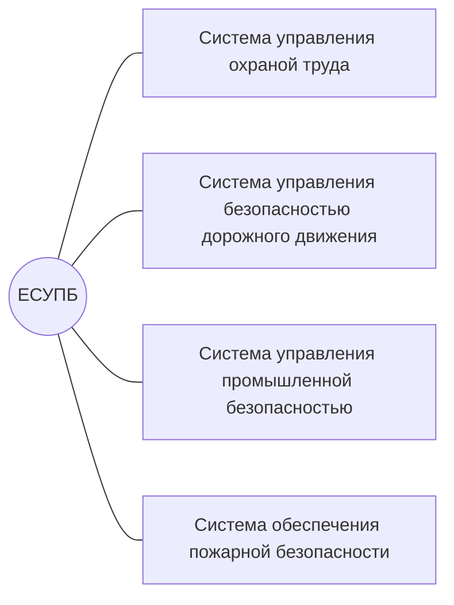

## PDF 50

## **3. БЕЗОПАСНОСТЬ ПРОИЗВОДСТВА**

**Принцип 4**
**<u>Социальная справедливость</u>**

## **УПРАВЛЕНИЕ ПРОИЗВОДСТВЕННОЙ БЕЗОПАСНОСТЬЮ**

Сохранение жизни и здоровья работников — один из ключевых приоритетов для Группы Газпром. Благополучие работников, создание комфортных и безопасных условий труда позволяют ей уверенно и устойчиво работать, добиваться успехов на благо страны и людей. Группа Газпром строго соблюдает требования охраны труда, снижает риски аварий и травматизма, а также постоянно совершенствует систему управления производственной безопасностью.

#### <u>Нацпроект «Здравоохранение»</u>

### **Подход к управлению производственной безопасностью**

Группа Газпром в полной мере осознает свою ответственность за создание безопасных условий труда, выполнение требований промышленной, пожарной безопасности и безопасности дорожного движения в ходе работ.

### **Цели и задачи Группы Газпром в области производственной безопасности и охраны труда**

- Создание безопасных условий труда, сохранение жизни и здоровья работников;
- снижение рисков аварий и инцидентов на опасных производственных объектах (ОПО);
- снижение рисков ДТП, связанных с производственной деятельностью;
- обеспечение пожарной безопасности.

#### **Существенные темы**

icon: heart rate monitor

4. Охрана здоровья и производственная безопасность в Группе Газпром и организациях-контрагентах

icon: building with columns

7. Соответствие деятельности Группы Газпром нормам законодательства (социально-экономическим, экологическим, антимонопольным)

**Достижение корпоративных целей ПАО «Газпром» в области производственной безопасности в 2023 г.**

| Корпоративная цель в области производственной безопасности                        | Организации из области применения ЕСУПБ | Показатель 2023 г. Целевое значение | Показатель 2023 г. Фактическое значение | Достижение в 2023 г., в % от целевого значения |
| --------------------------------------------------------------------------------- | --------------------------------------- | --------------------------------------- | ------------------------------------------- | ---------------------------------------------- |
| Снижение коэффициента частоты травм с временной потерей трудоспособности (LTIFR)¹ | Компании газового бизнеса²              | 0,089³                                  | 0,102                                       | +14,6                                          |

### **Структура и функционирование ЕСУПБ**

В ПАО «Газпром» внедрена Единая система управления производственной безопасностью (ЕСУПБ), интегрированная в систему управления корпоративными бизнес-процессами ПАО «Газпром».

ЕСУПБ основана на комплексе стандартов «Единая система управления производственной безопасностью» и, в частности, СТО Газпром 18000.1-001-2021 «Единая система управления производственной безопасностью. Основные положения»4. Она направлена на достижение целей и выполнение принятых обязательств

> **ЕСУПБ устанавливает единый порядок управления производственной безопасностью в соответствии с законодательством, достижениями науки и техники, корпоративными требованиями, а также позволяет учесть территориальные, производственные и другие условия, присущие каждому отдельному ДО.**

#### **Основные элементы ЕСУПБ**

Подоболее с информацией о регулирующих документах в области производственной безопасности Группы Газпром можно ознакомиться в <u>Приложении 6.4</u>.

1 Численность пострадавших в результате несчастных случаев с потерей рабочего времени / Общее количество часов, отработанных всем персоналом × 1 000 000.
2 Данные представлены по компаниям газового бизнеса периметра ЕСУПБ, без учета низких сетей (газораспределение) и сбыта нефтепродуктов.
3 Целевое значение установлено в соответствии со стратегическими целевыми показателями и рассчитано как скользящее среднее за последние пять лет со снижением на 10 %.
4 Утвержден приказом ПАО «Газпром» от 12 января 2021 г. № 2.
5 Утверждена приказом ПАО «Газпром» от 17 сентября 2019 г. № 416.

## PDF 57

6. Приложение

5. Окружающая среда и экологическая политика

4. Развитие регионов

3. Безопасность производства

2. Люди Группы Газпром

1. О Группе Газпром

----

<mark>БР Несчастные случаи на производстве, с. 40</mark> <mark>РСПП 3.1.5, 3.1.6</mark>

## **Показатели производственного травматизма**

| Показатель                                                                                                                            | 2021  | 2022  | 2023   |
| ------------------------------------------------------------------------------------------------------------------------------------- | ----- | ----- | ------ |
| Коэффициент частоты травматизма¹                                                                                                      | 0,13  | 0,12  | 0,173² |
| Коэффициент тяжести травматизма³                                                                                                      | 68,19 | 67,87 | 76,6²  |
| Количество пострадавших при несчастных случаях                                                                                        | 42    | 39    | 57²    |
| Количество пострадавших со смертельным исходом                                                                                        | 5     | 6     | 11²    |
| Количество несчастных случаев со смертельным исходом, связанных с работой независимых подрядчиков, работающих на объектах организации | 11    | 18    | 14     |
| Количество производственных травм подрядчиков с тяжелыми или необратимыми последствиями (за исключением травм со смертельным исходом) | 17    | 29    | 22     |

Коэффициент частоты травматизма в 2023 г. повысился на 44,2 % по причине роста количества несчастных случаев на производстве с увеличением количества пострадавших. Коэффициент тяжести травматизма возрос на 12,9 % по причине увеличения количества несчастных случаев на производстве.

----

<mark>МЭР 29</mark>

## **Численность пострадавших и погибших при несчастных случаях4 в Группе Газпром, чел.**

| Показатель                              | 2021 | 2022 | 2023 |
| --------------------------------------- | ---- | ---- | ---- |
| Компании газового бизнеса²              |      |      |      |
| количество пострадавших                 | 42   | 39   | 57   |
| • в т. ч. количество погибших           | 5    | 6    | 11   |
| Компании нефтяного бизнеса              |      |      |      |
| количество пострадавших                 | 70   | 45⁵  | 45⁵  |
| • в т. ч. количество погибших           | 4    | 0    | 0    |
| Компании электроэнергетического бизнеса |      |      |      |
| количество пострадавших                 | 3    | 7⁶   | 15⁶  |
| • в т. ч. количество погибших           | 0    | 1    | 0    |
| Газпром нефтехим Салават                |      |      |      |
| количество пострадавших                 | 2    | 1    | 0    |
| • в т. ч. количество погибших           | 2    | 0    | 0    |

Рост количества пострадавших в сравнении с 2022 г. обусловлен увеличением количества ДТП, произошедших по вине третьих лиц, и групповым несчастным случаям на производстве.

----

<mark>Индикатор Группы Газпром 29.1</mark>

## **Коэффициент частоты травм с временной потерей трудоспособности (LTIFR)7 в Группе Газпром**

| Наименование                                    | 2021 | 2022  | 2023  |
| ----------------------------------------------- | ---- | ----- | ----- |
| Компании газового бизнеса                       | 0,08 | 0,08  | 0,102 |
| Компании газового бизнеса (низкие сети)⁸        | –⁹   | –⁹    | 0,204 |
| Компании газового бизнеса (сбыт нефтепродуктов) | –⁹   | –⁹    | 0,369 |
| Компании нефтяного бизнеса                      | 0,36 | 0,338 | 0,323 |
| Компании электроэнергетического бизнеса         | 0,05 | 0,086 | 0,191 |

Рост показателя LTIFR в компаниях газового и электроэнергетического бизнеса Группы Газпром в 2023 г. обусловлен увеличением количества пострадавших с временной потерей трудоспособности.

Снижение LTIFR в компаниях нефтяного бизнеса Группы Газпром вызвано увеличением количества часов, отработанных персоналом.

----

<mark><u>Индикатор Группы Газпром 29.2</u></mark>

## **Коэффициент частоты смертельного травматизма (FAR)10 в Группе Газпром**

| Наименование                                    | 2021  | 2022   | 2023   |
| ----------------------------------------------- | ----- | ------ | ------ |
| Компании газового бизнеса                       | 0,99  | 1,18   | 1,963  |
| Компании газового бизнеса (низкие сети)⁸        | –⁹    | –⁹     | 1,927  |
| Компании газового бизнеса (сбыт нефтепродуктов) | –⁹    | –⁹     | 12,309 |
| Компании нефтяного бизнеса                      | 3,80  | 0¹¹    | 0¹¹    |
| Компании электроэнергетического бизнеса         | 0     | 1,23¹² | 0¹²    |
| Газпром нефтехим Салават¹³                      | 12,96 | 0      | 0      |

В отчетном году коэффициент частоты смертельного травматизма вырос в компаниях газового бизнеса Группы Газпром на 66,4 % в сравнении с 2022 г. Это было вызвано групповыми несчастными случаями со смертельным исходом.

----

1 Количество учтенных несчастных случаев на производстве за отчетный период с потерей трудоспособности на один и более дней / Среднесписочная численность работников × 1 000.
2 Данные представлены по компаниям газового бизнеса периметра ЕСУПБ, без учета низких сетей (газораспределение) и сбыта нефтепродуктов.
3 Сумма дней нетрудоспособности по всем случаям / Общее количество несчастных случаев.
4 С утратой трудоспособности на 1 рабочий день и более и со смертельным исходом.
5 Данные ПАО «Газпром нефть» указаны по ДО, а также совместным предприятиям под операционным управлением Газпром нефти в России и за рубежом.
6 Данные представлены с учетом показателей Группы Газпром теплоэнерго.

7 Количество пострадавших в результате несчастных случаев с потерей рабочего времени / Общее количество часов, отработанных всем персоналом × 1 000 000.
8 Указано для Группы Газпром межрегионгаз.
9 Сбор данных не осуществлялся.
10 Количество пострадавших в результате несчастных случаев со смертельным исходом / Общее количество часов, отработанных всем персоналом × 100 000 000.
11 Данные ПАО «Газпром нефть» указаны по ДО, а также совместным предприятиям под операционным управлением Газпром нефти в России и за рубежом.
12 Данные представлены с учетом показателей Группы Газпром теплоэнерго.
13 Указано для ООО «Газпром нефтехим Салават».

## PDF 115

| Номер индикатора                                                     | Наименование индикатора                                                                                                                   | 2022      | 2023       | Изменение (абсолютное/ относительное) | Факторный анализ изменений                                                             |
| -------------------------------------------------------------------- | ----------------------------------------------------------------------------------------------------------------------------------------- | --------- | ---------- | ------------------------------------- | -------------------------------------------------------------------------------------- |
| Индикаторы оценки достижений в области производственной безопасности |                                                                                                                                           |           |            |                                       |                                                                                        |
| 29                                                                   | Индикаторы, предусмотренные Стратегией развития системы управления производственной безопасностью ПАО «Газпром» на период 2021–2030 годов |           |            |                                       |                                                                                        |
| 29.1                                                                 | Коэффициент частоты травм с временной потерей трудоспособности (LTIFR)                                                                    |           |            |                                       |                                                                                        |
|                                                                      | • Компании газового бизнеса                                                                                                               | 0,08      | 0,102      | +27,5 %                               | Увеличение количества пострадавших с временной потерей трудоспособности.               |
|                                                                      | • Компании газового бизнеса (низкие сети)¹                                                                                                | –         | 0,204      | – –                                   |                                                                                        |
|                                                                      | • Компании газового бизнеса (сбыт нефтепродуктов)                                                                                         | –         | 0,369      | – –                                   |                                                                                        |
|                                                                      | • Компании нефтяного бизнеса²                                                                                                             | 0,338     | 0,323      | -4,4 %                                | –                                                                                      |
|                                                                      | • Компании электроэнергетического бизнеса³                                                                                                | 0,086     | 0,191      | +122,1 %                              | –                                                                                      |
| 29.2                                                                 | Коэффициент частоты смертельного травматизма (FAR)                                                                                        |           |            |                                       |                                                                                        |
|                                                                      | • Компании газового бизнеса                                                                                                               | 1,18      | 1,963      | +66,4 %                               | Групповые несчастные случаи со смертельным исходом.                                    |
|                                                                      | • Компании газового бизнеса (низкие сети)¹                                                                                                | –         | 1,927      | – –                                   |                                                                                        |
|                                                                      | • Компании газового бизнеса (сбыт нефтепродуктов)                                                                                         | –         | 12,309     | – –                                   |                                                                                        |
|                                                                      | • Компании нефтяного бизнеса²                                                                                                             | 0         | 0          | 0 %                                   | –                                                                                      |
|                                                                      | • Компании электроэнергетического бизнеса³                                                                                                | 1,23      | 0          | – –                                   |                                                                                        |
|                                                                      | • Газпром нефтехим Салават⁴                                                                                                               | 0         | 0          | 0 %                                   | –                                                                                      |
| 29.3                                                                 | Коэффициент выявленных профессиональных заболеваний (ODR)                                                                                 |           |            |                                       |                                                                                        |
|                                                                      | • Компании газового бизнеса                                                                                                               | 0,021     | 0,023      | +9,5 %                                | Увеличение количества впервые выявленных профессиональных заболеваний в отчетном году. |
|                                                                      | • Компании газового бизнеса (низкие сети)¹                                                                                                | –         | 0          | – –                                   |                                                                                        |
|                                                                      | • Компании газового бизнеса (сбыт нефтепродуктов)                                                                                         | –         | 0          | – –                                   |                                                                                        |
|                                                                      | • Компании нефтяного бизнеса²                                                                                                             | 0         | 0          | – –                                   |                                                                                        |
|                                                                      | • Компании электроэнергетического бизнеса³                                                                                                | 0,012     | 0          | – –                                   |                                                                                        |
|                                                                      | • Газпром нефтехим Салават                                                                                                                | 0,062     | 0,062      | – –                                   |                                                                                        |
| 30                                                                   | Расходы на охрану труда, млн руб.                                                                                                         | 23 472,46 | 26 882,57⁵ | +14,5 %                               | –                                                                                      |
| 31                                                                   | Расходы на промышленную безопасность, млн руб.                                                                                            | 8 851,96  | 17 806,48⁵ | +101,2 %                              | –                                                                                      |

1 Указано для Группы Газпром межрегионгаз.
2 Данные ПАО «Газпром нефть» указаны по дочерним обществам, а также совместным предприятиям под операционным управлением Газпром нефти в России и за рубежом.
3 Данные представлены с учетом показателей Газпром теплоэнерго.
4 Указано для ООО «Газпром нефтехим Салават».
5 Данные представлены по организациям, на которые распространяется ЕСУПБ.

| Номер индикатора                                          | Наименование индикатора                                                                                                                                              | 2022    | 2023     | Изменение (абсолютное/ относительное) | Факторный анализ изменений                                                                                                                                                                                                                                                                                               |
| --------------------------------------------------------- | -------------------------------------------------------------------------------------------------------------------------------------------------------------------- | ------- | -------- | ------------------------------------- | ------------------------------------------------------------------------------------------------------------------------------------------------------------------------------------------------------------------------------------------------------------------------------------------------------------------------ |
| Индикаторы оценки достижений в области развития персонала |                                                                                                                                                                      |         |          |                                       |                                                                                                                                                                                                                                                                                                                          |
| 32                                                        | Списочная численность                                                                                                                                                | 492,2   | 498,1    | +5,9 / +1,2 %                         | Увеличение численности персонала Группы Газпром в 2023 г. связано с реализацией стратегических проектов в переработке газа, реорганизацией структуры газораспределительных компаний в Группе Газпром межрегионгаз, а также вводом в эксплуатацию крупных проектов по добыче жидких углеводородов в Группе Газпром нефть. |
| 33                                                        | Текучность кадров                                                                                                                                                    | 5,9     | 6,7      | +0,8 п. п.                            | Причинами увеличения текучности кадров являются переезд дочерних организаций ПАО «Газпром» в г. Санкт-Петербург и реструктуризация в организациях Группы Газпром нефть.                                                                                                                                                  |
| 34                                                        | Численность работников, прошедших профессиональную подготовку (по рабочим), переподготовку и повышение квалификации (с разбивкой по категориям персонала), тыс. чел. | 559,2   | 594,7    | +6,0 %                                | Организация обязательного обучения, необходимого для допуска к работе на ОПО, в связи с увеличением численности работников. Принятие нормативных документов, регламентирующих обучение либо устанавливающих дополнительные требования по организации обязательного обучения.                                             |
| 35                                                        | Расходы на оплату труда                                                                                                                                              | 953,70  | 1 096,70 | +15,0 %                               |                                                                                                                                                                                                                                                                                                                          |
| 36                                                        | Социальные расходы                                                                                                                                                   | 38,80   | 50,90    | +31,2 %                               |                                                                                                                                                                                                                                                                                                                          |
| 37                                                        | Количество работников и пенсионеров, а также членов их семей, застрахованных по программам ДМС                                                                       | 592 043 | 598 494  | +1,1 %                                | –                                                                                                                                                                                                                                                                                                                        |
| 38                                                        | Расходы на личное страхование, млрд руб.                                                                                                                             | 16,9    | 17,8     | +5,3 %                                | –                                                                                                                                                                                                                                                                                                                        |
| 39                                                        | Количество школ, участвующих в проекте «Газпром-классы»⁶                                                                                                             | 26      | 29       | +11,5 %                               | Использование сетевой формы реализации проекта (этот формат позволяет объединить учащихся из разных регионов в один учебный класс и в последующем готовить молодые кадры одновременно для нескольких регионов). Увеличение количества регионов присутствия проекта «Газпром-классы» (Южный ФО).                          |

6 Приказ ОАО «Газпром» от 5 июня 2014 г. № 256 «Об утверждении Положения об организации и функционировании специализированных профильных классов «Газпром-классы» (с последующими изменениями).

## PDF 130

## **6.6. К РАЗДЕЛУ «ОКРУЖАЮЩАЯ СРЕДА И ЭКОЛОГИЧЕСКАЯ ПОЛИТИКА»**

### **Контур сбора информации по темам раздела «Охрана окружающей среды и экологическая политика» (если не указано иное)**

Используемые в Отчете термины ПАО «Газпром», Компания относятся к головной компании Группы Газпром — Публичному акционерному обществу «Газпром» и совокупности его 100 % дочерних обществ и организаций, занятых в деятельности по геологоразведке, добыче, транспортировке, подземному хранению, переработке углеводородов, обеспечению работы Единой системы газоснабжения (ЕСГ).

Под Группой Газпром, Газпромом или Группой подразумевается ПАО «Газпром» (со всеми перечисленными выше дочерними обществами и организациями со 100 % участием) и следующие компании: Группа Газпром нефть, Газпром энергохолдинг, Газпром нефтехим Салават, АО «Газпром добыча Томск», ООО «Газпром межрегионгаз», АО «Дальтрансгаз», ООО «Сахалинская Энергия», ОАО «Севернефтегазпром», ЗАО «Пургаз», А также дочерние общества ПАО «Газпром», осуществляющие свою деятельность за рубежом:

ОАО «Газпром трансгаз Беларусь», ЗАО «Газпром Армения», ОсОО «Газпром Кыргызстан», МКООО «Газпром Интернэшнл Лимитед».

Под Группой Газпром нефть и Газпром нефтью подразумевается ПАО «Газпром нефть», его дочерние общества и совместные предприятия, находящиеся в операционном управлении ПАО «Газпром нефть».

Под Газпром нефтехим Салаватом подразумевается ООО «Газпром нефтехим Салават» и его дочерние общества.

Под Газпром энергохолдингом подразумевается ООО «Газпром энергохолдинг» и его дочерние общества (ПАО «Мосэнерго», ПАО «МОЭК», ПАО «ОГК-2», ПАО «ТГК-1», АО «Газпром теплоэнерго»).

К компаниям газового бизнеса Группы Газпром относятся ПАО «Газпром» (совокупность его 100 % дочерних обществ и организаций, занятых в деятельности по добыче, транспортировке, подземному хранению и переработке углеводородов, а также в деятельности по обеспечению работы ЕСГ), ООО «Газпром межрегионгаз», АО «Газпром добыча Томск», АО «Дальтрансгаз», ООО «Сахалинская Энергия», ОАО «Севернефтегазпром», ЗАО «Пургаз».

----

**Приложения**

**Окружающая среда и экологическая политика**

**Развитие регионов**

**Безопасность производства**

**Люди Группы Газпром**

**О Группе Газпром**

#### **Численность выбывших работников и текучесть кадров по территориальному признаку**

| Федеральный округ / зарубежные страны | Всего выбыло, тыс. чел. 2021 | Всего выбыло, тыс. чел. 2022 | Всего выбыло, тыс. чел. 2023 | Из них по причинам текучести кадров, тыс. чел. 2021 | Из них по причинам текучести кадров, тыс. чел. 2022 | Из них по причинам текучести кадров, тыс. чел. 2023 | Текучесть кадров, % 2021 | Текучесть кадров, % 2022 | Текучесть кадров, % 2023 | Изменение 2023/2022, п. п. |
| ------------------------------------- | -------------------------------- | -------------------------------- | -------------------------------- | ------------------------------------------------------- | ------------------------------------------------------- | ------------------------------------------------------- | ---------------------------- | ---------------------------- | ---------------------------- | -------------------------- |
| Дальневосточный ФО                    | 1,4                              | 1,5                              | 1,6                              | 0,5                                                     | 0,6                                                     | 0,7                                                     | 4,7                          | 5,5                          | 5,9                          | +0,4                       |
| Приволжский ФО                        | 11,6                             | 11,3                             | 12,9                             | 3,6                                                     | 3,7                                                     | 4,3                                                     | 4,3                          | 4,3                          | 5,0                          | +0,7                       |
| Северо-Западный ФО                    | 12,2                             | 12,2                             | 12,6                             | 5,4                                                     | 5,7                                                     | 6,3                                                     | 8,0                          | 8,2                          | 8,8                          | +0,6                       |
| Северо-Кавказский ФО                  | 1,1                              | 1,1                              | 1,3                              | 0,4                                                     | 0,4                                                     | 0,5                                                     | 3,3                          | 3,4                          | 4,1                          | +0,7                       |
| Сибирский ФО                          | 5,1                              | 4,5                              | 5,3                              | 2,4                                                     | 2,3                                                     | 3,0                                                     | 9,8                          | 9,1                          | 10,9                         | +1,8                       |
| Уральский ФО                          | 17,9                             | 17,2                             | 18,7                             | 5,6                                                     | 5,2                                                     | 6,0                                                     | 4,4                          | 4,1                          | 4,6                          | +0,5                       |
| Центральный ФО                        | 11,6                             | 10,1                             | 11,4                             | 6,5                                                     | 5,6                                                     | 7,1                                                     | 9,1                          | 7,9                          | 9,8                          | +1,9                       |
| Южный ФО                              | 5,9                              | 5,5                              | 5,9                              | 2,5                                                     | 1,9                                                     | 2,1                                                     | 5,9                          | 4,5                          | 4,8                          | +0,3                       |
| Зарубежные страны                     | 6,5                              | 5,0                              | 4,4                              | 2,7                                                     | 2,6                                                     | 2,2                                                     | 9,3                          | 9,4                          | 7,9                          | -1,5                       |
| Всего                                 | 73,3                             | 68,4                             | 74,1                             | 29,6                                                    | 28,0                                                    | 32,2                                                    | 6,4                          | 5,9                          | 6,7                          | +0,8                       |

Причинами увеличения текучести кадров являются:
• переезд дочерних организаций ПАО «Газпром» в г. Санкт-Петербург;
• реструктуризация в компаниях Группы Газпром нефть.

Текучесть кадров в ПАО «Газпром» рассчитывается как доля работников, уволенных по собственному желанию (п. 3 ст. 77 Трудового кодекса Российской Федерации) и за прогулы и другие нарушения дисциплины (пункты ст. 81 Трудового кодекса Российской Федерации), выраженная в процентах от среднесписочной численности работников (с учетом внешних совместителей).