# Газпром 2023: social

Машинный результат LlamaParse Agentic, без ручных исправлений.

<!-- pdf_page: 1 -->
## PDF-страница 1

logo: ГАЗПРОМ

photo: Group of Gazprom executives

## **ВРЕМЯ**
## *сожми*
## **ВМЕСТЕ** ‘23

**ОТЧЕТ О СОЦИАЛЬНОЙ**
**ДЕЯТЕЛЬНОСТИ**
**ГРУППЫ ГАЗПРОМ**

<!-- pdf_page: 2 -->
## PDF-страница 2

logo: ВРЕМЯ быть ВМЕСТЕ

Отчет о социальной деятельности Группы Газпром (далее — Отчет) — документ, комплексно отражающий политику Группы Газпром в области устойчивого развития, основные цели и достигнутые за отчетный период результаты деятельности в данной области с раскрытием данных о вкладе Группы Газпром в социально-экономическое развитие Российской Федерации, предназначенный для использования группами заинтересованных сторон и подготовленный с учетом их замечаний и предложений, часть публичной нефинансовой отчетности.

В Отчете термины ПАО «Газпром», Компания относятся к материнской компании Группы Газпром — Публичному акционерному обществу «Газпром» (до 17 июля 2015 г. — Открытое акционерное общество «Газпром», ОАО «Газпром»).

Под Группой Газпром, Группой или Газпромом для целей составления Отчета следует понимать совокупность компаний, состоящую из ПАО «Газпром», его дочерних обществ и организаций. Определенные показатели включают данные совместных операций, совместных предприятий и ассоциированных организаций Группы Газпром.

Аналогично под терминами Группа Газпром нефть и Газпром нефть подразумевается ПАО «Газпром нефть», а также его дочерние общества и организации, под термином Группа Газпром межрегионгаз — ООО «Газпром межрегионгаз» и его дочерние общества, под термином Газпром энергохолдинг — ООО «Газпром энергохолдинг» и его дочерние общества, под термином Газпром нефтехим Салават — ООО «Газпром нефтехим Салават» и его дочерние общества.

**Отчет о социальной деятельности Группы Газпром за 2023 г. подготовлен с учетом, в частности, индикаторов и показателей, приведенных в следующих источниках:**

### <u>Нацпроект</u>

Национальные цели развития Российской Федерации, национальные и федеральные проекты (программы), утвержденные Указом Президента Российской Федерации от 7 мая 2018 г. № 204 «О национальных целях и стратегических задачах развития Российской Федерации на период до 2024 года» (с изменениями и дополнениями), Указом Президента Российской Федерации от 21 июля 2020 г. № 474 «О национальных целях развития Российской Федерации на период до 2030 года»

### <u>МЭР</u>

Методические рекомендации Министерства экономического развития Российской Федерации по подготовке отчетности об устойчивом развитии, утвержденные приказом Министерства экономического развития Российской Федерации от 1 ноября 2023 г. № 764

### <u>РСПП</u>

Базовые индикаторы результативности Российского союза промышленников и предпринимателей (РСПП)

### <u>БР</u>

Рекомендации Банка России по раскрытию публичными акционерными обществами нефинансовой информации, связанной с деятельностью таких обществ (Информационное письмо Банка России от 12 июля 2021 г. № ИН-06-28/49)

### <u>Индикатор Группы Газпром</u>

Перечень индикаторов оценки достижений Группы Газпром в области устойчивого развития, утвержденный приказом ПАО «Газпром» от 21 сентября 2023 г. № 354

icon: arrow

Подобное с информацией о стандартах и рекомендациях, с учетом которых подготовлен Отчет, можно ознакомиться в <u>Приложении 6.1</u>

| Обращение Председателя Правления ПАО «Газпром»                                     | 2   |
| ---------------------------------------------------------------------------------- | --- |
| 1. О ГРУППЕ ГАЗПРОМ                                                                | 4   |
| Миссия и стратегия                                                                 | 4   |
| Общая информация о Группе Газпром                                                  | 5   |
| Масштаб деятельности Группы Газпром                                                | 8   |
| Бизнес-модель Группы Газпром                                                       | 10  |
| Работа на благо Российской Федерации                                               | 13  |
| Внешнеэкономическая деятельность                                                   | 32  |
| Управление устойчивым развитием                                                    | 35  |
| Управление рисками                                                                 | 46  |
| Корпоративная этика и противодействие коррупции                                    | 50  |
| Управление качеством                                                               | 57  |
| Инновационное развитие                                                             | 59  |
| Цифровая трансформация                                                             | 64  |
| Сотрудничество с поставщиками                                                      | 66  |
| 2. ЛЮДИ ГРУППЫ ГАЗПРОМ                                                             | 70  |
| Управление персоналом                                                              | 70  |
| Забота о персонале                                                                 | 78  |
| Развитие персонала                                                                 | 90  |
| 3. БЕЗОПАСНОСТЬ ПРОИЗВОДСТВА                                                       | 96  |
| Управление производственной безопасностью                                          | 96  |
| Охрана труда                                                                       | 109 |
| Промышленная безопасность                                                          | 117 |
| Гражданская защита                                                                 | 122 |
| 4. РАЗВИТИЕ РЕГИОНОВ                                                               | 124 |
| Региональная политика                                                              | 124 |
| Газификация регионов                                                               | 126 |
| Взаимодействие с коренными малочисленными народами                                 | 134 |
| Благотворительность и волонтерство                                                 | 139 |
| 5. ОКРУЖАЮЩАЯ СРЕДА И ЭКОЛОГИЧЕСКАЯ ПОЛИТИКА                                       | 168 |
| Охрана окружающей среды                                                            | 168 |
| Низкоуглеродный вектор развития                                                    | 176 |
| Охрана атмосферного воздуха                                                        | 194 |
| Охрана водных ресурсов                                                             | 197 |
| Управление отходами                                                                | 200 |
| Сохранение биоразнообразия                                                         | 204 |
| 6. ПРИЛОЖЕНИЯ                                                                      | 208 |
| 6.1. Об Отчете                                                                     | 208 |
| 6.2. Практика взаимодействия с заинтересованными сторонами                         | 212 |
| 6.3. Индикаторы оценки достижений Группы Газпром в области устойчивого развития    | 224 |
| 6.4. Ключевые документы ПАО «Газпром», регулирующие вопросы устойчивого развития   | 229 |
| 6.5. К разделу «Люди Группы Газпром»                                               | 253 |
| 6.6. К разделу «Окружающая среда и экологическая политика»                         | 257 |
| 6.7. Ключевые показатели, прошедшие независимую проверку                           | 259 |
| 6.8. Подтверждение ООО «ФБК»                                                       | 260 |
| 6.9. Завершение РСПП                                                               | 263 |
| 6.10. Заключение по итогам Общественных консультаций                               | 264 |
| 6.11. Глоссарий основных сокращений и условных наименований, используемых в Отчете | 266 |
| 6.12. Контакты и обратная связь                                                    | 268 |

<!-- pdf_page: 3 -->
## PDF-страница 3

## **ОБРАЩЕНИЕ ПРЕДСЕДАТЕЛЯ ПРАВЛЕНИЯ ПАО «ГАЗПРОМ»**

photo: A. B. Miller, Chairman of the Board of PAO «Gazprom»

### **Дорогие друзья!**

Безусловный приоритет во всех сферах нашей деятельности остается неизменным — работа на благо России и ее граждан. Газпром обеспечивает надежные поставки энергоресурсов потребителям и реализует масштабные инфраструктурные проекты. Много внимания уделяет заботе о природе, развитию науки, массового спорта и другим социально значимым направлениям.

Мы стремимся, чтобы природный газ — самый удобный, экономичный и экологичный источник энергии — был доступен максимальному количеству жителей России. Доступ к сетевому газу делает быт людей значительно комфортнее. Поэтому в работе Газпрома особое место занимают масштабные программы газификации и догазификации российских регионов.

В 2023 году мы подвели газ к более чем 400 населенным пунктам. Сетевая газификация России уже достигла 89 % от технически возможной. Мы уверенно движемся к намеченной цели — довести показатель до 100 % к 2030 году.

По поручениям Президента России Владимира Владимировича Путина мы прокладываем газовые сети до границ участков домовладений потребителей. Делаем это без привлечения средств граждан. Всего к концу 2023 года созданы технические возможности для подключения к сетевому газу более 1,1 миллиона домовладений россиян. Развернута работа по догазификации котельных медицинских и образовательных организаций. В 2024 году участниками этой программы также стали владельцы домов в садоводческих товариществах в газифицированных населенных пунктах.

Природный газ — это и экологически безопасное моторное топливо. Его использование в разы снижает объем выбросов, что актуально для городов с высоким автомобильным трафиком. Газпром последовательно расширяет сеть газозаправочных станций. К концу 2023 года Группе Газпром принадлежало уже 464 объекта. Это больше половины от общего количества таких станций в стране.

Газпром тесно взаимодействует с отечественной промышленностью и наукой, занимается разработкой и внедрением передовых технологий, в том числе энергосберегающих. Это позволяет повышать эффективность процессов по всей производственной цепочке, сокращая потребление ресурсов на собственные нужды объектов Компании. В 2023 году общее потребление энергии из невозобновляемых источников по Группе сократилось на 3,5 %. Неизменный ориентир Газпрома на использование отечественных материалов и оборудования вносит весомый вклад в обеспечение технологического суверенитета топливно-энергетического комплекса страны и смежных отраслей промышленности.

Огромный коллектив Газпрома — почти полмиллиона человек — работает по всей России, от Калининграда до Камчатки, и за рубежом. Для каждого Газпром обеспечивает безопасные условия труда, высокий уровень социальной защищенности и широкие возможности для обучения и профессионального развития. Регулярно проводятся конкурсы профессионального мастерства, многие их призеры становятся победителями международных соревнований.

Газпром уделяет большое внимание гармоничному развитию и воспитанию молодого поколения. В рамках проекта «Газпром — детям», аналогов которому по масштабу и охвату в России нет, в отчетном году было построено и реконструировано 116 спорткомплексов, площадок и стадионов. То есть практически каждые три дня вводился в строй спортивный объект. А за всё время реализации проекта построено свыше 2 100 спортивных и социальных объектов.

### **Дорогие друзья!**

Более трех десятков лет Газпром работает для людей нашей большой страны. Укрепляет энергетическую безопасность. В любую погоду обеспечивает свет, газ и тепло в домах. Заботится о будущем многих поколений россиян. Наши потребители могут быть уверены — Газпром всегда на вахте.

- [signature present]

**А.Б. Миллер**
Председатель Правления
ПАО «Газпром»

<!-- pdf_page: 4 -->
## PDF-страница 4

## **МИССИЯ И СТРАТЕГИЯ**

**ПАО «Газпром» видит свою миссию в надежном, эффективном и сбалансированном обеспечении потребителей природным газом, другими видами энергоресурсов и продуктами их переработки.**

Стратегическая цель ПАО «Газпром» (Группы Газпром) — укрепление статуса лидера среди глобальных энергетических компаний посредством диверсификации рынков сбыта, обеспечения энергетической безопасности и устойчивого развития, роста эффективности деятельности, использования научно-технического потенциала.

Стратегическое планирование в ПАО «Газпром» определяет направления развития и управленческие решения на уровне Группы Газпром в целом, по видам бизнеса (газовому, нефтяному, электроэнергетическому) и видам деятельности, позволяющие достигать стратегических целей Группы Газпром. В рамках долгосрочного планирования формируются показатели, которые служат ориентирами для бюджетного планирования и реализации приоритетных проектов, закладывая основу для процесса инвестиционного планирования ПАО «Газпром».

Планирование операционной, инвестиционной и финансовой деятельности на средне- и краткосрочную перспективу осуществляется в рамках системы бюджетирования с детализацией планов и обеспечением сбалансированности бюджетных показателей Группы Газпром в целом, по видам бизнеса и направлениям деятельности (включая зарубежную деятельность).

> Для количественного определения задач по достижению основных ориентиров Группы Газпром была разработана и внедрена система планирования с использованием стратегических целевых показателей (СЦП), определен перечень СЦП по газовому, нефтяному и электроэнергетическому видам бизнеса. Для консолидации показателей всех видов бизнеса разработаны СЦП общекорпоративного уровня, отражающие результаты деятельности по Группе Газпром в целом.

Для обеспечения достижения СЦП во всех видах бизнеса на ежегодной основе формируется Долгосрочная программа развития ПАО «Газпром» (Группы Газпром)1, представляющая собой комплексный интегрированный план развития ПАО «Газпром».

СЦП первого и второго уровней количественно описывают и детализируют задачи по достижению стратегических целей для каждого вида бизнеса Группы Газпром.

### **Ключевые задачи Долгосрочной программы развития ПАО «Газпром» (Группы Газпром)**

* Определение перспективных направлений развития ПАО «Газпром» с учетом тенденций развития мирового и российского энергетических рынков, а также анализа конкурентной среды
* Формирование вариантов развития по каждому виду бизнеса Группы Газпром и перечня приоритетных проектов ПАО «Газпром»
* Финансово-экономическая оценка вариантов развития ПАО «Газпром»
* Оценка стратегических рисков и возможностей ПАО «Газпром» (Группы Газпром)
* Формирование рекомендаций и ряда мероприятий, направленных на достижение СЦП и устойчивое развитие ПАО «Газпром»

➔ **Подробнее с информацией о регулирующих документах в области стратегии Группы Газпром можно ознакомиться в <u>Приложении 6.4</u>.**

1 Утверждена решением Совета директоров ПАО «Газпром» от 22 июня 2023 г. № 3955.

----

## **ОБЩАЯ ИНФОРМАЦИЯ О ГРУППЕ ГАЗПРОМ**

**Газпром — одна из крупнейших нефтегазовых компаний мира по величине запасов и объемам добычи углеводородов.**

**Группа Газпром владеет крупнейшей в мире газотранспортной системой (ГТС), протяженность которой на территории России составляет**

## **180,6** **тыс. км**

Группа Газпром — гарант надежности газоснабжения и один из ключевых участников, обеспечивающих энергетическую безопасность России. Группа Газпром обеспечивает покрытие сезонного и пикового максимумов спроса на газ в зоне Единой системы газоснабжения (ЕСГ) и в отдельных субъектах Российской Федерации за ее пределами, поддерживает целостность, управляемость и безопасность работы ЕСГ.

Группа Газпром обеспечивает существенные поступления налоговых, таможенных и иных платежей в бюджет страны, рациональное природопользование и повышает энергетическую эффективность своей работы. Производственные, экологические, социальные и образовательные проекты Группы Газпром способствуют достижению национальных целей развития Российской Федерации2.

> **В приоритетах Группы Газпром — объединение газовой инфраструктуры западных и восточных регионов России, их газификация и догазификация, достижение технологического суверенитета, безусловное соблюдение обязательств перед потребителями и партнерами.**

#### **ПАО «Газпром» — головная компания Группы Газпром**

| Наименование компании и организационно-правовая форма | Публичное акционерное общество «Газпром»                                                                                                                                                    |
| ----------------------------------------------------- | ------------------------------------------------------------------------------------------------------------------------------------------------------------------------------------------- |
| \*\*Адрес\*\*                                         | Российская Федерация, 197229, г. Санкт-Петербург, Лахтинский просп., д. 2, корп. 3, стр. 1                                                                                                  |
| \*\*Форма собственности ПАО «Газпром»\*\*             | Смешанная российская собственность с долей федеральной собственности. Суммарная доля акций ПАО «Газпром», находящихся под прямым и косвенным контролем Российской Федерации, превышает 50 % |

#### **Основные направления работы Группы Газпром**

icon: геологоразведка
**Геологоразведка и добыча газа, газового конденсата, нефти**

icon: транспортировка
**Транспортировка и подземное хранение газа**

icon: переработка
**Переработка углеводородного сырья, газо- и нефтехимия**

icon: реализация газа
**Реализация газа, газового конденсата, нефти и продуктов газо- и нефтепереработки**

icon: производство
**Производство и сбыт тепловой и электрической энергии**

<!-- pdf_page: 5 -->
## PDF-страница 5

## **СТРОИМ ЭНЕРГЕТИКУ БУДУЩЕГО**

**ГАЗПРОМ ОБЕСПЕЧИВАЕТ ЭНЕРГЕТИЧЕСКУЮ БЕЗОПАСНОСТЬ РОССИИ, СЛЕДУЯ НАЦИОНАЛЬНЫМ ЦЕЛЯМ. НАША РАБОТА ОРИЕНТИРОВАНА НА БУДУЩЕЕ, МЫ ВНОСИМ ЗНАЧИТЕЛЬНЫЙ ВКЛАД В РАЗВИТИЕ ОТРАСЛИ И СТРАНЫ, СОХРАНЯЕМ ВЫСОКИЙ УРОВЕНЬ СОЦИАЛЬНОЙ ОТВЕТСТВЕННОСТИ.**

### **МАРИЯ АДИЛОВА**

**Заместитель начальника Управления ПАО «Газпром», ученый секретарь **секции «Стратегическое развитие и эффективность газовой отрасли»** Научно-технического совета ПАО «Газпром», к. т. н.**

С 1999 г. участвует в разработке стратегических документов и законодательных инициатив, направленных на устойчивое развитие Газпрома и топливно-энергетического комплекса России. Координирует разработку Долгосрочной программы развития ПАО «Газпром» (Группы Газпром) и выполнение директив Правительства Российской Федерации, касающихся перспективного развития Компании. Награджена Почетной грамотой Министерства энергетики Российской Федерации.

<!-- pdf_page: 6 -->
## PDF-страница 6

## **МАСШТАБ ДЕЯТЕЛЬНОСТИ ГРУППЫ ГАЗПРОМ**

I II

Запасы газа и производительность подземных хранилищ газа (ПХГ) в России увеличены до новых рекордных уровней.

К началу сезона отбора 2023/2024 г. в российских хранилищах создан оперативный резерв газа в объеме

**72,842 млрд м3.**

Это абсолютный рекорд для отечественной газовой отрасли.

Потенциальная максимальная суточная производительность также выведена на новый исторический максимум —

**858,8 млн м3.**

icon: pen

**Протяженность МГ и газопроводов-отводов, входящих в состав ЕСГ России, позволяет обогнуть Землю по экватору четыре раза.**

photo: Industrial gas processing facility with cooling towers and transmission towers

**Максимальный размер по вертикали подземного резервуара Калининградского ПХГ с геометрическим объемом 400 тыс. м3 превышает высоту здания Российской академии наук и сопоставим с высотой Шуховской телебашни в г. Москве.**

<!-- pdf_page: 7 -->
## PDF-страница 7

## **БИЗНЕС-МОДЕЛЬ ГРУППЫ ГАЗПРОМ**

### **РЕСУРСЫ**

#### icon: icon **ЗАПАСЫ**

**355 лицензий**
**на использование недрами с целью геологического изучения, разведки и добычи углеводородного сырья**

Группа Газпром и организации, инвестиции в которые классифицированы как совместные операции

**27 747,42 млрд м3**
**запасы природного газа**

По состоянию на 31 декабря 2023 г. согласно российской классификации категорий А+В, +С, с учетом доли Группы Газпром в запасах организаций, инвестиции в которые классифицированы как совместные операции

**2 991,6 млн т**
**запасы нефти и газового конденсата**

По российской классификации категорий А+В, +С, с учетом доли в запасах организаций, инвестиции в которые классифицированы как совместные операции

#### icon: icon **КАДРОВЫЙ И ИНТЕЛЛЕКТУАЛЬНЫЙ КАПИТАЛ**

**498,1 тыс. чел.**
**численность работников Группы Газпром**

**18 вузов1-**
**партнеров**

**3 397**
**патентов**

#### icon: icon **ПРОИЗВОДСТВЕННЫЕ АКТИВЫ**

Данные по России

**180,6 тыс. км**
**магистральных газопроводов**

**23 пхг**
**в 27 геологических структурах на территории России**

**7 заводов**
**по переработке газа и газового конденсата**

**3 НПЗ**

----

### **ОПЕРАЦИОННЫЕ ПОКАЗАТЕЛИ**

#### icon: icon **ДОБЫЧА**

С учетом доли Группы Газпром в добыче организаций, инвестиции в которые классифицированы как совместные операции, без учета доли Группы Газпром в добыче ассоциированными организациями и совместными предприятиями

**49,9 млрд м3**
**переработка природного и попутного газа**

**359,0 млрд м3**
**добыча природного и попутного газа в России**

**56,8 млн т**
**переработка нефти, стабильного газового конденсата и других жидких углеводородов (первичная)**

**72,4 млн т**
**добыча нефти и газового конденсата в России**

#### icon: icon **ПРОИЗВОДСТВО**

**51,9 млн т**
**нефтепродуктов**

**6,27 млн м3**
**гелия**

**3,6 млн т**
**СУГ**

#### icon: icon **ГЕНЕРАЦИЯ**

Производство электрической и тепловой энергии Газпром энергохолдингом, а также прочими генерирующими активами Группы Газпром

**142,6 млн Гкал**
**производство тепловой энергии**

**153,7 млрд кВт • ч**
**производство электрической энергии**

#### icon: icon **СНАБЖЕНИЕ ГАЗОМ НАСЕЛЕНИЯ И ПРЕДПРИЯТИЙ**

**29,2 млн**
**квартир и частных домовладений**

**38,7 тыс.**
**промышленных объектов**

**9,4 тыс.**
**сельскохозяйственных объектов**

**378,0 тыс.**
**коммунально-бытовых объектов**

----

### **СОЗДАВАЕМЫЕ ЦЕННОСТИ**

#### icon: icon **<u>ДЛЯ ПЕРСОНАЛА</u>**

**1 096,7 млрд руб.**
**расходы на оплату труда**

**594,7 тыс.**
**работников, прошедших обучение2**

**50,9 млрд руб.**
**социальные расходы**

#### icon: icon **<u>ДЛЯ ОБЩЕСТВА</u>**

**3 527,6 млрд руб.**
**совокупные обязательные платежи**

**> 4,5 тыс.**
**благотворительных и спонсорских мероприятий, профинансированных Группой Газпром**

**> 448 тыс. договоров**
**на выполнение мероприятий по газификации домовладений, исполненных до границ земельных участков**

**50,6 тыс.**
**домовладений и квартир в Российской Федерации, для которых созданы условия для газификации**

**336 котельных,**
**для которых созданы условия для газификации, в 412 населенных пунктах**

**461,1 млн руб.**
**финансовая поддержка КМН**

#### icon: icon **<u>ДЛЯ ОКРУЖАЮЩЕЙ СРЕДЫ</u>**

**54 %**
**доля природного газа в энергетическом балансе Российской Федерации**

**–9,5 %**
**сокращение массы образования отходов, переданных на захоронение и захороненных на собственных объектах**

**96,2 млрд руб.**
**общие расходы на ООС**

**–8 %**
**сокращение выбросов метана**

**1,230 млн т CO2-экв.**
**сокращение выбросов ПГ за счет газификации регионов**

<!-- pdf_page: 8 -->
## PDF-страница 8

Отчет о социальной деятельности Группы Газпром за 2023 год

## **Ключевые потребители продукции Группы Газпром**

Ключевые производственные активы Группы Газпром расположены на территории Российской Федерации. Группа Газпром также ведет свою производственную деятельность на территории ряда стран — республик бывшего Советского Союза (БСС) и дальнего зарубежья.

| Потребитель                    | Доля, % |
| ------------------------------ | ------- |
| Электронергетика               | 32,3    |
| Население                      | 19,8    |
| Коммунально-бытовой сектор     | 13,9    |
| Агрохимическая промышленность  | 7,0     |
| Металлургия                    | 2,9     |
| Нефтехимическая промышленность | 2,9     |
| Нефтяная промышленность        | 1,4     |
| Прочие потребители             | 19,8    |

| Потребитель                                                                       | Доля, % |
| --------------------------------------------------------------------------------- | ------- |
| Трейдеры и владельцы розничных сетей автомобильных газозаправочных станций (АГЗС) | 51,2    |
| Собственная мелкооптовая и розничная инфраструктура                               | 24,5    |
| Нефтехимические предприятия                                                       | 24,3    |

| Потребитель              | Доля, % |
| ------------------------ | ------- |
| Гарантирующие поставщики | 94,3    |
| Энергосбытовые компании  | 4,9     |
| Крупные потребители      | 0,8     |

| Потребитель                               | Доля, % |
| ----------------------------------------- | ------- |
| Жилищные организации                      | 51,0    |
| Бюджетные потребители                     | 13,0    |
| Теплоснабжающие организации (перекупщики) | 8,0     |
| Население                                 | 7,0     |
| Прочие                                    | 21,0    |

Данные по ООО «Газпром ГНП холдинг».

Данные по Газпром энергохолдингу.

На внутреннем рынке поставки природного газа потребителям обеспечиваются через 100 % дочернее общество ПАО «Газпром» — ООО «Газпром межрегионгаз». Газоснабжение всех категорий потребителей и учет потребления газа в 70 регионах Российской Федерации осуществляется Группой Газпром межрегионгаз через 53 региональные компании по реализации газа и их филиалы, которые заключают договоры и собирают платежи с конечных потребителей.

6. Приложение

5. Окружающая среда и экологическая политика

4. Развитие регионов

3. Безопасность производства

2. Люди Группы Газпром

1. О Группе Газпром

## **РАБОТА НА БЛАГО РОССИЙСКОЙ ФЕДЕРАЦИИ**

Для Группы Газпром как одной из значимых компаний страны особую важность имеет повышение благосостояния граждан, развитие и сохранение накопленного потенциала для будущих поколений.

Выступая на пленарных заседаниях Петербургского международного экономического форума 17 июня 2022 г.1 и 16 июня 2023 г.2, Президент Российской Федерации В.В. Путин сформулировал шесть ключевых принципов долгосрочного развития страны. Группа Газпром следует этим принципам в ходе своей деятельности.

### **Принцип 1**

#### **Открытость**

Группа Газпром открыта к сотрудничеству, расширяет взаимодействие с добросовестными зарубежными партнерами на основе принципов уважения взаимных национальных интересов, поддерживает постоянный диалог с заинтересованными сторонами.

icon: arrow

Подобное с информацией о взаимодействии Группы Газпром с партнерами и другими заинтересованными сторонами можно ознакомиться в подразделе <u>«Внешнеэкономическая деятельность»</u> и в <u>Приложении 6.2</u>.

### **Принцип 2**

#### **Опора на предпринимательские свободы**

Группа Газпром сотрудничает с местными предпринимателями в регионах присутствия и поддерживает малый и средний бизнес в его стремлении к разработке инновационных предложений для организаций Группы Газпром.

icon: arrow

Подобное с информацией о взаимодействии Группы Газпром с МСП и местным бизнесом можно ознакомиться в подразделе <u>«Сотрудничество с поставщиками»</u> и в <u>Приложении 6.2</u>.

### **Принцип 3**

#### **Ответственная и сбалансированная макроэкономическая политика**

Группа Газпром реализует крупные инвестиционные проекты, тем самым внося вклад в социально-экономическое развитие России и обеспечение независимости российской экономики.

icon: arrow

Подобное с информацией о крупнейших инвестиционных проектах Группы Газпром можно ознакомиться в подразделе <u>«Инвестиции на благо Российской Федерации»</u>.

### **Принцип 4**

#### **Социальная справедливость**

Группа Газпром прилагает максимум усилий для улучшения качества жизни людей по всей России, проводя газификацию населенных пунктов, обеспечивая рабочие места в российских регионах, заботясь о персонале и реализуя благотворительные и волонтерские программы.

icon: arrow

Подобное с информацией о социальном вкладе Группы Газпром можно ознакомиться в разделах <u>2. «Люди Группы Газпром»</u>, <u>3. «Безопасность производства»</u> и <u>4. «Развитие регионов»</u>.

### **Принцип 5**

#### **Опережающее развитие инфраструктуры**

Группа Газпром тесно сотрудничает с регионами присутствия, развивает их социальную инфраструктуру, строит спортивные и культурные объекты по всей России, заботится об окружающей среде.

icon: arrow

Подобное с информацией о социальном и экологическом вкладе Группы Газпром можно ознакомиться в подразделе <u>«Инвестиции на благо Российской Федерации»</u>, разделах <u>4. «Развитие регионов»</u> и <u>5. «Окружающая среда и экологическая политика»</u>.

### **Принцип 6**

#### **Достижение технологического суверенитета**

Группа Газпром разрабатывает собственные инновационные технологии, которые применяет в ходе своей деятельности, инвестирует в исследования и разработки, развивает цифровые проекты, сотрудничает с ведущими научными и образовательными организациями и способствует развитию творческого потенциала работников.

icon: arrow

Подобное с информацией о технологическом потенциале Группы Газпром можно ознакомиться в разделах <u>«Вклад в укрепление технологического суверенитета»</u>, <u>«Инновационное развитие»</u> и <u>«Цифровая трансформация»</u>.

1 <u>http://kremlin.ru/events/president/news/68669</u>
2 <u>http://kremlin.ru/events/president/news/71445</u>

12–13

<!-- pdf_page: 9 -->
## PDF-страница 9

## **Вклад в достижение национальных целей развития Российской Федерации**

### **Национальные цели развития Российской Федерации на период до 2030 г., национальные проекты**

Национальная цель:
* комфортная и безопасная среда для жизни

icon: National Projects of Russia

### **Деятельность Группы Газпром, способствующая достижению национальных целей развития Российской Федерации**

* Снижение негативных воздействий на окружающую среду и, как следствие, на здоровье и долголетие человека
* Надежное, эффективное и сбалансированное обеспечение потребителей природным газом, другими видами энергоресурсов и продуктами их переработки
* Развитие потенциала природного газа как основы будущей низкоуглеродной энергетики, в том числе для производства водорода и метано-водородных смесей
* Повышение энергетической эффективности
* Развитие энергетической инфраструктуры, в том числе трансграничной
* Развитие социальной инфраструктуры в регионах присутствия
* Сокращение выбросов парниковых газов (ПГ) на производственных объектах и у потребителей энергии за счет газификации регионов и перевода транспорта на природный газ
* Реализация мероприятий по охране окружающей среды и предотвращению изменения климата

### **Вклад Группы Газпром в реализацию национальных целей развития Российской Федерации в 2023 г.**

**30,2 млрд руб.**
инвестиций было направлено на охрану атмосферного воздуха и сокращение выбросов ПГ

**390,9 тыс. т**
вредных выбросов уловлено и обезврежено на установках очистки отходящих газов в Группе Газпром

**8 %**
сокращение выбросов метана1 в Группе Газпром

**7,05 млрд руб.**
текущие затраты на охрану атмосферного воздуха и предотвращение изменения климата

**8 755 человек**
прошли обучение по программам в области экологии на площадках различных образовательных организаций

**13,69 млрд руб.**
инвестиционные затраты на охрану и рациональное использование водных ресурсов

**97,1 %**
доля нормативно чистых и нормативно очищенных сточных вод в общем объеме водоотведения в поверхностные водные объекты

**2 183 установки**
для очистки сточных вод суммарной мощностью **1 196,1 тыс. м3 / сут.**

**12 060,4 млн м3**
объем оборотной и повторно используемой воды

**16,89 млрд руб.**
текущие затраты на сбор и очистку сточных вод

**2,5 млрд руб.**
направлено на цели сохранения биоразнообразия и охрану природных территорий, охрану и воспроизводство рыбных запасов

**4 353**
добровольных мероприятий, в том числе направленных на очистку прибрежных территорий рек и озер

**8,5 млрд руб.**
текущие затраты на защиту и реабилитацию земель, поверхностных и подземных вод

**5,2 млрд руб.**
инвестиций направлено на охрану и рациональное использование земель, в том числе на рекультивацию

**33 447,8 га**
площадь рекультивированных нарушенных земель

Высажено **241,6 тыс. саженцев**, очищено земли **более 10,4 тыс. га**

**95 млн особей**
различных видов рыб, в том числе особо ценных, выпустили в водоемы России организации Группы Газпром

**7,6 млрд руб.**
текущие затраты на обращение с отходами

**244 установки**
и предприятия для утилизации, обработки (включая обезвреживание) и размещения отходов общей мощностью **10 144,6 тыс. т в год**
функционируют в Группе Газпром

**146,3 млн руб.**
инвестиций выделено на реализацию проектов по утилизации, обезвреживанию и захоронению отходов

Заключено **442 договора** на догазификацию с социальными учреждениями

Созданы условия для газификации **50,6 тыс. домовладений и квартир**, а также **336 котельных** в **412** населенных пунктах

**116 спортивных объектов**
введено в эксплуатацию в рамках программы «Газпром — детям», которая охватила семь федеральных округов Российской Федерации

**Более 5 млрд руб.**
инвестировано в ВИЭ и вторичные энергетические ресурсы

**2 448,2 млн ГДж**
потребление топливно-энергетических ресурсов (ТЭР) в Группе Газпром

**162,1 млн ГДж**
экономия ТЭР в результате реализации программ энергосбережения в Группе Газпром

<!-- pdf_page: 10 -->
## PDF-страница 10

## **Национальные цели развития Российской Федерации на период до 2030 г., национальные проекты**

Национальная цель:
* сохранение населения, здоровье и благополучие людей

Национальные проекты:

icon: National Projects of Russia

Национальная цель:
* возможности для самореализации и развития талантов

icon: National Projects of Russia

Национальная цель:
* достойный, эффективный труд и успешное предпринимательство

Национальный проект:

icon: National Project of Russia

## **Деятельность Группы Газпром, способствующая достижению национальных целей развития Российской Федерации**

* Обеспечение работников, членов их семей, а также пенсионеров комплексом лечебно-профилактических и реабилитационных мероприятий, направленных на охрану и восстановление здоровья, продление долголетия, снижение смертности от сердечно-сосудистых заболеваний
* Обеспечение работников медицинским обслуживанием, страхованием (в том числе членов их семей)
* Проведение профилактических мероприятий
* Поддержка работников с семьями

* Поддержка участия молодежи и взрослых в формальном и неформальном образовании, получении высшего образования
* Взаимодействие с образовательными организациями в области разработки программам профессиональной подготовки, повышения квалификации персонала
* Развитие доступных для всех программ профессионального обучения и подготовки
* Подготовка перспективного кадрового резерва
* Разработка и внедрение новых технологий, инновационных продуктов и услуг, соответствующих и превосходящих мировой уровень, а также создание благоприятных условий для развития инновационной деятельности

* Создание новых рабочих мест, в том числе в цепочках поставок
* Развитие сотрудничества с малыми и средними предпринимателями

* Обеспечение конкурентоспособной заработной платы
* Защита социально-трудовых и профессиональных интересов работников, соблюдение трудовых прав
* Обеспечение свободы ассоциаций и коллективных переговоров
* Внедрение систем управления охраной труда, снижение потенциальных рисков для здоровья и производительности

## **Вклад Группы Газпром в реализацию национальных целей развития Российской Федерации в 2023 г.**

**598 494 человека**1
застраховано по программам добровольного медицинского страхования (ДМС)

**5 634,9 млн руб.**
выплаты на реабилитационно-восстановительное лечение

**221,6 млн руб.**
выплаты на целевые профилактические мероприятия в рамках ДМС

**33,9 тыс. работников**
получили льготу по жилищному обеспечению в виде дотаций при ипотечном кредитовании

**304,7 тыс. рабочих, 290,0 тыс. руководителей, специалистов**
и других служащих прошли обучение по программам профессиональной подготовки, переподготовки и повышения квалификации2

**1 993 студента**
обучаются в образовательных организациях высшего образования (вузах) Российской Федерации по договорам целевого обучения, заключенным с организациями Группы Газпром

**18 вузов-партнеров, 23 базовых кафедры, 226 программ**
повышения квалификации и профессиональной переподготовки в вузах, востребованных компаниями Группы Газпром

**11 229 студентов**
образовательных организаций высшего образования прошли практику в ДО Группы Газпром

**29 школ,**
в которых работают «Газпром-классы»

**31,7 млрд руб.**
объем инвестиций в НИОКР Группы Газпром

**80,1 тыс. человек**
принято на работу в 2023 г.

**3 623 выпускника**
образовательных организаций высшего и среднего профессионального образования принято на работу в 2023 г.

**Более 53 тыс. договоров**
на сумму 391,8 млрд руб. заключено с субъектами малого и среднего предпринимательства (МСП)

**На 2 %**
повышены оклады и тарифные ставки работников бюджетных организаций ПАО «Газпром», расположенных на территории России

**682 профсоюзные организации**
в составе «Газпром профсоюза»

**426 376 членов «Газпром профсоюза»**

**100 % охват**
коллективными договорами работников ПАО «Газпром» и его ДО, являющихся участниками Генерального коллективного договора

1 Работники Группы Газпром и члены их семей, пенсионеры и члены семей пенсионеров (бывших работников) Группы Газпром.
2 Численность работников, прошедших обучение, указана в человеко-курсах (если один человек обучался два раза, то он учитывается дважды, и т. д.).

<!-- pdf_page: 11 -->
## PDF-страница 11

## ОБЕСПЕЧИВАЕМ НАДЕЖНОЕ ГАЗОСНАБЖЕНИЕ

**ГАЗПРОМ ЭФФЕКТИВНО ОПТИМИЗИРУЕТ РАБОТУ СИСТЕМЫ ГАЗОСНАБЖЕНИЯ: ПХГ ПОЗВОЛЯЮТ СНИЗИТЬ ПИКОВЫЕ НАГРУЗКИ И ОБЕСПЕЧИТЬ ПОЧТИ ПОЛОВИНУ ПОСТАВОК ГРУППЫ В ОТОПИТЕЛЬНЫЙ СЕЗОН.**

photo: Сергей Хан

**СЕРГЕЙ ХАН**
**Заместитель начальника Департамента —**
**начальник Управления ПАО «Газпром», к. т. н.**

Курирует в Газпроме деятельность в области подземного хранения газа, определил основные подходы к этой работе в России. Добился роста максимальной суточной производительности ПХГ на 67 %. За многолетнюю плодотворную и эффективную работу по созданию и эксплуатации ПХГ награжден медалью «За заслуги перед Отечеством» II степени. Получил премию Правительства России за создание комплекса диагностической аппаратуры и системы экспертизы для продления срока безопасной эксплуатации скважин ПХГ.

<!-- pdf_page: 12 -->
## PDF-страница 12

## **Вклад в развитие российской экономики**

В 2023 г. Группа Газпром продолжала эффективно работать, выплачивать налоги, сотрудничать с отечественными производителями, малым и средним бизнесом, разрабатывать инновационные технологии, внедрять их в производство и тем самым вносить вклад в экономическое развитие России.

#### **Существенные темы**

icon: chart

2. Экономическая результативность Группы Газпром

----

<u>**МЭР 1, 24**</u> <u>**Индикаторы Группы Газпром 1, 35, 36**</u>

### **Вклад Группы Газпром в российскую экономику**

| Показатель                                                                       | 2021     | 2022     | 2023    | Изменение 2023/2022 |
| -------------------------------------------------------------------------------- | -------- | -------- | ------- | ------------------- |
| Доля Группы Газпром в валовом внутреннем продукте (ВВП) Российской Федерации, %¹ | 4,5      | 5,1      | 2,9     | -2,2 п. п.          |
| Выручка от продаж, млрд руб.                                                     | 10 241,4 | 11 674,0 | 8 541,8 | -26,8 %             |
| Социальные расходы, млрд руб.                                                    | 38,5     | 38,8     | 50,9    | +31,2 %             |
| Оплата труда, млрд руб.                                                          | 840,2    | 953,7    | 1 096,7 | +15,0 %             |

<u>**МЭР 6**</u>

### **Сумма начисленных обязательных платежей**², млн руб.

| Наименование                     | 2021      | 2022      | 2023      | Изменение 2023/2022, % |
| -------------------------------- | --------- | --------- | --------- | ---------------------- |
| Налоги и сборы, страховые взносы | 6 797 073 | 9 728 521 | 8 195 232 | -15,8                  |
| Иные обязательные платежи        | 4 797     | 3 074     | 4 673     | +52,0                  |

<u>**МЭР 7**</u>

### **Сумма уплаченных обязательных платежей**², млн руб.

| Наименование                     | 2021      | 2022      | 2023      | Изменение 2023/2022, % |
| -------------------------------- | --------- | --------- | --------- | ---------------------- |
| Налоги и сборы, страховые взносы | 3 309 720 | 5 380 536 | 3 523 989 | -34,5                  |
| Иные обязательные платежи        | 3 174     | 3 294     | 3 585     | +8,8                   |

icon: arrow

Подобнее с информацией о производственных и финансовых результатах деятельности Группы Газпром можно ознакомиться в <u>Годовом отчете ПАО «Газпром» за 2023 г.</u>

----

icon: people

**Внеочередным Общим собранием акционеров ПАО «Газпром» 30 сентября 2022 г. было принято решение о выплате промежуточных дивидендов по результатам деятельности ПАО «Газпром» в первом полугодии 2022 г. в размере 51,03 руб. на одну обыкновенную акцию. Общий объем объявленных дивидендных выплат составил 1 208,059 млрд руб., что соответствовало 50 % от скорректированной чистой прибыли Группы Газпром за первое полугодие 2022 г. по МСФО.**

**Годовое Общее собрание акционеров ПАО «Газпром» 30 июня 2023 г. с учетом выплаченных промежуточных дивидендов за первое полугодие 2022 г. приняло решение не объявлять и не выплачивать дивиденды по итогам 2022 г.**

----

1 Определяется как отношение добавленной стоимости Группы Газпром к ВВП Российской Федерации, рассчитываемому производственным методом как сумма добавленных стоимостей, создаваемых во всех отраслях экономики. Для расчета используется показатель «Валовой внутренний продукт» с <u>официального сайта Федеральной службы государственной статистики.</u>
2 Данные представлены по налогам и сборам за исключением штрафов и пеней.

----

## **Один из крупнейших налогоплательщиков в России**

<u>**БР Сведения о политиках и процедурах, с. 22**</u> <u>**РСПП 1.3**</u> <u>**Индикатор Группы Газпром 4**</u>

Группа Газпром – один из крупнейших налогоплательщиков в Российской Федерации. По итогам отчетного года Группой Газпром перечислено 3 527,6 млрд руб. в бюджеты, входящие в состав бюджетной системы Российской Федерации.

ПАО «Газпром» проводит единую налоговую политику и обеспечивает единый подход к соблюдению требований налогового законодательства всеми организациями Группы Газпром. При этом ПАО «Газпром» и организации Группы Газпром определяют свои налоговые обязательства и несут ответственность за соблюдение требований применимого налогового законодательства самостоятельно.

### **Налоговые принципы**

#### **Законность**
Группа Газпром строго и неукоснительно соблюдает налоговое законодательство Российской Федерации и других стран при определении налоговых обязательств

#### **Рациональность, оптимальность и разумная осмотрительность налогового планирования**
Рационально используются механизмы и возможности налогового планирования, учитывающие интересы акционеров и стратегические цели ПАО «Газпром»

#### **Гибкость и оперативность**
При управлении налоговой политикой Группа Газпром оперативно реагирует на динамично меняющуюся среду и быстро адаптируется к работе в новых условиях

#### **Централизация и унификация**
Единый методологический центр Группы Газпром отвечает за координацию процессов управления налогообложением на системной основе

----

## **3 527,6 млрд руб.**

**совокупные обязательные платежи Группы Газпром в 2023 г.**

### **Налоговый мониторинг**

Организации Группы Газпром продолжают присоединяться к системе налогового мониторинга, предоставляя налоговым органам доступ к данным бухгалтерского и налогового учета в режиме реального времени с помощью отечественной ИТ-платформы.

> **В 2023 г. число организаций Группы Газпром, включенных в систему налогового мониторинга, увеличилось до 50, а с 2024 г. их количество достигнет 76.**

Планы Группы Газпром в области налоговой политики на 2024 г. предусматривают продолжение перевода организаций Группы Газпром на налоговый мониторинг. Группа Газпром продолжит работу по повышению налоговой эффективности и управлению налоговыми рисками, а также реализации мероприятий по налоговому сопровождению проектов и деятельности Группы Газпром.

----

#### **Существенные темы**

icon: building

7. Соответствие деятельности Группы Газпром нормам законодательства (социально-экономическим, экологическим, антимонопольным)

icon: arrow

Подобнее с информацией о регулирующих документах в области реализации налоговой стратегии и налогообложения в Группе Газпром можно ознакомиться в <u>**Приложении 6.4.**</u>

<!-- pdf_page: 13 -->
## PDF-страница 13

## **Вклад в укрепление технологического суверенитета**

#### **Принцип 6**
#### <u>**Достижение технологического суверенитета**</u>

С учетом изменений в геополитической обстановке и беспрецедентного санкционного давления со стороны недружественных Российской Федерации стран Группа Газпром нацелена на замену импортной промышленной продукции на отечественные аналоги. Политика Группы Газпром в области импортозамещения и достижения технологической независимости предусматривает постоянное снижение объемов применяемого оборудования и технологий импортного производства на объектах Группы Газпром и наращивание доли оборудования и технологий отечественного производства при осуществлении производственной и инвестиционной деятельности Группы Газпром.

Группа Газпром руководствуется Корпоративным планом импортозамещения ПАО «Газпром» и реализует проекты в сфере импортозамещения.

#### **Меры по управлению рисками в области импортозамещения**

Группа Газпром управляет рисками снижения уровня технологической независимости путем реализации политики импортозамещения наиболее важных видов продукции и локализации производств с целью технологического развития Группы Газпром. Осуществляется постоянная работа по мониторингу санкций, в том числе возможности введения новых ограничительных мер со стороны Европейского союза, США и других недружественных стран в отношении России и российских лиц.

#### **Меры по управлению рисками в области импортозамещения**

Группа Газпром управляет рисками снижения уровня технологической независимости путем реализации политики импортозамещения наиболее важных видов продукции и локализации производств с целью технологического развития Группы Газпром. Осуществляется постоянная работа по мониторингу санкций, в том числе возможности введения новых ограничительных мер со стороны Европейского союза, США и других недружественных стран в отношении России и российских лиц.

icon: arrow

Подetailed с информацией о регулирующих документах в области импортозамещения в Группе Газпром можно ознакомиться в <u>Приложении 6.4</u>.

----

#### **Существенные темы**

icon: shopping cart

10. Система закупок в Группе Газпром и их локализация

----

* **Разработка и реализация дорожных карт, утверждаемых ПАО «Газпром» совместно с федеральными и региональными органами государственной власти, а также иными организациями;**
* **взаимодействие с производственными, инжиниринговыми и сервисными компаниями, в том числе в рамках различных соглашений;**

> **На протяжении многих лет Группа Газпром **системно занимается технологическим развитием** **производственного комплекса. В сотрудничестве** **с отечественными производителями** **ведется разработка высокотехнологичного** **и наукоемкого оборудования. В результате** **в газовом секторе уже практически достигнут** технологический суверенитет.**

----

icon: people

**В 2023 г. проведено четыре заседания Комитета Совета директоров ПАО «Газпром» по импортозамещению и технологическому развитию. На заседаниях рассматривались вопросы, касающиеся освоения современного отечественного оборудования для топливно-энергетического комплекса Российской Федерации, в том числе оборудования для СПГ-проектов ПАО «Газпром». Основные решения, принятые на заседаниях Комитета, касаются испытаний новых образцов оборудования на объектах ПАО «Газпром», заключения долгосрочных договоров покупки будущей вещи для отдельных видов оборудования, необходимости привлечения мер государственной поддержки (по отдельным видам оборудования), финансирования НИОКР, связанных с освоением производства отечественных приборов, за счет ПАО «Газпром».**

----

#### **134,4 млрд руб.**
**суммарный экономический эффект от импортозамещения с 2016 по 2023 г.**

----

* заключение и контроль исполнения долгосрочных договоров на серийное производство, поставку, техническое, сервисное и ремонтное обслуживание импортозамещающей продукции под гарантированные объемы поставок будущих лет.

Основные направления работ в области импортозамещения обусловлены спецификой газового бизнеса и особенностями технологических процессов производственной деятельности Группы Газпром.

Суммарный экономический эффект от импортозамещения в Группе Газпром за период 2016–2023 гг. составил 134,4 млрд руб.

Наибольший экономический эффект от проводимой работы в 2023 г. получен по направлению деятельности «Добыча газа, газового конденсата, нефти».

----

| Показатель                               | 2021 | 2022 | 2023 | Изменение 2023/2022, % |
| ---------------------------------------- | ---- | ---- | ---- | ---------------------- |
| Экономический эффект от импортозамещения | 21,9 | 24,7 | 35,6 | +44,1                  |

----

| Вид деятельности        | 2019     | 2020     | 2021     | 2022     | 2023     |
| ----------------------- | -------- | -------- | -------- | -------- | -------- |
| Добыча                  | 7 465,5  | 10 580,0 | 14 584,2 | 13 579,0 | 22 655,4 |
| Транспорт углеводородов | 4 088,6  | 4 266,2  | 4 879,7  | 9 185,3  | 10 218,2 |
| Переработка             | 75,5     | 31,8     | 7,4      | 302,4    | 1,7      |
| ПХГ                     | 19,1     | 0,5      | 600,6    | 286,6    | 8,0      |
| Производство СПГ        | –        | 3,7      | 0,1      | –        | 0,7      |
| Прочие                  | 3 149,1  | 1 761,9  | 1 820,2  | 1 385,0  | 2 706,0  |
| Всего                   | 14 797,9 | 16 644,1 | 21 892,3 | 24 738,3 | 35 589,8 |

| Вид деятельности        | Суммарный эффект за период 2016¹ – 2023 гг. млн руб. | Суммарный эффект за период 2016¹ – 2023 гг. % |
| ----------------------- | -------------------------------------------------------- | ------------------------------------------------- |
| Добыча                  | 77 759,8                                                 | 57,9                                              |
| Транспорт углеводородов | 42 592,8                                                 | 31,7                                              |
| Переработка             | 842,8                                                    | 0,6                                               |
| ПХГ                     | 925,1                                                    | 0,7                                               |
| Производство СПГ        | 4,4                                                      | 0,003                                             |
| Прочие                  | 12 281,7                                                 | 9,1                                               |
| Всего                   | 134 406,5                                                | 100                                               |

----

<mark>МЭР 8</mark> <mark>Индикатор Группы Газпром 16</mark>

#### **Доля закупок Группой Газпром товаров, работ, услуг у российских организаций**

| Показатель                                                                                                   | 2021 | 2022 | 2023 | Изменение 2023/2022, п. п. |
| ------------------------------------------------------------------------------------------------------------ | ---- | ---- | ---- | -------------------------- |
| Доля закупок товаров, работ, услуг у российских организаций в общем объеме закупок товаров, работ, услуг², % | 99,0 | 98,8 | 98,5 | -0,3                       |

----

icon: information

Для производства дополнительной продукции из многокомпонентного газа Чаяндинского и Колыктинского месторождений Группа Газпром продолжает строительство Амурского газоперерабатывающего завода (ГПЗ). По состоянию на 31 декабря 2023 г. запущены в работу три технологические линии завода из шести, а также две гелиевые установки из трех. Все работы по запуску технологических установок проведены без участия иностранных лицензиаров. Гелий является одним из самых востребованных благородных газов. Благодаря уникальным свойствам он нужен в самых разных высокотехнологичных отраслях — ракетно-космической, атомной и электронной промышленности, а также металлургии и медицине. Гелий Амурского ГПЗ имеет особую степень чистоты — 99,9999 %. В 2023 г. Группа Газпром увеличила гелиевые мощности в восемь раз и отгрузила около 400 т товарного гелия.

----

1 С момента начала подсчета экономического эффекта от импортозамещения.
2 Показатель рассчитан как отношение суммы осуществляемых Группой закупок товаров, работ, услуг у российских организаций к общей сумме закупок товаров, работ, услуг Группой за отчетный период.

<!-- pdf_page: 14 -->
## PDF-страница 14

## **Инвестиции на благо Российской Федерации**

#### **Принцип 3**
#### <u>**Ответственная и сбалансированная макроэкономическая политика**</u>

#### **Принцип 5**
#### <u>**Опережающее развитие инфраструктуры**</u>

ПАО «Газпром» инвестирует значительные средства в инфраструктуру регионов России, внося вклад в их экономическое развитие и создавая новые рабочие места для местных жителей.

В отчетном году была продолжена реализация инвестиционной программы ПАО «Газпром». Фактический объем капитальных вложений составил 2 012,44 млрд руб. В 2024 г. инвестиционная программа предусматривает объем освоения инвестиций на уровне 1 670,2 млрд руб.

Группа Газпром продолжит наращивать производственные мощности Якутского и Иркутского центров газодобычи, реализуя проекты обустройства Чаяндинского и Ковыктинского месторождений.

Группа Газпром будет вести строительство МГ «Сила Сибири», в том числе участка Ковыкта — Чаянда, и развивать Сахалинский центр газодобычи, обустроивая Киринское и Южно-Киринское месторождения, а также развивать инфраструктуру МГ Сахалин — Хабаровск — Владивосток1.

На полуострове Ямал продолжится обустройство Харасавэйского месторождения и строительство газопроводов для вывода газа.

В дополнение к этому в 2024 г. предусмотрена реализация проектов переработки углеводородов, проектов пикового баланса газа, проектов реконструкции.

**2 012,44**
**млрд руб.**
**фактический объем капитальных вложений**

**Протяженность МГ, введенных в эксплуатацию за период 2021–2023 гг., км**

| Год  | Протяженность МГ, введенных в эксплуатацию за период 2021–2023 гг., км |
| ---- | ---------------------------------------------------------------------- |
| 2023 | 2 492,71                                                               |
| 2022 | 402,82                                                                 |
| 2021 | 743,20                                                                 |

#### **Создание цифровой платформы для управления инвестиционными проектами**

Группа Газпром реализует масштабные проекты по внедрению цифровых технологий как с точки зрения охвата бизнес-процессов управления организацией Группы Газпром, так и с точки зрения территориального размещения конечных пользователей. В отчетном году Группа Газпром продолжила создание масштабной по функциональности Единой цифровой платформы по управлению инвестиционными проектами ПАО «Газпром» (ЕЦП). В составе ЕЦП разрабатываются общие для всех участников строительного процесса информационно-управляющие системы в области цифровых информационных моделей и управления инженерными данными, календарно-сетевого планирования, контроля за строительством, материально-технического обеспечения, управления инвестициями и контроля стоимости.

----

1 В части ввода компримирующих мощностей.

----

### **Влияние ключевых инвестиционных проектов организаций2 Группы Газпром на социально-экономическое развитие Российской Федерации в 2023 г.3**

#### **Обустройство Чаяндинского месторождения, Республика Саха (Якутия)**

**Год начала реализации**
**2013**

**Количество созданных рабочих мест**

**37**
За 2023 г.

**1 176**
С начала подсчета до 31.12.2023 г.

**1 176**
Планируемое за весь период реализации проекта

**Положительный социально-экономический эффект проекта**
* Обеспечение добычи газа для газоснабжения регионов Дальневосточного федерального округа России, с учетом экспорта на рынок Китая

**Развитие социальной инфраструктуры**
* ООО «Газпром добыча Ноябрьск» установило две детские площадки в поселке Пеледуй, хоккейный корт в поселке Витим, благоустроило двор и установило детскую площадку в г. Ленске
* Построен спорткомплекс «Стерх» в г. Якутске
* Приобретено оборудование и проведен ремонт Ленской центральной районной больницы

**Благотворительная поддержка**
* ООО «Газпром добыча Ноябрьск» и ООО «Газпром трансгаз Томск» ежегодно оказывают благотворительную помощь социально незащищенным слоям населения

**Преимущества в области производственной безопасности, энергоэффективности, снижения воздействия на окружающую среду**
* Автоматизация и малолюдные технологии
* Применение оборудования для обеспечения безопасности работ на скважинах и систем коррозионного мониторинга, системы термостабилизации грунтов
* Создание ведомственной пожарной части
* Применение автономных источников питания на основе ВИЗ
* Регулярный экологический мониторинг и контроль

#### **Обустройство Ковыктинского месторождения, Иркутская область**

**2019**

**421**
За 2023 г.

**2 550**
С начала подсчета до 31.12.2023 г.

**2 860**
Планируемое за весь период реализации проекта

**Социальная поддержка**
* Строительство двух 24-квартирных жилых домов в поселке Жигалово Иркутской области

2 Включая совместные предприятия.
3 Подробнее с информацией о реализации инвестиционных проектов Группой Газпром можно ознакомиться в <u>«Годовом отчете ПАО «Газпром» за 2023 г.</u>

<!-- pdf_page: 15 -->
## PDF-страница 15

## **Обустройство Харасавэйского месторождения (сеноман-аптские залежи), Ямало-Ненецкий автономный округ**

**Год начала реализации**
**2012**

**Количество созданных рабочих мест**
**90**
За 2023 г.

**504**
С начала подсчета до 31.12.2023 г.

**948**
Планируемое за весь период реализации проекта

#### **Положительный социально-экономический эффект проекта**

* Расширение объемов добычи газа на полуострове Ямал

#### **Поддержка коренных малочисленных народов (КМН)**

* Территория традиционного проживания КМН очищена от металлолома и прочего мусора, оставшегося со времен первых геолого-разведочных экспедиций

#### **Преимущества в области производственной безопасности, энергоэффективности, снижения воздействия на окружающую среду**

* Применение подземных резервуаров для размещения отходов бурения в стабильном твердомерзлом состоянии
* Применение термоизолярующих обсадных труб, исключающее растепление многолетнемёрзлых пород, а также позволяющее минимизировать допустимое расстояние между скважинами и уменьшить размеры кустовой площадки
* Использование замкнутых систем водоснабжения, исключающих загрязнения водоемов и почвы
* Строительство специальных переходов через линейные коммуникации для миграции диких животных

----

## **Обустройство Бованенковского месторождения (сеноман-аптские залежи), Ямало-Ненецкий автономный округ**

**2006**

**75**
За 2023 г.

**3 268**
С начала подсчета до 31.12.2023 г.

**3 309**
Планируемое за весь период реализации проекта

* Нарастивание объемов добычи газа с целью поставок потребителям России и на экспорт

#### **Поддержка КМН**

* Были оборудованы специальные оленьи переходы через коммуникации Бованенковского месторождения в целях сохранения традиций оленеводства и образа жизни КМН
* Оленеводам была предоставлена квалифицированная медицинская помощь и консультации узких специалистов в медицинском комплексе «Бованенково»
* Территория традиционного проживания КМН очищена от металлолома и прочего мусора, оставшегося со времен первых геолого-разведочных экспедиций

* Автоматизация и малолюдные технологии
* Применение термостабилизационной системы грунтов и оснащение лифтовой колонны насосно-компрессорных труб теплоизолярованными лифтовыми трубами для предотвращения растепления пород устья скважин
* Проведение геофизических исследований по технологии, исключающей выпуск газа в атмосферу
* Применение подземных резервуаров для размещения отходов бурения в стабильном твердомерзлом состоянии
* Подготовка газа к транспорту наиболее современным и экологически чистым методом низкотемпературной сепарации с применением отечественных турбодетандеров
* Использование замкнутых систем водоснабжения, исключающих загрязнения водоемов и почвы
* Строительство специальных переходов через линейные коммуникации для миграции диких животных

----

## **Строительство МГ «Сила Сибири», Республика Саха (Якутия), Амурская область**

**2014**

**167**
За 2023 г.

**2 394**
С начала подсчета до 31.12.2023 г.

**2 521**
Планируемое за весь период реализации проекта

* Социально-экономическое развитие восточных регионов страны
* Создание технологических возможностей для реализации программ по газификации населенных пунктов

* Автоматизация и малолюдные технологии
* Автоматизированная сварка и тройной контроль сварных соединений, предотвращающие аварии

----

## **Строительство участка МГ «Сила Сибири» от Ковыктинского до Чаяндинского месторождения, Республика Саха (Якутия), Иркутская область**

**20221**

**0**
За 2023 г.

**200**
С начала подсчета до 31.12.2023 г.

**590**
Планируемое за весь период реализации проекта

* Добыча газа с Чаяндинского и Ковыктинского месторождений с целью газоснабжения регионов Дальневосточного федерального округа России, с учетом экспорта на рынок Китая
* Развитие современных газоперерабатывающих и газохимических производств

#### **Газификация региона**

* Пуск ГРС Свободный. Газ поставляется в жилой микрорайон, в котором проживают работники Амурского ГПЗ

* Применение автономных источников питания на основе ВИЭ
* Регулярный экологический мониторинг и контроль
* Использование быстроразвертываемых самоходных мостовых переходов для сохранения экосистемы;
* Улучшение экологической обстановки в населенных пунктах за счет перевода угольных электростанций на природный газ
* Установка на КС энергосберегающего оборудования с повышенным КПД для увеличения энергетической эффективности транспортировки газа, а также низким уровнем выбросов и значительным ресурсом работы
* Использование стальных труб российского производства, имеющих внутреннее гладкостное покрытие, что позволяет снижать затраты энергии на транспортировку газа

----

1 Год ввода / запуска в работу основных производственных объектов.

<!-- pdf_page: 16 -->
## PDF-страница 16

## **МГ Сахалин — Хабаровск — Владивосток (в том числе газопровод-отвод от МГ Сахалин — Хабаровск — Владивосток до государственной границы КНР), Сахалинская область, Хабаровский край, Приморский край**

icon: calendar
**Год начала реализации**
**2009**

icon: people
**Количество созданных рабочих мест**
**33**
За 2023 г.
**1 124**
С начала подсчета до 31.12.2023 г.
**1 161**
Планируемое за весь период реализации проекта

#### **Положительный социально-экономический эффект проекта**

* Обеспечение надежного газоснабжения потребителей Приморского и Хабаровского краев
* Увеличение объемов поставки газа российским потребителям по трассе МГ
* Осуществление экспортных поставок газа

#### **Преимущества в области производственной безопасности, энергоэффективности, снижения воздействия на окружающую среду**

* Автоматизация и малолюдные технологии
* Улучшение экологической обстановки в населенных пунктах за счет перевода угольных электростанций на природный газ
* Установка на КС энергосберегающего оборудования с повышенным КПД для увеличения энергетической эффективности транспортировки газа, а также низким уровнем выбросов и значительным ресурсом работы
* Использование стальных труб российского производства, имеющих внутреннее гладкостное покрытие, что позволяет снижать затраты энергии на транспортировку газа
* Регулярный экологический мониторинг и контроль

----

## **Газоперерабатывающий комплекс (ГПК) в составе Комплекса переработки этансодержащего газа (КПЭГ) в районе п. Усть-Луга, Ленинградская область**

icon: calendar
**Год начала реализации**
**20191**

icon: people
**Количество созданных рабочих мест**
**1342**
За 2023 г.
**9002**
С начала подсчета до 31.12.2023 г.
**4 6473**
Планируемое за весь период реализации проекта

#### **Положительный социально-экономический эффект проекта**

* Создание более 4 тыс. рабочих мест после запуска проект

#### **Развитие социальной инфраструктуры**

* Запланировано строительство жилого фонда, социальной и коммунальной инфраструктуры в микрорайоне 7 г. Кингисеппа

#### **Преимущества в области производственной безопасности, энергоэффективности, снижения воздействия на окружающую среду**

* Анализ рисков в области промышленной безопасности при проектировании объектов ГПК КПЭГ с применением современного риск-ориентированного подхода. Для оценки риска аварий и гибели людей, а также разработки необходимых мероприятий по обеспечению промышленной и пожарной безопасности привлечены ведущие российские научные и проектные профильные организации
* Разработка проектных решений, направленных на сохранение существующих экосистем, быта местного населения, окружающих ГПК КПЭГ
* Осуществление всех строительных процессов, включая возведение производственных объектов, в строгом соответствии с экологическими, санитарными, противопожарными и другими применимыми стандартами

----

## **Строительство Амурского газоперерабатывающего завода, Амурская область**

icon: calendar
**Год начала реализации**
**2015**

icon: people
**Количество созданных рабочих мест**
**0**
За 2023 г.
**3 539**
С начала подсчета до 31.12.2023 г.
**3 897**
Планируемое за весь период реализации проекта

#### **Положительный социально-экономический эффект проекта**

##### **Развитие социальной инфраструктуры**

* Поэтапный ввод в эксплуатацию 78 домов жилого микрорайона «Алексеевский» г. Свободного, рассчитанного на проживание 5 тыс. человек, и 10 многоквартирных жилых домов в точечной застройке в г. Свободный. По итогам 2023 г.:
  – сданы в эксплуатацию 33 жилых дома на 1 167 квартир в микрорайоне «Алексеевский»;
  – в рамках точечной застройки в г. Свободном сданы в эксплуатацию 10 жилых домов на 709 квартир
* В рамках реализации проекта «Жилой микрорайон для Амурского ГПЗ в г. Свободном» в 2023 г. введен один объект социальной инфраструктуры — «Средняя общеобразовательная школа на 900 учащихся»
* Создание более 3,5 тыс. рабочих мест, трудоустройство более 1 тыс. жителей Амурской области
* Проведен капитальный ремонт стадиона «Факел» в г. Завитинске и спортивной площадки на территории МОАУ «СОШ № 4 с углубленным изучением отдельных предметов» в г. Шимановске
* Организовано дополнительное образование в центре инклюзивного обучения МОАУ СОШ № 5 г. Свободного
* Ведется работа по созданию музейной экспозиции о деятельности Амурского ГПЗ

##### **Образовательные программы и подготовка кадров**

* Заключены соглашения о сотрудничестве в сфере обеспечения трудовыми ресурсами с российскими образовательными организациями среднего профессионального и высшего образования
* Реализуется проект «Газпром-класс» с дальнейшим целевым обучением выпускников «Газпром-класса» в образовательных организациях среднего профессионального и высшего образования

#### **Преимущества в области производственной безопасности, энергоэффективности, снижения воздействия на окружающую среду**

* Для приобретения практических навыков безопасного выполнения работ обслуживающим персоналом разработана система 3D-навигации и позиционированию на производственной площадке Амурского ГПЗ (по типу виртуальной реальности)
* Осуществление всех технологических процессов и операций в закрытой, герметичной системе
* Оснащение технологических установок современной системой контроля, управления и автоматизации, высокий уровень противоаварийной автоматической защиты обеспечивают безопасную эксплуатацию и сводят к минимуму вероятность возникновения аварийных ситуаций, в том числе связанных с выбросами опасных веществ
* Использование запорной арматуры с классом герметичности не ниже 1-го класса обеспечивает минимальную вероятность пропуски вредных веществ в атмосферу
* Использование технологических процессов без использования внешних источников холода (криогенные газовые установки)
* Сбор всех видов сточных вод с направлением их на очистные сооружения для очистки
* В процессе биологической очистки сточных вод использование мембранных биореакторов, увеличивающих мощность очистных сооружений без увеличения площади конструкций
* Применение рекуперации тепла выхлопных газов газоперекачивающих агрегатов ГПА-32 «Ладога» ГТУ: нагрев воды котлового контура, используемой в качестве теплоносителя в системе теплоснабжения, осуществляется за счет утилизации теплоты выхлопных газов ГПА
* Применение информационных технологий и ПО (1С: Охрана окружающей среды, Электронные наряды-допуска, Учет отказов и неисправностей)

----

1 Год начала работы проектного офиса по реализации проекта. Оператор — ООО «РусХимАльянс», совместное предприятие ПАО «Газпром» и АО «РусГазДобыча».
2 Численность работников проектного офиса.
3 Указана штатная численность персонала ГПК КПЭГ на полное развитие. Информация предоставлена в соответствии с проектом штатного расписания.

<!-- pdf_page: 17 -->
## PDF-страница 17

## РАБОТАЕМ НА СТРАТЕГИЧЕСКУЮ ПЕРСПЕКТИВУ

**НАША ЗАДАЧА — ОБЕСПЕЧИТЬ СТАБИЛЬНЫЕ ПОСТАВКИ ГАЗА ЖИТЕЛЯМ СТРАНЫ И ПРЕДПРИЯТИЯМ. ПОТРЕБИТЕЛИ ГАЗПРОМА ТОЧНО ЗНАЮТ, ЧТО ИМ ХВАТИТ ГАЗА НА ДЕСЯТИЛЕТИЯ ВПЕРЕД.**

photo: Elena Kruchinina standing in front of a digital display showing gas pipeline infrastructure

**ЕЛЕНА КРУЧИНИНА**
Начальник Управления ПАО «Газпром»

Участвует в разработке и формировании прогнозных балансов газа по газотранспортным системам ЕСГ, Восточной Сибири и Дальнего Востока. Их наличие позволяет эффективно загружать производственные мощности Газпрома и обеспечивать надежное газоснабжение потребителей, в том числе при пиковых нагрузках. Награждена Почетной грамотой Министерства энергетики Российской Федерации.

<!-- pdf_page: 18 -->
## PDF-страница 18

## **ВНЕШНЕЭКОНОМИЧЕСКАЯ ДЕЯТЕЛЬНОСТЬ**

В условиях нестабильной политической обстановки Группа Газпром гарантированно выполняет обязательства перед зарубежными потребителями и продолжает работу по наращиванию экспортного потенциала.

#### **Принцип 1**
#### <u>**Открытость**</u>

В 2023 г. на мировых энергетических рынках наблюдалось восстановление спроса на энергоресурсы. При этом серьезное негативное влияние на мировую энергетику, прежде всего на газовый рынок, продолжают оказывать геополитические факторы, преобладание политически мотивированных решений в энергополитике ряда стран, высокие риски в области энергетической безопасности и ценовая волатильность. Каждый из этих факторов может спровоцировать повторное обострение энергетического кризиса в краткосрочной и среднесрочной перспективе. Однако роль природного газа в мировом энергобалансе в долгосрочной перспективе продолжит расти при любом сценарии развития рынков. Причиной этому являются высокие потребительские качества «голубого топлива», в том числе его пониженный углеродный след, нетоксичность при транспортировке и хранении, а также удобство применения в электрогенерации для оперативного замещения ветровых, солнечных и водных ВИЭ.

Кризисные явления на энергетических рынках в 2023 г., в том числе закрытие промышленных предприятий, отмена инвестиционных планов различных компаний, повышение рисков в области энергетической безопасности, сильнее всего проявились на европейском рынке. По предварительным оценкам, за 2023 г. потребление газа в европейских странах снизилось на 35 млрд м3. Таким образом, за два последних года суммарное снижение спроса составило более 100 млрд м3. При этом добыча газа в европейском регионе вновь перешла в фазу падения после небольшого увеличения в 2022 г. По итогам 2023 г. добыча снизилась на 18 млрд м3, в том числе у основного производителя — Норвегии — на 7,5 млрд м3. В то же время существенный рост спроса на газ был зафиксирован в странах Азиатско-Тихоокеанского региона. Локомотивом роста потребления газа стал Китай.

В отчетном году Группа Газпром продолжила работу по реализации российского газа на экспорт в Китай. По итогам 2023 г. прирост трубопроводных поставок газа ПАО «Газпром» обеспечил более половины дополнительных импортных объемов газа на китайском рынке. Объем транспортировки газа по газопроводу «Сила Сибири» существенно вырос по сравнению с 2022 г., увеличившись на 47,6 %, в том числе благодаря росту поставок в соответствии с запросом китайской стороны на дополнительные объемы газа.

**На 47,6 %**
**возрос объем транспортировки газа по газопроводу «Сила Сибири» по сравнению с 2022 г.**

ПАО «Газпром», CNPC (Китай) и PipeChina (Китай) подписали соглашение по вопросам проектирования и строительства трансграничного участка газопровода по «дальневосточному» маршруту. Трансграничный участок является важным элементом проекта поставок газа из России в Китай по «дальневосточному» маршруту.

----

#### **Существенные темы**

icon: globe

16. Участие Группы Газпром в государственных, общественных, международных инициативах

----

#### **Итоги трейдинговой деятельности ООО «Газпром экспорт» в 2023 г.**

* В 2023 г. продолжились поставки природного газа через Электронную торговую платформу ООО «Газпром экспорт» (ЭТП) и в рамках EFET-соглашений. Суммарно через данные каналы продаж было поставлено 737,5 млн м3.
* В рамках развития ЭТП в 2023 г. был реализован интегрированный с учетной системой ИУС П Экспорт функционал по формированию счетов, подписанию их электронной подписью и автоматическому уведомлению контрагентов о выставлении счетов.
* Реализована новая функциональность Системы сопровождения торговой деятельности в части автоматизированной обработки данных по показателям энергетических рынков и результатам торгов газом, опубликованы математические модели расчета объемной гибкости газовых контрактов и обновленная балансовая модель.
* Начата совместная работа с ООО «Газпром водород», ООО «Газпром ВНИИГАЗ», ООО «Газпром инвестпроект» и ЧУ СЦ «ВНИИГАЗ-Сертификат» по вопросам реализации углеродно-нейтрального природного газа и включения торговли углеродными единицами в деятельность Группы Газпром.

Важным направлением работы Группы Газпром стало дальнейшее укрепление сотрудничества в газовой отрасли со странами Центральной Азии.

По предварительным оценкам, в 2023 г. потребление природного газа в странах Центральной Азии составило более 110 млрд м3, а объем товарной добычи газа превысил 150 млрд м3, около трети из которых поставляется на экспорт. Несмотря на это, дисбаланс между объемами добычи и потребления газа, а также неравномерность спроса стимулируют увеличение импорта газа некоторыми странами региона.

Поставки ПАО «Газпром» в Центральную Азию в долгосрочной перспективе будут способствовать динамичному развитию экономик стран данного региона.

В 2023 г. было продолжено активное взаимодействие с рядом африканских стран в отношении потенциального сотрудничества в области газомоторного топлива (ГМТ). В частности, обсуждаются возможные совместные проекты по развитию рынка ГМТ в Танзании. Распространение ГМТ в Африке будет способствовать решению как социальных задач по обеспечению населения топливом, так и экологических, поскольку использование природного газа на транспорте способствует сокращению выбросов ПГ и загрязняющих веществ в атмосферу.

#### **Надежное газоснабжение в странах Центральной Азии**

В 2023 г. впервые начались поставки российского природного газа потребителям Республики Узбекистан через территорию Республики Казахстан. Газ пошел в реверсном режиме по специально выделенному маршруту на базе системы МГ «Средняя Азия — Центр». Для этого на территории Казахстана были задействованы газопроводы «Средняя Азия — Центр — 4» и «Средняя Азия — Центр — 5». Чтобы реализовать поставки по этому маршруту, специалисты национальных газовых компаний Казахстана и Узбекистана при содействии работников Группы Газпром в сжатые сроки выполнили диагностические и ремонтно-восстановительные работы на газотранспортных объектах, построили новую газовую инфраструктуру. Благодаря усилиям всех сторон в ходе реализации проекта были модернизированы ГТС Казахстана и Узбекистана, а главное, обеспечена энергобезопасность и организовано надежное газоснабжение в регионе.

<!-- pdf_page: 19 -->
## PDF-страница 19

#### 6. Приложения

----

#### 5. Окружающая среда и экологическая политика

----

#### 4. Развитие регионов

----

#### 3. Безопасность производства

----

#### 2. Люди Группы Газпром

----

#### 1. О Группе Газпром

----

icon: information

### **Проекты цифровой трансформации в области внешнеэкономической деятельности**

#### **Разработка информационной системы коллегиальных органов управления**

По состоянию на весну 2024 г. завершается реализация пилотного проекта внедрения в одной из зарубежных дочерних организаций Группы Газпром информационной системы коллегиальных органов на базе отечественного программного обеспечения. Установлен и протестирован основной функционал данной информационной системы, осуществляется дополнительная локализация отдельных процессов, а также прорабатывается инфраструктурный перенос системы на импортонезависимый программно-аппаратный комплекс.

#### **Создание портала ВЭД**

В 2023 г. Группа Газпром вела разработку Цифровой инициативы «Создание портала внешнеэкономической деятельности ПАО «Газпром».

Инициатива предполагает создание широкого набора инструментов для организации информационно-аналитического взаимодействия (цифровых сервисов) между участниками внешнеэкономической деятельности Группы Газпром на портале, а также создание единого цифрового пространства для обеспечения интегрированности бизнес-процессов.

В отчетном периоде была проведена оценка объема и форматов передаваемой информации, согласован перечень передаваемых отчетов, подготовлено и согласовано описание целевого бизнес-процесса получения, обработки, корректировки и согласования форм отчетности, подготовлены заявка на изменение и функциональные требования для реализации проекта. Кроме того, был реализован механизм получения отчетности на специализированный общий адрес электронной почты с последующей маршрутизацией форм, а также проводилось тестирование пилотного объема функциональности на массиве данных зарубежных представлений ПАО «Газпром».

### **Сотрудничество с международными энергетическими организациями**

В 2023 г. представители организаций Группы Газпром приняли участие в работе Глобального газового центра (ГГЦ), Азиатского форума БОАО (АФБ), Африканской энергетической палаты (AEC), Международного делового конгресса (МДК), Форума стран — экспортеров газа (ФСЭГ), Российско-китайского энергетического бизнес-форума. Мероприятия указанных международных энергетических организаций были посвящены широкому кругу вопросов развития газовой отрасли.

#### **Меры по управлению санкционными, ценовыми и объемными (товарно-сырьевыми) рисками (на внешних рынках)**

* Осуществление регулярного мониторинга введения санкций во исполнение действующих санкционных актов, а также принятия новых или изменения действующих санкционных актов США и ЕС;
* своевременное информирование руководства ПАО «Газпром» о введении новых санкций и о принятии санкционных актов США и ЕС;
* диверсификация рынков и каналов сбыта энергоносителей. С учетом сложившихся геополитических и экономических ограничений оптимизируются контрактные условия, определяются разрешенные для использования типы сделок и финансовые инструменты;
* развитие внутренних компетенций с целью замещения иностранных поставщиков и подрядчиков.

➔ **Подробнее **с информацией** **о взаимодействии** **Группы Газпром** **с зарубежными** **регуляторами** **энергетических** **рынков можно** **ознакомиться** в <u>Приложении 6.2</u>.**

## **УПРАВЛЕНИЕ УСТОЙЧИВЫМ РАЗВИТИЕМ**

Миссия Группы Газпром в области устойчивого развития — вносить позитивный вклад в социально-экономическое развитие Российской Федерации и других регионов ее присутствия, следуя принципам экологической и социальной ответственности, чтобы, соответствуя потребностям настоящего времени, сохранять и приумножать возможности будущих поколений.

### **Подход к управлению устойчивым развитием и оценка достижений**

icon: МЭР 35 icon: РСПП 1.1

Основполагающим документом, определяющим миссию, цели, обязательства Группы Газпром в области устойчивого развития, подходы к их реализации, является Политика Группы Газпром в области устойчивого развития1 (далее — Политика).

По поручению Совета директоров ПАО «Газпром» был разработан и утвержден Перечень индикаторов оценки достижений Группы Газпром в области устойчивого развития2. По результатам расчета индикаторов определяется комплексный вклад организаций Группы Газпром в социально-экономическое развитие Российской Федерации.

Данная работа была проведена структурными подразделениями ПАО «Газпром» в рамках Плана по реализации Политики Группы Газпром в области устойчивого развития3 (далее — План).

Во исполнение Плана также был утвержден План мероприятий по отказу от одноразовой пластиковой продукции в офисной деятельности Группы Газпром4.

В соответствии с Планом были также утверждены Политика корпоративного добровольчества (волонтерства) Группы Газпром5 и Методологические подходы по управлению рисками и исполнителями ПАО «Газпром» и Компаний Группы Газпром, Кодекс поведения поставщика (подрядчика, исполнителя) ПАО «Газпром» и Компаний Группы Газпром, Кодекс поведения поставщика (подрядчика, исполнителя) ПАО «Газпром», реализуются инициативы цифровой трансформации в области внешнеэкономической деятельности.

В отчетном году была утверждена Климатическая стратегия ПАО «Газпром»7, в начале 2024 г. — Программа сохранения биологического разнообразия при добыче и разработке месторождений в районах деятельности ПАО «Газпром» на континентальном шельфе Российской Федерации в Арктике8.

----

1 Утверждена решением Совета директоров ПАО «Газпром» от 30 апреля 2021 г. (с последующими изменениями). <u>https://www.gazprom.ru/f/posts/60/091228/2022-04-28-sustainability-policy.pdf</u>
2 Утвержден приказом ПАО «Газпром» от 21 сентября 2023 г. № 354.
3 Утвержден приказом ПАО «Газпром» от 1 сентября 2022 г. № 333.
4 Утвержден приказом ПАО «Газпром» от 12 января 2023 г. № 8.
5 Утверждена приказом ПАО «Газпром» от 10 августа 2023 г. № 292. <u>https://www.gazprom.ru/f/posts/57/969815/policy-corporate-volunteering-2023.pdf</u>
6 Утверждены распоряжением ПАО «Газпром» от 28 февраля 2024 г. № 61.
7 Утверждена решением Совета директоров ПАО «Газпром» от 24 октября 2023 г. № 3990.
8 Утверждена приказом ПАО «Газпром» от 13 февраля 2024 г. № 53.

----

icon: arrow

Подоболее с информацией об индикаторах оценки достижений Группы Газпром в области устойчивого развития можно ознакомиться в <u>Приложении 6.3</u>.

icon: arrow

Подоболее с информацией о деятельности Группы Газпром в области ООС можно ознакомиться в разделе <u>5. «Окружающая среда и экологическая политика»</u>.

icon: arrow

Подоболее с информацией о волонтерской деятельности в Группе Газпром можно ознакомиться в разделе <u>4. «Развитие регионов»</u>.

icon: arrow

Подоболее с информацией о риск-менеджменте в Группе Газпром можно ознакомиться в подразделе <u>«Управление рисками»</u>.

icon: arrow

Подоболее с информацией о цифровых проектах в области ВЭД в Группе Газпром можно ознакомиться в подразделе <u>«Внешнеэкономическая деятельность»</u>.

icon: arrow

Подоболее с информацией о регулирующих документах в области корпоративного управления можно ознакомиться в <u>Приложении 6.4</u>.

icon: arrow

Подоболее с информацией о Климатической стратегии Группы Газпром можно ознакомиться в подразделе <u>«Климатическая стратегия Группы Газпром»</u>.

<!-- pdf_page: 20 -->
## PDF-страница 20

Отчет о социальной деятельности Группы Газпром за 2023 год

## **Система корпоративного управления**

### **Структура корпоративного управления и контроля**

Согласно Кодексу корпоративного управления ПАО «Газпром»1, органами, образующими систему корпоративного управления и контроля ПАО «Газпром», являются:

Общее собрание акционеров, Совет директоров, Правление, Председатель Правления и Ревизионная комиссия, а также аудитор ПАО «Газпром».

#### **Общее собрание акционеров ПАО «Газпром»** — высший орган управления, к компетенции которого отнесены наиболее важные вопросы, в том числе:

- избрание членов Совета директоров и Ревизионной комиссии;
- назначение аудиторской организации;
- принятие решения о выплате (объявлении) дивидендов;
- утверждение Годового отчета и годовой бухгалтерской (финансовой) отчетности;
- утверждение внутренних документов, регулирующих деятельность органов ПАО «Газпром».

#### **Совет директоров ПАО «Газпром»** осуществляет стратегическое руководство, в том числе его функциями являются:

- определение приоритетных направлений деятельности ПАО «Газпром», утверждение его перспективных планов и основных программ деятельности, в том числе годового бюджета и инвестиционных программ;
- определение принципов и подходов к организации в ПАО «Газпром» управления рисками, внутреннего контроля и внутреннего аудита;
- установление порядка совершения сделок;
- утверждение внутренних документов ПАО «Газпром» по вопросам, относящимся к его компетенции, в том числе в области устойчивого развития, таких как Политика Группы Газпром в области устойчивого развития, Кодекс корпоративной этики ПАО «Газпром»2, Антикоррупционная политика ПАО «Газпром»3.

Состав Совета директоров ПАО «Газпром» сбалансирован таким образом, чтобы решать поставленные задачи в интересах акционеров и ПАО «Газпром» в целом. Члены Совета директоров обладают широким спектром компетенций, отвечающих масштаbam и специфике деятельности ПАО «Газпром», в числе которых компетенции в области корпоративного управления и устойчивого развития. Независимые директора принимают активное участие в его работе и предлагают к обсуждению вопросы, в том числе касающиеся устойчивого развития и корпоративного управления.

Вопросы определения количественного состава Совета директоров ПАО «Газпром», избрания его членов и досрочного прекращения их полномочий относятся к компетенции Общего собрания акционеров. Акционер или акционеры, являющиеся в совокупности владельцами не менее чем 2 % голосующих акций ПАО «Газпром», вправе предложить кандидатов для избрания в Совет директоров ПАО «Газпром», число которых не может превышать количественный состав Совета директоров.

Годовым общим собранием акционеров ПАО «Газпром», состоявшимся 30 июня 2023 г., принято решение избрать 11 членов Совета директоров ПАО «Газпром» на срок до третьего годового Общего собрания акционеров ПАО «Газпром» с момента избрания.

> **Двое из 11 избранных членов Совета директоров являются независимыми директорами. Председатель Совета директоров ПАО «Газпром» не является исполнительным директором ПАО «Газпром».**

1 Утвержден решением годового Общего собрания акционеров ПАО «Газпром» от 30 июня 2017 г., протокол № 1.
2 Утвержден решением Совета директоров ОАО «Газпром» от 25 февраля 2014 г. № 2309 (с последующими изменениями).
3 Утверждена решением Совета директоров ПАО «Газпром» от 15 ноября 2016 г. № 2846 (с последующими изменениями).

----

1. О Группе Газпром
2. Люди Группы Газпром
3. Безопасность производства
4. Развитие регионов
5. Окружающая среда и экологическая политика
6. Приложение

----

**МЭР 37**

**Состав Совета директоров ПАО «Газпром» в детализации по статусу членов Совета директоров, %**

| Статус директора          | 2021 | 2022 | 2023 |
| ------------------------- | ---- | ---- | ---- |
| Исполнительный директор   | 18   | 18   | 18   |
| Неисполнительный директор | 55   | 64   | 64   |
| Независимый директор      | 27   | 18   | 18   |

**Возрастной состав Совета директоров ПАО «Газпром», %**

| Возрастная категория | Число директоров |
| -------------------- | ---------------- |
| Старше 50 лет        | 91               |
| От 30 до 50 лет      | 9                |

#### **Компетенции членов Совета директоров ПАО «Газпром»**

##### **Компетенции**

| Компетенции                                           | Члены Совета директоров 1 | Члены Совета директоров 2 | Члены Совета директоров 3 | Члены Совета директоров 4 | Члены Совета директоров 5 | Члены Совета директоров 6 | Члены Совета директоров 7 | Члены Совета директоров 8 | Члены Совета директоров 9 | Члены Совета директоров 10 | Члены Совета директоров 11 |
| ----------------------------------------------------- | ----------------------------- | ----------------------------- | ----------------------------- | ----------------------------- | ----------------------------- | ----------------------------- | ----------------------------- | ----------------------------- | ----------------------------- | ------------------------------ | ------------------------------ |
| Государственное управление                            | ✓                             | ✓                             |                               | ✓                             |                               |                               |                               | ✓                             | ✓                             |                                | ✓                              |
| Высшее руководство и опыт работы в советах директоров | ✓                             | ✓                             | ✓                             | ✓                             | ✓                             | ✓                             | ✓                             | ✓                             | ✓                             | ✓                              | ✓                              |
| Экономика и финансы                                   | ✓                             | ✓                             | ✓                             | ✓                             |                               | ✓                             | ✓                             | ✓                             | ✓                             | ✓                              | ✓                              |
| Топливо-энергетический комплекс                       | ✓                             | ✓                             | ✓                             | ✓                             | ✓                             | ✓                             |                               | ✓                             | ✓                             | ✓                              | ✓                              |
| Стратегическое планирование                           | ✓                             | ✓                             | ✓                             | ✓                             | ✓                             |                               | ✓                             | ✓                             | ✓                             |                                | ✓                              |
| Международное сотрудничество / ведение бизнеса        | ✓                             | ✓                             | ✓                             | ✓                             | ✓                             | ✓                             | ✓                             | ✓                             | ✓                             | ✓                              | ✓                              |
| Корпоративное управление                              | ✓                             | ✓                             | ✓                             | ✓                             |                               |                               |                               | ✓                             | ✓                             |                                | ✓                              |
| Управление рисками / внутренний аудит                 |                               |                               | ✓                             | ✓                             |                               | ✓                             | ✓                             | ✓                             | ✓                             | ✓                              | ✓                              |
| Операционное управление                               | ✓                             | ✓                             |                               | ✓                             | ✓                             |                               |                               | ✓                             | ✓                             | ✓                              | ✓                              |
| Человеческий капитал и системы вознаграждения         | ✓                             |                               | ✓                             | ✓                             |                               | ✓                             | ✓                             | ✓                             | ✓                             | ✓                              | ✓                              |
| Научная деятельность                                  | ✓                             | ✓                             |                               | ✓                             | ✓                             | ✓                             | ✓                             | ✓                             | ✓                             |                                | ✓                              |
| Устойчивое развитие                                   | ✓                             | ✓                             | ✓                             | ✓                             | ✓                             |                               | ✓                             | ✓                             | ✓                             |                                | ✓                              |

> icon: people **При Совете директоров ПАО «Газпром» созданы четыре профильных комитета, целью которых является предварительное рассмотрение входящих в компетенцию Совета директоров наиболее важных вопросов деятельности ПАО «Газпром» по соответствующим направлениям.**

#### **Комитет Совета директоров ПАО «Газпром» по устойчивому развитию**

Основные функции:

- формирование рекомендаций Совету директоров по определению направлений деятельности Группы Газпром в области устойчивого развития;
- предварительное рассмотрение отчетов о социальной деятельности Группы Газпром, контроль за обеспечением их полноты, точности и достоверности;
- разработка рекомендаций Совету директоров в целях совершенствования работы по раскрытию информации в отчетах о социальной деятельности Группы Газпром;
- формирование рекомендаций Совету директоров по оценке результатов реализации Политики Группы Газпром в области устойчивого развития.

<!-- pdf_page: 21 -->
## PDF-страница 21

6. Приложения

5. Окружающая среда и экологическая политика

4. Развитие регионов

3. Безопасность производства

2. Люди Группы Газпром

1. О Группе Газпром

## **Комитет Совета директоров ПАО «Газпром» по аудиту**

Основные функции:
• оценка кандидатов в аудиторы ПАО «Газпром», оценка заключения аудитора;
• обеспечение независимости и объективности осуществления функций внутреннего и внешнего аудита;
• контроль за обеспечением полноты, точности и достоверности финансовой отчетности ПАО «Газпром»;
• контроль за надежностью и эффективностью функционирования системы управления рисками и внутреннего контроля.

## **Комитет Совета директоров ПАО «Газпром» по назначениям и вознаграждениям**

К компетенции относится, в том числе:
• формирование рекомендаций Совету директоров в отношении политики ПАО «Газпром» по вознаграждению членов Совета директоров, материальному стимулированию членов Правления и Председателя Правления ПАО «Газпром», надзора за ее внедрением и реализацией;
• предварительное рассмотрение вопросов, связанных с кадровыми назначениями, в том числе с учетом обеспечения преемственности деятельности членов Правления, формирование рекомендаций Совету директоров в отношении кандидатов на должности Председателя Правления, заместителей Председателя Правления, членов Правления ПАО «Газпром», кандидатов на должности руководителей структурных подразделений ПАО «Газпром», осуществляющих функции корпоративного секретаря, и иных определяемых Советом директоров ключевых руководящих работников ПАО «Газпром»;
• формирование рекомендаций Совету директоров по ежегодному проведению детальной формализованной процедуры самооценки или внешней оценки эффективности работы Совета директоров и его членов, а также комитетов Совета директоров, формирование рекомендаций Совету директоров по определению приоритетных направлений для усиления состава Совета директоров;
• взаимодействие с акционерами, которое не должно ограничиваться кругом крупнейших акционеров, с целью формирования рекомендаций акционерам в отношении голосования по вопросу избрания кандидатов в Совет директоров по поручению Совета директоров.

## **Комитет Совета директоров ПАО «Газпром» по импортозамещению и технологическому развитию**

Основные функции:
• формирование рекомендаций Совету директоров по определению направлений деятельности Группы Газпром в области импортозамещения и технологического развития;
• формирование рекомендаций Совету директоров по оценке результатов реализации мероприятий по импортозамещению ПАО «Газпром»;
• предварительное рассмотрение предложений по совершенствованию документов в области импортозамещения и технологического развития.

Комитеты Совета директоров формируются и действуют в соответствии с положениями о комитетах, утвержденными Советом директоров, а именно:
• Положением о Комитете Совета директоров ПАО «Газпром» по аудиту1;
• Положением о Комитете Совета директоров ПАО «Газпром» по назначениям и вознаграждениям2;
• Положением о Комитете Совета директоров ПАО «Газпром» по устойчивому развитию3;
• Положением о Комитете Совета директоров ПАО «Газпром» по импортозамещению и технологическому развитию4.

Предложения о формировании комитетов и кандидатах в члены комитетов Совета директоров ПАО «Газпром» вносятся лицами, которые в соответствии с Уставом ПАО «Газпром»5 имеют право созывать и требовать созыва заседания Совета директоров.

----

1 Утверждено решением Совета директоров ОАО «Газпром» от 25 февраля 2014 г. № 2314 (с последующими изменениями).
2 Утверждено решением Совета директоров ПАО «Газпром» от 30 сентября 2016 г. № 2819 (с последующими изменениями).
3 Утверждено решением Совета директоров ПАО «Газпром» от 13 июля 2021 г. № 3627.
4 Утверждено решением Совета директоров ПАО «Газпром» от 18 января 2022 г. № 3707.
5 Утвержден решением годового Общего собрания акционеров ОАО «Газпром» от 26 июня 2015 г., протокол № 1 (с последующими изменениями).

----

<mark><u>МЭР 36, 38</u></mark>

## **Деятельность Совета директоров ПАО «Газпром», его комитетов и Правления ПАО «Газпром» в 2023 г.**

| Показатель                                         | Совет директоров | Комитет по аудиту | Комитет по назначениям и вознаграждениям | Комитет по импортозамещению и технологическому развитию | Комитет по устойчивому развитию | Правление   |
| -------------------------------------------------- | ---------------- | ----------------- | ---------------------------------------- | ------------------------------------------------------- | ------------------------------- | ----------- |
| Количество членов                                  | 11               | 3                 | 3                                        | 3                                                       | 3                               | 13          |
| • в т. ч. независимых                              | 2                | 2                 | 2                                        | 0                                                       | 0                               | Неприменимо |
| Количество заседаний, в т. ч.:                     | 64               | 11                | 10                                       | 4                                                       | 3                               | 22          |
| • очных                                            | 7⁵               | –                 | –                                        | 2                                                       | –                               | 13⁶         |
| • заочных                                          | 57               | 11                | 10                                       | 2                                                       | 3                               | 9           |
| Количество рассмотренных вопросов                  | 153              | 11                | 10                                       | 10                                                      | 3                               | 61          |
| • в т. ч. имеющих отношение к устойчивому развитию | 67               | 2                 | 2                                        | 5                                                       | 3                               | 22          |

**Правление ПАО «Газпром»** — коллегиальный исполнительный орган, осуществляющий руководство текущей деятельностью ПАО «Газпром». К компетенции Правления, в частности, отнесены следующие вопросы:
• разработка для представления Совету директоров ПАО «Газпром» перспективных планов и основных программ деятельности ПАО «Газпром» (годового бюджета и инвестиционных программ ПАО «Газпром»), подготовка отчетов об их выполнении, а также разработка и утверждение текущих планов деятельности ПАО «Газпром»;
• организация контроля за выполнением перспективных и текущих планов и программ ПАО «Газпром», реализацией его инвестиционных, финансовых и иных проектов;
• установление порядка ознакомления акционеров с информацией о ПАО «Газпром»;
• утверждение внутренних документов ПАО «Газпром» по вопросам, относящимся к компетенции Правления, в том числе в области устойчивого развития, например Экологической политики ПАО «Газпром»7.

**Председатель Правления ПАО «Газпром»** — единоличный исполнительный орган, который организует исполнение решений Общего собрания, Совета директоров и Правления, в том числе связанных с устойчивым развитием.

**Ревизионная комиссия ПАО «Газпром»** — постоянно действующий выборный орган, который осуществляет контроль за финансово-хозяйственной деятельностью ПАО «Газпром», готовит предложения по повышению эффективности управления его активами, по обеспечению снижению финансовых и операционных рисков, совершенствованию системы внутреннего контроля.

**Аудиторская организация ПАО «Газпром»** осуществляет проверку финансово-хозяйственной деятельности ПАО «Газпром» в соответствии с правовыми актами Российской Федерации на основании заключаемого с ней договора, назначается Общим собранием акционеров ПАО «Газпром» на основании предложений Совета директоров по итогам проведения конкурса.

В ПАО «Газпром» функционирует **институт корпоративного секретаря**8. Функции корпоративного секретаря в объеме, рекомендованном российским Кодексом корпоративного управления, распределены между несколькими структурными подразделениями ПАО «Газпром» в соответствии с утвержденными Советом директоров положениями, регулирующими их деятельность.

icon: arrow

Подобные с информацией о регулирующих документах в области корпоративного управления можно ознакомиться в <u>Приложении 6.4</u>.

----

6 Заседания проводились с использованием видео-конференц-связи.
7 Утверждена постановлением Правления ОАО «Газпром» от 25 мая 2015 г. № 21.
8 Решение Совета директоров ПАО «Газпром» от 30 сентября 2016 г. № 2817.

<!-- pdf_page: 22 -->
## PDF-страница 22

## **Система управления устойчивым развитием**

Управление деятельностью в области устойчивого развития является частью системы корпоративного управления ПАО «Газпром».

flow_chart: Структура управления устойчивым развитием

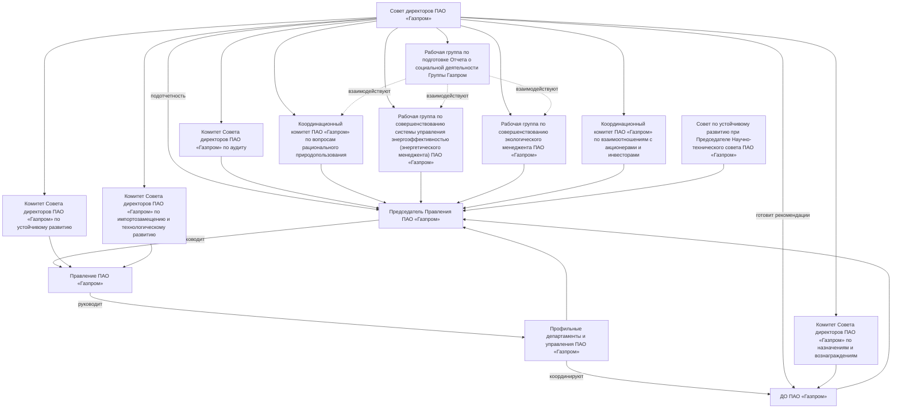

**Председатель Правления ПАО «Газпром»** осуществляет руководство реализацией Политики Группы Газпром в области устойчивого развития в ПАО «Газпром», в ДО — их **генеральные директора**.

Структурные подразделения ПАО «Газпром», его ДО управляют отдельными вопросами устойчивого развития и реализуют положения Политики Группы Газпром в области устойчивого развития.

Координацию деятельности структурных подразделений ПАО «Газпром», его ДО в области устойчивого развития осуществляет структурное подразделение ПАО «Газпром», отвечающее за информационную политику ПАО «Газпром».

В ПАО «Газпром» функционирует **Координационный комитет по вопросам рационального природопользования**1. Его основная цель — координация работы подразделений и организаций ПАО «Газпром» в области рационального природопользования, энергоэффективности, охраны окружающей среды и устойчивого развития.

В целях обеспечения комплексного подхода и координации деятельности структурных подразделений ПАО «Газпром» в области экологического и энергетического менеджмента постоянно действуют **Рабочая группа по совершенствованию системы экологического менеджмента ПАО «Газпром»**2 и **Рабочая группа по совершенствованию системы управления энергоэффективностью (энергетического менеджмента) ПАО «Газпром»**3.

В ПАО «Газпром» также функционирует **Координационный комитет по взаимоотношениям с акционерами и инвесторами ПАО «Газпром»**4, созданный для обеспечения комплексного подхода и координации деятельности структурных подразделений ПАО «Газпром» в рамках проводимой на постоянной основе работы с его акционерами и инвесторами, в том числе потенциальными. Основными задачами Координационного комитета по взаимоотношениям с акционерами и инвесторами ПАО «Газпром» являются разработка и проведение единой и последовательной политики по взаимоотношениям с акционерами и инвесторами. Работа с инвестиционным сообществом строится на основе ежегодно разрабатываемого Координационным комитетом плана.

В управлении устойчивым развитием Группы Газпром принимает участие **Совет по устойчивому развитию при председателе Научно-технического совета (НТС) ПАО «Газпром»**5. Его функции включают оценку основных научно-технических проблем отрасли, рассмотрение тенденций развития российского и мирового топливно-энергетического комплекса и конъюнктуры мировых энергетических рынков. Совет также участвует в формировании долгосрочного прогноза развития отрасли и научно-технического развития ПАО «Газпром», готовит предложения по стратегическим вопросам развития ПАО «Газпром», в том числе по концептуальному обоснованию перспективных проектов, и разрабатывает рекомендации по реализации передовых технических идей и технологических решений, новых форм и методов организации производства и управления.

icon: arrow
Подобнее с дополнительной информацией об управлении устойчивым развитием Группы Газпром можно ознакомиться в <u>**Приложении 6.1**</u>.

### **Вознаграждение членов Совета директоров ПАО «Газпром»**

По решению Общего собрания акционеров членам Совета директоров в период исполнения ими своих обязанностей могут выплачиваться вознаграждения. Размеры таких вознаграждений устанавливаются решением Общего собрания акционеров на основании рекомендаций Совета директоров, подготовленных в соответствии с Положением о порядке определения размера вознаграждений членам Совета директоров ПАО «Газпром»6 (далее — Положение). Данный документ предусматривает, что Совет директоров может рекомендовать Общему собранию акционеров не выплачивать вознаграждения членам Совета директоров или выплатить вознаграждение меньше величины, рассчитанной в соответствии с Положением. Также Положение предусматривает возможность сокращения в полном объеме вознаграждений членов Совета директоров в случае принятия Советом директоров решения об отказе в одностороннем порядке от выплаты процентов по облигациям без определения срока их погашения, эмитентом которых является ДО ПАО «Газпром».

Члены Совета директоров, замещающие государственные должности и должности государственной гражданской службы, не получают вознаграждения от ПАО «Газпром». В ПАО «Газпром» действует Комитет Совета директоров ПАО «Газпром» по назначениям и вознаграждениям.

----

1 Создан приказом ПАО «Газпром» от 14 мая 2020 г. № 215.
2 Создана приказом ПАО «Газпром» от 14 января 2021 г. № 16.
3 Создана приказом ПАО «Газпром» от 23 декабря 2022 г. № 547.
4 Создан приказом ОАО «Газпром» от 17 ноября 2008 г. № 292.
5 Создан приказом ПАО «Газпром» от 16 ноября 2016 г. № 715.
6 Утверждено решением Совета директоров ОАО «Газпром» от 15 апреля 2015 г. № 2523 (с последующими изменениями).

<!-- pdf_page: 23 -->
## PDF-страница 23

6. Приложения

5. Окружающая среда и экологическая политика

4. Развитие регионов

3. Безопасность производства

2. Люди Группы Газпром

1. О Группе Газпром

Система вознаграждения членов Совета директоров ПАО «Газпром» в целом соответствует рекомендациям п. 4.2 российского Кодекса корпоративного управления1. В частности, размер денежного вознаграждения членов Совета директоров не привязан к участию в отдельных заседаниях Совета директоров и комитетов Совета директоров. В структуре вознаграждения членов Совета директоров не используются формы дополнительного материального стимулирования. Опционная программа для членов Совета директоров ПАО «Газпром» не предусмотрена. В ПАО «Газпром» не установлены какие-либо дополнительные выплаты или компенсации в случае досрочного прекращения полномочий членов Совета директоров.

Вознаграждение члену Совета директоров состоит из трех частей: базовой, дополнительной и премиальной. Базовая часть вознаграждения выплачивается за осуществление полномочий члена Совета директоров. Размер базовой части вознаграждения является одинаковым для всех членов Совета директоров.

### **Вознаграждение членов Ревизионной комиссии ПАО «Газпром»**

По решению Общего собрания акционеров членам Ревизионной комиссии ПАО «Газпром» в период исполнения ими своих обязанностей могут выплачиваться вознаграждения. Размеры таких вознаграждений устанавливаются решением Общего собрания акционеров на основании рекомендаций Совета директоров, подготовленных в соответствии с Положением о вознаграждениях членам Ревизионной комиссии ПАО «Газпром»3.

Вознаграждение выплачивается членам Ревизионной комиссии по итогам работы за корпоративный год и зависит от степени их участия в работе Ревизионной комиссии, выраженной коэффициентом личного участия, который также отражает исполнение дополнительных обязанностей в качестве Председателя Ревизионной комиссии. В случае досрочного прекращения полномочий, а также избрания члена Ревизионной комиссии на внеочередном Общем собрании акционеров расчет суммы вознаграждения производится с учетом фактического участия члена Ревизионной комиссии в заседаниях. При этом выплата вознаграждения производится пропорционально фактически отработанному времени.

Члены Ревизионной комиссии, занимающие государственные должности и должности государственной гражданской службы, не получают вознаграждения.

Дополнительная часть вознаграждения выплачивается за исполнение членом Совета директоров дополнительных обязанностей, связанных с исполнением функций Председателя Совета директоров, заместителя Председателя Совета директоров, работой в комитетах Совета директоров. Дополнительная часть вознаграждения также является фиксированной и не привязана к участию в отдельных заседаниях комитетов Совета директоров.

Премиальная часть вознаграждения выплачивается за достижение общекорпоративных ключевых показателей эффективности (КПЭ), таких как «Рентабельность инвестиций акционеров», «Рентабельность акционерного капитала», «Производительность труда», «Интегральный ключевой показатель эффективности инновационной деятельности».

Годовым Общим собранием акционеров ПАО «Газпром» 30 июня 2023 г. принято решение2 выплатить вознаграждения членам Совета директоров ПАО «Газпром», не занимающим государственные должности Российской Федерации и должности государственной гражданской службы, в размерах, рекомендованных Советом директоров ПАО «Газпром».

### **Уровень корпоративного управления, оценки и рейтинги**

В соответствии с рекомендациями российского Кодекса корпоративного управления (п. 2.9) в ПАО «Газпром» на регулярной основе проводятся комплексные независимые оценки практики корпоративного управления. Результаты оценки учитываются при подготовке мероприятий по дальнейшему развитию корпоративных стандартов. Начиная с 2014 г. в ПАО «Газпром» трижды проводилась комплексная независимая оценка практики корпоративного управления. В 2014 и 2017 гг. к внешней оценке привлекались эксперты АО «КПМГ» и ООО «Горизонт КФ».

В 2023 г. была проведена очередная независимая комплексная оценка корпоративного управления ПАО «Газпром» экспертами ООО «Кэпт Налоги и Консультирование»4 и ООО «Горизонт КФ». Подходы к оценке основаны на требованиях законодательства Российской Федерации и правил листинга российских бирж, рекомендациях российского Кодекса корпоративного управления, иных рекомендациях Банка России, методических рекомендациях федеральных органов исполнительной власти, передовой корпоративной практике.

Анализ корпоративного управления проводился в разрезе следующих основных блоков:

* обеспечение прав акционеров;
* деятельность Совета директоров и комитетов Совета директоров;
* деятельность органов управления и контроля;
* корпоративная этика и противодействие коррупции;
* использование инсайдерской информации и информационная безопасность;
* корпоративная социальная ответственность;
* управление рисками;
* раскрытие информации.

В целом система корпоративного управления ПАО «Газпром», как и в 2017 г., получила высокие оценки, что в полной мере соответствует с наивысшим рейтингом качества управления, ежегодно присваиваемым ПАО «Газпром» рейтинговым агентством «Эксперт РА» начиная с 2021 г.

Традиционно наибольшее количество баллов — пять из пяти возможных — получили такие направления корпоративного управления, как обеспечение права голоса акционеров; организация деятельности исполнительных органов; внешний аудит; управление рисками; организация взаимодействия с ДО.

По ряду направлений эксперты повысили оценку до максимальной — с четырех до пяти баллов. В числе таких направлений обеспечение прав собственности акционеров и прав на получение дивидендов; система предупреждения конфликта интересов; состав и структура Совета директоров, объем компетенций; вознаграждения и преемственность; стратегическое планирование и бюджетирование; корпоративная социальная ответственность.

В 2023 г. эксперты выделили в качестве отдельных сегментов корпоративную этику и противодействие коррупции, использование инсайдерской информации и информационную безопасность. По этим сегментам также присвоены наивысшие баллы.

## **A++ .gq**
**(наивысший)**
**рейтинг качества управления ПАО «Газпром» по оценке рейтингового агентства АО «Эксперт РА»**

1 Рекомендован к применению письмом Банка России от 10 апреля 2014 г. № 06-52/2463 «О кодексе корпоративного управления».
2 Итоги голосования по вопросу отражены в протоколе Общего собрания акционеров ПАО «Газпром» от 30 июня 2023 г. № 1.
3 Утверждено решением Совета директоров ПАО «Газпром» от 9 декабря 2015 г. № 2641 (с последующими изменениями).
4 Бывшее российское подразделение международной сети фирм КПМГ.

<!-- pdf_page: 24 -->
## PDF-страница 24

icon: icon

В 2021 г. рейтинговое агентство АО «Эксперт РА» присвоило ПАО «Газпром» наивысший рейтинг качества управления (А+++.gq)1. В 2022, 2023 и 2024 гг. агентство подтвердило наивысший рейтинг.

Оценка качества управления осуществлялась экспертами по следующим основным направлениям:
* позиционирование (деловая репутация, стратегия развития и др.);
* органы управления и контроля;
* информационная прозрачность;
* права акционеров и иных заинтересованных сторон;
* факторы поддержки (дополнительные позитивные изменения);
* стресс-факторы (факторы, которые оказывают значительное негативное влияние на рейтинг).

В числе факторов, позитивно повлиявших на выводы, эксперты отметили высокий уровень организации деятельности коллегиальных органов управления ПАО «Газпром», в том числе:
* высокий уровень нагрузки на Совет директоров и его комитеты (большое количество заседаний);
* наличие четырех профильных комитетов при Совете директоров;
* председательство неисполнительного директора в Совете директоров и независимого директора в Комитете Совета директоров по аудиту;
* страхование ответственности членов Совета директоров с высоким размером страховой суммы;
* вовлеченность Совета директоров и Правления в ESG-повестку.

Кроме того, были отмечены высокий уровень организации системы управления рисками и высокая степень защиты прав собственников и прочих заинтересованных лиц. Положительными факторами, повлиявшими на оценку, стали также такие аспекты, как наличие подразделений, осуществляющих функции корпоративного секретаря, с закреплением их прав, обязанностей и компетенции в соответствующих положениях; эффективные системы управления трудовыми отношениями, корпоративной этики и противодействия коррупции, а также высокий уровень качества стратегического планирования.

icon: icon

Подоболее с информацией о регулирующих документах в области корпоративного управления Группы Газпром можно ознакомиться в <u>Приложении 6.4</u>.

icon: icon

Подоболее с информацией о взаимодействии Группы Газпром с акционерами и инвесторами можно ознакомиться в <u>Приложении 6.2</u>.

icon: icon

## **Рейтинги ПАО «Газпром» в области устойчивого развития**

Большинство ключевых зарубежных ESG-рейтингов приостановили деятельность в России. Тем не менее ПАО «Газпром» проактивно развивает взаимодействие со всеми рейтинговыми агентствами.

1 Методология присвоения рейтингов качества управления АО «Эксперт РА» опубликована на сайте организации <u>www.raexpert.ru</u>

----

## **ESG-рейтинги ПАО «Газпром»**

| Рейтинг/индекс                                                                                                              | 2021                     | 2022                                   | 2023                                   |
| --------------------------------------------------------------------------------------------------------------------------- | ------------------------ | -------------------------------------- | -------------------------------------- |
| Рэнкинг в области устойчивого развития российских компаний промышленного сектора Национального рейтингового агентства (НРА) | –                        | 0,814 (1 группа, продвинутый уровень)² | 0,796 (1 группа, продвинутый уровень)³ |
| Индекс устойчивого развития российского бизнеса (подготовлен РБК и рейтинговым агентством НКР)                              | –                        | Категория 1 (высокий уровень)⁴         | Категория 1 (высокий уровень)⁵         |
| Рейтинг лучшего работодателя по версии Forbes                                                                               | –                        | Золото⁶                                | Золото⁷                                |
| Рейтинг качества управления «Эксперт РА»                                                                                    | A+++.gq                  | A+++.gq                                | A+++.gq⁸                               |
| Рейтинг отчетности компаний в области устойчивого развития AK\&M                                                            | Высший уровень раскрытия | Высший уровень раскрытия⁹              | Высший уровень раскрытия¹⁰             |
| Индекс МосБиржи — РСПП «Ответственность и открытость»                                                                       | A (группа лидеров)       | A (группа лидеров)¹¹                   | A (группа лидеров)¹²                   |
| Индекс МосБиржи — РСПП «Вектор устойчивого развития»                                                                        | A (группа лидеров)       | A (группа лидеров)                     | A (группа лидеров)¹³                   |
| Sustainalytics ESG Risk Rating                                                                                              | 37,4                     | 56,6                                   | 56,2                                   |
| CHRB¹⁴                                                                                                                      | –                        | –                                      | 6,4                                    |
| RAEX ESG Corporate Ranking                                                                                                  | –                        | –                                      | ВВВ¹⁵                                  |

icon: icon

В декабре 2023 г. состоялось расширенное заседание Комитета по корпоративной ответственности и устойчивому развитию РСПП, посвященное подведению итогов года и десятилетию Проекта по расчету индексов РСПП по устойчивому развитию (ESG-индексов). ПАО «Газпром» было отмечено Дипломом РСПП как одна из компаний, которая все эти годы была лидером Индексов РСПП.

icon: icon

### **Поддержка кредитных рейтингов**

Работа ПАО «Газпром» на российском долговом рынке была высоко оценена инвестиционным сообществом — по итогам 2023 г. ПАО «Газпром» признано лауреатом премии Cbonds Awards в номинации «Эмитент года»16.

----

2 <u>https://www.ra-national.ru/wp-content/uploads/2023/02/ranking_prom_2023.pdf</u>
3 <u>https://www.ra-national.ru/wp-content/uploads/2024/01/esg-rjenking-rossijskih-konpanij-promyshlennogo-sektora-22.01.2024____.pdf</u>
4 По данным за 2020–2021 гг. <u>https://ratings.ru/files/research/macro/NCR_ESG_Oct22.pdf</u>
5 <u>https://trends.rbc.ru/trends/green/650b1a619a79478e138a37ba</u>
6 <u>https://www.forbes.ru/rating/482177-lucsie-rabotodateli-rossii-2022-rejting-forbes</u>
7 <u>https://www.forbes.ru/ratings/best-employers</u>
8 <u>https://raexpert.ru/database/companies/gazprom/</u>
9 <u>https://akmrating.ru/rejtingotchetnostiesg/</u>
10 <u>https://www.akm.ru/upload/akmrating/Sustainable_Development_Reporting_Rating_%202023.pdf</u>
11 <u>https://rspp.ru/upload/iblock/e07/efghhr37sx3rkf35uznh3pd9t1ihq4tz/Prezentatsiya_ESG_indeksy-RSPP-2022.pdf</u>
12 <u>https://rspp.ru/events/news/resultaty-esgindeksov-rspp-2023-657729a495dfc/</u>
13 <u>https://rspp.ru/events/news/resultaty-esgindeksov-rspp-2023-657729a495dfc/</u>
14 Оценивание происходит один раз в два года, в 2022 г. оценка российских компаний не осуществлялась.
15 Оценка по Группе Газпром по состоянию на 1 декабря 2023 г. <u>www.raexpert.eu</u>
16 <u>https://cbonds.ru/awards/195/</u>

<!-- pdf_page: 25 -->
## PDF-страница 25

## **УПРАВЛЕНИЕ РИСКАМИ**

Группа Газпром взвешенно и ответственно развивает корпоративную Систему управления рисками и внутреннего контроля (СУРиВК). Обязательства и полномочия в области управления рисками распределены между органами управления, структурными подразделениями ПАО «Газпром» и его ДОиО. В ПАО «Газпром» функционирует обособленное структурное подразделение, отвечающее за развитие СУРиВК, его деятельность координирует заместитель Председателя Правления.

### **Структура СУРиВК**

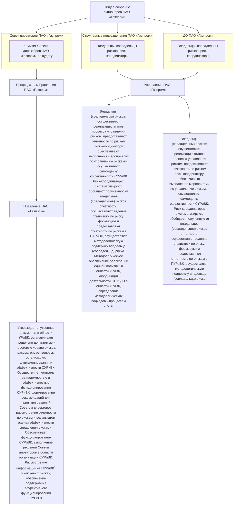

Корпоративная СУРиВК ПАО «Газпром» соответствует требованиям Федерального закона от 26 декабря 1995 г. № 208-ФЗ «Об акционерных обществах», поручениям и указаниям Президента Российской Федерации, директивам Правительства Российской Федерации и рекомендациями Росимущества и Банка России, положениям Кодекса корпоративного управления, а также Политике управления рисками и внутреннего контроля ПАО «Газпром»2, направленной на достижение поставленных перед ПАО «Газпром» целей.

Процесс управления рисками и внутреннего контроля в ПАО «Газпром» регламентирован Политикой управления рисками и внутреннего контроля ПАО «Газпром», которая соответствует требованиям к функционированию и развитию СУРиВК.

В Политике управления рисками и внутреннего контроля ПАО «Газпром» определены цели и задачи СУРиВК, основные принципы и подходы к ее организации, ее участники и их полномочия, требования к реализации процесса управления рисками.

Ключевые риски ПАО «Газпром» выявляются и оцениваются на регулярной основе, при этом меры реагирования позволяют удерживать уровень идентифицированных ключевых рисков в приемлемом для ПАО «Газпром» диапазоне.

Внутренний контроль ПАО «Газпром» обеспечивает достаточную уверенность в достижении целей бизнес-процессов, владельцами которых являются его соответствующие структурные подразделения.

Информация в области управления рисками и внутреннего контроля своевременно собирается и передается заинтересованным сторонам, что позволяет руководству ПАО «Газпром» принимать управленческие решения с учетом рисков.

**Риски в области охраны окружающей среды, производственной безопасности, закупочной деятельности, кадровой политики, ИТ и ИБ, управления качеством, импортозамещения, санкционной политики и рынков сбыта, присущие деятельности Группы Газпром**

| Вид риска                                                               | Источник риска                                                                                                                                                                                                                                                                                                                  | Ссылка на раздел                                                                                                                                  |
| ----------------------------------------------------------------------- | ------------------------------------------------------------------------------------------------------------------------------------------------------------------------------------------------------------------------------------------------------------------------------------------------------------------------------- | ------------------------------------------------------------------------------------------------------------------------------------------------- |
| Риски в области информационных технологий и информационной безопасности |                                                                                                                                                                                                                                                                                                                                 |                                                                                                                                                   |
| • Риски ИТ                                                              | Внутренние и внешние В процессе цифровой трансформации в Группе Газпром идентифицированы риски, связанные с вводом новых / реализацией существующих внешних секторальных санкций в области ИТ, направленных на снижение надежности функционирования информационно-управляющих, информационных и иных автоматизированных систем. | ➔ Подробнее с информацией о мерах Группы Газпром по снижению рисков в области ИТ и ИБ можно ознакомиться в подразделе *«Цифровая трансформация».* |
| • Риски ИБ                                                              | Внутренние и внешние На деятельность Группы Газпром могут оказать влияние риски ИБ, реализация которых может привести к нарушению целостности, конфиденциальности или доступности информационных ресурсов, информационных активов и вычислительных сетей.                                                                       |                                                                                                                                                   |

<!-- pdf_page: 26 -->
## PDF-страница 26

| Вид риска                                               | Источник риска                                                                                                                                                                                                                                                                                                                                                                                                                                                                                                                                                                           | Ссылка на раздел                                                                                                                                                                              |
| ------------------------------------------------------- | ---------------------------------------------------------------------------------------------------------------------------------------------------------------------------------------------------------------------------------------------------------------------------------------------------------------------------------------------------------------------------------------------------------------------------------------------------------------------------------------------------------------------------------------------------------------------------------------- | --------------------------------------------------------------------------------------------------------------------------------------------------------------------------------------------- |
| Риски в области охраны окружающей среды                 |                                                                                                                                                                                                                                                                                                                                                                                                                                                                                                                                                                                          |                                                                                                                                                                                               |
| • Природно-климатические                                | Внешние  Возможные изменения климата, неблагоприятные природные и гидрометеорологические явления, которые могут нанести ущерб зданиям и сооружениям, системам трубопроводного транспорта, инженерным коммуникациям. Значительная доля объема добычи газа приходится на Западную Сибирь, где климатические условия могут усложнить и увеличить себестоимость добычи.                                                                                                                                                                                                              | ➔  Подробнее с информацией о мерах Группы Газпром по снижению рисков в области охраны окружающей среды можно ознакомиться в разделе *5. «Окружающая среда и экологическая политика»*. |
| • Экологические                                         | Внутренние и внешние  Основные виды производственной деятельности по добыче, транспортировке, переработке и хранению углеводородов связаны с риском загрязнения окружающей среды. Воздействие на окружающую среду в результате аварий в процессе производственно-хозяйственной деятельности, воздействие на экосистемы, влекущее загрязнение земель и водоемов, ухудшение почвенно-растительного покрова и развитие эрозионных процессов могут привести к деградации экосистем, сокращению мест обитания редких и находящихся под угрозой исчезновения видов растений, животных. |                                                                                                                                                                                               |
| Риски в области санкционной политики и рынков сбыта     |                                                                                                                                                                                                                                                                                                                                                                                                                                                                                                                                                                                          |                                                                                                                                                                                               |
| • Санкционные                                           | Внешние  Риск расширения санкционных ограничений и введения санкций США и ЕС в отношении России и российских лиц по причине внешних факторов, приводящий к финансовым (нефинансовым) последствиям для ПАО «Газпром» и проектов Группы Газпром.                                                                                                                                                                                                                                                                                                                                   | ➔  Подробнее с информацией о мерах Группы Газпром по снижению рисков в области ВЭД можно ознакомиться в подразделе *«Внешнеэкономическая деятельность»*.                              |
| • Ценовые и объемные товарно-сырьевые на внешних рынках | Внешние  Неблагоприятные экономические условия, снижение спроса и цен на энергоносители, снижение и (или) сохранение низкого уровня биржевых котировок в течение длительного периода времени, оказывающие негативное влияние на цены и объемы поставок газа на внешние рынки.                                                                                                                                                                                                                                                                                                    |                                                                                                                                                                                               |

| Вид риска                                                 | Источник риска                                                                                                                                                                                                                                                                                                                                       | Ссылка на раздел                                                                                                                                                                    |
| --------------------------------------------------------- | ---------------------------------------------------------------------------------------------------------------------------------------------------------------------------------------------------------------------------------------------------------------------------------------------------------------------------------------------------- | ----------------------------------------------------------------------------------------------------------------------------------------------------------------------------------- |
| Риски в области производственной безопасности             |                                                                                                                                                                                                                                                                                                                                                      |                                                                                                                                                                                     |
| • Риски охраны труда                                      | Внутренние и внешние  Производственная деятельность связана с рисками негативного воздействия на здоровье и безопасность персонала, возникновением аварий, инцидентов и пожаров.                                                                                                                                                             | ➔  Подробнее с информацией о мерах Группы Газпром по снижению рисков в области производственной безопасности можно ознакомиться в разделе *3. «Безопасность производства»*. |
| • Риски пожарной безопасности                             |                                                                                                                                                                                                                                                                                                                                                      |                                                                                                                                                                                     |
| • Риски промышленной безопасности                         |                                                                                                                                                                                                                                                                                                                                                      |                                                                                                                                                                                     |
| Риски в области закупочной деятельности                   |                                                                                                                                                                                                                                                                                                                                                      |                                                                                                                                                                                     |
| • Риски осуществления закупок                             | Внутренние и внешние  Процессы осуществления закупочной деятельности связаны с рисками несоблюдения требований законодательства, регламентирующего закупочную деятельность.                                                                                                                                                                  | ➔  Подробнее с информацией о мерах Группы Газпром по снижению рисков в области закупочной деятельности можно ознакомиться в подразделе *«Сотрудничество с поставщиками»*.   |
| Риски в области кадровой политики                         |                                                                                                                                                                                                                                                                                                                                                      |                                                                                                                                                                                     |
| • Риски, связанные с персоналом                           | Внутренние и внешние  Эффективность деятельности организаций Группы Газпром зависит от укомплектованности достаточно квалифицированным персоналом, развития профессиональных навыков работников посредством внедрения комплексных программ обучения и повышения квалификации, повышения заинтересованности работников в развитии и обучении. | ➔  Подробнее с информацией о мерах Группы Газпром по снижению рисков в области кадровой политики можно ознакомиться в разделе *2. «Люди Группы Газпром»*.                   |
| Риски в области управления качеством                      |                                                                                                                                                                                                                                                                                                                                                      |                                                                                                                                                                                     |
| • Риски снижения уровня качества продуктов, работ и услуг | Внутренние и внешние  Деятельность Группы Газпром подвержена риску снижения качества производимых в Группе Газпром продуктов, работ, а также оказываемых услуг.                                                                                                                                                                              | ➔  Подробнее с информацией о мерах Группы Газпром по снижению рисков в области управления качеством можно ознакомиться в подразделе *«Управление качеством»*.               |
| Риски в области импортозамещения                          |                                                                                                                                                                                                                                                                                                                                                      |                                                                                                                                                                                     |
| • Риски снижения уровня технологической независимости     | Внутренние и внешние  Деятельность Группы Газпром подвержена влиянию ограничительных мер в отношении российских компаний, введенных США, ЕС и другими странами.                                                                                                                                                                              | ➔  Подробнее с информацией о мерах Группы Газпром по снижению рисков импортозамещения можно ознакомиться в подразделе *«Вклад в укрепление технологического суверенитета»*. |

<!-- pdf_page: 27 -->
## PDF-страница 27

## **КОРПОРАТИВНАЯ ЭТИКА И ПРОТИВОДЕЙСТВИЕ КОРРУПЦИИ**

### **Корпоративные ценности и этика**

В ПАО «Газпром» действует Кодекс корпоративной этики ПАО «Газпром», разработанный в 2012 г. и действующий в редакции, утвержденной в 2014 г., с последующими изменениями (далее — Кодекс этики). Кодекс этики учитывает лучшие российские и зарубежные корпоративные практики.

Положения Кодекса этики обязательны для исполнения всеми работниками ПАО «Газпром». С 2019 г. Кодекс этики распространен на членов Совета директоров, соответствующие дополнения внесены в Положение о Совете директоров ПАО «Газпром»1. Ежегодно руководящие работники ПАО «Газпром», в том числе члены Правления, оформляют письменные обязательства соблюдать положения Кодекса этики по установленной форме.

В документе закреплены корпоративные ценности ПАО «Газпром», определены основанные на них наиболее важные правила делового поведения, исключающие случаи конфликта интересов и коррупции, предусматривающие ограничения, в частности, в отношении совместной работы родственников, участия работников в компаниях-конкурентах и выборных органах государственной власти, связанные с приемом подарков.

В подконтрольных ПАО «Газпром» организациях действуют собственные кодексы корпоративной этики, соответствующие Кодексу этики головной компании.

> **Начиная с 2021 г. проводятся мероприятия **по максимальному вовлечению контрагентов** **ПАО «Газпром», не входящих в Группу Газпром, в его** **систему корпоративных ценностей. В заключаемые** **контракты включается разработанная ПАО «Газпром»** **оговорка о необходимости соблюдения работниками** контрагента положений Кодекса этики.**

Кодекс этики определяет порядок действий работников в ситуации конфликта интересов, объявляет нетерпимость к коррупционному поведению, устанавливает обязанность руководителей и работников по уведомлению работодателя о поступивших в их адрес предложениях коррупционного характера.

> **Согласно Кодексу этики ПАО «Газпром» не участвует **в политической деятельности и не финансирует** политические организации.**

В Кодексе этики закреплены принципы заботы о природе, запрет на дискриминацию работников, установлены механизмы реализации норм корпоративной этики и контроля за их соблюдением.

#### **Корпоративные ценности ПАО «Газпром»**

* **Профессионализм**
* **Бережливость**
* **Взаимное уважение**
* **Имидж**
* **Инициативность**
* **Открытость к диалогу**
* **Преемственность**

----

#### **Существенные темы**

icon: building
7. Соответствие деятельности Группы Газпром нормам законодательства (социально-экономическим, экологическим, антимонопольным)

icon: gavel
15. Противодействие коррупции в Группе Газпром

----

### **Предотвращение конфликта интересов**

В Группе Газпром действуют корпоративные механизмы выявления, предотвращения и урегулирования конфликта интересов у членов органов управления ПАО «Газпром».

#### **Выявление, предотвращение и урегулирование конфликта интересов у членов Совета директоров ПАО «Газпром»**

В соответствии с пунктом 5.5 статьи 5 Положения о Совете директоров ПАО «Газпром»:

* члены Совета директоров не должны использовать свое положение и полученную информацию о деятельности ПАО «Газпром» в личных интересах, а также допускать их использование в личных интересах другими лицами;
* члены Совета директоров должны воздерживаться от действий, которые приведут или могут привести к возникновению конфликта интересов;
* при возникновении конфликта интересов у члена Совета директоров:
  – член Совета директоров, у которого возник конфликт интересов, должен информировать об этом Совет директоров путем направления уведомления Председателю Совета директоров. Уведомление должно содержать сведения о факте наличия конфликта интересов и основаниях его возникновения;
  – председатель Совета директоров направляет поступившее ему уведомление о наличии конфликта интересов всем членам Совета директоров до принятия решения по вопросу, по которому у члена Совета директоров имеется конфликт интересов;
  – член Совета директоров вправе воздержаться от голосования по вопросу, по которому у него имеется конфликт интересов. Председатель Совета директоров в случаях, когда того требуют характер обсуждаемого вопроса либо специфика конфликта интересов, вправе предложить члену Совета директоров, имеющему конфликт интересов, не присутствовать при обсуждении соответствующего вопроса;
* если член Совета директоров, имеющий конфликт интересов, воздержался от голосования или не присутствовал на заседании Совета директоров при обсуждении вопроса повестки дня, по которому у него имеется конфликт интересов, это отражается в протоколе заседания Совета директоров.

В соответствии с пунктом 45.1 статьи 45 Устава ПАО «Газпром» члены Совета директоров в течение двух месяцев со дня, когда они узнали или должны были узнать о наступлении обстоятельств, в силу которых они могут быть признаны заинтересованными в совершении ПАО «Газпром» сделок, обязаны уведомить ПАО «Газпром»:

* о юридических лицах, в отношении которых они, их супруги, родители, дети, полнородные и неполнородные братья и сестры, усыновители и усыновленные и (или) их подконтрольные организации являются контролирующими лицами или имеют право давать обязательные указания;
* о юридических лицах, в органах управления которых они, их супруги, родители, дети, полнородные и неполнородные братья и сестры, усыновители и усыновленные и (или) их подконтрольные лица занимают должности;
* об известных им совершаемых или предполагаемых сделках, в которых они могут быть признаны заинтересованными лицами.

Сделка, в совершении которой имеется заинтересованность, не порождает конфликта интересов в том случае, если в отношении такой сделки соблюдены требования главы XI Федерального закона «Об акционерных обществах».

Информация о связанных сторонах (третьих лицах) раскрывается Компанией в составе годовой консолидированной финансовой отчетности, подготовленной в соответствии с МСФО.

<!-- pdf_page: 28 -->
## PDF-страница 28

## **Выявление, предотвращение и урегулирование конфликта интересов у членов Правления ПАО «Газпром»**

В соответствии со статьями 5–8, 10 Кодекса этики, пунктом 3.4 статьи 3 и пунктом 5.6 статьи 5 Положения о Правлении ПАО «Газпром»1:

* члены Правления не должны использовать свое положение и полученную информацию о деятельности ПАО «Газпром» в личных интересах, а также допускать их использование в личных интересах другими лицами, должны воздерживаться от действий, которые приведут или могут привести к возникновению конфликта интересов;
* на членов Правления ПАО «Газпром» распространяются ограничения Кодекса этики в отношении совместной работы родственников, участия работников в компаниях-конкурентах и выборных органах государственной власти, ограничения, связанные с приемом подарков и другие;
* участие членов Правления ПАО «Газпром» в органах управления других организаций допускается только с согласия Совета директоров ПАО «Газпром»;
* в случае возникновения конфликта интересов члены Правления ПАО «Газпром» как его работники могут обращаться в Комиссию по этике.

ПАО «Газпром» проводит работу по выявлению и предупреждению возникновения конфликта интересов у единоличных исполнительных органов подконтрольных ему организаций. Согласно сложившейся практике у всех единоличных исполнительных органов подконтрольных организаций на регулярной основе (не реже одного раза в три года) осуществляется сбор и анализ информации о наличии или отсутствии признаков конфликта интересов (путем анкетирования). У вновь назначенных руководителей объектов вложений соответствующее анкетирование проводится после их назначения на должность.

В случае возникновения конфликта интересов у единоличного исполнительного органа подконтрольной ПАО «Газпром» организации последний обязан проинформировать об этом Комиссию по корпоративной этике ПАО «Газпром».

> **В 2023 г. информация о наличии конфликта **интересов у членов Совета директоров, Правления,** **Председателя Правления ПАО «Газпром»** **в Комиссию по корпоративной этике ПАО «Газпром»** не поступала. Председателю Совета директоров **также не поступало уведомлений от членов Совета** **директоров о наличии конфликта интересов** по вопросам повесток дня органа управления.**

### **Обучение в сфере корпоративной этики**

Работники администрации и филиалов ПАО «Газпром» и его ДОиО регулярно проходят обучение в рамках электронного курса «Корпоративная этика» с итоговой проверкой знаний в формате тестирования. В 2023 г. соответствующее обучение прошли 131 153 работника.

**131 153** работника
обучено в рамках электронного курса «Корпоративная этика»

В 2022 г. разработан курс «Корпоративная этика в ПАО «Газпром» для поставщиков» для дистанционного обучения работников сторонних организаций. В рамках запущенного в июле 2023 г. пилотного проекта с электронным курсом этики для поставщиков ознакомилось более 1,2 тыс. пользователей.

**> 1,2 тыс.** пользователей
ознакомилось с электронным курсом этики для поставщиков

----

1 Утверждено решением годового Общего собрания акционеров ПАО «Газпром» от 30 июня 2016 г., протокол № 1 (с последующими изменениями).

----

## **Комиссия по корпоративной этике ПАО «Газпром»**

Ответственность за организацию работы по исполнению требований и положений Кодекса этики возложена на постоянно действующую Комиссию по корпоративной этике ПАО «Газпром» (далее — Комиссия по этике). Она состоит не менее чем из пяти человек, ее персональный состав назначается приказом ПАО «Газпром».

### **Основные направления работы Комиссии по этике**

* Разъяснение работникам положений Кодекса этики и порядка его применения;
* рассмотрение обращений по мере их поступления в соответствии с требованиями действующего законодательства Российской Федерации с привлечением, при необходимости, профильных структурных подразделений и ДО, принятие мер реагирования в случаях выявления нарушений Кодекса этики в пределах компетенции;
* выявление у единоличных исполнительных органов подконтрольных ПАО «Газпром» организаций признаков конфликта интересов и выработка рекомендаций по устранению и минимизации возможных негативных последствий ситуаций конфликта интересов при их выявлении;
* организация на ежегодной основе работы по оформлению по установленной форме руководителями, в том числе работниками, являющимися членами Совета директоров и членами Правления ПАО «Газпром», письменных обязательств соблюдать положения Кодекса этики.

Информация о работе Комиссии по этике ежегодно доводится до сведения Председателя Правления ПАО «Газпром». Кроме того, в целях повышения эффективности принимаемых Компанией мер по предотвращению и урегулированию конфликта интересов в соответствии с государственной политикой в области противодействия коррупции и улучшения делового климата в Российской Федерации в 2022 г. в Кодексе этики закреплено положение о регулярном (не реже одного раза в три года) доведении до сведения Совета директоров ПАО «Газпром» информации о соблюдении в ПАО «Газпром» норм корпоративной этики. В рамках исполнения указанной нормы в 2023 г. Совету директоров ПАО «Газпром» был представлен соответствующий доклад.

По вопросам разъяснения положений и применения Кодекса этики, получения информации о ставших известными нарушениях этических норм, а также в случае возникновения конфликта интересов работники ПАО «Газпром» обращаются к своему непосредственному руководителю или в Комиссию по этике. Если непосредственным руководителем не приняты меры, направленные на предотвращение или устранение конфликта интересов, либо принятые меры не повлекли устранение конфликта интересов, работник информирует об этом Комиссию по этике.

Согласно Кодексу этики меры ответственности работников за нарушение положений Кодекса этики включают:
* общественное порицание;
* публичное осуждение;
* лишение премии (в соответствии с внутренними документами);
* дисциплинарное взыскание (при наличии признаков дисциплинарного проступка).

> **В 2023 г. Комиссия по этике провела восемь заседаний, на которых был **рассмотрен 21 вопрос. Большинство обращений, полученных в 2023 г.,** касались разъяснений механизма применения отдельных положений Кодекса **этики, делового поведения работников ДО, а в ряде случаев — ситуаций,** имеющих, по мнению заявителей, признаки конфликта интересов.**

Обращения в Комиссию по этике осуществляются посредством сообщений по электронной почте <u>ethics.comission@adm.gazprom.ru</u>, по телефону «Горячей линии» Комиссии по этике +7 (495) 719-11-71 или почтовым отправлением.

<!-- pdf_page: 29 -->
## PDF-страница 29

flow_chart: Порядок рассмотрения обращений Комиссией по этике

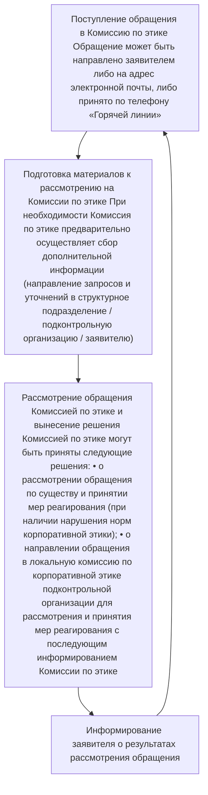

В подконтрольных ПАО «Газпром» организациях созданы собственные комиссии по корпоративной этике, рассматривающие обращения своих работников в соответствии с кодексами корпоративной этики данных организаций.

## **Противодействие коррупции**

Антикоррупционная политика ПАО «Газпром» отражает приверженность руководства и работников Группы Газпром этическим стандартам ведения законного, открытого и честного бизнеса, совершенствования корпоративной культуры, следования лучшим практикам корпоративного управления и поддержания деловой репутации на должном уровне. Этот документ определяет задачи, компетенцию органов управления в области предупреждения и противодействия коррупции, устанавливает комплекс мер, направленных на предупреждение и противодействие коррупции, ответственность.

> **Соблюдение положений Политики является обязательным для органов управления и всех работников организаций Группы Газпром.**

> icon: people **Совет директоров ПАО «Газпром» в 2023 г. рассмотрел вопрос «О ходе работы по предупреждению и противодействию коррупции в ПАО «Газпром» и поручил Председателю Правления ПАО «Газпром» продолжить работу в данном направлении.**

### **Основные принципы Антикоррупционной политики**

* **Принцип соответствия действующему законодательству**
* **Принцип ответственности и неотвратимости наказания**
* **Принцип личного примера руководства**
* **Принцип эффективности антикоррупционных процедур**
* **Принцип открытости бизнеса**
* **Принцип вовлеченности работников**
* **Принцип соразмерности антикоррупционных процедур риску коррупции**
* **Принцип постоянного контроля и регулярного мониторинга**

### **Управление работой по противодействию коррупции**

* **Совет директоров ПАО «Газпром»**
  * Общее руководство деятельностью Группы Газпром в области предупреждения и противодействия коррупции
  * Рассмотрение отчетов исполнительных органов организаций Группы Газпром о деятельности по предупреждению и противодействию коррупции
* **Председатель Правления ПАО «Газпром»**
  * Распределение полномочий, обязанностей и ответственности по предупреждению и противодействию коррупции между заместителями Председателя Правления и подразделениями ПАО «Газпром»
  * Организация мероприятий, направленных на реализацию принципов и требований Антикоррупционной политики (включая назначение лиц, ответственных за разработку, внедрение и контроль антикоррупционных процедур)
* **Комитет Совета директоров ПАО «Газпром» по аудиту**
  * Подготовка предложений по совершенствованию процедур внутреннего контроля в области противодействия коррупции

## **Механизмы информирования о коррупции**

Порядок подачи и рассмотрения обращений на «Горячую линию» по вопросам противодействия мошенничеству, коррупции и хищениям изложен в Положении о «Горячей линии» по вопросам противодействия мошенничеству, коррупции и хищениям в Группе Газпром1.

Сообщения регистрируются, проверяются и передаются в обработку, в процессе которой обеспечивается конфиденциальность личности заявителя, а также переданных им сведений и не допускаются любые меры воздействия в отношении лица, предоставившего информацию.

В случае если сообщение, поступившее на «Горячую линию», касается конфликта интересов или коррупционных и иных действий, подпадающих под регулирование Кодексом корпоративной этики ПАО «Газпром», оно также направляется в Комиссию по корпоративной этике.

При наличии в сообщении сведений о подготавливаемом, совершаемом или совершенном противоправном деянии, а также о лице, его подготавливающем, совершающем или совершившем, обращение направляется в правоохранительные органы.

По итогам обработки информации, поступившей по «Горячей линии», в случаях подтверждения указанной информации, выявления в ходе ее обработки иных фактов, свидетельствующих о мошенничестве, коррупции и хищениях в Группе Газпром, выявления фактов предоставления недостоверной информации о бенефициарах контрагентов

----

1 Утверждено приказом ОАО «Газпром» от 4 сентября 2014 г. <u>№ 423.</u>

icon: arrow
**Подробнее с информацией о регулирующих документах в области противодействия коррупции можно ознакомиться в <u>Приложении 6.4.</u>**

icon: arrow
**Подробнее с информацией о противодействии коррупции можно ознакомиться в <u>Годовом отчете ПАО «Газпром» за 2023 г.</u>**

icon: arrow
**Обращения по вопросам противодействия мошенничеству, коррупции и хищениям в Группе Газпром осуществляются посредством сообщений по электронной почте <u>hotline@ss.gazprom.ru</u>, по телефону «Горячей линии» +7 (812) 613-11-88 или почтовым отправлениям.**

<!-- pdf_page: 30 -->
## PDF-страница 30

6. Приложения

5. Окружающая среда и экологическая политика

4. Развитие регионов

3. Безопасность производства

2. Люди Группы Газпром

1. О Группе Газпром

Группы Газпром и аффилированности контрагентов Группы Газпром с работниками Группы Газпром Служба корпоративной защиты готовит и в установленном порядке направляет Председателю Правления ПАО «Газпром» заключение, на основании которого принимается решение о необходимости проведения служебной проверки, создания рабочих групп (комиссий) и о принятии мер для противодействия мошенничеству, коррупции и хищениям в Группе Газпром.

### **Обучение по вопросам в области противодействия коррупции**

Работники организаций Группы Газпром проходят обучение по программам антикоррупционной направленности, разработанным «Газпром корпоративный институт», ЧОУ ДПО «Центр предпринимательских рисков», ФГБОУ ВО «Российская академия народного хозяйства и государственной службы при Президенте Российской Федерации» и другими образовательными организациями.

icon: МЭР 42

**Среднее количество часов обучения по вопросам противодействия коррупции на одного работника организаций Группы Газпром в год**

| Показатель                                                                                               | 2021 | 2022 | 2023 | Изменение 2023/2022, %                                                  |
| -------------------------------------------------------------------------------------------------------- | ---- | ---- | ---- | ----------------------------------------------------------------------- |
| Среднее количество часов обучения по вопросам противодействия коррупции на одного работника в год, час.  | 0,1  | 0,2  | 0,3  | +50                                                                     |
| Рост среднего количества часов обучения по вопросам противодействия коррупции в Группе Газпром в 2023 г. |      |      |      | был обусловлен увеличением численности работников,подлежащих обучению¹. |

### **Защита персональных данных**

Политика обработки персональных данных в ПАО «Газпром»2 (далее — Политика) определяет основные принципы, цели, условия и способы обработки персональных данных, перечни субъектов и обрабатываемых в ПАО «Газпром» персональных данных, функции ПАО «Газпром» при обработке персональных данных, права субъектов персональных данных, а также реализуемые требования к защите персональных данных. Политика разработана с учетом требований Конституции Российской Федерации, законодательных и иных нормативных правовых актов Российской Федерации в области персональных данных. Политикой предусмотрено, что обработка персональных данных в ПАО «Газпром» осуществляется с учетом необходимости обеспечения защиты прав и свобод субъектов персональных данных, в том числе защиты права на неприкосновенность частной жизни, личную и семейную тайну.

> **В 2023 г. в Группе Газпром не зафиксировано нарушений конфиденциальности персональных данных.**

1 Приказ ПАО «Газпром» от 1 сентября 2022 г. № 331.
2 Утверждена приказом от 23 декабря 2013 г. № 510 (с последующими изменениями).

----

## **УПРАВЛЕНИЕ КАЧЕСТВОМ**

### **Система управления качеством**

**Существенные темы**

icon: 1

13. Управление качеством в Группе Газпром

Группа Газпром контролирует качество своей продукции (работ, услуг) на всех этапах жизненного цикла. Для повышения результативности проводимой работы в ПАО «Газпром» и в организациях Группы Газпром внедрены и функционируют системы менеджмента качества (СМК).

#### **Структура СМК ПАО «Газпром»**

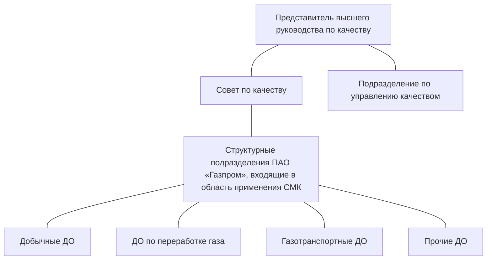

**СМК ПАО «Газпром» сертифицирована на соответствие требованиям стандарта ГОСТ Р ИСО 9001-2015.**

icon: arrow

Подобные с информацией о регулирующих документах в области управления качеством в Группе Газпром можно ознакомиться в <u>**Приложении 6.4**</u>.

### **Контроль качества работ поставщиков**

<u>РСПП 3.4.2</u>

Для обеспечения высокого качества продукции, работ и услуг ПАО «Газпром» рекомендует своим поставщикам внедрять СМК на основе комплекса корпоративных стандартов серии СТО Газпром 9000. Эти стандарты устанавливают повышенные по отношению к международным и национальным аналогам требования, а также вводят дополнительные требования для обеспечения качества продукции, работ, услуг с учетом специфики безопасной эксплуатации объектов ПАО «Газпром».

> **По состоянию на 31 декабря 2023 г. 453 поставщика товаров, работ, услуг и 35 организаций Группы Газпром сертифицировали свои СМК на соответствие требованиям СТО Газпром 9001-2018.**

<!-- pdf_page: 31 -->
## PDF-страница 31

## **Мониторинг удовлетворенности потребителей**

Чтобы обеспечить стабильно высокое качество продукции, Группа Газпром ведет постоянный мониторинг удовлетворенности потребителей, осуществляя расчет и анализ СЦП второго уровня «Индекс удовлетворенности потребителей».

В 2023 г. для расчета индексов удовлетворенности потребителей было опрошено около 68 тыс. потребителей. Результаты расчета индексов удовлетворенности потребителей приведены в таблице, все плановые значения достигнуты.

icon: arrow

**Подробнее с информацией о системе планирования с использованием СЦП можно ознакомиться в подразделе <u>«Миссия и стратегия»</u>.**

<u>Индикаторы Группы Газпром 20, 21, 22</u>

| Наименование                                                                                     | Фактическое значение за 2021 г. | Фактическое значение за 2022 г. | Целевое значение на 2023 г. | Фактическое значение за 2023 г. |
| ------------------------------------------------------------------------------------------------ | ------------------------------- | ------------------------------- | --------------------------- | ------------------------------- |
| Индекс удовлетворенности потребителей (газовый бизнес)                                           | 77,26                           | 86,03                           | 74                          | 85,49                           |
| Индекс удовлетворенности потребителей сегмента реализации газомоторного топлива (газовый бизнес) | 87,92                           | 89,94                           | 82                          | 91,59                           |
| Индекс удовлетворенности потребителей (электроэнергетический бизнес)                             | 85,61                           | 86,95                           | 78                          | 87,73                           |

#### **Меры по управлению риском снижения уровня качества продукции, работ и услуг**

Группа Газпром управляет рисками снижения уровня качества с помощью мер по контролю качества выпускаемой продукции (работ, услуг) на всех этапах жизненного цикла. Чтобы добиться повышения результативности этой работы, в ПАО «Газпром» и организациях Группы Газпром были внедрены СМК. В их рамках разработаны процедуры управления продукцией несоответствующего качества. При выявлении продукции несоответствующего качества организации Группы Газпром незамедлительно уведомляют об этом потребителей. При этом продукция с неидентифицированным или сомнительным статусом классифицируется как несоответствующая. Управление продукцией несоответствующего качества включает в себя идентификацию такой продукции, проведение необходимой коррекции, повторную верификацию продукции, анализ причин несоответствия для принятия корректирующих действий.

----

## **ИННОВАЦИОННОЕ РАЗВИТИЕ**

В Группе Газпром создана и совершенствуется экосистема инновационного развития, ведется системная работа по поддержке инновационной деятельности, которая распространяется на газовый, нефтяной и электроэнергетический виды бизнеса.

**Существенные темы**

icon: gears

8. Инновации в Группе Газпром

----

#### **Принцип 6**
#### <u>**Достижение технологического суверенитета**</u>

##### <u>Нацпроект «Наука и университеты»</u>

### **Программа инновационного развития**

icon: МЭР 4

Программа инновационного развития ПАО «Газпром» до 2025 г. (далее — Программа)1 разработана с целью постоянного повышения уровня технологического и организационного развития ПАО «Газпром» для поддержания его позиций глобальной энергетической компании и надежного поставщика энергоресурсов. Программа формируется на десятилетний период и охватывает газовый, нефтяной и электроэнергетический виды бизнеса.

Одним из принципов, на котором базируется Программа, является распространение и конкретизация инновационных процессов от ПАО «Газпром» к его ДО, в том числе за счет разработки и реализации ДО собственных программ инновационного развития. Для реализации этого принципа утверждены необходимые методические документы. Рядом ДО уже сформированы и реализуются собственные программы инновационного развития, планируется расширение состава ДО, участвующих в разработке таких программ.

В целях реализации определенных Программой технологических и организационных приоритетов выполняются программы (планы) НИОКР ПАО «Газпром», ПАО «Газпром нефть», ООО «Газпром энергохолдинг» и других ДО.

Приоритетные области технологического развития Программы включают технологии поиска и разведки, повышения эффективности разработки месторождений, в том числе новых, на континентальном шельфе и содержащих нетрадиционные ресурсы. Кроме того, Группа Газпром изучает и разрабатывает технологии для повышения эффективности транспортировки и хранения газа, переработки углеводородов, технологии производства СПГ, использования и реализации газа.

#### **Основные направления организационных инноваций Группы Газпром**

* Совершенствование инновационной деятельности, корпоративного управления и долгосрочного прогнозирования, управления затратами и инвестиционной деятельностью, управления рисками;
* технико-экономическое моделирование;
* совершенствование систем ценообразования и тарифной политики;
* рост эффективности использования энергетических, природных, трудовых и финансовых ресурсов;
* снижение себестоимости продукции и услуг;
* повышение производительности труда;
* снижение негативного воздействия на окружающую среду в ходе производственной деятельности;
* повышение надежности и безопасности производственного оборудования;
* повышение уровня организационного развития.

**Индикатор Группы Газпром 17**

## **31,7 млрд руб.**
**объем инвестиций в НИОКР в 2023 г.**

**Индикатор Группы Газпром 18**

## **400 патентов**
**получено Группой в 2023 г.**

----

1 Утверждена решением Совета директоров ПАО «Газпром» от 1 декабря 2020 г. № 3513.

<!-- pdf_page: 32 -->
## PDF-страница 32

## **Система управления инновационной деятельностью**

#### **Структура управления инновационной деятельностью**

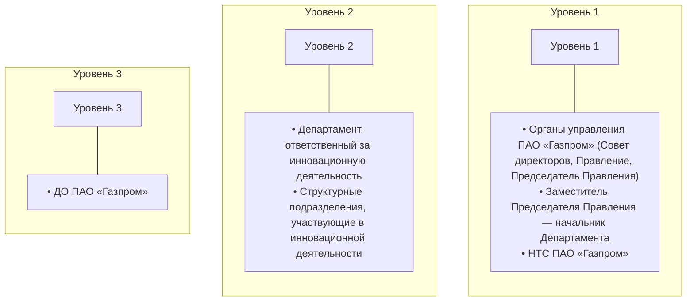

Группа Газпром обладает развитой системой управления инновационной деятельностью. В ПАО «Газпром» на постоянной основе работает Комиссия по НИОКР, которая рассматривает вопросы целесообразности и организации выполнения НИОКР в ПАО «Газпром» и его ДО, руководствуясь принципами открытости, объективности и независимости. По результатам работы Комиссии в 2023 г. принято решение о выполнении 102 новых тематик НИОКР (на 32 % больше по сравнению с 2022 г.).

В 2023 г. на основании решений Комиссии сформировано и утверждено три дополнения к Программе НИОКР ПАО «Газпром» и его дочерних обществ на 2023 г. Эти дополнения направлены на обеспечение непрерывности и ритмичности процесса выполнения НИОКР и сокращения сроков от идеи до получения и внедрения результатов.

### **Результаты инновационной деятельности**

В соответствии с последними достижениями науки и техники выполнены новые технологические проекты и схемы разработки действующих месторождений (например, Астраханского газоcondенсатного месторождения (ГКМ), Ковыктинского ГКМ, сеноманской газовой залежи Тота-Яхинского месторождения).

В отчетном году в целях повышения эффективности разработки действующих месторождений разработаны и внедрены, в частности:
* геомеханико-фильтрационные секторные модели Ковыктинского ГКМ;
* трехмерные (3D) геомеханические секторные модели Ковыктинского ГКМ.

По заказу ПАО «Газпром» выполняется НИОКР в области мембранных технологий. Полученные в 2023 г. результаты позволили принять проектное решение о применении технологии мембранного выделения CO2 в проекте «Сахалин-3». В 2024–2025 гг. предусмотрена разработка решений по использованию на объектах Группы Газпром мембранных технологий для выделения азота из природного газа, водорода — из водородсодержащего газа, а также ксенона и криптона — из углеводородных газов.

В мае 2023 г. в г. Астрахани состоялась научно-практическая конференция «Управление инновациями в ПАО «Газпром»: задачи и перспективы», участие в которой приняли более 170 человек — руководители и специалисты структурных подразделений ПАО «Газпром» и ДО, представители сторонних организаций, в том числе Российской академии наук, национального института развития ВЭБ.РФ, опорных вузов ПАО «Газпром». На пяти тематических круглых столах было представлено более 40 докладов. Представленные материалы

icon: arrow

**Подробнее с информацией о регулирующих документах в области инновационного развития в Группе Газпром можно ознакомиться в <u>Приложении 6.4</u>.**

icon: arrow

**Подробнее с информацией об управлении инновационной деятельностью в ПАО «Газпром» можно ознакомиться на <u>официальном сайте</u> ПАО «Газпром».**

по оценке приоритетов технологического и организационного развития планируется использовать при разработке Программы инновационного развития на следующий десятилетний период в условиях новых вызовов и неопределенностей.

#### **Объем инвестиций в НИОКР в Группе Газпром**, млрд руб.1

| Год  | Объем инвестиций в НИОКР (млрд руб.) |
| ---- | ------------------------------------ |
| 2023 | 31,70                                |
| 2022 | 30,01                                |
| 2021 | 24,60                                |

#### **Количество патентов Группы Газпром**

| Год  | Количество патентов |
| ---- | ------------------- |
| 2023 | 3 397               |
| 2022 | 3 119               |
| 2021 | 2 901               |

### **Сотрудничество с российским бизнесом в области инновационного развития**

Группа Газпром поддерживает стремление малого и среднего бизнеса к разработке инновационных предложений для своих организаций. В ПАО «Газпром» действует интернет-портал системы «одного окна», с помощью которого предприниматели могут отправлять свои предложения для внедрения в производственную деятельность организаций Группы Газпром. Интернет-портал обслуживает весь процесс подачи инновационного предложения для использования в ПАО «Газпром» — от этапа подачи заявки до получения финального заключения. В 2023 г. было зарегистрировано 80 новых обращений и подготовлено 43 экспертных заключения. Комиссия ПАО «Газпром» по внедрению инновационной продукции рассмотрела 10 предложений и включила в Реестр инновационной продукции 9 наименований. В настоящее время в Реестре инновационной продукции содержится 150 позиций, из которых 109 предложено субъектами МСП.

### **Взаимодействие с научным сообществом**

Группа Газпром прилагает максимум усилий для привлечения талантливых ученых к разработке инновационных технологий в газовой отрасли. Одним из способов добиться этого стал ежегодный конкурс на соискание Премии ПАО «Газпром» в области науки и техники. В 2023 г. на конкурс было представлено 17 работ, в создании которых приняли участие 29 организаций Группы Газпром и 5 сторонних организаций. Общий экономический эффект от внедрения результатов 10 лучших работ, ставших призерами конкурса, превысил 50 млрд руб.

Победителем конкурса стала работа «Разработка и внедрение технологии эжектирования газа для снижения объемов его сраивания на компрессорных станциях», представленная ООО «Газпром трансгаз Казань» в сотрудничестве с подразделениями ПАО «Газпром», ООО «Газпром ВНИИГАЗ» и РГУ нефти и газа (НИУ) им. И.М. Губкина. По теме работы получено 18 патентов Российской Федерации.

Ученые разработали технологию, которая позволяет без дополнительных затрат энергии откачивать природный газ из оборудования и трубопроводов компрессорной станции (КС), где планируются технологические работы, и перенаправлять его в трубопроводы КС, не задействованные в таких работах. Это обеспечивает максимально возможное сохранение газа и предотвращение его выбросов в атмосферу.

Разработанная победителями конкурса технология уже внедрена в отраслевой практике и включена в Реестр инновационной продукции для внедрения в ПАО «Газпром». В настоящее время она используется на компрессорной станции ООО «Газпром трансгаз Казань».

<!-- pdf_page: 33 -->
## PDF-страница 33

## **Сотрудничество с вузами и НИИ**

Совместно с научными центрами Группа Газпром реализует множество проектов, направленных на развитие отечественной науки и способствующих повышению эффективности технологических процессов организаций Группы Газпром. Это сотрудничество ведется в рамках реализации Программы инновационного развития.

В своем взаимодействии с вузами Группа Газпром руководствуется принципами преемственности, системности и инновационной направленности, установленными Концепцией взаимодействия с государственными образовательными организациями высшего образования и Положением о взаимодействии ОАО «Газпром» и его дочерних обществ с опорными вузами1.

В качестве основных партнеров определяются следующие категории вузов:
* «Опорный вуз ПАО «Газпром» — для осуществления взаимодействия в области подготовки, повышения квалификации и профессиональной переподготовки специалистов, ведения научно-исследовательской деятельности по ключевым направлениям деятельности Группы Газпром;
* «Специальный партнер ПАО «Газпром» — для осуществления взаимодействия в области подготовки, повышения квалификации и профессиональной переподготовки специалистов по определенному (целевому) перечню направлений (специальностей);
* «Базовый партнер дочернего общества ПАО «Газпром» — для осуществления взаимодействия в области подготовки, повышения квалификации и профессиональной переподготовки специалистов и реализации научно-технических проектов, соответствующих профилю деятельности данного ДО.

#### <u>**Индикатор Группы Газпром 42**</u>

<u>**Вузы —</u> партнеры ПАО «Газпром» на 31 декабря 2023 г.**

| Опорные вузы ПАО «Газпром» | Опорные вузы ПАО «Газпром»                                                                                        |
| -------------------------- | ----------------------------------------------------------------------------------------------------------------- |
| 1.                         | Казанский национальный исследовательский технологический университет                                              |
| 2.                         | Московский государственный технический университет им. Н.Э. Баумана (национальный исследовательский университет)  |
| 3.                         | Московский государственный университет им. М.В. Ломоносова                                                        |
| 4.                         | Национальный исследовательский Томский политехнический университет                                                |
| 5.                         | Национальный исследовательский университет «Высшая школа экономики»                                               |
| 6.                         | Российский государственный университет нефти и газа (национальный исследовательский университет) им. И.М. Губкина |
| 7.                         | Санкт-Петербургский горный университет императрицы Екатерины II                                                   |
| 8.                         | Санкт-Петербургский государственный морской технический университет                                               |
| 9.                         | Санкт-Петербургский государственный политехнический университет Петра Великого                                    |
| 10.                        | Санкт-Петербургский государственный экономический университет                                                     |
| 11.                        | Тюменский индустриальный университет                                                                              |
| 12.                        | Уфимский государственный нефтяной технический университет                                                         |
| 13.                        | Ухтинский государственный технический университет                                                                 |

| Вузы — специальные партнеры ПАО «Газпром» | Вузы — специальные партнеры ПАО «Газпром»                                                            |
| ----------------------------------------- | ---------------------------------------------------------------------------------------------------- |
| 14.                                       | Высшая школа менеджмента Санкт-Петербургского государственного университета                          |
| 15.                                       | Государственный университет морского и речного флота им. адмирала С.О. Макарова                      |
| 16.                                       | Санкт-Петербургский государственный электротехнический университет «ЛЭТИ» им. В.И. Ульянова (Ленина) |
| 17.                                       | Северо-Восточный федеральный университет им. М.К. Аммосова                                           |
| 18.                                       | Университет «Иннополис»                                                                              |

1 Утверждено приказом ОАО «Газпром» от 4 сентября 2014 г. № 422.

<u>Опорные</u> вузы формируют целевые программы научных исследований и разработок в интересах ПАО «Газпром», на основании которых вуз может заключить договоры на выполнение НИОКР по темам, вошедшим в данные программы, на внеконкурсной основе.

В интересах ПАО «Газпром» опорные вузы выполняют научно-исследовательские работы по всем базовым направлениям его технологической цепочки. Многие такие исследования и разработки помогают повысить эффективность технологических процессов. В настоящее время с участием ПАО «Газпром» реализуется проект создания инновационного научно-технического центра морской робототехники на базе Санкт-Петербургского государственного морского технического университета.

icon: information
В 2023 г. в сотрудничестве с вузами и НИИ был проведен ряд научно-технических работ:
* применение суперкомпьютерных технологий для управления запасами ПАО «Газпром», оптимизации стратегий освоения лицензионных участков и прогноза показателей деятельности ПАО «Газпром» (совместный проект с МГУ им. М.В. Ломоносова);
* разработка программно-аппаратного комплекса контроля добычи и технического состояния скважин на основе волоконно-оптических технологий (ООО «Газпром ВНИИГАЗ»);
* создание информационной системы и цифровой модели для выбора конструкций скважин, обеспечивающих их максимальную производительность» (ООО «Газпром ВНИИГАЗ»).

icon: information
В 2023 г. совместно с ФГАОУ «Санкт-Петербургский политехнический университет Петра Великого» инициирован проект создания конструкции и технологии изготовления критических деталей горячего тракта ГТУ Т32 с применением аддитивных технологий.

icon: information
В 2023 г. ПАО «Газпром» принимало участие в мероприятиях Десятилетия науки и технологий в Российской Федерации. На площадке XII Петербургского международного газового форума Компания провела лекторий информационной платформы <u>#ОткрытаяНаука</u>. В мероприятиях лектория приняли участие представители опорных вузов ПАО «Газпром», нефтегазовых компаний, инновационных центров и проектных институтов страны.

icon: arrow
Подробнее с информацией о взаимодействии Группы Газпром с образовательными и научными организациями можно ознакомиться в <u>Приложении 6.2</u>.

<!-- pdf_page: 34 -->
## PDF-страница 34

## ЦИФРОВАЯ ТРАНСФОРМАЦИЯ

Главная цель цифровой трансформации Группы Газпром — качественное повышение эффективности производственных и управленческих процессов за счет широкого применения цифровых технологий, а также формирование среды для создания новых направлений деятельности.

#### **Принцип 6**
#### <u>**Достижение технологического суверенитета**</u>

##### <u>Нацпроект «Цифровая экономика»</u>

### **Стратегия цифровой трансформации**

Внедрение цифровых технологий — важный инструмент повышения эффективности корпоративного управления и достижения стратегических целей Группы Газпром. Решение комплекса задач, стоящих перед Группой Газпром, является драйвером для развития различных секторов экономики, в том числе радиоэлектронной промышленности и ИТ-сектора в целом.

Работа по цифровизации ведется в соответствии со Стратегией цифровой трансформации ПАО «Газпром» (Группы Газпром)1. Данная Стратегия обеспечивает внедрение в деятельность ПАО «Газпром» новых цифровых технологий, позволяющих повысить эффективность существующих процессов и сформировать условия для развития новых сегментов бизнеса. Также этот документ закладывает необходимые механизмы для поддержания целостности управления цифровой трансформацией и упрощения процедуры поддержки цифровых проектов2.

icon: arrow
**Подробнее с информацией о регулирующих документах в области цифровой трансформации Группы Газпром можно ознакомиться в <u>Приложении 6.4</u>.**

### **Использование технологий искусственного интеллекта**

Интеллектуальные системы Группы Газпром используют широкий спектр технологий искусственного интеллекта (ИИ), таких как интеллектуальная поддержка принятия решений, компьютерное зрение, обработка естественного языка, распознавание и синтез речи. Сегодня ряд задач выполняется с помощью цифровых решений, сочетающих в себе преимущества классических аналитических моделей и методов ИИ. Цифровые двойники зачастую содержат в своей основе гибридную модель, одна часть которой описывается физическими уравнениями из соответствующей предметной области, а другая часть реализуется с использованием алгоритмов ИИ. Цифровой двойник решает задачи моделирования и оптимизации работы производственного актива (или процесса) в разных условиях и при различных технологических режимах и может использоваться на протяжении всего жизненного цикла актива.

Группа Газпром обладает широким потенциалом для апробирования и внедрения технологий ИИ для того, чтобы стать лидером среди глобальных энергетических компаний в дальнейшем развитии и эффективном использовании интеллектуальных технологий.

----

1 Утверждена решением Совета директоров ПАО «Газпром» от 3 апреля 2024 г. № 4065.
2 С 2022 г. мероприятия цифровой трансформации субхолдингов ООО «Газпром межрегионгаз», ООО «Газпром энергохолдинг» включены в Стратегию цифровой трансформации ПАО «Газпром» (Группы Газпром). ПАО «Газпром нефть» разрабатывает собственную Стратегию цифровой трансформации.

----

### **Цифровизация налоговой функции**

Для взаимодействия с налоговыми органами — участниками налогового мониторинга Группы Газпром используется единое решение, а именно Витрина данных, разработанная на отечественной ИТ-платформе.

icon: information
Группа Газпром участвует в пилотном проекте Федеральной налоговой службы по интеграции ИТ-систем участников налогового мониторинга с информационной системой налоговой службы АИС «Налог-3». В 2023 г. проводилась работа по тестированию новых версий сценариев информационного взаимодействия с налоговыми органами, которая продолжится в 2024 г.

#### **Меры по управлению рисками в области ИТ и ИБ**

Группа Газпром управляет рисками ИТ и ИБ с помощью следующих мер:

* переход на преимущественное использование отечественного программного обеспечения, замещение импортного компьютерного оборудования отечественными аналогами;
* соблюдение требований к обеспечению ИБ федерального законодательства Российской Федерации, в том числе постановлений Правительства Российской Федерации и приказов федеральных органов исполнительной власти, уполномоченных в области безопасности и технической защиты конфиденциальной информации, а также локальных нормативных актов ПАО «Газпром» в этой сфере.

<!-- pdf_page: 35 -->
## PDF-страница 35

## **СОТРУДНИЧЕСТВО С ПОСТАВЩИКАМИ**

#### **Принцип 2**
### <u>**Опора на предпринимательские свободы**</u>

#### <u>**Нацпроект «Малое и среднее предпринимательство»**</u>

Система закупок Группы Газпром базируется на следующих принципах:
* создание условий для своевременного и полного обеспечения потребностей Группы Газпром в товарах, работах, услугах и выявление поставщика (подрядчика, исполнителя), способного своевременно и качественно удовлетворить потребности заказчика с требуемыми показателями цены, качества и надежности;
* обеспечение безопасности функционирования опасных производственных объектов ЕСГ;
* информационная открытость закупок;
* равноправие, справедливость, отсутствие дискриминации и необоснованных ограничений конкуренции по отношению к участникам закупки;
* целевое и экономически эффективное расходование денежных средств;
* создание условий для конкуренции.

> **Ключевая цель закупочной деятельности — своевременное и полное удовлетворение потребностей организаций Группы Газпром в товарах, работах, услугах с необходимыми показателями их цены, качества и надежности.**

### **Управление закупками**

В целях реализации единой политики в области закупочной деятельности Группы Газпром в соответствии с принципами, установленными Положением о закупках товаров, работ, услуг ПАО «Газпром» и компаний Группы Газпром1 (далее — Положение о закупках), в ПАО «Газпром» создан Центральный орган управления закупками Группы Газпром.

#### **Функции Центрального органа управления закупками Группы Газпром**
* Планирование и проведение закупок Группы Газпром;
* методологическое сопровождение и контроль закупочной деятельности компаний Группы Газпром;
* формирование Реестра потенциальных участников закупок Группы Газпром по итогам предквалификации.

Для закупок Группа Газпром использует Автоматизированную систему электронных закупок ПАО «Газпром» (АСЭЗ), охватывающую весь цикл закупки от планирования потребности до заключения и исполнения договора.

Закупки в электронной форме проводятся на Электронной торговой площадке ГПБ2, интегрированной с Единой информационной системой в сфере закупок товаров, работ, услуг для обеспечения государственных и муниципальных нужд (ЕИС, <u>www.zakupki.gov.ru</u>) и АСЭЗ.

Отбор поставщиков в Группе Газпром осуществляется с применением процедур, предусмотренных Положением о закупках. Также Положением о закупках установлены единые правила и порядок закупок товаров, работ, услуг, способы закупок и условия их применения.

----

#### **Существенные темы**

icon: bar chart
2. Экономическая результативность Группы Газпром

icon: building
7. Соответствие деятельности Группы Газпром нормам законодательства (социально-экономическим, экологическим, антимонопольным)

icon: shopping cart
10. Система закупок в Группе Газпром и их локализация

**14,9 тыс. договоров**
**на сумму**
## **763,7 млрд руб.**
**заключено в 2023 г. по итогам конкурентных закупок и маркетинговых исследований**

**Более 99,2 %**
**электронных закупок в общем объеме конкурентных закупок и маркетинговых исследований Группы Газпром**

----

При проведении закупок3 в документацию о конкурентной закупке может быть включено требование о наличии предлагаемой участниками закупки продукции в Едином Реестре материально-технических ресурсов (МТР), допущенных к применению на объектах и отвечающих требованиям ПАО «Газпром»4, а также включение соответствующего условия в проект договора. Единый Реестр МТР насчитывает более 2,2 тыс. реестровых записей в отношении продукции 540 промышленных предприятий. За 2023 г. в него было внесено более 270 новых записей, в том числе в отношении продукции 29 производителей, ранее не представленных в Едином Реестре МТР.

В ПАО «Газпром» проводится предквалификация поставщиков (подрядчиков, исполнителей), задача которой — формировать Реестр потенциальных участников закупок Группы Газпром, товары, работы, услуги которых соответствуют установленным требованиям к производственным процессам, качеству и безопасности. Организации, подавшие заявки на участие в предквалификации, оцениваются на предмет их правоспособности, платежеспособности, деловой репутации, наличия квалифицированного персонала и МТР, соблюдения норм и требований законодательства, в том числе в области охраны труда, экологической, промышленной и пожарной безопасности. По состоянию на 1 января 2024 г. в Реестр потенциальных участников закупок Группы Газпром включены 1 132 участника процедуры предквалификации, в том числе 832 компании, которые являются субъектами МСП.

**832 компании**
**являются субъектами МСП**

**1 132 участника**
**процедуры предквалификации включены в Реестр потенциальных участников закупок**

### **Цепочка поставок**

#### **Закупка МТР**
* Газ, энергия, жидкие углеводороды
* Газопромысловое и буровое оборудование
* Общезаводское и газоиспользующее оборудование
* Химические материалы
* Специальная техника на шасси и гусеничном ходу, автотехника
* Соединительные детали трубопроводов, трубопроводная арматура и металлопрокат
* Телекоммуникационное и серверное оборудование
* Газоперекачивающие агрегаты и комплектующие
* Нестандартизированное и специальное оборудование
* Нефтехимаппаратура

#### **Закупка работ и услуг**
* Услуги по транспортировке и хранению газа и жидких углеводородов
* Строительно-монтажные работы
* Аренда и приобретение недвижимости
* Транспортно-логистические услуги
* Строительство скважин (эксплуатационное бурение и сопутствующие работы)
* Финансовая аренда (лизинг)
* Капитальный ремонт
* Проектно-изыскательные работы
* Диагностика
* Техническое обслуживание и текущий ремонт
* Создание и обслуживание информационно-управляющих систем

**Индикатор Группы Газпром 14**
## **41,5 млрд руб.**
**эффективность конкурентных закупок и маркетинговых исследований5**

В 2023 г. организации Группы Газпром заключили договоры на поставку товаров, выполнение работ, оказание услуг с более чем 32,8 тыс. контрагентов, из которых 32,5 тыс. (99 %) не являются взаимозависимыми с заказчиками лицами6.

#### **Закупки организаций Группы Газпром**

| Показатель                                                                                  | 2021  | 2022  | 2023  | Изменение 2023/2022, % |
| ------------------------------------------------------------------------------------------- | ----- | ----- | ----- | ---------------------- |
| Общий объем конкурентных закупок и маркетинговых исследований, млрд руб.                    | 454,3 | 919,1 | 763,7 | -16,9                  |
| Всего заключено договоров по итогам конкурентных закупок и маркетинговых исследований, тыс. | 11,7  | 15,4  | 14,9  | -3,2                   |

----

1 Утверждено решением Совета директоров ПАО «Газпром» от 19 октября 2018 г. № 3168 (с последующими изменениями).
2 ООО «Электронная торговая площадка ГПБ» (ЭТП ГПБ) (секция «Закупки Компаний Группы Газпром»: <u>https://etpgpb.ru/pao_gazprom/</u>).
3 В соответствии с Положением о закупках: <u>https://zakupki.gazprom.ru/reestr_mtr/index.html</u>
4 Единый Реестр МТР ПАО «Газпром»: <u>https://www.gazprom.ru/tenders/requirements-for-goods/</u>
5 Разница между суммой начальных (максимальных) цен и суммой цен договоров, заключенных по итогам закупок.
6 В соответствии с п. 1.2.5 Положения о закупках.

<!-- pdf_page: 36 -->
## PDF-страница 36

6. Приложение
5. Окружающая среда и экологическая политика
4. Развитие регионов
3. Безопасность производства
2. Люди Группы Газпром
1. О Группе Газпром

----

icon: information

## **Цифровая трансформация закупочной деятельности**

В 2023 г. Группа Газпром продолжила работу по развитию импортонезависимой автоматизированной системы электронных закупок ПАО «Газпром» АСЭЗ 2.0. В опытную эксплуатацию запущено четыре модуля АСЭЗ, что увеличило быстродействие рабочих процессов. Кроме того, был создан портал контрагентов Группы Газпром, который позволяет любому участнику рынка заявить о себе и зарегистрироваться в АСЭЗ, а также помогает проходить процедуры предквалификации и сертификации. В дополнение к этому был запущен в эксплуатацию обновленный раздел «Закупки Группы Газпром» сайта ПАО «Газпром», созданный для решения задач по повышению информационной открытости и развитию добросовестной конкуренции при проведении закупок.

## **Исключение конфликта интересов в ходе закупочной деятельности**

Соблюдение требований законодательства Российской Федерации в сфере закупок обеспечивается принятыми локальными нормативными документами ПАО «Газпром», предусматривающими, в частности, механизмы предупреждения и недопущения совершения нарушений при осуществлении закупок.

В ПАО «Газпром» соблюдаются основные принципы противодействия коррупции, мошенничеству и исключению конфликта интересов при проведении закупок, осуществляются мероприятия по предупреждению нарушений.

Во исполнение требований статьи 13.3 Федерального закона от 25 декабря 2008 г. № 273-ФЗ «О противодействии коррупции» в ПАО «Газпром» принята Антикоррупционная политика, а также действует Кодекс корпоративной этики ПАО «Газпром».

В организациях Группы Газпром реализуется обучение по программе повышения квалификации «Аудит и контроль в сфере закупок как механизм противодействия коррупции», целью которого, помимо прочего, является приобретение знаний в области правовых основ антикоррупционного законодательства.

Порядок обжалования действий (бездействий) заказчика, комиссии по осуществлению закупок, оператора электронной площадки при закупке товаров, работ, услуг, если такие действия (бездействия) нарушают права и законные интересы участника закупки, предусмотрен статьей 18.1 Федерального закона от 26 июля 2006 г. № 135-ФЗ «О защите конкуренции», а также ч. 10–13 Федерального закона от 18 июля 2011 г. № 223-ФЗ «О закупках товаров, работ, услуг отдельными видами юридических лиц».

icon: arrow

**Подробнее**
**с информацией**
**о взаимодействии**
**Группы Газпром**
**с контрагентами**
**в области обеспечения**
**производственной**
**безопасности можно**
**ознакомиться в разделе**
<u>**3. «Безопасность производства».**</u>

icon: arrow

**Подробнее**
**с информацией**
**о взаимодействии**
**Группы Газпром**
**с контрагентами**
**в области охраны**
**окружающей среды**
**можно ознакомиться**
**в разделе**
<u>**5. «Окружающая среда и экологическая политика».**</u>

### **Экономия ПАО «Газпром» и его ДО по итогам проведения конкурентных закупок и маркетинговых исследований**, млрд руб.1

| Год  | Экономия (млрд руб.) |
| ---- | -------------------- |
| 2023 | 41,5                 |
| 2022 | 35,6                 |
| 2021 | 29,9                 |

icon: arrow

**Подробнее с информацией о регулирующих документах в области закупочной деятельности Группы Газпром можно ознакомиться в <u>Приложении 6.4.</u>**

icon: arrow

**Подробнее с информацией о взаимодействии Группы Газпром с поставщиками можно ознакомиться в <u>Приложении 6.2.</u>**

----

## **Поддержка малого и среднего бизнеса**

Во исполнение решений Правительства Российской Федерации ПАО «Газпром» реализует комплекс мероприятий по расширению доступа субъектов МСП к закупкам, осуществляемым ПАО «Газпром» и его ДО.

Для привлечения субъектов МСП к сотрудничеству максимально упрощены процедуры закупок, в которых они могут участвовать:

- закупки проводятся в электронной форме;
- требуется минимальный перечень документов;
- финансовое обеспечение заявки не требуется.

icon: MЭP 9 icon: Индикаторы Группы Газпром 9, 15

Общий объем договоров организаций Группы Газпром, заключенных в 2023 г. с компаниями, включенными в Единый реестр субъектов МСП2, превысил 391,8 млрд руб. (более 53 тыс. договоров), в том числе по итогам конкурентных закупок и маркетинговых исследований — 320,6 млрд руб. (9,2 тыс. договоров).

Субъекты МСП составили более половины (61 %, или 20 тысяч) от общего количества контрагентов организаций Группы Газпром (32,8 тысячи) по договорам на поставку товаров, выполнение работ, оказание услуг, заключенным в 2023 г.

### **61 % субъектов МСП**
**от общего числа поставщиков**

### **391,8 млрд руб.**
**объем договоров с субъектами МСП**

icon: award

ПАО «Газпром» вошло в топ-5 крупнейших компаний-заказчиков с государственным участием по уровню лояльности к малому и среднему бизнесу. Рейтинг составило АО «Корпорация «МСП», которое, обобщив и систематизировав данные по итогам закупочной деятельности 2022 г., представило его в отчетном году в рамках Петербургского международного экономического форума.

> **В 2023 г. платформа <u>«Газпром</u> <u>маркет», используемая</u> <u>ПАО «Газпром» для преискурантных</u> закупок, стала победителем премии CIPR Digital в номинации «Лучший российский маркетплейс».**

### **Закупки Группы Газпром у субъектов МСП**

| Показатель                                              | 2021  | 2022  | 2023  | Изменение 2023/2022 |
| ------------------------------------------------------- | ----- | ----- | ----- | ------------------- |
| Доля субъектов МСП от общего количества контрагентов, % | 62,1  | 60,3  | 61,0  | +0,7 п. п.          |
| Объем договоров с субъектами МСП, млрд руб.             | 248,5 | 468,2 | 391,8 | -16,3 %             |

В 2024 г. ПАО «Газпром» продолжит работу по совершенствованию управления закупочной деятельностью, автоматизации и цифровизации закупочных процессов, обеспечению соблюдения доли закупок отдельных видов продукции российского производства, а также доли закупок у субъектов МСП.

### **Меры по управлению рисками в области закупочной деятельности**

Группа Газпром управляет рисками в области закупочной деятельности с помощью механизмов предупреждения и недопущения совершения нарушений при осуществлении закупок, в том числе zaloженных в локальных нормативных актах. В Группе Газпром применяются закупочные процедуры, обеспечивающие выбор контрагентов на условиях состязательности, проводится изучение рынка, экспертиза начальных (максимальных) цен товаров, работ, услуг (цен договоров).

----

1 Экономия определена как разница между суммами начальных (максимальных) цен и цен заключенных по итогам закупок договоров с учетом условных затрат на организацию и проведение закупок.

2 <u>https://ofd.nalog.ru</u>

<!-- pdf_page: 37 -->
## PDF-страница 37

## **2. ЛЮДИ ГРУППЫ ГАЗПРОМ**

**1.0. Группа Газпром**
**2. Люди Группы Газпром**
**3. Безопасность производства**
**4. Развитие регионов**
**5. Окружающая среда и экологическая политика**
**6. Приложения**

----

#### **Принцип 4**
#### **<u>Социальная справедливость</u>**

## **УПРАВЛЕНИЕ ПЕРСОНАЛОМ**

В Группе Газпром на первое место ставятся вопросы благополучия персонала, его мотивации, развития и удовлетворенности условиями труда. В Газпроме работают представители тысяч трудовых династий. В Группе Газпром общее количество должностей служащих и профессий рабочих составляет более 1 500. Общий результат ее деятельности — это сумма усилий всех без исключения работников большого коллектива Группы Газпром, каждый из которых трудится на совесть, с полной самоотдачей, понимая, что работает для процветания России, на благо настоящих и будущих поколений.

### **Система управления персоналом**

Главная задача Группы Газпром в области управления персоналом — сформировать конкурентоспособный, высоко-профессиональный, ответственный и сплоченный коллектив, нацеленный на эффективное решение актуальных задач, стоящих перед Группой Газпром в современных экономических и социально-политических условиях.

Для эффективного управления персоналом на основе принципов социального партнерства разработана Политика управления человеческими ресурсами ПАО «Газпром», его дочерних обществ и организаций1. Ее главная цель — обеспечение максимальной отдачи от инвестиций в персонал.

Это достигается за счет сохранения стабильного статуса «предпочтительного работодателя», комплексной мотивации каждого работника на достижение целей Группы Газпром, а также создания и развития объективной и эффективной системы оценки личного вклада каждого работника.

----

#### **Существенные темы**

icon: hand holding heart

5. Социальное обеспечение и нематериальная мотивация персонала в Группе Газпром

icon: people with plus sign

6. Присутствие Группы Газпром на рынке труда и влияние на занятость населения

icon: handshake

12. Равные возможности для всех работников Группы Газпром

----

1 Утверждена постановлением Правления ОАО «Газпром» от 7 ноября 2006 г. № 49.

----

Группа Газпром постоянно совершенствует свой подход и систему управления персоналом и каждые пять лет пересматривает ключевой документ, которым руководствуется в этой сфере, — Комплексную программу повышения эффективности управления человеческими ресурсами ПАО «Газпром», его дочерних обществ и организаций (далее — Программа)2.

### **Направления Программы**

* Планирование трудовых ресурсов;
* подбор и оценка персонала;
* обучение и развитие персонала;
* мотивация персонала;
* социальная политика;
* управление затратами, отчетность и оценка деятельности;
* информационное обеспечение и корпоративные коммуникации.

Каждое из этих направлений включает контрольные показатели, которые анализируются ежегодно при подведении итогов работы организаций Группы Газпром.

#### **Меры по управлению рисками в области кадровой политики**

Группа Газпром стремится снизить риски в области управления персоналом с помощью мер по обеспечению укомплектованности организаций Группы Газпром персоналом требуемой квалификации, развития профессиональных навыков работников посредством внедрения комплексных программ обучения и повышения квалификации, повышения заинтересованности работников в развитии и обучении. В результате выполнения Комплексной программы повышения эффективности управления человеческими ресурсами ПАО «Газпром», его дочерних обществ и организаций на период 2021–2025 гг. и применения мер по снижению вероятности реализации рисков владельцем бизнес-процесса обеспечено удержание уровня рисков в приемлемом диапазоне.

### **Обеспечение равных прав работников**

В Группе Газпром не допускается дискриминация в области трудовых прав и свобод по признаку пола, национальному, религиозному и другим признакам, не связанным с деловыми качествами работников.

Все кадровые решения, принимаемые в организациях Группы Газпром, принимаются исключительно по результатам оценки профессионально значимых качеств соискателей и работников.

Группа Газпром соблюдает требования национального законодательства и нормы Международной организации труда в вопросах продолжительности рабочего дня и условий труда, охраны труда, вознаграждения за труд, социального обеспечения, предоставления оплачиваемого отпуска.

Социальные льготы предоставляются всем работникам организаций Группы Газпром и отдельным категориям в соответствии с законодательством Российской Федерации.

Работники организаций Группы Газпром в случае подозрения в дискриминационном отношении для защиты своих интересов могут обратиться в Комиссию по корпоративной этике ПАО «Газпром».

Равные права и возможности для всех работников организаций Группы Газпром закреплены в положениях Генерального коллективного договора ПАО «Газпром» и его дочерних обществ3 (ГКД).

----

icon: arrow

Подробнее с информацией о взаимодействии Группы Газпром с работниками можно ознакомиться в <u>**Приложении 6.2.**</u>

icon: arrow

Подробнее с информацией о регулирующих документах в области управления персоналом в Группе Газпром можно ознакомиться в <u>**Приложении 6.4.**</u>

icon: arrow

Подробнее с информацией о работе Комиссии по корпоративной этике ПАО «Газпром» можно ознакомиться в подразделе <u>**«Комиссия по корпоративной этике ПАО «Газпром».**</u>

----

2 В 2023 г. действовала Комплексная программа повышения эффективности управления человеческими ресурсами ПАО «Газпром», его дочерних обществ и организаций на период 2021–2025 гг., утвержденная распоряжением ПАО «Газпром» от 26 апреля 2021 г. № 201.
3 Утвержден конференцией работников ОАО «Газпром» и его дочерних обществ 23 ноября 2012 г.

<!-- pdf_page: 38 -->
## PDF-страница 38

РСПП 3.1.4

### **Генеральный коллективный договор ПАО «Газпром» и его дочерних обществ**

* Служит основой механизма социального партнерства;
* обеспечивает баланс интересов работников и работодателей путем выполнения взаимных обязательств сторон;
* устанавливает единые социальные обязательства для ДО, осуществляющих производственную деятельность в сфере добычи, транспортировки, переработки, хранения и реализации газа.

Вопросы заключения или изменения положений ГКД, а также контроля за его выполнением находятся в ведении Комиссии по регулированию социально-трудовых отношений в ПАО «Газпром» и его дочерних обществах, образованной на равноправной основе из числа наделенных необходимыми полномочиями представителей сторон ГКД.

В феврале 2024 г. ГКД был продлен досрочно на период с 1 января 2025 г. по 31 декабря 2027 г.

Охватывает

## **100 %**
**работников**
ПАО «Газпром» и его ДО, являющихся участниками ГКД

## **235,7**
**тыс. человек —**
**суммарная списочная численность по состоянию на 31 декабря 2023 г.**

----

МЭР 44 РСПП 3.1.12

#### **Состав Правления ПАО «Газпром»**, %

| Показатель        | 2021 | 2022 | 2023 |
| ----------------- | ---- | ---- | ---- |
| Пол               |      |      |      |
| • мужчины         | 85,7 | 85,7 | 92,3 |
| • женщины         | 14,3 | 14,3 | 7,7  |
| Возраст           |      |      |      |
| • до 30 лет       | –    | –    | –    |
| • от 30 до 50 лет | 14,3 | 14,3 | 15,4 |
| • старше 50 лет   | 85,7 | 85,7 | 84,6 |

В 2023 г. доля мужчин в Правлении ПАО «Газпром» увеличилась в связи с выходом из его состава Е.В. Бурмистровой.

БР Исключение дискриминации в сфере труда, п. 1, 2, с. 42 РСПП 3.2.2, 3.1.12

Организации Группы Газпром неукоснительно исполняют требования законодательства Российской Федерации по квотированию рабочих мест для трудоустройства инвалидов. Для этого организации Группы Газпром оформляют с такими работниками трудовые отношения на любые рабочие места или заключают соглашения о трудоустройстве инвалидов с иными организациями или индивидуальными предпринимателями. Работники с ограниченными возможностями, а также работники, имеющие на иждивении детей с ограниченными возможностями, пользуются дополнительными льготами и гарантиями.

**ПАО «Газпром» обеспечивает равный для мужчин и женщин размер вознаграждения на должностях с одинаковыми требованиями и компетенциями. Различия в соотношении постоянной и переменной части заработной платы мужчин и женщин отсутствуют.**

----

## **Структура персонала**

МЭР 44 РСПП 3.1.12 <u>Индикатор Группы Газпром 32</u>

#### **Списочная численность организаций Группы Газпром на конец отчетного периода**

| Показатель                                                    | 2021                                                        | 2022  | 2023  | Изменение 2023/2022, %     |
| ------------------------------------------------------------- | ----------------------------------------------------------- | ----- | ----- | -------------------------- |
| Списочная численность на 31 декабря отчетного года, тыс. чел. | 479,2                                                       | 492,2 | 498,1 | +1,2                       |
| в т. ч.:                                                      | Доля работников организаций Группы Газпром по категориям, % |       |       | Изменение 2023/2022, п. п. |
| Руководители                                                  | 14,3                                                        | 14,5  | 14,8  | +0,3                       |
| в т. ч.:                                                      |                                                             |       |       |                            |
| • мужчины                                                     | 75,9                                                        | 75,7  | 75,9  | +0,2                       |
| • женщины                                                     | 24,1                                                        | 24,3  | 24,1  | -0,2                       |
| в т. ч.:                                                      |                                                             |       |       |                            |
| • до 30 лет                                                   | 3,6                                                         | 3,6   | 4,1   | +0,5                       |
| • от 30 до 50 лет                                             | 69,8                                                        | 69,3  | 68,2  | -1,1                       |
| • свыше 50 лет                                                | 26,6                                                        | 27,1  | 27,7  | +0,6                       |
| Специалисты и служащие                                        | 34,2                                                        | 34,4  | 34,7  | +0,3                       |
| в т. ч.:                                                      |                                                             |       |       |                            |
| • мужчины                                                     | 58,8                                                        | 58,8  | 59,3  | +0,5                       |
| • женщины                                                     | 41,2                                                        | 41,2  | 40,7  | -0,5                       |
| в т. ч.:                                                      |                                                             |       |       |                            |
| • до 30 лет                                                   | 11,9                                                        | 11,9  | 11,8  | -0,1                       |
| • от 30 до 50 лет                                             | 68,0                                                        | 67,4  | 66,2  | -1,2                       |
| • свыше 50 лет                                                | 20,1                                                        | 20,7  | 22,0  | +1,3                       |
| Рабочие                                                       | 51,5                                                        | 51,1  | 50,5  | -0,6                       |
| в т. ч.:                                                      |                                                             |       |       |                            |
| • мужчины                                                     | 78,6                                                        | 78,8  | 78,9  | +0,1                       |
| • женщины                                                     | 21,4                                                        | 21,2  | 21,1  | -0,1                       |
| в т. ч.:                                                      |                                                             |       |       |                            |
| • до 30 лет                                                   | 13,9                                                        | 13,8  | 13,4  | -0,4                       |
| • от 30 до 50 лет                                             | 57,1                                                        | 56,7  | 55,7  | -1,0                       |
| • свыше 50 лет                                                | 29,0                                                        | 29,5  | 30,9  | +1,4                       |

Увеличение численности персонала организаций Группы Газпром в 2023 г. связано с реализацией стратегических проектов в переработке газа, реорганизацией структуры газораспределительных компаний в Группе Газпром межрегионгаз, а также вводом в эксплуатацию крупных проектов по добыче жидких углеводородов.

icon: hand holding pen

## **0,7 %**
**от общего числа занятых в Российской Федерации составляет численность персонала организаций Группы Газпром.**

Увеличение доли работников в возрасте свыше 50 лет во всех категориях персонала обусловлено естественным взрослением, а также проводимой в России пенсионной реформой 2019–2028 гг.

<!-- pdf_page: 39 -->
## PDF-страница 39

### **Вахтовый персонал**

Организации Группы Газпром работают в отдаленных районах Сибири, Крайнего Севера и континентального шельфа России. В 2023 г. на месторождениях, расположенных вдалеке от населенных пунктов, часто в сложных погодных условиях, на вахте работали 59,2 тыс. человек.

Группа Газпром ценит труд вахтовых работников и стремится сделать всё, чтобы им комфортно работалось в суровой природной обстановке. Вахтовики доставляются корпоративным транспортом на вахту от пункта сбора до производственного объекта и обратно, живут в вахтовых поселках, инфраструктура которых постоянно улучшается, получают качественное медицинское обслуживание и необходимые социальные услуги. Организации Группы Газпром строго контролируют соблюдение режима труда и отдыха вахтового персонала.

#### **Структура персонала, работающего вахтовым методом**1

| Показатель                                                                                                                                      | 31.12.2021 г. | 31.12.2022 г. | 31.12.2023 г. | Изменение 2023/2022 |
| ----------------------------------------------------------------------------------------------------------------------------------------------- | ------------- | ------------- | ------------- | ------------------- |
| Списочная численность работников организаций Группы Газпром, применяющих вахтовый метод организации работ, тыс. чел.                            | 225,2         | 233,9         | 241,3         | +3,2 %              |
| Численность вахтового персонала, тыс. чел.                                                                                                      | 53,9          | 56,7          | 59,2          | +4,4 %              |
| • в т. ч. работающих в районах Крайнего Севера и в приравненных к ним местностях                                                                | 50,2          | 52,9          | 56,0          | +5,9 %              |
| Удельный вес вахтового персонала в списочной численности работников организаций Группы Газпром, применяющих вахтовый метод организации работ, % | 23,9          | 24,2          | 24,5          | +0,3 п. п.          |

Рост среднесписочной численности вахтового персонала в 2023 г. на 2,5 тыс. человек (+4,4 %) обусловлен вводом в эксплуатацию новых объектов с вахтовой формой обслуживания в отдаленных районах, в том числе в районах Крайнего Севера.

### **Система мотивации и оплаты труда**

#### **Материальная мотивация**

Группа Газпром обеспечивает своим работникам достойную оплату труда, руководствуясь российским законодательством и Политикой управления оплатой труда работников организаций ПАО «Газпром»2 (далее — Политика). В Политике определены единые подходы к оплате труда в Группе Газпром.

В соответствии с Политикой заработная плата состоит из постоянной (оклады / тарифные ставки) и переменной (доплаты, надбавки, премирование) частей. Доля постоянной части зависит от системы оплаты труда и составляет до 70 %.

> **Ключевой принцип Группы Газпром в области **материальной мотивации персонала —** **взаимосвязь уровня заработной платы работников** **с их квалификацией, деловыми качествами,** **сложностью выполняемой работы, условиями труда** и результатами выполнения поставленных задач.**

Действующие в организациях Группы Газпром системы оплаты труда предусматривают:
- установление окладов и тарифных ставок с учетом квалификации и деловых качеств;
- ежемесячное премирование работников за результаты их производственной деятельности;
- доплаты и надбавки в зависимости от условий труда и объема выполняемых работ;

----

1 Представлены данные по среднесписочной численности работников организаций Группы Газпром.
2 Утверждена приказом ОАО «Газпром» от 20 марта 2015 г. № 133 (с последующими изменениями).

----

- единовременное премирование за ввод в эксплуатацию производственных мощностей, внедрение новой техники, экономию энергоресурсов;
- вознаграждение по итогам работы за год.

Оплата труда при выполнении работ в условиях, отклоняющихся от нормальных, в том числе сверхурочной работы, производится в соответствии с трудовым законодательством и иными документами, содержащими нормы трудового права. С целью поддержания реального уровня оплаты труда в соответствии со статьей 134 Трудового кодекса Российской Федерации ежегодно проводится индексация заработной платы работников ПАО «Газпром» и его ДОИО. С 1 января 2023 г. оклады и тарифные ставки работников бюджетных организаций ПАО «Газпром», расположенных на территории Российской Федерации, повышены на 2,0 %.

#### **Размер среднемесячной заработной платы в дочерних обществах, осуществляющих основные виды деятельности ПАО «Газпром»**, тыс. руб.

| Показатель                             | 2021  | 2022  | 2023  | Изменение 2023/2022, % |
| -------------------------------------- | ----- | ----- | ----- | ---------------------- |
| Размер среднемесячной заработной платы | 107,2 | 127,3 | 136,8 | +7,5                   |

### **Нематериальная мотивация**

Группа Газпром ценит вклад своих работников в развитие бизнеса и отрасли и поощряет их государственными, ведомственными и корпоративными наградами.

За личный вклад в развитие топливно-энергетического комплекса, достижение высоких результатов в производственной деятельности и многолетний добросовестный труд в 2023 г. было награждено 4 966 работников и 11 коллективов Группы Газпром, из них:
- государственными наградами Российской Федерации — 40 человек;
- поощрениями Президента Российской Федерации — 5 человек и 1 коллектив;
- ведомственными наградами Министерства энергетики Российской Федерации — 1 427 человек, других министерств и ведомств — 207 человек;
- корпоративными наградами ПАО «Газпром» — 3 287 человек и 10 коллективов.

Одним из дополнительных инструментов развития и мотивации персонала, популяризации профессиональных достижений и распространения лучшего опыта в Группе Газпром выступают конкурсы профессионального мастерства.

По четным годам проводятся конкурсы по нескольким профессиям основных направлений деятельности ДО ПАО «Газпром» в рамках Фестиваля труда (профессионального мастерства). В отчетном году велась подготовка к проведению этого мероприятия в 2024 г.

В 2023 г. размер среднемесячной заработной платы по ДО, осуществляющим основные виды деятельности ПАО «Газпром» (добыча, переработка, транспорт и подземное хранение газа), составил 136,8 тыс. руб. Это на 7,5 % выше аналогичного показателя 2022 г.

В 2023 г. состоялся Смотр-конкурс на лучшие технические средства обучения и учебно-методические материалы для Системы непрерывного фирменного профессионального образования персонала ПАО «Газпром» (СНФПО) 2022–2023 гг. (далее — Смотр). На этот Смотр 23 дочерних общества и 4 образовательных организации ПАО «Газпром» представили 55 учебно-методических разработок.

В октябре 2023 г. в г. Санкт-Петербурге на площадке конгрессно-выставочного центра «Экспофорум» состоялся III Международный строительный чемпионат, учрежденный Министерством строительства и жилищно-коммунального хозяйства Российской Федерации и Государственной корпорацией по атомной энергии «Росатом». Сборная команда ПАО «Газпром» стала лидером по количеству наград в основной лиге состязаний. Представители Группы Газпром завоевали 32 медали в 22 командных и индивидуальных номинациях и стали лидерами по количеству золотых медалей — их было завоевано 9.

> **Индикатор Группы Газпром 45**

## **4 221 работник**

**Группы Газпром принял участие в конкурсах профессионального мастерства в 2023 г. (+11,5 % к 2022 г.)**

code: QR-код для перехода на страницу с подробной информацией

Подобные с онлайн-выставкой Смотра можно ознакомиться <u>здесь</u>.

----

icon: значок награды

В ноябре 2023 г. работник ООО «Газпром трансгаз Уфа», призер смотра-конкурса профессионального мастерства на звание «Лучший сварщик ПАО «Газпром» — 2022», принял участие в международном конкурсе сварщиков 2023 Arc Cup International Welding Competition и занял первое место в номинации «Ручная дуговая сварка покрытым электродом».

<!-- pdf_page: 40 -->
## PDF-страница 40

## **ПОВЫШАЕМ КАЧЕСТВО ЖИЗНИ**

**ГАЗПРОМ ПРОЯВЛЯЕТ ЗАБОТУ О СВОИХ РАБОТНИКАХ И ПЕНСИОНЕРАХ, СОДЕЙСТВУЕТ В УЛУЧШЕНИИ ЖИЛИЩНЫХ УСЛОВИЙ, ОКАЗЫВАЕТ ВСЕСТОРОННЮЮ СОЦИАЛЬНУЮ ПОДДЕРЖКУ РАБОТНИКАМ С СЕМЕЙНЫМИ ОБЯЗАННОСТЯМИ, МОТИВИРУЕТ ВЕСТИ АКТИВНЫЙ И ЗДОРОВЫЙ ОБРАЗ ЖИЗНИ. ЗАБОТЯСЬ О ЛЮДЯХ, МЫ СОХРАНЯЕМ КАДРОВЫЙ ПОТЕНЦИАЛ.**

photo: Artem Lukyanchov standing in front of a background showing a family and a swimming pool

**АРТЕМ ЛУКЬЯНОВ**
**Заместитель начальника Управления ПАО «Газпром»**

Ведет работу по реализации социальной политики Газпрома, в том числе корпоративной жилищной политики и социальной защиты пенсионеров. Формирует предложения по повышению эффективности управления человеческими ресурсами и объектами социальной сферы. Участвует в организации корпоративных спартакиад.

<!-- pdf_page: 41 -->
## PDF-страница 41

## **ЗАБОТА О ПЕРСОНАЛЕ**

В Группе Газпром ценят труд своих работников, своевременно реагируют на их запросы и мотивируют их к эффективной работе с помощью разнообразных социальных программ. В Газпроме проявляют заботу о семьях и детях работников. Вклад в благополучие семей содействует демографическому развитию страны, росту рождаемости и продолжительности жизни.

**Нацпроект «Демография»**
**Нацпроект «Здравоохранение»**
**Нацпроект «Культура»**

### **Социальные программы**

#### **Социальное обеспечение**

Группа Газпром стремится укреплять свою репутацию социально ответственного работодателя и привлекать лучшие кадры, постоянно расширяя и совершенствуя систему социальной поддержки работников. Социальная политика Группы Газпром способствует росту мотивации персонала к эффективной и продолжительной трудовой деятельности. Основой ее реализации являются долгосрочные социальные программы, способствующие решению задач работодателя по привлечению и закреплению на длительный срок работников, имеющих квалификацию и требуемый опыт работы.

##### **Ключевые направления реализации социальной политики**

**Выплаты социального характера** предоставляются всем работникам, а также отдельным категориям персонала, в частности работникам с семейными обязанностями; работникам, имеющим многодетные семьи; работникам, имеющим на иждивении детей-инвалидов.

**Медицинское обеспечение** получают работники, бывшие работники (пенсионеры) организаций Группы Газпром, а также члены их семей в рамках заключаемых договоров добровольного медицинского страхования (ДМС), а также по прямым договорам, заключаемым с медицинскими организациями.

**Личное страхование.** В отношении работников Группы Газпром в дополнение к обязательному социальному страхованию от несчастных случаев заключаются договоры добровольного страхования от несчастных случаев и болезней, по которым страховыми рисками являются утрата трудоспособности или смерть в результате несчастного случая или заболевания, а также впервые диагностированное критическое заболевание.

**Жилищное обеспечение** работников организовано в рамках корпоративной программы, основанной на принципе софинансирования, который предполагает привлечение средств работодателя и работников на основе механизма банковского ипотечного кредитования. Реализация данной программы позволяет организациям Группы Газпром сохранять кадровый потенциал в долгосрочной перспективе.

**Негосударственное пенсионное обеспечение** осуществляется в виде выплат из АО «НПФ ГАЗФОНД».

В 2023 г. все социальные программы Группы Газпром продолжали реализовываться без сокращений.

icon: arrow

**Подробнее с информацией о негосударственном пенсионном обеспечении для работников Группы Газпром можно ознакомиться в подразделе <u>«Пенсионное обеспечение»</u>.**

----

#### **Существенные темы**

icon: heart in hands

5. Социальное обеспечение и нематериальная мотивация персонала в Группе Газпром

----

#### **Обеспечение добровольным личным страхованием работников, работающих по трудовому договору**1

| Обеспечение личным страхованием                                        | Полная занятость | Временная занятость² | Неполная занятость³ |
| ---------------------------------------------------------------------- | ---------------- | -------------------- | ------------------- |
| Страхование жизни⁴                                                     | ◯                | ✗                    | ◯                   |
| Оказание медицинских услуг                                             | ◯                | ✗                    | ◯                   |
| Выплата компенсаций в связи с потерей трудоспособности и инвалидностью | ◯                | ◯                    | ◯                   |

#### **Забота о семьях**

Группа Газпром стремится внести свой вклад в реализацию национального проекта «Демография» и оказывает социальную поддержку работникам с семейными обязанностями.

В число таких льгот и выплат включена единовременная материальная помощь работникам, впервые вступившим в брак, а также работникам при рождении ребенка (усыновлении или удочерении, оформлении опекунства).

Тем, кто находится в отпуске по уходу за ребенком до достижения им возраста трех лет, выплачивается ежемесячное пособие.

Группа Газпром оказывает материальную помощь многодетным и малообеспеченным семьям работников, работникам, имеющим на иждивении ребенка-инвалида, а также одиноким работникам, воспитывающим детей без матери или отца. Дети умерших (погибших) работников получают материальную поддержку, включая материальную помощь на обучение в вузах; кроме того, если они успешно учатся, Газпром выплачивает им ежемесячное пособие.

Группа Газпром заботится об отдыхе и развитии детей работников: компенсирует стоимость оздоровительных путевок, а также возмещает расходы работников на содержание детей в детских садах и на дополнительное образование в кружках.

Работникам, имеющим семьи с детьми, Группа Газпром предоставляет льготу по жилищному обеспечению в повышенном размере. Многодетные работники имеют приоритетное право на улучшение жилищных условий. Кроме того, в отношении многодетных семей в Группе Газпром осуществляются выплаты на частичное погашение основного долга по ипотеке, в том числе повторно при рождении каждого следующего ребенка.

Работники с семьями получают возможность отдохнуть со своей семьей на 64 корпоративных объектах, из которых 11 предназначены для организации детского отдыха.

**44 % персонала —** работники, имеющие детей5

**23 тыс. семей работников —** многодетные

**33,9 тыс. работников** получили льготу по жилищному обеспечению в виде дотаций при ипотечном кредитовании в 2023 г., из них

**2,5 тыс. работников —** многодетные

**137,5 тыс. человек** отдохнули в санаториях Группы Газпром в 2023 г.

----

1 Представленная информация относится к ПАО «Газпром», его представителям, филиалам, ДО основных видов деятельности и организациям инфраструктуры, входящим в систему бюджетирования ПАО «Газпром».
2 Под временной занятостью понимаются срочные трудовые договоры. В том случае, если они заключены на срок менее трех лет, страхование жизни не предоставляется. В том случае, если они заключены на срок менее двух месяцев, не осуществляется оказание медицинских услуг (ДМС).
3 Неполная занятость согласно Трудовому кодексу Российской Федерации, статья 93. В случае заключения договоров гражданско-правового характера о возмездном оказании услуг льготы не предоставляются.
4 Распространяется на руководящих работников Администрации ПАО «Газпром» и ДО основных видов деятельности, представляет дополнительное страховое покрытие рисков причинения вреда жизни и здоровью работника.
5 Учитываются дети работников до 18 лет, а также студенты до 24 лет (живущие на попечении родителей).

<!-- pdf_page: 42 -->
## PDF-страница 42

## **Пенсионное обеспечение**

<u>РСПП 1.8</u>

Негосударственное пенсионное обеспечение работников Группы Газпром организовано в рамках корпоративной пенсионной программы и осуществляется на основании пенсионных договоров, заключаемых организациями ПАО «Газпром» с Акционерным обществом «Негосударственный пенсионный фонд ГАЗФОНД». Реализация программы позволяет обеспечить социальную защиту работников после их выхода на пенсию и предполагает получение работником дополнительной негосударственной пенсии при выполнении необходимых условий.

Для приобретения права на корпоративную пенсию по классическим пенсионным схемам работник должен проработать в организациях ПАО «Газпром» не менее 15 лет и достичь возраста, дающего право на пенсию по старости.

Для формирования пенсионного капитала в рамках новых пенсионных схем могут учитываться дополнительные параметры, например заслуги и должность работника. Пенсионные программы реализуются в зависимости от финансовой возможности организации, в том числе с применением принципа софинансирования со стороны работника.

Социальная защита пенсионеров в ПАО «Газпром» основывается на выплатах, осуществляемых ПАО «Газпром» и его дочерними организациями. Выплаты, предоставляемые ПАО «Газпром» и его дочерними организациями бывшим работникам после выхода на пенсию, унифицированы, некоторые из них зависят от стажа работы.

**Численность получающих пенсию участников пенсионной программы организаций Группы Газпром, тыс. чел.**

| Год  | Численность участников пенсионной программы (тыс. чел.) |
| ---- | ------------------------------------------------------- |
| 2023 | 141,8                                                   |
| 2022 | 141,6                                                   |
| 2021 | 139,9                                                   |

**141,8 тыс. человек**
**получали в 2023 г. негосударственную пенсию по договорам с АО «НПФ ГАЗФОНД»**

----

## **Корпоративная медицина и страхование**

<u>Индикатор Группы Газпром 37</u>

**598 494 человека**1
**застрахованы по программам ДМС**

Сбережение здоровья персонала, поддержание его потенциала для долгодетней активной жизни — одна из важнейших задач Группы Газпром. Работникам, пенсионерам Группы Газпром, а также членам их семей предоставляется комплексное медицинское обеспечение. Для работников Группы Газпром проводятся профилактические медицинские осмотры, включая ежегодную диспансеризацию, а также создаются условия для ведения здорового образа жизни.

В системе управления корпоративной медициной Группы Газпром центром ответственности выступает Управление ПАО «Газпром», формирующее и применяющее единые подходы в области медицинского обеспечения, контролирующее качество оказания медицинской помощи и обеспечивающее санитарно-эпидемиологическое благополучие.

В 2023 г. продолжилась реализация Комплексного плана мероприятий по развитию медицинского обеспечения в Группе Газпром на 2022–2025 гг.2 Важным шагом для развития системы корпоративной медицины в Группе Газпром стало определение в 2023 г. в ДО основных видов деятельности центров ответственности по медицинскому обеспечению — медицинских служб или медицинских подразделений, реализующих соответствующие задачи. Кроме того, в 2023 г. были разработаны целевые показатели деятельности по корпоративной медицине в Группе Газпром. Велось обучение медицинских работников Группы Газпром на базе кафедры производственной медицины «Газпром корпоративный институт».

Группа Газпром заключает договоры ДМС со страховыми компаниями, которые организуют и оплачивают оказание медицинских услуг и проведение профилактических мероприятий на базе ведомственных медицинских организаций, а если такой возможности нет — в сторонних медицинских учреждениях, перечень которых определяется Программой ДМС3. Объем услуг закреплен в программах ДМС. Застрахованные работники, пенсионеры и члены их семей получают амбулаторно-поликлиническую, стационарную помощь, а также санаторно-курортное и реабилитационно-восстановительное лечение по медицинским показаниям. По ДМС также может предоставляться дороговое наблюдение и родовспоможение, что соответствует национальному курсу по защите материнства и детства. В рамках программ ДМС осуществляются иммунопрофилактические мероприятия, в том числе ежегодная вакцинация против гриппа и других инфекционных заболеваний.

В отчетном году страховая компания, сотрудничающая с Группой Газпром, провела мониторинг качества медицинского обеспечения руководящего состава ПАО «Газпром» и его ДО, осуществляемого по договорам ДМС, и представила результаты мониторинга в ПАО «Газпром».

**На 26,9 тыс.**
(+20,3 %) **выросло количество работников Группы Газпром, прошедших диспансеризацию в 2023 г.**

**Количество работников и пенсионеров Группы Газпром, а также членов их семей, застрахованных по программам ДМС, чел.**

| Показатель                                                                                                                                        | 2021    | 2022    | 2023    | Изменение 2023/2022, % |
| ------------------------------------------------------------------------------------------------------------------------------------------------- | ------- | ------- | ------- | ---------------------- |
| Количество работников Группы Газпром, застрахованных по программам ДМС на конец отчетного периода                                                 | 306 010 | 313 049 | 316 232 | +1,0                   |
| Количество членов семей работников Группы Газпром, застрахованных по программам ДМС на конец отчетного периода                                    | 158 150 | 171 599 | 173 120 | +0,9                   |
| Количество пенсионеров и членов семей пенсионеров (бывших работников) Группы Газпром, застрахованных по программам ДМС на конец отчетного периода | 105 261 | 107 395 | 109 142 | +1,6                   |

#### **Ключевые задачи системы медицинского обеспечения Группы Газпром**

- Проведение обязательных медицинских осмотров, регламентированных законодательством Российской Федерации;
- проведение диспансеризации, диспансерного наблюдения и иных видов профилактических осмотров;
- реализация профилактических программ, направленных на предотвращение развития профессиональных заболеваний;
- санаторно-курортное лечение и оздоровительный отдых для работников.

----

1 Работники Группы Газпром и члены их семей, пенсионеры и члены семей пенсионеров (бывших работников) Группы Газпром.
2 Утвержден постановлением Правления ПАО «Газпром» от 20 октября 2022 г. № 39.
3 Перечень и объем медицинских услуг, оказываемых застрахованному лицу по договору ДМС.

<!-- pdf_page: 43 -->
## PDF-страница 43

6. Приложения
5. Окружающая среда и экологическая политика
4. Развитие регионов
3. Безопасность производства
2. Люди Группы Газпром
1. О Группе Газпром

**Объемы выплат по договорам ДМС организаций Группы Газпром в части реабилитационно-восстановительного лечения и целевых профилактических мероприятий**, млн руб.

| Наименование показателя                   | 2021    | 2022    | 2023    | Изменение 2023/2022, % |
| ----------------------------------------- | ------- | ------- | ------- | ---------------------- |
| Реабилитационно-восстановительное лечение | 4 888,0 | 5 393,9 | 5 634,9 | +4                     |
| Целевые профилактические мероприятия      | 131,0   | 198,7   | 221,6   | +12                    |

Увеличение расходов на реабилитационно-восстановительное лечение в 2023 г. по большей части связано с ростом его стоимости. Рост расходов Группы Газпром на целевые профилактические мероприятия в основном обусловлен увеличением расходов на профилактические осмотры, проведенные в организациях инфраструктуры и филиалах ПАО «Газпром».

В 2023 г. расходы Группы Газпром на содержание медицинской инфраструктуры, санаторно-курортных объектов и приобретение услуг у аналогичных сторонних организаций выросли до 23,1 млрд руб. в связи с индексацией заработной платы и социальных выплат работникам, а также выполнением работ по капитальному ремонту и техническому обслуживанию медицинских и оздоровительных объектов. Расходы на программы страхования здоровья увеличились до 17,8 млрд руб.

icon: arrow

Подробнее с информацией о регулирующих документах в области корпоративной медицины и личного страхования работников Группы Газпром можно ознакомиться в <u>Приложении 6.4</u>.

| Год  | Расходы на программы страхования здоровья работников, млрд руб. |
| ---- | --------------------------------------------------------------- |
| 2023 | 17,8                                                            |
| 2022 | 16,9                                                            |
| 2021 | 15,7                                                            |

| Год  | Расходы на организацию и проведение медицинских мероприятий для работников и членов их семей, млрд руб. |
| ---- | ------------------------------------------------------------------------------------------------------- |
| 2023 | 23,1                                                                                                    |
| 2022 | 21,6                                                                                                    |
| 2021 | 18,2                                                                                                    |

| Год  | Численность работников Группы Газпром, прошедших диспансеризацию, чел. |
| ---- | ---------------------------------------------------------------------- |
| 2023 | 159 154                                                                |
| 2022 | 132 298                                                                |

В отчетном году диспансеризацию прошли 159 154 работника ПАО «Газпром» и его ДО2. Это на 20,3 % больше, чем годом ранее. Такой рост обусловлен внедрением программ профилактики сердечно-сосудистых и онкологических заболеваний в организациях Группы Газпром, а также популяризацией диспансеризации среди работников.

В 2023 г. 72 793 человека прошли реабилитационно-восстановительное лечение в рамках договоров ДМС Группы Газпром.

На 2024 г. запланировано проведение закупки медицинского оборудования для 32 ДО.

1 Затраты на ДМС, страхование от несчастных случаев и заболеваний, страхование жизни ПАО «Газпром», его 15 филиалов, 86 бюджетировемых ДО, организаций и представителей ПАО «Газпром».
2 Данные представлены по 88 организациям, включая филиалы ПАО «Газпром», ДОиО.

## **Внутрикорпоративные коммуникации**

Сплоченность персонала Группы Газпром, приверженность работников общим ценностям, формирование и закрепление корпоративной идентичности реализуются за счет эффективных коммуникаций и поддержания в Группе Газпром единого информационного пространства. Для этого используются разнообразные коммуникационные каналы, позволяющие охватить и вовлечь максимальное количество работников Группы Газпром.

## **Каналы внутренних коммуникаций Группы Газпром в 2023 г.**

**256** официальных аккаунтов организаций Группы Газпром в социальных сетях

**54** корпоративных газеты

**3** радиостанции

**3** телеканала

**8** журналов

### **Экосистема для развития и коммуникаций**

ГИД — это корпоративная цифровая экосистема Группы Газпром, обеспечивающая информированность и вовлеченность работников.

ГИД доступен в виде суперприложения на всех мобильных операционных системах, а также в веб-версии. В экосистеме собрано несколько десятков современных онлайн-сервисов для работы и жизни, доступных пользователю в один клик. Приложение позволяет работникам получать информацию о Группе Газпром, общаться, узнавать новости, участвовать в благотворительных сборах и добровольческих акциях.

### **Возможности ГИД**

#### **Обучение и развитие навыков**

- Система развивающих микрокурсов

#### **Лояльность**

- Корпоративный магазин
- Цифровой банк достижений

#### **Коммуникации**

- Лента новостей, информирование о корпоративных событиях, повышение вовлеченности работников
- Корпоративный календарь мероприятий
- Система опросов и анкетирования
- Пользовательские публикации и сообщества

ГИД ориентирован на повышение эффективности и трансформацию бизнес-процессов Группы Газпром посредством применения цифровых технологий в процессе корпоративных коммуникаций.

<!-- pdf_page: 44 -->
## PDF-страница 44

## **Спорт в Группе Газпром**

Поддерживая общенациональный курс на улучшение здоровья нации, Газпром уделяет особое внимание корпоративному спорту и поощряет работников, вовлеченных в занятия физкультурой и спортом. Развитие корпоративного спорта как элемента корпоративной культуры осуществляется в рамках реализации социальной политики Группы Газпром и способствует укреплению корпоративных ценностей и традиций, сплочению коллективов и улучшению в них психологического микроклимата. Участие в спортивных программах помогает улучшить здоровье работников, повысить мотивацию к труду и его результативность.

В августе 2023 г. была утверждена Программа развития корпоративного спорта в ПАО «Газпром», его дочерних обществах и организациях1. Она предусматривает создание эффективной системы управления корпоративным спортом и проведение спортивных мероприятий разного уровня для работников Группы Газпром.

### **Задачи Программы развития корпоративного спорта**

* Популяризация физической культуры, массового спорта и здорового образа жизни как элемента корпоративной культуры, формирование у работников устойчивой потребности к занятиям физической культурой и спортом, мотивации к здоровому образу жизни;
* создание условий для занятий физической культурой и спортом, организация и проведение физкультурных и спортивных мероприятий;
* создание эффективной системы управления корпоративным спортом, в том числе управления корпоративными объектами спорта.

Реализуя Программу развития корпоративного спорта, организации Группы Газпром проводят различные мероприятия, обеспечивающие вовлечение работников в систематические занятия физкультурой и спортом. В организациях Группы Газпром в течение рабочего дня проводится производственная гимнастика, повышающая работоспособность персонала. Группа Газпром организует походы выходного дня, физкультурно-спортивные корпоративные праздники, туристские походы, а также массовые физкультурные и спортивные мероприятия, в том числе по видам спорта, включенным в программу спартакиад ПАО «Газпром». Работники Группы Газпром принимают участие в подготовке и сдают нормативы испытаний (тестов) Всероссийского физкультурно-спортивного комплекса «Готов к труду и обороне» (ГТО).

icon: information

Группа Газпром активно участвует в крупных спортивных мероприятиях, проводимых в стране. В мае 2023 г. в г. Переславле-Залесском Ярославской области прошел полумарафон «Александровские версты», направленный на популяризацию здорового образа жизни и вовлечение различных групп населения в регулярные занятия физической культурой и спортом.

В полумарафоне приняли участие 1 839 спортсменов и любителей бега из 38 регионов страны. Самой многочисленной корпоративной командой стала команда Группы Газпром из 62 человек, ядро которой составили работники ООО «Газпром трансгаз Ухта». Все участники корпоративной команды успешно преодолели дистанцию «Александровских верст», а сильнейшие заняли места на пьедестале.

Самым крупным спортивным мероприятием Группы Газпром является Спартакиада ПАО «Газпром», которая проводится с 1996 г. в регионах, где присутствуют его ДО. Спартакиада проводится один раз в два года, поочередно по летним и зимним видам спорта, в два этапа: вначале проходят состязания в ДО между обособленными структурными подразделениями, а затем проводятся финальные соревнования уже между ДО.

### **Крупнейшие корпоративные мероприятия 2023 г.**

#### **IX корпоративный фестиваль «Факел» самодеятельных творческих коллективов и исполнителей дочерних обществ и организаций ПАО «Газпром»**

В мае 2023 г. в г. Сочи (Красная Поляна) на базе Горно-туристического центра «Газпром» прошел IX корпоративный фестиваль «Факел» самодеятельных творческих коллективов и исполнителей дочерних обществ и организаций ПАО «Газпром». В нем приняли участие более 1,2 тыс. человек из 38 ДОИО, представляющих Россию, Беларусь и Кыргызстан.

Фестиваль проводится в Группе Газпром с 2004 г. с целью раскрытия творческого потенциала ее работников и членов их семей. Это движение талантливых, активных и целеустремленных людей, сохраняющих многонациональную культуру и передающих лучшие отечественные традиции подрастающему поколению.

#### **Торжественное мероприятие ко Дню Победы «Непокоренные»**

В рамках празднования Дня Победы 9 мая 2023 г. при поддержке ПАО «Газпром» и Правительства Санкт-Петербурга на «Газпром Арене» было организовано торжественное мероприятие «Непокоренные», которое включало исполнение рок-оратории «Черный январь. Прошленное воскресенье», созданной в честь 80-й годовщины событий, описанных в романе А. Фадеева «Молодая гвардия», и песен военных лет. Постановщики выбрали форму на стыке трех видов искусств — театрального, музыкального и хореографического. Музыкальные номера были выдержаны в различных жанрах: от камерных романсов под аккомпанемент акустической гитары и флейты до рок-арий в сопровождении симфонического оркестра Московского музыкального театра «Геликон-опера».

Приглашения на концерт, помимо работников Группы Газпром, были распространены бесплатно через администрации районов, общественные организации г. Санкт-Петербурга. Концерт посетило около 17 тыс. человек.

#### **Городской семейный праздник «Петровская ярмарка»**

В сентябре 2023 г. на территории «Газпром Арены» при поддержке Правительства Санкт-Петербурга ПАО «Газпром» организовало городской семейный праздник «Петровская ярмарка» для жителей и гостей города на Неве. За два дня работы ярмарку посетило более 15 тыс. человек. На мероприятии выступили лауреаты корпоративного фестиваля «Факел», представившие культуру практически всей многонациональной России. Были организованы мастер-классы по изготовлению национальных сувениров, представлены развлекательные и познавательные программы для детей и взрослых, прошли гастрономические выставки-продажи с участием филиалов ООО «Газпром питание» из разных регионов присутствия Группы Газпром.

#### **Праздничный концерт «Рождественские открытки»**

24 декабря 2023 г. на «Газпром Арене» состоялся большой праздничный концерт «Рождественские открытки». Наиболее популярные российские новогодние произведения прозвучали в исполнении звезд оперы в сопровождении балета, известных музыкантов, популярных актеров театра и кино в сопровождении Российского государственного симфонического оркестра кинематографии под руководством народного артиста России дирижера С. Скрипки. Известные всем новогодние хиты и удивительное технологичное шоу стали прекрасным началом новогодних праздников. На празднике присутствовало 25 тыс. гостей, в числе которых было около 15 тыс. работников организаций Группы Газпром и членов их семей. Часть приглашений была передана социальным учреждениям г. Санкт-Петербурга, ветеранам, людям с ограниченными возможностями здоровья, студентам и школьникам.

<!-- pdf_page: 45 -->
## PDF-страница 45

## **Социальное партнерство**

<u>БР Независимость профсоюзов и коллективных переговоров, п. 1, 2, с. 42</u>

<u>РСПП 3.2.1</u>

Группа Газпром признает свободу профессиональных объединений и право на ведение коллективных переговоров, предусмотренные Конституцией Российской Федерации, Трудовым кодексом Российской Федерации, а также Федеральным законом от 12 января 1996 г. № 10-ФЗ «О профессиональных союзах, их правах и гарантиях деятельности».

Интересы работников Группы Газпром представляет Межрегиональная профсоюзная организация «Газпром профсоюз» и профсоюзные организации, входящие в ее структуру. «Газпром профсоюз» — одна из крупнейших в России профсоюзных организаций, созданная по производственному принципу.

В 2023 г. взаимодействие работников и Группы Газпром реализовывалось на основе принципов социального партнерства в сфере труда, коллективно-договорного регулирования социально-трудовых отношений, уважения взаимных интересов, равноправия, соблюдения трудового законодательства и иных нормативных правовых актов, содержащих нормы трудового права, с учетом оптимального баланса интересов сторон для эффективного решения задач, стоящих перед Группой Газпром, и выполнения принимаемых обязательств.

Правовое регулирование социально-трудовых отношений в Группе Газпром осуществляется в соответствии с трудовым законодательством Российской Федерации и стран присутствия, Отраслевым соглашением по организациям нефтяной, газовой отраслей промышленности и строительства объектов нефтегазового комплекса на 2023–2025 гг., Генеральным коллективным договором ПАО «Газпром» и его дочерних обществ на 2022–2024 гг., а также коллективными договорами и иными локальными нормативными актами организаций Группы Газпром.

В 2023 г. не было зарегистрировано нарушений или существенных рисков нарушения прав работников на свободу ассоциаций или ведение коллективных переговоров в процессе деятельности подразделений и поставщиков Группы Газпром. Конфликтных ситуаций между работниками и работодателями, приводящих к забастовкам, приостановке работы, коллективным трудовым спорам, в том числе связанных с нарушением прав человека на свободу ассоциации и заключение коллективных договоров, в отчетном периоде зафиксировано не было.

**Количество профсоюзных организаций, включенных в структуру «Газпром профсоюза»**1

| Год  | Количество профсоюзных организаций, включенных в структуру «Газпром профсоюза» |
| ---- | ------------------------------------------------------------------------------ |
| 2023 | 682                                                                            |
| 2022 | 652                                                                            |
| 2021 | 641                                                                            |

**Общая численность членов профсоюзных организаций, входящих в «Газпром профсоюз»**, чел.

| Год  | Общая численность членов профсоюзных организаций, входящих в «Газпром профсоюз», чел. |
| ---- | ------------------------------------------------------------------------------------- |
| 2023 | 426 376                                                                               |
| 2022 | 392 865                                                                               |
| 2021 | 364 038                                                                               |

В 2023 г. прирост численности членов «Газпром профсоюза» составил 8,5 % по сравнению с предыдущим отчетным периодом.

**426**
**тыс. человек**
общая численность членов профсоюзных организаций, входящих в «Газпром профсоюз»

**> 12 тыс.**
**локальных нормативных актов**
принято в 2023 г. с учетом мнения профсоюзных органов

----

### **Результаты проверок, проведенных профсоюзными организациями, входящими в «Газпром профсоюз»**

| Показатель                                                                                 | 2021   | 2022   | 2023   |
| ------------------------------------------------------------------------------------------ | ------ | ------ | ------ |
| Количество проверок, проведенных профсоюзными организациями                                | 491    | 529    | 568    |
| • в т. ч. комплексных по всем вопросам трудового законодательства                          | 261    | 283    | 236    |
| Рассмотрено обращений всего:                                                               | 4 019  | 5 465  | 5 546  |
| • в т. ч. обоснованных                                                                     | 1 324  | 1 402  | 1 398  |
| • в т. ч. частично обоснованных                                                            | 92     | 98     | 101    |
| Принято на личном приеме работников и неработающих пенсионеров                             | 11 108 | 12 374 | 15 092 |
| Проведено проверок условий состояния охраны труда                                          | 429    | 349    | 443    |
| Получено письменных обращений по вопросам нарушения прав работников в области охраны труда | 25     | 5      | 15     |
| Общее количество выявленных нарушений                                                      | 1 860  | 2 159  | 1 772  |
| Выдано представлений об устранении выявленных нарушений трудового законодательства         | 220    | 182    | 127    |

В большинстве случаев обращения касались вопросов, связанных с разъяснением положений действующего трудового законодательства, пунктов ГКД, нормативных актов, в том числе Положения об оплате труда и Положения о социальной защите пенсионеров. Кроме того, обращения затрагивали вопросы трудовых, жилищных, пенсионных правоотношений, социально-экономические интересы членов профсоюза.

«Газпром профсоюз» и профсоюзные организации, входящие в его структуру, оказывают поддержку участникам специальной военной операции, в том числе работникам организаций Группы Газпром и членам их семей, а также беженцам и жителям новых регионов. Проводятся благотворительные акции, сбор добровольных пожертвований, создаются фонды поддержки. Организуется сбор гуманитарной помощи, волонтерская деятельность на пунктах временного размещения, закупается медицинское оборудование, инвентарь и расходные материалы для больниц и госпиталей. В 2022–2023 гг. было отправлено свыше 1 950 т грузов и гуманитарной помощи.

«Газпром профсоюз» выступил инициатором и координатором кампании, в рамках которой дочерними обществами Группы Газпром и профсоюзными организациями был организован летний отдых 1 025 детей из Донецкой Народной Республики, Луганской Народной Республики и Запорожской области.

<!-- pdf_page: 46 -->
## PDF-страница 46

## **ПОМОГАЕМ СТРОИТЬ КАРЬЕРУ**

**ГАЗПРОМ ПРЕДОСТАВЛЯЕТ ШИРОКИЕ ВОЗМОЖНОСТИ ДЛЯ РАЗВИТИЯ И ПРОФЕССИОНАЛЬНОГО РОСТА. В ФОКУСЕ ВНИМАНИЯ МОЛОДЕЖЬ — БУДУЩЕЕ ОТРАСЛИ.**

photo: Dmitry Ponomarev standing in front of a large screen showing industrial facilities and workers

**ДМИТРИЙ ПОНОМАРЕВ**
**Заместитель генерального директора по управлению персоналом ООО «Газпром переработка», к. юрид. н.**

Внедрил аудит бизнес-процессов системы управления персоналом в ООО «Газпром переработка» и филиалах компании. Создал Учебно-производственный центр, инициировал оснащение научно-образовательных лабораторий, а также открытие уникальной «Школы главного технолога». Отмечен Почетной грамотой Министерства энергетики Российской Федерации.

<!-- pdf_page: 47 -->
## PDF-страница 47

## **РАЗВИТИЕ ПЕРСОНАЛА**

Чтобы сохранять и закреплять статус лидера отрасли, организации Группы Газпром стремятся привлечь талантливых работников и предоставить им возможности для повышения компетенций, приобретения новых навыков и продвижения в карьере. Для этого в Газпроме разработаны и реализуются многочисленные образовательные программы.

#### **Существенные темы**

icon: hand with heart

5. Социальное обеспечение и нематериальная мотивация персонала в Группе Газпром

----

<u>**Нацпроект «Образование»**</u> <u>**Нацпроект «Наука и университеты»**</u>

### **Система обучения в Группе Газпром**

**<u>БР Приложение 4 «Обучение и образование», п. 1–4, с. 42</u>** **<u>РСПП 3.1.10</u>**

В Группе Газпром действует Система непрерывного фирменного профессионального образования персонала ПАО «Газпром» (СНФПО). Одним из инструментов СНФПО является ежегодный централизованный График повышения квалификации и профессиональной переподготовки руководителей и специалистов ПАО «Газпром», его ДОИО. Кроме того, ДО формируют собственные планы по обучению в учебно-производственных центрах и в образовательных организациях регионов присутствия.

Соответствие профессионального уровня работников требованиям производства и стратегии развития Группы Газпром достигается за счет планомерного обучения в течение всей профессиональной деятельности по заранее разработанным образовательным программам с применением разнообразных учебно-методических материалов, тренажеров-имитаторов и развития собственной учебно-производственной базы.

Газпром продолжает участвовать в формировании национальной системы квалификаций, основанной на профессиональных стандартах. В 2023 г. Министерство труда и социальной защиты Российской Федерации утвердило семь профессиональных стандартов, разработанных ПАО «Газпром». Кроме того, за отчетный год было разработано четыре проекта таких стандартов запланировано к разработке в 2024 г.

----

icon: information

В целях обеспечения практикоориентированности обучения с учетом требований современного производства в 2023 г. утверждена Программа модернизации учебно-производственной базы организаций ПАО «Газпром». Данный документ предусматривает реализацию мероприятий, направленных на создание условий для обучения персонала безопасным методам и приемам выполнения работ, реализацию цифровых инициатив, а также обновление ИТ-инфраструктуры с учетом импортозамещения.

----

#### **МЭР 31** **<u>Индикатор Группы Газпром 34</u>**

**Показатели в области реализации обучающих программ в Группе Газпром**

| Показатель                                                                                                                                     | 2021    | 2022    | 2023    | Изменение 2023/2022, % |
| ---------------------------------------------------------------------------------------------------------------------------------------------- | ------- | ------- | ------- | ---------------------- |
| Среднее количество часов обучения (все виды) на одного работника Группы Газпром в разбивке по группам занятий, час.                            |         |         |         |                        |
| • руководители, специалисты и другие служащие                                                                                                  | 51      | 58      | 56      | -3                     |
| • рабочие                                                                                                                                      | 71      | 71      | 77      | +8                     |
| Общее количество часов обучения работников Группы Газпром, тыс. час., в т. ч. в разбивке по полу:                                              | 28 638  | 30 609  | 32 299  | +6                     |
| • мужчины                                                                                                                                      | 23 669  | 25 428  | 26 891  | +6                     |
| • женщины                                                                                                                                      | 4 969   | 5 181   | 5 408   | +4                     |
| Численность работников, прошедших обучение по программам повышения квалификации и профессиональной переподготовки в Группе Газпром, тыс. чел.¹ | 466,4   | 559,2   | 594,7   | +6                     |
| • руководителей, специалистов и других служащих, прошедших обучение по программам дополнительного профессионального образования                | 250,1   | 299,7   | 290,0   | -3                     |
| • рабочих, прошедших профессиональное обучение                                                                                                 | 216,3   | 259,5   | 304,7   | +17                    |
| Численность работников Группы Газпром, прошедших обучение в области производственной безопасности, чел.²                                       | 141 955 | 177 219 | 173 687 | -2                     |
| Численность работников Группы Газпром, прошедших обучение в области норм корпоративной этики, чел.                                             | 229 891 | 30 865  | 131 153 | +425                   |

## **39 338** **работников**1
**Группы Газпром прошли целевое обучение по темам в области цифровой трансформации в отчетном году**

icon: arrow

Подробнее с информацией об обучении работников Группы Газпром в области противодействия коррупции можно ознакомиться в подразделе <u>«Обучение по вопросам противодействия коррупции</u>».

icon: arrow

Подробнее с информацией об обучении работников Группы Газпром в области охраны окружающей среды можно ознакомиться в подразделе <u>«Экологическое обучение персонала</u>».

icon: arrow

Подробнее с информацией об обучении работников Группы Газпром в области производственной безопасности можно ознакомиться в подразделе <u>«Обучение в области производственной безопасности</u>».

icon: arrow

Подробнее с информацией об обучении работников Группы Газпром в области корпоративной этики можно ознакомиться в подразделе <u>«Обучение в сфере корпоративной этики</u>».

----

icon: information

В отчетном году в ПАО «Газпром» была разработана и внедрена система дистанционного ознакомления работников с требованиями законодательства и внутренних документов в области противодействия неправомерному использованию инсайдерской информации и манипулированию рынком. Работники получили возможность повысить свою осведомленность в этой сфере, пройдя краткий ознакомительный курс о требованиях в области защиты инсайдерской информации в электронном формате, и проверить полученные знания путем тестирования.

----

1 Численность работников, прошедших обучение, указана в человеко-курсах (если один человек обучался два раза, то он учитывается дважды, и т. д.).
2 Указаны сведения о руководителях, специалистах и других служащих, прошедших предтатстационную подготовку по промышленной безопасности, охране труда и др. Численность работников, прошедших обучение, указана в человеко-курсах (если один человек обучался два раза, то он учитывается дважды, и т. д.).

<!-- pdf_page: 48 -->
## PDF-страница 48

## **Подготовка и адаптация молодых кадров**

Чтобы сформировать трудовой коллектив, способный решать сложные задачи и выполнять масштабные проекты, необходимо обеспечить быструю адаптацию работников после поступления на работу или назначения на новую должность.

Положение о работе со студентами и молодыми специалистами в дочерних обществах и организациях ПАО «Газпром»1 определяет основные принципы по адаптации молодых работников в организациях Группы Газпром.

Процесс адаптации молодых специалистов осуществляется в рамках специализированных адаптационных программ.

Программы реализуются с привлечением наставников и экспертов, в числе которых молодые работники и ветераны отрасли.

В рамках программ адаптации организовано знакомство молодых работников с корпоративными традициями, а также повышение квалификации в соответствии с направлениями профессиональной деятельности в целях отбора наиболее перспективных из них для планирования их дальнейшего профессионального развития в ПАО «Газпром» и его ДО.

В 2023 г. по адаптационным программам ПАО «Газпром» прошли обучение 952 человека.

«Школа подготовки молодых специалистов ПАО «Газпром» дополнена разделами в области ИТ и инновационных технологических решений, применяемых на производственных объектах ПАО «Газпром».

В целях эффективной адаптации к производственной деятельности молодых работников и их привлечения к участию в научной деятельности в ДО ПАО «Газпром» действуют 54 Совета молодых ученых и специалистов, по инициативе которых организуется проведение круглых столов и научно-практических конференций, спортивных и культурно-массовых мероприятий.

Перспективные молодые работники Группы Газпром получают возможность повысить свой профессиональный уровень в рамках специально разработанной для них Программы стажировки молодых работников на производственных объектах Группы Газпром (далее — Программа).

Программа содержит различные модули по стратегическим направлениям деятельности Группы Газпром, стажировки по индивидуальным планам на производственных объектах организаций Группы Газпром, а также сессии по развитию личностно-деловых и управленческих компетенций. Заключительная часть Программы — презентация стажерами итоговых проектов перед экспертной комиссией Администрации ПАО «Газпром». В 2023 г. стажировку по Программе прошли 13 человек.

ПАО «Газпром» ежегодно предоставляет грантовую поддержку молодым ученым своих ДОиО. Гранты предоставляются на конкурсной основе. По итогам конкурса победителям предоставляются гранты для поступления в аспирантуру и прикреплени**а** к докторантуре.

**952**
**человека**
**прошли обучение по адаптационным программам ПАО «Газпром»**

**54**
**Совета молодых ученых и специалистов действуют в ДО ПАО «Газпром»**

icon: information
В отчетном году на базе РГУ нефти и газа (НИУ) им. И.М. Губкина проведена XV Всероссийская конференция молодых ученых, специалистов и студентов «Новые технологии в газовой промышленности» (газ, нефть, энергетика). В конференции приняли участие молодые работники дочерних обществ и организаций ПАО «Газпром» и российских организаций нефтегазовой отрасли. По 15 тематическим направлениям конференции представлено 250 докладов. Молодые работники дочерних обществ и организаций ПАО «Газпром» заняли 9 первых мест из 15, а также завоевали одну специальную номинацию из трех.

icon: information
В 2023 г. на площадке ООО «Газпром добыча Астрахань» проведены Семинар-совещание председателей Советов молодых ученых и специалистов дочерних обществ и организаций ПАО «Газпром», а также очный финальный этап конкурса «Лучший молодой работник Группы Газпром».

icon: information
В течение 2023 г. головной научной организацией ПАО «Газпром» — ООО «Газпром ВНИИГАЗ» — организованы онлайн-лекции «Погружение в науку», которые позволили молодым работникам получить информацию о применении передовых технологий, изменениях в законодательных аспектах исследовательской деятельности, правилах написания научных статей и диссертационных работ. Общее число участников лекций составило более 2 тыс. человек.

----

## **Взаимодействие с вузами**

<u>**Индикатор Группы Газпром 44**</u>

**18**
**вузов-партнеров**

**23**
**базовые кафедры**

**16 651**
**ученик**
**принял участие в Отрасельной олимпиаде школьников «Газпром»**

**4 888**
**студентов**
**участвовали в Студенческой олимпиаде «Газпром»**

Сотрудничество Группы Газпром с образовательными организациями имеет многолетние традиции. Его ключевое направление — совместная реализация перспективных проектов в научно-технической сфере, а также создание и совершенствование условий для обеспечения высокого качества профессиональной подготовки специалистов.

Чтобы привлечь молодых работников, ПАО «Газпром» реализует проекты профильного характера. В их числе «Газпром-классы», Отрасельная олимпиада школьников «Газпром», Студенческая олимпиада «Газпром». Кроме того, проводятся Слеты учащихся «Газпром-классов» и целевых студентов ПАО «Газпром».

Группа Газпром заинтересована в отборе лучших и наиболее перспективных студентов и предоставлении им возможности трудоустройства. Чтобы добиться этой цели, Группа Газпром организует в вузах Дни Газпрома и Ярмарки вакансий. На данных мероприятиях студенты знакомятся с деятельностью ДО ПАО «Газпром» и готовящимися к реализации проектами, узнают об имеющихся и перспективных вакансиях, а также получают приглашения для прохождения практики на производственных объектах ПАО «Газпром». В 2023 г. проведено 19 Ярмарок вакансий в образовательных организациях.

Группа Газпром анализирует региональные рынки труда, изучает данные о составе и движении работников со средним профессиональным и высшим образованием. На основании этой информации ДО осуществляется отбор кандидатов на целевое обучение, а на производственных объектах организуют практики студентов и стажировки научно-педагогических работников образовательных организаций. Численность студентов образовательных организаций высшего образования, прошедших практику в дочерних обществах и организациях ПАО «Газпром» в 2023 г., составила 11 229 человек.

Для обеспечения высокого качества профессиональной подготовки специалистов по основным направлениям деятельности ПАО «Газпром» на основе экспертной оценки были определены 18 вузов-партнеров. Они расположены в городах Санкт-Петербурге, Москве, Томске, Казани, Уфе, Ухте, Якутске, Тюмени, Иннополисе. В зависимости от потенциального эффекта от взаимодействия с вузами и с учетом показателей по соответствию направлений вузовских исследований технологическим приоритетам Группы Газпром, результативности научно-исследовательской деятельности, эффективности деятельности и финансовой устойчивости 13 вузов имеют статус опорного вуза, у пяти вузов статус специального вуза — партнера ПАО «Газпром».

**Индикатор Группы Газпром 40**

**11 229**
**студентов**
**вузов прошли практику в ДОиО ПАО «Газпром» в 2023 г.**

**Численность студентов вузов, **обучавшихся по договорам** целевого обучения, заключенным **с организациями Группы Газпром**, чел.**

| Год  | Численность студентов вузов, обучавшихся по договорам целевого обучения, заключенным с организациями Группы Газпром, чел. |
| ---- | ------------------------------------------------------------------------------------------------------------------------- |
| 2023 | 1 993                                                                                                                     |
| 2022 | 2 020                                                                                                                     |
| 2021 | 2 102                                                                                                                     |

В 2024 г. планируется заключение 295 договоров целевого обучения на условиях поступления по детализированной квоте для организаций Группы Газпром.

----

1 Утверждено приказом ОАО «Газпром» от 9 июня 2015 г. № 310 (с последующими изменениями).

<!-- pdf_page: 49 -->
## PDF-страница 49

6. Приложения

5. Окружающая среда и экологическая политика

4. Развитие регионов

3. Безопасность производства

2. Люди Группы Газпром

1. О Группе Газпром

### <u>Индикатор Группы Газпром 41</u>

**Численность выпускников, трудоустроенных в организации Группы Газпром**, чел.

| Показатель                                                                                       | 2021  | 2022  | 2023  |
| ------------------------------------------------------------------------------------------------ | ----- | ----- | ----- |
| Общая численность трудоустроенных выпускников, в т. ч.:                                          | 2 966 | 3 495 | 3 623 |
| • трудоустроенных выпускников вузов                                                              | 2 030 | 2 163 | 2 097 |
| • трудоустроенных выпускников образовательных организаций среднего профессионального образования | 936   | 1 332 | 1 526 |

Группа Газпром активно привлекает студентов для работы в своих организациях в составе студенческих отрядов. Это делается в рамках Соглашения о стратегическом партнерстве между ПАО «Газпром», АО «Газстройпром» и Молодежной общероссийской общественной организацией «Российские Студенческие Отряды» (МООО «РСО»). Численность студентов, принимающих участие в деятельности стройотрядов на объектах Группы Газпром, растет: в отчетном году она увеличилась в 2,4 раза по сравнению с 2022 г.

В 2023 г. более 3 тыс. студентов со всей России участвовали в 19 трудовых проектах в составе 112 строительных и сервисных студенческих отрядов на объектах Чаяндынского, Ковыктинского, Уренгойского, Заполярского месторождений, МГ «Сила Сибири», а также на социальных и туристических объектах ПАО «Газпром».

Подготовка к трудовому сезону осуществлялась в течение года, руководители и участники трудовых проектов проходили обучающие программы, тренинги.

В 2023 г. на базе семи средних профессиональных и высших образовательных организаций — партнеров ПАО «Газпром» было организовано профессиональное обучение участников студенческих отрядов по рабочим специальностям. Всего прошли подготовку 852 студента по 29 рабочим специальностям.

С 2023 г. также стартовало взаимодействие по сервисному направлению, в рамках которого более 80 студентов работали на гостинично-туристических объектах организаций Группы Газпром.

### <u>Индикатор Группы Газпром 43</u>

**Численность участников «Российских Студенческих Отрядов», занятых на производственных объектах ПАО «Газпром»**, чел.

| Год  | Численность участников «Российских Студенческих Отрядов», занятых на производственных объектах ПАО «Газпром», чел. |
| ---- | ------------------------------------------------------------------------------------------------------------------ |
| 2023 | 3 016                                                                                                              |
| 2022 | 1 235                                                                                                              |

icon: information

В октябре 2023 г. в г. Санкт-Петербурге в рамках III Международного строительного чемпионата состоялся I Слет студенческих отрядов ПАО «Газпром» (далее — Слет). Участниками Слета стали более 170 студентов российских вузов, работавших в 2023 г. в составе студенческих отрядов на объектах Группы Газпром. В ходе Слета состоялось награждение лучших бойцов студенческих отрядов ПАО «Газпром» по итогам трудового семестра. Студотрядовцы познакомились с карьерными возможностями для молодых специалистов в системе ПАО «Газпром», посетили расположенные в г. Санкт-Петербурге объекты Группы Газпром, приняли участие в стратегической сессии по формированию командной работы бойцов «Российских Студенческих Отрядов» на тему «Проектирование пространства вахтовых поселков».

## **Газпром-классы**

В целях ранней профессиональной ориентации школьников в регионах деятельности Группы Газпром реализуется проект «Газпром-классы». Для учащихся «Газпром-классов» организуются командообразующие, спортивные и культурно-массовые мероприятия, проводятся корпоративные тренинги профориентационного характера. Наиболее способные и мотивированные на успешную профессиональную самореализацию учащиеся принимают участие в отборочных процедурах для последующего целевого обучения по востребованным организациями Группы Газпром направлениям подготовки.

По состоянию на 1 сентября 2023 г. проект «Газпром-классы» реализовывался при поддержке 21 организации Группы Газпром в 29 школах, расположенных в шести федеральных округах Российской Федерации.

К проекту каждый год присоединяются всё новые регионы — например, в отчетном году «Газпром-класс» впервые открылся в Астраханской области (ООО «Газпром добыча Астрахань»). Кроме того, при поддержке ООО «Газпром переработка» в 2023 г. был открыт «Газпром-класс» в сетевой форме. Такой формат позволил объединить учащихся из разных регионов (Ханты-Мансийский автономный округ — Югра, Ямало-Ненецкий автономный округ, Республика Коми, Астраханская и Оренбургская области) в один учебный класс и в последующем готовить молодые кадры одновременно для нескольких регионов.

В апреле 2023 г. совместно с Санкт-Петербургским политехническим университетом Петра Великого с применением дистанционных технологий проведен Конкурс научно-исследовательских проектов учащихся «Газпром-классы» «Ступени» и Слета учащихся «Газпром-классов».

проектов учащимся «Газпром-классов» «Ступени». В нем участвовали учащиеся «Газпром-классов», ОЧУ «Газпром школа», ЧОУ «Газпром школа Санкт-Петербург», ЧПОУ «Газпром техникум Новый Уренгой», ЧПОУ «Газпром колледж Волгоград имени И.А. Матлашова». В рамках проведения Конкурса по теме «Технологический прорыв: от идеи до применения» работали пять секций: «Инженерные решения в нефтегазовой отрасли», «Химическая технология», «Цифровая экономика, управление социальными технологиями», «Техносферная экологическая безопасность (в нефтегазовой отрасли)», «Энергосбережение и альтернативная энергетика». Эксперты из 11 вузов — партнеров ПАО «Газпром» изучили и оценили более 60 проектов, представленных на конкурс 95 участниками.

В мае 2023 г. при поддержке ООО «Газпром трансгаз Санкт-Петербург» и Санкт-Петербургского политехнического университета Петра Великого (СПбПУ) был проведен VI Слет учащихся «Газпром-классов» (далее — Слет). Мероприятие прошло в г. Санкт-Петербурге. Ребята погрузились в научно-проектную, профориентационную и культурно-спортивную программы. Участниками Слета стали 150 учащихся профильных классов, ОЧУ «Газпром школа», ЧОУ «Газпром школа Санкт-Петербург», студенты ЧПОУ «Газпром колледж Волгоград имени И.А. Матлашова», «Газпром техникум Новый Уренгой», а также представители вузов — партнеров ПАО «Газпром».

В 2024 г. также планируется проведение Конкурса научно-исследовательских проектов учащихся «Газпром-классы» «Ступени» и Слета учащихся «Газпром-классов».

<u>Индикатор Группы Газпром 39</u>

**29 школ** участвуют в проекте «Газпром-классы»

code: QR-код для перехода к информации о проекте

Подобные с информацией о проекте можно ознакомиться <u>здесь</u>.

<!-- pdf_page: 50 -->
## PDF-страница 50

## **3. БЕЗОПАСНОСТЬ ПРОИЗВОДСТВА**

**1. О Группе Газпром**
**2. Лидеры группы Газпром**
**3. Безопасность производства**
**4. Газпром в мире**
**5. Сохранение окружающей среды и экологическая политика**
**6. Приложения**

----

#### **Принцип 4**
#### **<u>Социальная справедливость</u>**

## **УПРАВЛЕНИЕ ПРОИЗВОДСТВЕННОЙ БЕЗОПАСНОСТЬЮ**

Сохранение жизни и здоровья работников — один из ключевых приоритетов для Группы Газпром. Благополучие работников, создание комфортных и безопасных условий труда позволяют ей уверенно и устойчиво работать, добиваться успехов на благо страны и людей. Группа Газпром строго соблюдает требования охраны труда, снижает риски аварий и травматизма, а также постоянно совершенствует систему управления производственной безопасностью.

#### <u>**Нацпроект «Здравоохранение»**</u>

### **Подход к управлению производственной безопасностью**

Группа Газпром в полной мере осознает свою ответственность за создание безопасных условий труда, выполнение требований промышленной, пожарной безопасности и безопасности дорожного движения в ходе работ.

### **Цели и задачи Группы Газпром в области производственной безопасности и охраны труда**

- Создание безопасных условий труда, сохранение жизни и здоровья работников;
- снижение рисков аварий и инцидентов на опасных производственных объектах (ОПО);
- снижение рисков ДТП, связанных с производственной деятельностью;
- обеспечение пожарной безопасности.

----

#### **Существенные темы**

icon: heart rate monitor

4. Охрана здоровья и производственная безопасность в Группе Газпром и организациях-контрагентах

icon: building with columns

7. Соответствие деятельности Группы Газпром нормам законодательства (социально-экономическим, экологическим, антимонопольным)

----

#### **Достижение корпоративных целей ПАО «Газпром» в области производственной безопасности в 2023 г.**

| Корпоративная цель в области производственной безопасности                        | Организации из области применения ЕСУПБ | Показатель 2023 г. Целевое значение | Показатель 2023 г. Фактическое значение | Достижение в 2023 г., в % от целевого значения |
| --------------------------------------------------------------------------------- | --------------------------------------- | --------------------------------------- | ------------------------------------------- | ---------------------------------------------- |
| Снижение коэффициента частоты травм с временной потерей трудоспособности (LTIFR)¹ | Компании газового бизнеса²              | 0,089³                                  | 0,102                                       | +14,6                                          |

#### **Структура и функционирование ЕСУПБ**

В ПАО «Газпром» внедрена Единая система управления производственной безопасностью (ЕСУПБ), интегрированная в систему управления корпоративными бизнес-процессами ПАО «Газпром».

> **ЕСУПБ устанавливает единый порядок управления производственной безопасностью в соответствии с законодательством, достижениями науки и техники, корпоративными требованиями, а также позволяет учесть территориальные, производственные и другие условия, присущие каждому отдельному ДО.**

Политики ПАО «Газпром» в области охраны труда, промышленной и пожарной безопасности, безопасности дорожного движения5.

ЕСУПБ основана на комплексе стандартов «Единая система управления производственной безопасностью» и, в частности, СТО Газпром 18000.1-001-2021 «Единая система управления производственной безопасностью. Основные положения»4. Она направлена на достижение целей и выполнение принятых обязательств

##### **Основные элементы ЕСУПБ**

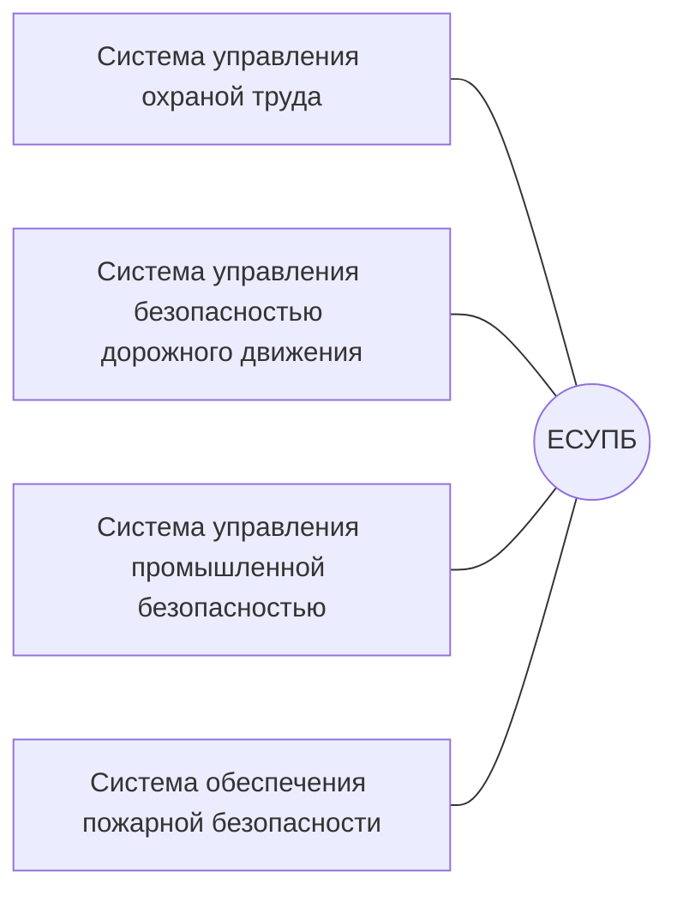

icon: arrow

Подобнее с информацией о регулирующих документах в области производственной безопасности Группы Газпром можно ознакомиться в <u>**Приложении 6.4.**</u>

----

1 Численность пострадавших в результате несчастных случаев с потерей рабочего времени / Общее количество часов, отработанных всем персоналом × 1 000 000.
2 Данные представлены по компаниям газового бизнеса периметра ЕСУПБ, без учета низких сетей (газораспределение) и сбыта нефтепродуктов.
3 Целевое значение установлено в соответствии со стратегическими целевыми показателями и рассчитано как скользящее среднее за последние пять лет со снижением на 10 %.
4 Утвержден приказом ПАО «Газпром» от 12 января 2021 г. № 2.
5 Утверждена приказом ПАО «Газпром» от 17 сентября 2019 г. № 416.

<!-- pdf_page: 51 -->
## PDF-страница 51

flow_chart: Структура ЕСУПБ ПАО «Газпром»

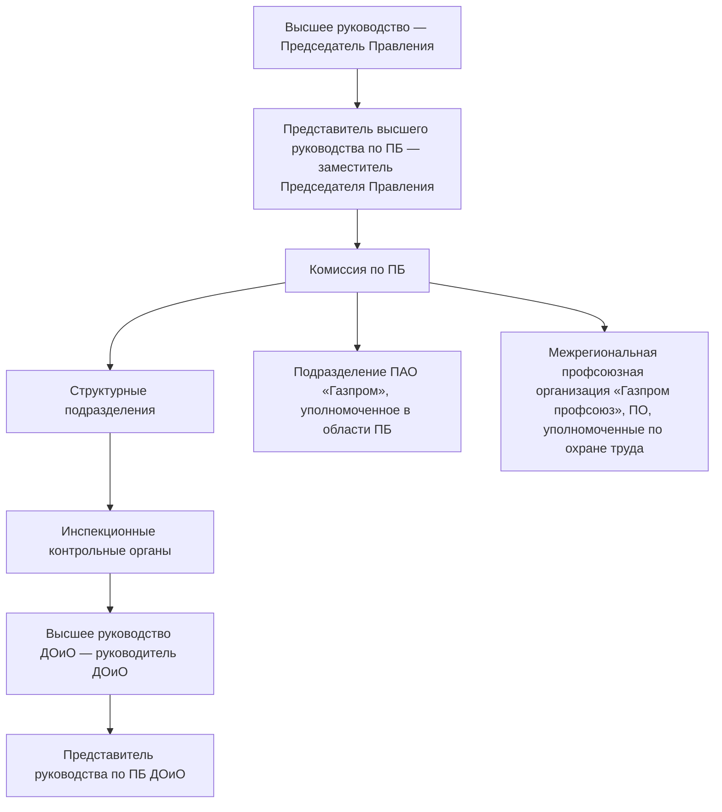

## **Система корпоративного контроля соблюдения требований производственной безопасности**

| Аудит ЕСУПБ (Администрация ПАО «Газпром»)                                                     | Проводит оценку эффективности работы ЕСУПБ                                                                                                                                        |
| --------------------------------------------------------------------------------------------- | --------------------------------------------------------------------------------------------------------------------------------------------------------------------------------- |
| ООО «Газпром газобезопасность» и ООО «Газпром газнадзор»                                      | Контролируют соблюдение требований производственной безопасности на объектах Группы Газпром                                                                                       |
| ООО «Газпром газобезопасность»                                                                | Контролирует соблюдение требований газовой и противофонтанной безопасности                                                                                                        |
| Строительная инспекция ООО «Газпром газнадзор» и строительный контроль заказчика и подрядчика | Контролируют безопасность строительства и реконструкции объектов                                                                                                                  |
| ООО «Газпром инвест»                                                                          | Обеспечивает соблюдение требований ЕСУПБ на объектах строительства, реконструкции, диагностики, технического обслуживания, капитального и текущего ремонта объектов ПАО «Газпром» |

1 На схеме использованы следующие сокращения: ПБ — производственная безопасность, ПО — профсоюзные организации, ДОиО — дочерние общества, организации и филиалы ПАО «Газпром».

Развитие и совершенствование ЕСУПБ и каждого ее элемента ведется в соответствии со Стратегией развития системы управления производственной безопасностью ПАО «Газпром» на период 2021–2030 гг.2 (далее — Стратегия). Реализация требований Стратегии осуществляется в соответствии с мероприятиями Целевой программы обеспечения производственной безопасности ПАО «Газпром» на 2022–2025 годы3.

Функционирование ЕСУПБ и ее постоянное совершенствование позволяет обеспечивать устойчивое развитие ПАО «Газпром»

> icon: people **Совет директоров ПАО «Газпром» в 2023 г. рассмотрел **вопрос «О состоянии работы по промышленной** **безопасности и охране окружающей среды»** и одобрил проводимую в ПАО «Газпром» работу по охране труда, промышленной и пожарной безопасности, охране окружающей среды**4.

с заданными показателями производственной безопасности и поддерживать безопасную производственную среду на каждом рабочем месте.

### **Периметр действия ЕСУПБ**

В организационный периметр ЕСУПБ входят ПАО «Газпром», его ДО по добыче, подготовке, транспортировке, переработке, распределению и хранению природного газа, газового конденсата и нефти, а также ДО, обеспечивающие работу ЕСГ.

В список организаций, на которые распространяется ЕСУПБ, включены Администрация ПАО «Газпром» и 15 его филиалов, 79 ДОиО и 4 субхолдинга: Группа Газпром нефть, Газпром энергохолдинг, Группа Газпром межрегионгаз, Группа Газпром ГНП холдинг.

По состоянию на 31 декабря 2023 г. общая списочная численность работников5 периметра ЕСУПБ составила 636,42 тыс. человек6.

В ЕСУПБ не включены представительства Группы Газпром на территории других стран.

**636,42**
**тыс. человек**
**списочная численность работников периметра ЕСУПБ**

**Охват работников ЕСУПБ, тыс. чел.**

| Год  | Охват работников ЕСУПБ, тыс. чел. |
| ---- | --------------------------------- |
| 2023 | 636,42                            |
| 2022 | 621,50                            |
| 2021 | 315,00                            |

### **Совершенствование ЕСУПБ в 2023 г.**

В отчетном году приняты новые документы и планы в области производственной безопасности, в том числе по итогам расследования происшествий. Среди них планы мероприятий по предупреждению происшествий и обеспечению безопасности на объектах Группы Газпром, типовые правила безопасности при проведении работ, а также некоторые методические документы.

2 Утверждена приказом ПАО «Газпром» от 9 сентября 2020 г. № 368.
3 Утверждена приказом ПАО «Газпром» от 7 февраля 2022 г. № 50.
4 Утверждено решением Совета директоров ПАО «Газпром» от 9 июня 2023 г. № 3944.
5 Информация представлена с учетом работников, уволенных 31 декабря 2023 г.
6 Данные представлены с учетом Группы Газпром теплоэнерго.

<!-- pdf_page: 52 -->
## PDF-страница 52

## **ЗАБОТИМСЯ О ГЛАВНОМ**

**ЗДОРОВЬЕ РАБОТНИКОВ — ПРИОРИТЕТ ГАЗПРОМА. МЫ ВЫСТРАИВАЕМ И ПОСТОЯННО УЛУЧШАЕМ СИСТЕМУ ОХРАНЫ ТРУДА, ЧТОБЫ ЛЮДИ РАБОТАЛИ В БЕЗОПАСНЫХ УСЛОВИЯХ.**

photo: Vladimir Subbotin in front of a large screen showing industrial landscapes

**ВЛАДИМИР СУББОТИН**
Генеральный директор
ООО «Газпром трансгаз Самара»

Лично участвует в разработке научных технологий и методов управления производственной безопасностью.
Случаи травматизма, аварии, инциденты на ОПО отсутствуют в ДО более девяти лет. В 2023 г. компания признана
за период 2020–2022 гг. лучшей в области охраны труда среди газотранспортных предприятий Газпрома. Имеет
благодарность Правительства Российской Федерации, награжден Почетной грамотой Совета Федерации
Федерального Собрания Российской Федерации.

<!-- pdf_page: 53 -->
## PDF-страница 53

## **Соответствие ЕСУПБ отраслевым стандартам**

В соответствии с требованиями СТО Газпром 18000.3-004-2020 «Единая система управления производственной безопасностью. Организация и проведение аудитов»1 структурные подразделения ПАО «Газпром», ДО по добыче, транспортировке, хранению и переработке газа проверяются на соответствие требованиям производственной безопасности не реже одного раза в три года, иные ДОИО ПАО «Газпром» — не реже одного раза в пять лет2.

> **За пятилетний период проверяются 100 % всех **работников (включая подрядчиков), работа** **и/или рабочее место которых охвачены действием** системы управления охраной труда.**

## **Внешние аудиты ЕСУПБ**

ЕСУПБ ПАО «Газпром» соответствует национальному стандарту ГОСТ Р ИСО 45001-20203.

### **> 588,5**
**тыс. человек**4
**численность персонала ПАО «Газпром» и 63 его ДО, прошедших сертификацию**

**Количество организаций Группы Газпром, в которых проведены проверки системы управления производственной безопасностью (ЕСУПБ)**

| Показатели                                                              | 2021 | 2022 | 2023 | Изменение 2023/2022, % |
| ----------------------------------------------------------------------- | ---- | ---- | ---- | ---------------------- |
| Внешние аудиты соответствия требованиям стандарта ГОСТ Р ИСО 45001-2020 | 57   | 59   | 63   | +6,8                   |

**Количество работников, занятых в организациях Группы Газпром, имеющих сертификаты соответствия требованиям стандартов ГОСТ Р ИСО 45001-2020**4, **тыс. чел.**

| Год  | Количество работников, занятых в организациях Группы Газпром, имеющих сертификаты соответствия требованиям стандартов ГОСТ Р ИСО 45001-2020 (тыс. чел.) |
| ---- | ------------------------------------------------------------------------------------------------------------------------------------------------------- |
| 2023 | 588,5                                                                                                                                                   |
| 2022 | 575,0                                                                                                                                                   |
| 2021 | 273,5                                                                                                                                                   |

**Количество организаций Группы Газпром, имеющих сертификаты соответствия требованиям стандарта ГОСТ Р ИСО 45001-2020**

| Год  | Количество организаций Группы Газпром, имеющих сертификаты соответствия требованиям стандарта ГОСТ Р ИСО 45001-2020 |
| ---- | ------------------------------------------------------------------------------------------------------------------- |
| 2023 | 63                                                                                                                  |
| 2022 | 59                                                                                                                  |
| 2021 | 57                                                                                                                  |

----

1 Утвержден приказом ПАО «Газпром» от 2 марта 2020 г. № 94.
2 В соответствии с требованиями СТО Газпром 18000.3-004-2020 «Единая система управления производственной безопасностью. Организация и проведение аудитов».
3 «Системы менеджмента охраны здоровья и безопасности труда. Требования и рекомендации по применению».
4 Данные представлены по списочной численности работников ДО газового бизнеса основных видов деятельности, сбыта нефтепродуктов, низких сетей (газораспределение), нефтяного и электроэнергетического бизнесов, с учетом уволенных 31 декабря 2023 г.

----

## **Корпоративный контроль за соблюдением требований производственной безопасности**

Внутренние проверки соответствия законодательным и корпоративным требованиям осуществляются в рамках корпоративного контроля за соблюдением требований в области производственной безопасности на объектах Группы Газпром.

К корпоративному контролю относится многоуровневая система, состоящая из административно-производственного контроля за соблюдением требований производственной безопасности, корпоративного инспекционного контроля и аудита ЕСУПБ.

Административно-производственный контроль за соблюдением требований производственной безопасности осуществляется с целью предотвращения возможных происшествий, а также проведения самооценки и оценки деятельности структурных подразделений и филиалов по управлению рисками в области производственной безопасности.

В рамках корпоративного инспекционного контроля осуществляется надзорная деятельность за соблюдением требований промышленной и пожарной безопасности, охраны труда, а также контроль за устранением выявленных нарушений по результатам инспекционной деятельности государственных надзорных органов.

Аудит ЕСУПБ осуществляется структурным подразделением ПАО «Газпром», уполномоченным в области производственной безопасности. В ходе аудита проводится проверка результативности (эффективности) функционирования ЕСУПБ в ДО. Руководители профильных структурных подразделений ПАО «Газпром» проводят выездные инспекции в ДО основных видов деятельности для оценки работ по управлению ключевыми рисками в области производственной безопасности.

Кроме того, в Группе Газпром проводится постоянный общественный контроль за соблюдением требований в области охраны труда со стороны профсоюзных организаций и уполномоченных по охране труда.

## **Идентификация опасностей и рисков**

В ПАО «Газпром» утвержден СТО Газпром 18000.1-002-2020 «Единая система управления производственной безопасностью. Идентификация опасностей и управление рисками в области производственной безопасности»5.

В 2023 г. по результатам оценки рисков в ПАО «Газпром» не было выявлено критических рисков, связанных с производственной безопасностью. ПАО «Газпром» идентифицировало 21 риск в области производственной безопасности, из них 7 существенных:

* риск травмирования работника при ДТП;
* риск травмирования работника в результате температурного воздействия;
* риск выброса опасных веществ с последующим возгоранием на ОПО МГ;
* риск травмирования работника в результате падения, обрушения, обвалов предметов, материалов, земли;
* риск травмирования работника при воздействии движущихся, разлетающихся, вращающихся предметов и деталей;
* риск травмирования работника в результате падения при разности уровня высот;
* риск разгерметизации технологического оборудования и технических устройств на ОПО МГ.

Для каждого риска определены меры управления, предусмотрены методы реагирования, а также разработаны мероприятия по минимизации.

### **Меры по управлению рисками в области производственной безопасности**

Управление рисками в области производственной безопасности Группа Газпром осуществляет в рамках функционирования ЕСУПБ. Оценку рисков в этой сфере проводят в каждом ДО. Для ключевых рисков разрабатываются мероприятия, направленные на их минимизацию. Результаты идентификации опасностей и оценки рисков используются при определении целей в области производственной безопасности ПАО «Газпром» и его ДО.

----

5 Утвержден приказом ПАО «Газпром» от 30 января 2020 г. № 37.

<!-- pdf_page: 54 -->
## PDF-страница 54

## **Расследование инцидентов**

Группа Газпром тщательно расследует каждое происшествие, своевременно устанавливает его причины и вырабатывает рекомендации для предотвращения подобных инцидентов в дальнейшем. Порядок расследования происшествий регламентирован требованиями законодательства и СТО Газпром 18000.4-008-2019 «Единая система управления производственной безопасностью. Анализ коренных причин происшествий. Порядок их установления и разработки мероприятий по предупреждению»1.

Для расследования формируется комиссия, которая документирует обстоятельства происшествия, собирает данные о происшествии и всех сопутствующих событиях, анализирует собранные материалы и выявленные причины инцидента, формирует отчет. Чтобы оценить полноту и достоверность собранных данных, корректность проведенного анализа и выводов о причинах происшествия, проводится экспертиза представленных материалов. По окончании расследования разрабатываются и проводятся мероприятия по предупреждению происшествий. О результатах расследования также информируют работников структурных подразделений и филиалов ПАО «Газпром».

### **Схема реагирования на происшествие в области охраны труда, промышленной и пожарной безопасности и безопасности дорожного движения**

| Документирование (фиксация) обстоятельств происшествия                | Планирование сбора данных                           | Сбор данных о происшествии и сопутствующих событиях                                                                                                                   | Анализ собранных материалов о происшествии и сопутствующих событиях. Установление коренных причин | Экспертиза результатов | Информирование ДО о происшедшем происшествии и причинах возникновения | Разработка мероприятий по предупреждению                  |
| --------------------------------------------------------------------- | --------------------------------------------------- | --------------------------------------------------------------------------------------------------------------------------------------------------------------------- | ------------------------------------------------------------------------------------------------- | ---------------------- | --------------------------------------------------------------------- | --------------------------------------------------------- |
| icon: person with checklist                                           | icon: person at desk with gear                      | icon: briefcase                                                                                                                                                       | icon: document with magnifying glass                                                              | icon: calendar         | icon: person at computer                                              | icon: document with checkmark                             |
| Осмотр места происшествия и документирование (фиксация) обстоятельств | Определение руководства АКП². Назначение группы АКП | В соответствии с разделами 6–8 СТО Газпром 18000.4-008-2019 «Анализ коренных причин происшествий. Порядок их установления и разработки мероприятий по предупреждению» |                                                                                                   |                        | Распространение информационного листка «Внимание»                     | В соответствии с разделом 10 СТО Газпром 18000.4-008-2019 |
| Немедленно после получения информации о происшествии                  | В течение 3 календарных дней с момента происшествия | В течение 45 календарных дней с момента происшествия                                                                                                                  |                                                                                                   |                        | В течение 3 календарных дней после утверждения отчета об АКП          | Согласно плану мероприятий по предупреждению происшествий |

----

1 Утвержден приказом ПАО «Газпром» от 31 мая 2019 г. № 208 (с последующими изменениями).
2 АКП — анализ коренных причин.

## **Участие персонала в обеспечении производственной безопасности**

В Группе Газпром принята процедура информирования каждого работника о Политике и целях в области производственной безопасности, а также о личной ответственности каждого работника и его вкладе в результативность и совершенствование ЕСУПБ. Работники получают информацию о требованиях нормативных документов ЕСУПБ, применимых к их деятельности, узнают о реальных и потенциальных последствиях невыполнения требований. До сведения персонала доводится процедура расследования происшествий, информация о рисках, возможных инцидентах в области производственной безопасности, а также о необходимых действиях работников при их возникновении.

В Группе Газпром действуют уполномоченные по охране труда, представляющие интересы работников по вопросам производственной безопасности.

> **Газпром использует различные способы привлечения внимания работников к теме производственной безопасности. В 2023 г. был опубликован тематический выпуск журнала «Газовая промышленность»3, посвященный производственной безопасности в ПАО «Газпром».**

### **Способы информирования работников в области производственной безопасности**

* Информационные стенды;
* инструкции по безопасным методам производства работ;
* видеоролики по безопасным методам производства работ;
* обзоры аварий, инцидентов и несчастных случаев за истекший месяц;
* видеореконструкции тяжелых несчастных случаев;
* справочные правовые системы на рабочих местах для лиц, ответственных за производственную безопасность;
* системы связи, оповещения и определения местоположения персонала, занятого на ОПО.

### **Обучение в области производственной безопасности**

Обучение персонала Группы Газпром в области безопасности труда — это основа для создания безопасной производственной среды и предотвращения происшествий. Для каждой категории работников разработаны программы обучения и повышения квалификации в собственных учебно-производственных центрах Группы Газпром и в специализированных образовательных организациях.

#### **Виды обучающих программ**

##### **Очные образовательные программы**
Программы дополнительного профессионального образования, реализуемые организациями СНФПО ПАО «Газпром» в различных форматах (тренинги, деловые игры и т. д.).

##### **Практические занятия и демонстрации**
Позволяют работникам безопасно практиковаться в выполнении операций и использовании специального оборудования, отрабатывать процессы эвакуации и оказания первой помощи.

##### **Электронные способы обучения**
Использование компьютерных программ и моделей, интерактивных обучающих курсов, видеоматериалов, проведение вебинаров и онлайн-тренингов позволяет обучать работников в удобном формате и следить за достигнутыми результатами.

##### **Регулярные проверки знаний**
Тестирование позволяет убедиться, что работники полностью усвоили правила и инструкции и их квалификация в области производственной безопасности соответствует предъявляемым требованиям.

<!-- pdf_page: 55 -->
## PDF-страница 55

Группа Газпром организует обучение персонала в области производственной безопасности в собственных образовательных организациях, в том числе ЧОУ ДПО «Газпром корпоративный институт». В отчетном году работники Группы Газпром получили возможность пройти обучение по 33 программам и 20 электронным курсам в области производственной безопасности. В 2023 г. «Газпром корпоративный институт» разработал программу повышения квалификации «Организация системы психологического сопровождения деятельности персонала, обеспечивающего выполнение задач в области производственной безопасности». Целью обучения является развитие компетенций работников ДОиО, оказывающих психологическую поддержку коллегам, выполняющим задачи в области производственной безопасности. Запуск программы запланирован на 2024 г. В отчетном году численность работников Группы Газпром, прошедших обучение по программам в области производственной безопасности, составила 173 687 человек1.

**173 687**
**человек**
**прошли обучение по программам в области производственной безопасности**

**146**
**наград и поощрений**
**в области производственной безопасности, в т. ч. 25 федеральных, получили работники Группы Газпром в 2023 г.**

> **В едином коммуникационном канале для всех работников Группы Газпром — корпоративном мобильном приложении ГИД — реализован функционал в области производственной безопасности.**
>
> icon: arrow
>
> Подробнее о корпоративной цифровой системе ГИД можно узнать в подразделе <u>«Внутрикорпоративные коммуникации»</u>.

### **Информирование о происшествиях**

Работники Группы Газпром обязаны проинформировать о любых происшествиях непосредственного руководителя, а также могут сообщить в профсоюзную организацию, в том числе через уполномоченного по охране труда. Кроме того, они могут направить предложения по совершенствованию элементов ЕСУПБ, вопросы относительно производственной безопасности, а также любую другую информацию по этой теме через следующие каналы коммуникаций:

* по телефону;
* по электронной почте;
* по почте или курьером с пометкой «Горячая линия»;
* через внутренний интранет-портал ДО;
* через мобильное приложение;
* СМС-сообщением с мобильного телефона или текстовым сообщением через мессенджер;
* лично руководителю подразделения или в профильную службу.

Работники, сообщившие о происшествии, опасностях и рисках в области производственной безопасности, о реальном положении дел и возможностях улучшения через эти каналы, защищены от давления, преследования или наказания за сообщение. Они имеют полное право отказаться от выполнения работ в случае опасности для их жизни и здоровья вследствие нарушения требований охраны труда до устранения такой опасности2.

----

1 Указаны сведения о руководителях, специалистах и других служащих, прошедших предаттестационную подготовку по промышленной безопасности, охране труда и др. Численность работников, прошедших обучение, указана в человеко-курсах (если один человек обучался два раза, то он учитывается дважды, и т. д.).
2 За исключением случаев, предусмотренных федеральным законодательством.

----

### **Цифровые проекты в области производственной безопасности**

Разработанный ЧУ ДПО «Газпром ОНУТЦ» VR-тренажер «Вывод ячейки ЗРУ-10 кВ по наряду-допуску» с применением технологии виртуальной реальности (VR) способен обучить электромонтеров и слесарей-электриков вести безопасную работу в электроустановках. Тренажер включает фото- и видеотур с полем зрения 360° и практические упражнения в виртуальной реальности, позволяющие обеспечить максимальное погружение в технологический процесс. В VR-тренажере отрабатывается порядок действий по выводу ячейки ЗРУ-10 кВ в ремонт по наряду-допуску и ее вводу в работу после ремонта с соблюдением требований охраны труда и мер безопасности, а также нештатные и аварийные ситуации.

В ООО «Газпром добыча Ямбург» ведется тестирование технологий компьютерного зрения для обеспечения контроля соблюдения требований охраны труда и промышленной безопасности, включая контроль доступа транспорта на производственный объект, а также управление доступом персонала на основе биометрических данных.

В ООО «Газпром ПХГ» и ООО «Газпром трансгаз Уфа» прошли испытания и успешно применяются системы дистанционного лазерного обнаружения метана. Лазерный детектор, совмещенный с камерой, позволяет не только получать информацию о самом факте утечки, но и определять место ее возникновения.

## **Контроль производственной безопасности подрядчиков**

Группа Газпром требует от подрядчиков неукоснительного соблюдения принятых норм и правил, которые регламентированы в корпоративном документе СТО Газпром 18000.2-015-2021 «Единая система управления производственной безопасностью. Требования к системе управления производственной безопасностью. Порядок взаимодействия с подрядными организациями по обеспечению на объектах ПАО «Газпром» требований производственной безопасности»3. Этот документ содержит требования к системе управления производственной безопасностью подрядных организаций, порядок взаимодействия, распределены обязанности и зоны ответственности всех участников на объектах строительства, реконструкции и ремонта. Отдельно регламентированы этапы с потенциально высокими рисками, связанные с наличием опасных веществ на объектах незавершенного строительства.

Во все договоры подряда на выполнение работ по строительству, реконструкции, диагностике, техническому обслуживанию, капитальному и текущему ремонту объектов ПАО «Газпром» включены обязательные условия по выполнению требований, установленных СТО Газпром.

Все несчастные случаи с работниками подрядных организаций расследуются в соответствии с требованиями законодательства. В договоры подряда включены обязательства по проведению анализа причин происшествий и разработке мероприятий по их предупреждению4.

Для повышения эффективности взаимодействия с подрядчиками назначен единый технический заказчик по реализации инвестиционных проектов ПАО «Газпром» — ООО «Газпром инвест»5. Для обеспечения функционирования и совершенствования ЕСУПБ, а также координации взаимодействия с подрядчиками по вопросам производственной безопасности создана Комиссия по производственной безопасности ООО «Газпром инвест», в состав которой включены представители первой линии руководителей, а также представитель работников. Заседания комиссии проводятся не реже, чем один раз в полугодие.

----

3 Утвержден распоряжением ПАО «Газпром» от 7 июня 2021 г. № 269.
4 В соответствии с СТО Газпром 18000.4-008-2019.
5 100 % дочернее общество ПАО «Газпром».

<!-- pdf_page: 56 -->
## PDF-страница 56

Отчет о социальной деятельности Группы Газпром за 2023 год

1. О Группе Газпром
2. Люди Группы Газпром
3. **Безопасность производства**
4. Развитие регионов
5. Окружающая среда и экологическая политика
6. Приложение

## **Обучение работников подрядных организаций**

Группа Газпром контролирует реализацию программ обучения в области производственной безопасности для работников подрядных организаций. В отчетном году более 110 тыс. работников из 37 подрядных организаций Группы Газпром прошли обучение в области производственной безопасности по следующим направлениям: лидерство и поведенческий аудит безопасности, культура производственной безопасности, оценка рисков, VR-обучение в области электробезопасности, пожарной безопасности, работ на высоте и огневых работ. Кроме того, 7 891 водитель подрядных организаций Группы Газпром прошел курс «Защитное вождение».

### **Аэромониторинг безопасности**

ООО «Газпром инвест» внедрило систему аэромониторинга за соблюдением требований производственной безопасности на объектах строительства ПАО «Газпром» с использованием беспилотных летательных аппаратов (БПЛА). Операторы БПЛА получают заявки, в которых указаны объекты, координаты и акценты на определенные работы для выполнения аэросъемки, и направляют туда БПЛА. Отчеты о зафиксированных нарушениях направляются подрядчикам, которые должны устранить нарушения и принять меры для предупреждения таких случаев в будущем.

## **Аудит поставщиков в области производственной безопасности**

Аудиты поставщиков проводятся в соответствии с требованиями СТО Газпром 178-2020 «Порядок проведения комплексного аудита организаций, осуществляющих или планирующих изготовление продукции для нужд ПАО «Газпром»1. Комплексные аудиты поставщиков проводятся в три этапа: камеральная проверка, выездная проверка и подготовка отчета по комплексному аудиту. В рамках проведения аудитов систем менеджмента контрагентов проводится проверка выполнения требований производственной безопасности, предусмотренных стандартами Группы Газпром2 и условиями договоров.

**> 110**
**тыс. работников**
**из 37 подрядных организаций Группы Газпром прошли обучение в области производственной безопасности**

### **ОХРАНА ТРУДА**

В Группе Газпром здоровье и жизнь людей считаются важнейшей ценностью. Делается все, чтобы минимизировать риск травматизма и угроз здоровью работников и подрядчиков на объектах и в организациях Группы Газпром.

ЕСУПБ, наряду с системой управления промышленной и пожарной безопасностью, безопасностью дорожного движения, включает систему управления охраной труда (СУОТ), которая соответствует требованиям Трудового кодекса Российской Федерации3, законодательных и нормативных актов в этой сфере и охватывает всех работников ПАО «Газпром» и его ДО.

### **Предотвращение производственного травматизма**

<mark>БР Приложение 4, «Идентификация опасностей, оценка риска <u>возникновения аварий и инцидентов», «Служба охраны труда», с. 39</u></mark>

В 2023 г. в ПАО «Газпром», его дочерних обществах, организациях и филиалах в 44 несчастных случаях на производстве пострадало 57 работников, в числе которых было 11 погибших.

Основными видами несчастных случаев на производстве в отчетном году стали ДТП, падения пострадавших и травмирование работников при выполнении работ повышенной опасности.

В Группе Газпром были проведены расследования несчастных случаев в соответствии с требованиями законодательных актов Российской Федерации, а также осуществлено установление коренных причин происшествий, разработаны мероприятия по предупреждению подобных происшествий в области производственной безопасности.

**Виды несчастных случаев в 2023 г.**4

| Вид несчастного случая                                      | Случаев |
| ----------------------------------------------------------- | ------- |
| ДТП                                                         | 18      |
| Падение пострадавшего                                       | 16      |
| Воздействие движущихся, разлетающихся механизмов, предметов | 8       |
| Воздействие экстремальных температур                        | 7       |
| Падение, обрушение, обвалы предметов, материалов, земли     | 4       |
| Поражение электрическим током                               | 1       |
| Иные причины                                                | 3       |

1 Утвержден распоряжением ПАО «Газпром» от 10 августа 2020 г. № 283.
2 СТО Газпром серии 18000.

3 Трудовой кодекс Российской Федерации от 30 декабря 2001 г. № 197-ФЗ.
4 Данные представлены по компаниям газового бизнеса периметра ЕСУПБ, без учета низких сетей (газораспределение) и сбыва нефтепродуктов.

108–109

#### **Существенные темы**

icon: heart pulse line

4. Охрана здоровья и производственная безопасность в Группе Газпром и организациях-контрагентах

icon: building with columns

7. Соответствие деятельности Группы Газпром нормам законодательства (социально-экономическим, экологическим, антимонопольным)

<!-- pdf_page: 57 -->
## PDF-страница 57

6. Приложение

**<u>БР Несчастные случаи на производстве, с. 40</u>** **<u>РСПП 3.1.5, 3.1.6</u>**

## **Показатели производственного травматизма**

| Показатель                                                                                                                            | 2021  | 2022  | 2023   |
| ------------------------------------------------------------------------------------------------------------------------------------- | ----- | ----- | ------ |
| Коэффициент частоты травматизма¹                                                                                                      | 0,13  | 0,12  | 0,173² |
| Коэффициент тяжести травматизма³                                                                                                      | 68,19 | 67,87 | 76,6²  |
| Количество пострадавших при несчастных случаях                                                                                        | 42    | 39    | 57²    |
| Количество пострадавших со смертельным исходом                                                                                        | 5     | 6     | 11²    |
| Количество несчастных случаев со смертельным исходом, связанных с работой независимых подрядчиков, работающих на объектах организации | 11    | 18    | 14     |
| Количество производственных травм подрядчиков с тяжелыми или необратимыми последствиями (за исключением травм со смертельным исходом) | 17    | 29    | 22     |

Коэффициент частоты травматизма в 2023 г. повысился на 44,2 % по причине роста количества несчастных случаев на производстве с увеличением количества пострадавших. Коэффициент тяжести травматизма возрос на 12,9 % по причине увеличения количества несчастных случаев на производстве.

----

**<u>МЭР 29</u>**

## **Численность пострадавших и погибших при несчастных случаях4 в Группе Газпром, чел.**

| Показатель                              | 2021 | 2022 | 2023 |
| --------------------------------------- | ---- | ---- | ---- |
| Компании газового бизнеса²              |      |      |      |
| количество пострадавших                 | 42   | 39   | 57   |
| • в т. ч. количество погибших           | 5    | 6    | 11   |
| Компании нефтяного бизнеса              |      |      |      |
| количество пострадавших                 | 70   | 45⁵  | 45⁵  |
| • в т. ч. количество погибших           | 4    | 0    | 0    |
| Компании электроэнергетического бизнеса |      |      |      |
| количество пострадавших                 | 3    | 7⁶   | 15⁶  |
| • в т. ч. количество погибших           | 0    | 1    | 0    |
| Газпром нефтехим Салават                |      |      |      |
| количество пострадавших                 | 2    | 1    | 0    |
| • в т. ч. количество погибших           | 2    | 0    | 0    |

Рост количества пострадавших в сравнении с 2022 г. обусловлен увеличением количества ДТП, произошедших по вине третьих лиц, и групповым несчастным случаям на производстве.

----

1 Количество учтенных несчастных случаев на производстве за отчетный период с потерей трудоспособности на один и более дней / Среднесписочная численность работников × 1 000.
2 Данные представлены по компаниям газового бизнеса периметра ЕСУПБ, без учета низких сетей (газораспределение) и сбыта нефтепродуктов.
3 Сумма дней нетрудоспособности по всем случаям / Общее количество несчастных случаев.
4 С утратой трудоспособности на 1 рабочий день и более и со смертельным исходом.
5 Данные ПАО «Газпром нефть» указаны по ДО, а также совместным предприятиям под операционным управлением Газпром нефти в России и за рубежом.
6 Данные представлены с учетом показателей Группы Газпром теплоэнерго.

----

**<u>Индикатор Группы Газпром 29.1</u>**

## **Коэффициент частоты травм с временной потерей трудоспособности (LTIFR)7 в Группе Газпром**

| Наименование                                    | 2021 | 2022  | 2023  |
| ----------------------------------------------- | ---- | ----- | ----- |
| Компании газового бизнеса                       | 0,08 | 0,08  | 0,102 |
| Компании газового бизнеса (низкие сети)⁸        | –⁹   | –⁹    | 0,204 |
| Компании газового бизнеса (сбыт нефтепродуктов) | –⁹   | –⁹    | 0,369 |
| Компании нефтяного бизнеса                      | 0,36 | 0,338 | 0,323 |
| Компании электроэнергетического бизнеса         | 0,05 | 0,086 | 0,191 |

Рост показателя LTIFR в компаниях газового и электроэнергетического бизнеса Группы Газпром в 2023 г. обусловлен увеличением количества пострадавших с временной потерей трудоспособности.

Снижение LTIFR в компаниях нефтяного бизнеса Группы Газпром вызвано увеличением количества часов, отработанных персоналом.

----

**<u>Индикатор Группы Газпром 29.2</u>**

## **Коэффициент частоты смертельного травматизма (FAR)10 в Группе Газпром**

| Наименование                                    | 2021  | 2022   | 2023   |
| ----------------------------------------------- | ----- | ------ | ------ |
| Компании газового бизнеса                       | 0,99  | 1,18   | 1,963  |
| Компании газового бизнеса (низкие сети)⁸        | –⁹    | –⁹     | 1,927  |
| Компании газового бизнеса (сбыт нефтепродуктов) | –⁹    | –⁹     | 12,309 |
| Компании нефтяного бизнеса                      | 3,80  | 0¹¹    | 0¹¹    |
| Компании электроэнергетического бизнеса         | 0     | 1,23¹² | 0¹²    |
| Газпром нефтехим Салават¹³                      | 12,96 | 0      | 0      |

В отчетном году коэффициент частоты смертельного травматизма вырос в компаниях газового бизнеса Группы Газпром на 66,4 % в сравнении с 2022 г. Это было вызвано групповыми несчастными случаями со смертельным исходом.

----

7 Количество пострадавших в результате несчастных случаев с потерей рабочего времени / Общее количество часов, отработанных всем персоналом × 1 000 000.
8 Указано для Группы Газпром межрегионгаз.
9 Сбор данных не осуществлялся.
10 Количество пострадавших в результате несчастных случаев со смертельным исходом / Общее количество часов, отработанных всем персоналом × 100 000 000.
11 Данные ПАО «Газпром нефть» указаны по ДО, а также совместным предприятиям под операционным управлением Газпром нефти в России и за рубежом.
12 Данные представлены с учетом показателей Группы Газпром теплоэнерго.
13 Указано для ООО «Газпром нефтехим Салават».

<!-- pdf_page: 58 -->
## PDF-страница 58

### **Количество пострадавших и погибших при несчастных случаях в Группе Газпром**, чел.

| Показатель                              | 2021 Мужчины | 2021 Женщины | 2022 Мужчины | 2022 Женщины | 2023 Мужчины | 2023 Женщины |
| --------------------------------------- | ---------------- | ---------------- | ---------------- | ---------------- | ---------------- | ---------------- |
| Компании газового бизнеса¹              |                  |                  |                  |                  |                  |                  |
| количество пострадавших                 | 39               | 3                | 36               | 3                | 50               | 7                |
| • в т. ч. количество погибших           | 5                | 0                | 6                | 0                | 11               | 0                |
| Компании нефтяного бизнеса              |                  |                  |                  |                  |                  |                  |
| количество пострадавших                 | 62               | 8                | 38²              | 7²               | 37²              | 8²               |
| • в т. ч. количество погибших           | 4                | 0                | 0                | 0                | 0                | 0                |
| Компании электроэнергетического бизнеса |                  |                  |                  |                  |                  |                  |
| количество пострадавших                 | 3                | 0                | 6                | 1                | 14³              | 1³               |
| • в т. ч. количество погибших           | 0                | 0                | 1                | 0                | 0                | 0                |
| Газпром нефтехим Салават⁴               |                  |                  |                  |                  |                  |                  |
| количество пострадавших                 | 2                | 0                | 1                | 0                | 0                | 0                |
| • в т. ч. количество погибших           | 2                | 0                | 0                | 0                | 0                | 0                |

Причины разницы среди пострадавших мужчин и женщин заключаются в статистическом соотношении работающих на ОПО лиц мужского и женского пола.

Для снижения рисков возникновения несчастных случаев Группа Газпром разработала ряд документов, в числе которых планы мероприятий по предупреждению происшествий при проведении работ, предотвращению ДТП и обеспечению безопасности дорожного движения, программы реконструкции и технического перевооружения объектов Группы Газпром.

**МЭР 27** | **РСПП 3.1.9** | **Индикатор Группы Газпром 30**

**Расходы Группы Газпром на охрану труда**5, млн руб.

| Год  | Расходы Группы Газпром на охрану труда, млн руб. |
| ---- | ------------------------------------------------ |
| 2023 | 26 882,57                                        |
| 2022 | 23 472,46                                        |

> **В 2023 г. в ПАО «Газпром» проведен Конкурс на лучшее дочернее общество по организации работ по охране труда. Определены победители в трех группах: «Добыча, переработка и хранение газа», «Транспорт газа», «Организации инфраструктуры».**

**Расходы Группы Газпром на охрану труда**, млн руб.

| Наименование                                    | 2021   | 2022     | 2023      | Изменение 2023/2022, % |
| ----------------------------------------------- | ------ | -------- | --------- | ---------------------- |
| Компании газового бизнеса                       | 12 825 | 14 663,4 | 17 165,78 | +17,1                  |
| Компании газового бизнеса (низкие сети)⁶        | –⁷     | 1 867,68 | 2 139,81  | +14,6                  |
| Компании газового бизнеса (сбыт нефтепродуктов) | –⁷     | 95,37    | 138,35    | +45,1                  |
| Компании нефтяного бизнеса                      | –⁷     | 5 106,71 | 4 805,30  | -5,9                   |
| Компании электроэнергетического бизнеса         | 1 915  | 1 739,3³ | 2 633,33³ | +51,4                  |
| Газпром нефтехим Салават⁴                       | 209    | 221,6    | 255,35    | +15,2                  |

1 Данные представлены по компаниям газового бизнеса периметра ЕСУПБ, без учета низких сетей (газораспределение) и сбыта нефтепродуктов.
2 Данные ПАО «Газпром нефть» указаны по ДО, а также совместным предприятиям под операционным управлением Газпром нефти в России и за рубежом.
3 Данные представлены с учетом показателей Группы Газпром теплоэнерго.
4 Указано для ООО «Газпром нефтехим Салават».
5 Данные представлены по организациям, на которые распространяется ЕСУПБ.
6 Указано для Группы Газпром межрегионгаз.
7 Сбор данных не осуществлялся.

## **Оценка условий труда**

Для обеспечения производственной безопасности на объектах Группы Газпром внедрены такие процессы, как специальная оценка условий труда (СОУТ) и производственный контроль за условиями труда (ПК).

СОУТ проводится один раз в пять лет8. Она организуется службами охраны труда ДО и реализуется экспертной организацией, входящей в соответствующий реестр. В рамках СОУТ на рабочих местах проводятся идентификация факторов производственной среды и трудового процесса и оценка их воздействия на работников.

ПК проводится ежегодно силами санитarno-промышленных лабораторий ДО ПАО «Газпром», а также сторонними аккредитованными лабораториями. Они определяют наличие вредных и (или) опасных производственных факторов и степень их влияния на здоровье работников.

По результатам СОУТ и ПК предпринимаются следующие шаги:
- работники информируют об идентифицированных на рабочем месте вредных и (или) опасных факторах производственной среды;
- разрабатываются и реализуются мероприятия по улучшению условий труда, включая предоставление средств индивидуальной и коллективной защиты;
- проводятся обязательные предварительные и периодические медицинские осмотры работников.

**1,28 млн**
**исследований и измерений вредных производственных факторов проведено в рамках ПК**

**Количество рабочих мест классов 3 и 4, а также работников, задействованных на этих рабочих местах в организациях, входящих в периметр ЕСУПБ, 2023 г.**

| Показатель                   | Класс 3.1 | Класс 3.2 | Класс 3.3 | Класс 3.4 | Класс 4 |
| ---------------------------- | ------------- | ------------- | ------------- | ------------- | ----------- |
| Количество рабочих мест, ед. | 36 066        | 17 947        | 775           | 39            | 21          |
| Количество работников, чел.  | 66 909        | 42 554        | 2 483         | 73            | 73          |

icon: information

Группа Газпром ведет совместную работу с федеральными органами власти в области производственной безопасности (Ростехнадзор, Минтруд России, МЧС России, Роструд, ФСС), в том числе в области разработки нормативных документов в этой сфере.

В отчетном году Газпром принял участие в мероприятиях Всероссийской недели охраны труда — 2023, где организовал и провел специальную сессию для обсуждения с Минтрудом России наиболее важных тем. Кроме того, на базе ООО «Газпром энерго» состоялся круглый стол по вопросу профилактики травматизма и повышения надежности человеческого фактора в производственной среде. Группа Газпром также организовала выездное заседание НТС на базе ООО «Газпром добыча Астрахань» и учебного центра ООО «Газпром газобезопасность».

<!-- pdf_page: 59 -->
## PDF-страница 59

## ДЕРЖИМ КУРС НА БЕЗОПАСНОСТЬ

**КЛЮЧЕВАЯ ЗАДАЧА ПРИ ЧРЕЗВЫЧАЙНОЙ СИТУАЦИИ — СОХРАНИТЬ ЧЕЛОВЕЧЕСКИЕ ЖИЗНИ. МЫ РЕГУЛЯРНО ПРОВОДИМ СУДОВЫЕ УЧЕНИЯ И ОТРАБАТЫВАЕМ СПАСЕНИЕ ЛЮДЕЙ НА МОРЕ.**

photo: Captain of the gas carrier ship in front of a background showing an offshore oil platform and the ship at sea

**ВЛАДИМИР ЛИ**
Капитан судна-газовоза «Портовой»
(ООО «Газпром флот»)

Руководит работой судна-газовоза, обеспечивает функционирование системы управления безопасностью судов и охраной труда, контролирует подготовку экипажа к борьбе за живучесть судна и спасение людей. Победитель корпоративного конкурса капитанов на знание фундаментальных основ морской науки в 2023 г.

<!-- pdf_page: 60 -->
## PDF-страница 60

## Предупреждение профессиональных заболеваний

Основные профессиональные заболевания у работников Группы Газпром могут развиваться в результате воздействия производственных химических и физических факторов или в связи с физическими перегрузками и перенапряжением отдельных органов и систем.

По каждому выявленному случаю профессионального заболевания проводится расследование, выявляются причины, разрабатываются и принимаются меры по профилактике подобных заболеваний.

#### **Меры, принимаемые в Группе Газпром для профилактики профессиональных заболеваний**

* Оптимизация трудового процесса для снижения времени воздействия на работников производственных факторов;
* модернизация и замена устаревшей техники, имеющей высокие показатели воздействия вредных производственных факторов;
* обеспечение работников современными эффективными средствами индивидуальной и коллективной защиты.

**0**
**смертельных случаев, вызванных профессиональными заболеваниями в отчетном году в Группе Газпром**

<u>**Индикатор Группы Газпром 29.3**</u>

| Наименование                                    | 2021  | 2022   | 2023  |
| ----------------------------------------------- | ----- | ------ | ----- |
| Компании газового бизнеса                       | 0,019 | 0,021  | 0,023 |
| Компании газового бизнеса (низкие сети)²        | —³    | —³     | 0     |
| Компании газового бизнеса (сбыт нефтепродуктов) | —³    | —³     | 0     |
| Компании нефтяного бизнеса                      | 0     | 0      | 0     |
| Компании электроэнергетического бизнеса         | 0     | 0,012⁴ | 0⁴    |
| Газпром нефтехим Салават⁵                       | 0     | 0,062  | 0,062 |

В 2023 г. коэффициент профессиональных заболеваний в компаниях газового бизнеса Группы Газпром вырос на 9,5 % в связи с увеличением количества впервые выявленных профессиональных заболеваний, что, в свою очередь, стало возможным ввиду расширения охвата и улучшения методов диагностики заболеваний.

----

## **ПРОМЫШЛЕННАЯ БЕЗОПАСНОСТЬ**

Группа Газпром соблюдает требования для обеспечения промышленной безопасности, постоянно контролирует состояние ОПО и обеспечивает полную готовность к оперативному устранению аварий и инцидентов.

### Предотвращение аварий

По состоянию на 31 декабря 2023 г. в Государственном реестре опасных производственных объектов зарегистрировано 8 402 ОПО, в том числе:
* компании газового бизнеса — 4 473;
* компании газового бизнеса (низкие сети)6 — 2 189;
* компании газового бизнеса (сбыт нефтепродуктов) — 251;
* компании нефтяного бизнеса — 7977;
* компании электроэнергетического бизнеса — 6888;
* Газпром нефтехим Салават — 4.

Для снижения аварийности на производственных объектах разработаны и реализуются следующие программы:
* Комплексная программа реконструкции и технического перевооружения объектов добычи газа на 2023–2027 гг.9;
* Комплексная программа реконструкции и технического перевооружения объектов переработки газа и жидких углеводородов на 2023–2027 гг.10;
* Комплексная программа реконструкции и технического перевооружения объектов транспорта газа на 2023–2027 гг.11

Кроме того, ведется разработка и актуализация локальных нормативных актов ПАО «Газпром» для совершенствования системы производственного контроля, организации и проведения диагностики оборудования.

Группа Газпром ведет модернизацию и ремонт оборудования, организует техническое обслуживание, диагностику и экспертизу промышленной безопасности технических устройств, зданий и сооружений, обучает персонал противоаварийным мерам и проводит комплексные учения по ликвидации аварийных ситуаций.

Для обеспечения промышленной безопасности в Группе Газпром:
* созданы и функционируют 18 собственных аварийно-спасательных служб;
* заключены договоры с профессиональными аварийно-спасательными службами на обеспечение противофонтанной, газовой, пожарной, промышленной безопасности и охраны труда, а также на выполнение плановых газоопасных и ремонтно-восстановительных работ;
* создан аварийный запас материально-технических ресурсов и финансового резерв для локализации и ликвидации последствий аварий;
* совершенствуется учебно-материальная база для подготовки работников к действиям в аварийной ситуации.

**18**
**собственных аварийно-спасательных служб**

Количество инцидентов осталось на уровне 2022 г.: три из них произошли на линейной части МГ, один — в результате нарушения целостности запорного устройства люка камеры приема очистных поршней.

> **В 2023 г. на ОПО ПАО «Газпром» в периметре ЕСУПБ **количество аварий сократилось более чем на треть.** **Четыре аварии произошли на линейной части МГ,** **их основными причинами были коррозионные процессы** и дефекты сварных соединений.**

----

6 Указано для Группы Газпром межрегионгаз.
7 Данные ПАО «Газпром нефть» указаны по ДО, а также совместным предприятиям под операционным управлением Газпром нефти в России и за рубежом.
8 Данные представлены с учетом показателей Группы Газпром теплоэнерго.
9 Утверждена постановлением Правления ПАО «Газпром» от 22 сентября 2022 г. № 35.
10 Утверждена постановлением Правления ПАО «Газпром» от 8 декабря 2022 г. № 50.
11 Утверждена постановлением Правления ПАО «Газпром» от 6 октября 2022 г. № 37.

<!-- pdf_page: 61 -->
## PDF-страница 61

### **Количество аварий и инцидентов в сфере промышленной безопасности по Группе Газпром**

| Наименование                            | 2021 | 2022 | 2023 |
| --------------------------------------- | ---- | ---- | ---- |
| Компании газового бизнеса¹              |      |      |      |
| • аварии                                | 7    | 6    | 4    |
| • инциденты                             | 5    | 4    | 4    |
| Компании нефтяного бизнеса              |      |      |      |
| • аварии                                | 0    | 2²   | 0²   |
| • инциденты                             | 54³  | 5²   | 5²   |
| Компании электроэнергетического бизнеса |      |      |      |
| • аварии                                | 0    | 0⁴   | 1⁴   |
| • инциденты                             | 60   | 22⁴  | 20⁴  |
| Газпром нефтехим Салават⁵               |      |      |      |
| • аварии                                | 0    | 0    | 0    |
| • инциденты                             | 2    | 0    | 1    |

По результатам расследования и анализа коренных причин аварий и инцидентов разработан и реализуется комплекс мероприятий по предупреждению аналогичных происшествий. Локализация и ликвидация аварий проводятся в соответствии с планом мероприятий, утвержденном в каждом ДО. Он предусматривает все сценарии возникновения и развития аварий на объекте, определяет достаточное количество сил и средств, организацию взаимодействия, а также материально-технического, инженерного и финансового обеспечения операций.

**Расходы Группы Газпром на промышленную безопасность**6, млн руб.

| Год  | Расходы (млн руб.) |
| ---- | ------------------ |
| 2023 | 17 806,48          |
| 2022 | 8 851,96           |

**Расходы Группы Газпром на промышленную безопасность**, млн руб.

| Наименование                                    | 2021  | 2022     | 2023      | Изменение 2023/2022, % |
| ----------------------------------------------- | ----- | -------- | --------- | ---------------------- |
| Компании газового бизнеса                       | 4 639 | 6 814,17 | 5 130,48  | -24,7                  |
| Компании газового бизнеса (низкие сети)⁷        | –⁸    | 21,18    | 18,23     | -13,9                  |
| Компании газового бизнеса (сбыт нефтепродуктов) | –⁸    | 951,41   | 11 392,84 | +1 097,5               |
| Компании нефтяного бизнеса²                     | –⁸    | 368,07   | 478,82    | +30,1                  |
| Компании электроэнергетического бизнеса         | 676   | 697,12   | 786,11    | +12,8                  |
| Газпром нефтехим Салават⁵                       | 490   | 459,27   | 681,66    | +48,4                  |

В 2023 г. существенно выросли затраты на промышленную безопасность в компаниях газового бизнеса, занимающихся сбытом нефтепродуктов. Это связано с необходимостью увеличения расходов на экспертизу промышленной безопасности зданий, сооружений и технических устройств в рамках инвестиционной программы Группы Газпром.

----

1 Данные представлены по компаниям газового бизнеса периметра ЕСУПБ, без учета низких сетей (газораспределение) и сбыта нефтепродуктов.
2 Данные ПАО «Газпром нефть» указаны по ДО, а также совместным предприятиям под операционным управлением Газпром нефти в России и за рубежом.
3 Снижение показателя связано с изменением порядка учета и регистрации техногенных событий.
4 Данные представлены с учетом показателей Группы Газпром теплоэнерго.
5 Указано для ООО «Газпром нефтехим Салават».
6 Данные представлены по организациям, на которые распространяется ЕСУПБ.
7 Указано для Группы Газпром межрегионгаз.
8 Сбор данных не осуществлялся.

----

## **Обеспечение пожарной безопасности**

Для предотвращения пожаров на объектах Газпром руководствуется Планом организационно-технических мероприятий по обеспечению пожарной безопасности (далее — План), разработанным в 2023 г.9 В рамках данного Плана Группа Газпром совершенствует корпоративный контроль и ведет профилактическую работу в области пожарной безопасности, осуществляет контроль за состоянием систем противопожарной защиты, проводит комплексные учения для персонала в области обеспечения пожарной безопасности.

> **Газпром стремится своевременно выявлять угрозы, возникающие от природных пожаров в районах размещения объектов добычи и транспортировки газа, а также оперативно информировать о них подразделения ведомственной пожарной охраны объектов Группы Газпром. Для этого ПАО «Газпром» совместно с АО «Газпром космические системы» развивают информационный сервис мониторинга пожарной обстановки с использованием технологий космического мониторинга.**

### **Количество пожаров на объектах защиты ПАО «Газпром»**10

| Наименование                           | 2021 | 2022 | 2023 |
| -------------------------------------- | ---- | ---- | ---- |
| Общее количество пожаров               | 6    | 4    | 2    |
| • в т. ч. на производственных объектах | 0    | 1    | 0    |
| Количество пострадавших на пожарах     | 2    | 1    | 0    |
| • в т. ч. погибших на пожарах          | 1    | 0    | 0    |
| Сумма материального ущерба, млн руб.   | 3,6  | 26,1 | 81,6 |

icon: information

В отчетном году Группа Газпром организовала и провела соревнования по пожарно-спасательному спорту среди ДО ПАО «Газпром» в г. Оренбурге. По итогам соревнований была сформирована сборная команда ПАО «Газпром», которая позднее показала лучший командный результат на Всероссийских соревнованиях МЧС России на Кубок Федерации пожарно-спасательного спорта России.

#### **На 50 %**
сократилось количество пожаров на объектах защиты ПАО «Газпром» в 2023 г.

icon: information

В отчетном году Газпром организовал и провел один из этапов учений «Безопасная Арктика — 2023» на территории пожарно-испытательного полигона в г. Новом Уренгое. В рамках учений велась отработка ликвидации пожара на газовой скважине с проведением противофонтанных работ четырьмя различными способами.

Произошло два пожара по разным причинам, в том числе из-за неисправности электрооборудования. Ни один человек в результате пожаров не пострадал.

#### **0 пострадавших**
в результате пожаров

----

9 Утвержден 29 ноября 2022 г. № 03-241.
10 Данные представлены по компаниям газового бизнеса периметра ЕСУПБ, без учета низких сетей (газораспределение) и сбыта нефтепродуктов.

<!-- pdf_page: 62 -->
## PDF-страница 62

## **ЗАЩИЩАЕМ ПРОИЗВОДСТВО И ЛЮДЕЙ**

**ДЕЯТЕЛЬНОСТЬ ГАЗПРОМА СТРАТЕГИЧЕСКИ ВАЖНА ДЛЯ БЛАГОПОЛУЧИЯ СТРАНЫ И ЕЕ ЖИТЕЛЕЙ. ГАРАНТИРОВАТЬ БЕЗОПАСНОСТЬ КОЛЛЕГ И БЕСПЕРЕБОЙНУЮ РАБОТУ ПРЕДПРИЯТИЙ — НАШ ПРОФЕССИОНАЛЬНЫЙ ДОЛГ.**

photo: A man in a blue suit standing in front of a large screen showing a tower, with a hand holding a card in the foreground.

**МАРАТ ЛИТВИНОВСКИЙ**
Сотрудник Главного управления охраны ПАО «Газпром»

Отвечает за соблюдение пропускного и внутриобъектового режима и охрану зданий и помещений ПАО «Газпром». Быстро принимает правильные решения, успешно обеспечивает целостность и безопасность объектов. Принимал участие в специальной военной операции в качестве добровольца, дважды награжден госнаградами Российской Федерации.

<!-- pdf_page: 63 -->
## PDF-страница 63

## **ГРАЖДАНСКАЯ ЗАЩИТА**

Группа Газпром проводит системную работу в области гражданской обороны и защиты работников, населения и территорий от чрезвычайных ситуаций.

### **Корпоративная система гражданской защиты**

В 2003 г. была создана Корпоративная система гражданской защиты ПАО «Газпром», целью которой стала защита работников и материальных ценностей Группы Газпром от чрезвычайных ситуаций (ЧС) природного и техногенного характера, от последствий террористических актов, а также защита населения и территорий страны от ЧС природного и техногенного характера, вызванных авариями и катастрофами на ОПО Группы Газпром.

Председатель Правления ПАО «Газпром» руководит КСГЗ и ее подсистемами на корпоративном уровне.

Руководство системами гражданской защиты на объектовом уровне (уровне ДО и филиалов) возложено на менеджеров ДО и филиалов (объектов) ПАО «Газпром».

Каждый уровень КСГЗ включает:
- координационные органы;
- постоянно действующие органы управления;
- органы повседневного управления;
- эвакуационные органы;
- комиссии по повышению устойчивости функционирования в ЧС военного времени.

#### **Структура КСГЗ ПАО «Газпром»**

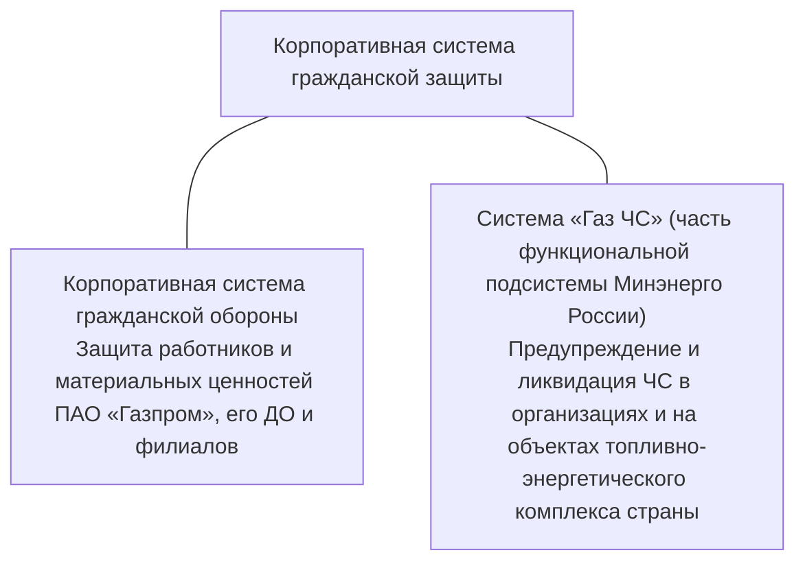

### **Основные задачи КСГЗ**

- Обеспечение готовности к действиям в условиях ЧС природного и техногенного характера, а также военных конфликтов органов и пунктов управления, систем связи и оповещения, сил и средств КСГЗ, предназначенных и выделяемых для предупреждения и ликвидации ЧС различного характера на объектах Группы Газпром, защиты работников и материальных ценностей организаций Группы Газпром, возникающих при военных конфликтах или вследствие этих конфликтов;
- взаимодействие с органами управления и силами функциональных и территориальных подсистем РСЧС1;
- оповещение работников об опасностях, возникающих при ЧС различного характера, а также в условиях военных конфликтов или вследствие этих конфликтов;
- подготовка работников к действиям в ЧС различного характера и их обучение способами защиты от опасностей, возникающих при военных конфликтах или вследствие этих конфликтов;
- прогнозирование и оценка социально-экономических последствий ЧС различного характера на объектах ЕСГ;
- создание в целях гражданской обороны запасов материально-технических, продовольственных, медицинских и иных средств, а также резервов финансовых и материальных ресурсов для ликвидации ЧС различного характера на объектах ЕСГ;
- осуществление корпоративного контроля в области ГО и защиты от ЧС.

----

#### **Существенные темы**

icon: building

7. Соответствие деятельности Группы Газпром нормам законодательства (социально-экономическим, экологическим, антимонопольным)

### **Результаты работы корпоративной системы гражданской защиты в 2023 г.**

В 2023 г. Газпром накапливал фонд защитных сооружений гражданской обороны и приводил их в соответствие с нормами проектирования инженерно-технических мероприятий гражданской обороны. Были приняты меры по повышению готовности органов управления, систем связи и оповещения к работе в условиях ЧС природного и техногенного характера. Продолжалась замена устаревших и выработавших свой срок средств индивидуальной защиты на современную продукцию отечественного производства. Совершенствовались системы мониторинга, обеспечивающие повышение безопасности эксплуатации ОПО и защиту жизни и здоровья работников и населения. Группа Газпром вела работу по повышению уровня подготовки личного состава формирования и их обеспеченности имуществом и техникой.

> **КСГЗ ПАО «Газпром» полностью обеспечена человеческими, материальными и финансовыми ресурсами, системами связи, оповещения и информационного обеспечения. Состояние гражданской обороны и защиты от ЧС различного характера в организациях Группы Газпром соответствует основным требованиям законодательства в этой сфере. Органы управления, силы и средства, предназначенные для решения задач в области гражданской обороны, предупреждения и ликвидации ЧС различного характера, готовы к выполнению поставленных задач.**

### **Обеспечение готовности работников Группы Газпром к ЧС**

| Год  | Количество проведенных тактико-специальных учений, объектовых и штабных тренировок для поддержания готовности работников Группы Газпром к ЧС |
| ---- | -------------------------------------------------------------------------------------------------------------------------------------------- |
| 2023 | 4 484                                                                                                                                        |
| 2022 | 2 613                                                                                                                                        |
| 2021 | 2 558                                                                                                                                        |

| Год  | Количество работников Группы Газпром, участвовавших в тактико-специальных учениях, объектовых и штабных тренировках, чел. |
| ---- | ------------------------------------------------------------------------------------------------------------------------- |
| 2023 | 115 954                                                                                                                   |
| 2022 | 126 168                                                                                                                   |
| 2021 | 106 200                                                                                                                   |

| Год  | Количество должностных лиц, ответственных за гражданскую защиту, прошедших обучение по различным программам подготовки в области защиты от ЧС, чел. |
| ---- | --------------------------------------------------------------------------------------------------------------------------------------------------- |
| 2023 | 7 568                                                                                                                                               |
| 2022 | 7 674                                                                                                                                               |
| 2021 | 9 067                                                                                                                                               |

| Год  | Количество работников Группы Газпром, прошедших обучение по различным программам подготовки в области защиты от ЧС, чел. |
| ---- | ------------------------------------------------------------------------------------------------------------------------ |
| 2023 | 310 228                                                                                                                  |
| 2022 | 299 641                                                                                                                  |
| 2021 | 299 335                                                                                                                  |

### **Административные штрафы и нефинансовые санкции за нарушения в области организации ГО и защиты от ЧС в Группе Газпром**

| Год  | Сумма выплаченных административных штрафов, тыс. руб. |
| ---- | ----------------------------------------------------- |
| 2023 | 560                                                   |
| 2022 | 125                                                   |
| 2021 | 759                                                   |

| Год  | Количество нефинансовых санкций |
| ---- | ------------------------------- |
| 2023 | 7                               |
| 2022 | 3                               |
| 2021 | 6                               |

Сумма выплаченных административных штрафов за нарушения в области ГО и защиты от ЧС в 2023 г. составила 560 тыс. руб., что на 78 % больше, чем в 2022 г. К организациям Группы Газпром применено семь нефинансовых санкций в области организации ГО и защиты от ЧС (на 57 % больше, чем в 2022 г.). Такая динамика обусловлена увеличением количества проведенных надзорных мероприятий со стороны контролирующих органов.

**0 ЧС**
природного и техногенного характера на объектах ПАО «Газпром» в 2023 г.

**На 41,7 %** выросло в отчетном году количество проведенных Группой Газпром тактико-специальных учений, объектовых и штабных тренировок

<!-- pdf_page: 64 -->
## PDF-страница 64

## **4. РАЗВИТИЕ РЕГИОНОВ**

#### **Принцип 4**
#### **<u>Социальная справедливость</u>**

### **РЕГИОНАЛЬНАЯ ПОЛИТИКА**

Социальная ответственность, повышение качества жизни граждан, развитие инфраструктуры регионов присутствия, расширение возможностей для воспитания здорового молодого поколения с устойчивыми ценностными ориентирами — среди важнейших задач Группы Газпром. Проекты реализуются в таких ключевых направлениях для развития общества и сохранения его единства, как образование, здравоохранение, культура и спорт. Усилиями большой команды Группа Газпром вносит свой вклад в создание условий для достойной жизни в России.

#### **Существенные темы**

icon: hand holding house

1. Реализация Группой Газпром программ развития газоснабжения и газификации субъектов Российской Федерации

icon: deer and cart

11. Взаимодействие Группы Газпром с местными сообществами в регионах присутствия

### **Подход к сотрудничеству с регионами присутствия**

<u>**РСПП 3.3.1**</u>

Группа Газпром как социально ответственный бизнес учитывает интересы государства. Она является единым целым с теми регионами, где ведут свою деятельность ее организации. Благодаря диалогу с населением Группа Газпром узнаёт о его потребностях, оказывает поддержку именно в тех чувствительных для граждан сферах, где она нужнее всего. Вместе с государством она участвует в реализации социальных программ, чтобы повысить качество жизни людей по всей России, а также в благотворительных и волонтерских проектах.

Цель Концепции региональной политики ПАО «Газпром»1 — создание экономических, правовых и организационных условий для успешной реализации общей стратегии социально-экономического развития организаций Группы Газпром в регионах по всей стране. Программа газификации позволяет существенно улучшить быт людей, создает стимул для развития бизнеса и производства в регионах. Газпром открывает новые предприятия, расширяет мощности и ГТС, что позволяет создавать новые рабочие места и решать вопрос трудоустройства представителей самых разных профессий.

----

1 Утверждена постановлением Правления ОАО «Газпром» от 22 мая 2003 г. № 32.

## **Основные направления взаимодействия с регионами**

icon: coins
Обеспечение налоговых поступлений в бюджеты всех уровней

icon: hands
Содействие в решении социально значимых вопросов

icon: lighthouse
Поддержка коренных малочисленных народов Севера

icon: house with people
Благоустройство населенных пунктов

icon: theater mask
Развитие культуры и спорта, проектов в сфере образования

icon: people
Содействие занятости населения

icon: handshake
Взаимодействие и реализация совместных проектов с общественными институтами и местными сообществами

icon: factory
Взаимодействие с органами государственной власти по реализации программ газификации

#### <u>**Индикатор Группы Газпром 7**</u>

На 31 декабря 2023 г. у Группы Газпром действовало 81 соглашение с регионами России. Пять из них были заключены в отчетном году:

* Договор о сотрудничестве ПАО «Газпром» с Правительством Ленинградской области в 2023–2025 годах;
* Соглашение о сотрудничестве между ПАО «Газпром» и Правительством Кировской области;
* Соглашение о намерениях по газоснабжению и газификации Мурманской области;
* Соглашение о сотрудничестве между ПАО «Газпром» и Правительством Ханты-Мансийского автономного округа — Югры на 2024–2028 годы;
* Соглашение о сотрудничестве между ПАО «Газпром» и Правительством Ямало-Ненецкого автономного округа на 2024–2026 годы.

Соглашения с регионами заключаются от лица ПАО «Газпром». Взаимодействие с субъектами в сфере социально-экономического развития регионов осуществляется ПАО «Газпром» при участии ДОиО, работающих на территории этих регионов Российской Федерации.

Заключая соглашения с регионами, Группа Газпром подтверждает свое намерение оказывать содействие в решении различных задач в социально-экономической сфере, таким образом внося значимый вклад в создание и развитие инфраструктуры. Газпром также создает условия для стабильного и перспективного функционирования ЕСГ на основе взаимовыгодного сотрудничества Группы Газпром и субъектов Российской Федерации.

Соглашения о сотрудничестве с администрациями муниципальных образований действуют почти во всех регионах присутствия дочерних обществ и организаций ПАО «Газпром». Соглашения направлены на обеспечение взаимодействия с регионами в рамках реализации стратегических проектов ПАО «Газпром», на укрепление дружеских, партнерских отношений и расширение деловых связей дочерних обществ и организаций ПАО «Газпром» с предприятиями, организациями, а также властями муниципальных образований на территории субъектов Российской Федерации.

## **81**
**соглашение**
**с регионами России**

icon: arrow
Подробнее с информацией о реализации инвестиционных проектов Группой Газпром в российских регионах можно ознакомиться в разделе <u>1. «О Группе Газпром»</u>.

icon: arrow
Подробнее с информацией о регулирующих документах в области региональной политики Группы Газпром в российских регионах можно ознакомиться в <u>**Приложении 6.4.**</u>

icon: arrow
Подробнее с информацией о взаимодействии с органами местного самоуправления можно ознакомиться в <u>**Приложении 6.2.**</u>

<!-- pdf_page: 65 -->
## PDF-страница 65

6. Приложение
5. Окружающая среда и экологическая политика
4. Развитие регионов
3. Безопасность производства
2. Люди Группы Газпром
1. О Группе Газпром

<u>Нацпроект «Жилье и городская среда»</u> <u>Нацпроект «Экология»</u>

## **Газификация регионов**

Группа Газпром продолжает масштабную работу, которая помогает россиянам подключаться к сетевому газу и значительно повышает качество жизни в городах и селах.

В 2023 г. завершено строительство 195 межпоселковых газопроводов общей протяженностью 2 447 км, благодаря чему были созданы условия для газификации 50,6 тыс. домовладений и квартир, а также 336 котельных в 412 населенных пунктах.

В 2024 г. планируется завершение строительства 306 межпоселковых газопроводов общей протяженностью 3 790,7 км для газификации более 69 тыс. домовладений и 314 котельных в 700 населенных пунктах.

**73,8 %**
<u>уровень газификации природным газом в целом по России на конец 2023 г.1</u>

**46 регионов,**
<u>где строятся ГРС</u>

**8 ГРС**
<u>с газопроводами-отводами построены Группой Газпром межрегионгаз</u>

**195 построенных межпоселковых газопроводов**
<u>общей протяженностью 2 447 км</u>

**72 субъекта Российской Федерации**

**1,230 млн т CO2-экв.**
<u>сокращение выбросов ПГ за счет газификации регионов</u>

**1 192** <u>Индикатор Группы Газпром 2</u>
**населенных пункта**
<u>подключено к газопроводам ПАО «Газпром» в рамках программ развития газоснабжения и газификации субъектов Российской Федерации на период до 2025 года2</u>

### **Программа газификации на 2021–2025 гг.**

В 2020 г. разработаны и утверждены программы развития газоснабжения и газификации субъектов Российской Федерации на период 2021–2025 гг. для 67 субъектов Российской Федерации. В 2022 г. актуализировано 66 программ. В 2022 г. были разработаны и утверждены программы на период до 2025 г. по Республике Татарстан, Костромской, Свердловской и Челябинской областям, а также скорректирована программа по Иркутской области на период 2021–2025 гг.

Программы 72 субъектов Российской Федерации предусматривают строительство:
* около 2,3 тыс. межпоселковых газопроводов протяженностью 30 тыс. км;
* 5,5 тыс. внутрипоселковых газопроводов протяженностью 36,6 тыс. км;
* 153 ГРС.

Программы газификации предусматривают создание условий для газификации около 977 тыс. домовладений и квартир, а также 4,7 тыс. котельных в 5,7 тыс. населенных пунктов.

**30 тыс. км межпоселковых газопроводов**
<u>предусматривает Программа газификации на 2021–2025 гг.</u>

Кроме того, предусмотрено строительство или реконструкция существующих газопроводов-отводов, техническое перевооружение ГРС.

Группа Газпром ведет работу по формированию проекта Программы развития газоснабжения и газификации Мурманской области на период 2025–2030 гг. В отчетном году разработаны проекты ежегодных планов-графиков синхронизации выполнения программ развития газоснабжения и газификации на 2024 г. по мероприятиям и срокам реализации объектов.

В соответствии с пунктом 8 Перечня поручений Президента Российской Федерации В.В. Путина3 ПАО «Газпром» совместно с органами исполнительной власти Республики Бурятия, Забайкальского края и Амурской области разработаны и утверждены планы-графики («дорожные карты») газификации Республики Бурятия и Забайкальского края до 2032 г., а также городского округа г. Тында до 2027 г. Планы-графики («дорожные карты») газификации Республики Бурятия и Забайкальского края до 2032 г. в числе прочего предусматривают формирование программ развития газоснабжения и газификации указанных регионов на период 2026–2032 гг. по итогам выполнения ряда предшествующих мероприятий, в том числе запланированных на 2024–2025 гг. корректировки, согласования и утверждения прогнозных топливно-энергетических балансов данных регионов, а также разработки материалов корректировок Генеральных схем газоснабжения и газификации.

В отчетном году был утвержден Комплексный график газификации г. Свободного Амурской области, предусматривающий в 2024 г. газификацию четырех котельных.

Совместно с федеральными органами власти Группа Газпром продолжает работу над совершенствованием законодательства для упрощения и ускорения строительства объектов газоснабжения, оптимизации сроков и стоимости проектов.

**36,6 тыс. км внутрипоселковых газопроводов**
<u>предусматривает Программа газификации на 2021–2025 гг.</u>

Так, в 2023 г. представители Группы Газпром участвовали в ежегодных заседаниях регионального штаба Московской области по реализации Президентского проекта «Социальная газификация» на период 2021–2025 гг., в заседаниях региональных штабов по газификации в семи субъектах Северо-Кавказского федерального округа и межведомственных рабочих групп регионов по топливно-энергетическому комплексу, а также федеральных штабов по газификации под руководством Заместителя Председателя Правительства Российской Федерации А.В. Новака.

Группа Газпром участвовала в координации своей деятельности и деятельности региональных властей по газификации и газоснабжению на период 2021–2025 гг. В отчетном году было усилено взаимодействие с региональными штабами, согласованы планы-графики на 2024 г., обеспечен контроль работы по социальной газификации.

Решался вопрос ускорения оформления прав на земельные (лесные) участки, а также других вопросов по инвестиционным проектам Группы Газпром в рамках создания Восточной системы газоснабжения с властями Сибирского и Дальневосточного федеральных округов.

icon: arrow
Все регионы России, в которых реализуются программы развития газоснабжения и газификации субъектов Российской Федерации, указаны на <u>Карте газификации</u>.

1 <u>https://energypolicy.ru</u>
2 Раскрытие данного индикатора предполагает предоставление информации о количестве населенных пунктов, подключенных к газопроводам ПАО «Газпром», нарастающим итогом.
3 Перечень поручений Президента Российской Федерации В.В. Путина от 5 мая 2023 г. № Пр-914.

<!-- pdf_page: 66 -->
## PDF-страница 66

## **РАЗВИВАЕМ КРИОГЕННЫЕ ТЕХНОЛОГИИ**

**СПЕЦИАЛИЗАЦИЯ НА КРИОГЕННЫХ ТЕХНОЛОГИЯХ СЖИЖЕНИЯ И ТРАНСПОРТИРОВКИ ПРИРОДНОГО ГАЗА ПОЗВОЛЯЕТ ЗАПУСКАТЬ НОВЫЕ ПРОИЗВОДСТВЕННЫЕ МОЩНОСТИ В ОГРАНИЧЕННЫЕ СРОКИ. СОЗДАВАЕМАЯ ГАЗПРОМОМ КОМПЛЕКСНАЯ ИНФРАСТРУКТУРА МАЛОТОННАЖНОГО ПРОИЗВОДСТВА И ПОТРЕБЛЕНИЯ СПГ РАСШИРЯЕТ СФЕРЫ ИСПОЛЬЗОВАНИЯ ПРИРОДНОГО ГАЗА — КАК ГАЗОМОТОРНОГО ТОПЛИВА ДЛЯ РАЗЛИЧНЫХ ВИДОВ ТРАНСПОРТА И В ПРОМЫШЛЕННОСТИ, А ТАКЖЕ ПРИ АВТОНОМНОЙ ГАЗИФИКАЦИИ СОЦИАЛЬНО ЗНАЧИМЫХ ОБЪЕКТОВ.**

photo: Любовь Бриш standing in front of a background showing a gas truck and industrial facility

**ЛЮБОВЬ БРИШ**
**Генеральный директор**
**ООО «Газпром гелий сервис»**

Создала центр компетенций по реализации инвестпроектов, основанных на применении криотехнологий в газовой энергетике. Руководит деятельностью первого в России и крупнейшего в мире гелиевого хаба Газпрома. Обеспечила строительство и осуществляет эксплуатацию малотоннажных заводов по производству СПГ на Дальнем Востоке, а также первой в России системы полного цикла производства и реализации СПГ в Южном федеральном округе. Сформировала самое большое в стране автопредприятие на СПГ для транспортировки сжиженных газов на внутренних и международных маршрутах.

<!-- pdf_page: 67 -->
## PDF-страница 67

Отчет о социальной деятельности Группы Газпром за 2023 год

130–131

## **Догазификация регионов**

В уже газифицированных населенных пунктах Группа Газпром ведет догазификацию — бесплатно прокладывает газопроводы до границ земельных участков граждан и котельных медицинских и образовательных учреждений.

ООО «Газпром газификация» является Единым оператором газификации в 72 субъектах Российской Федерации и на федеральной территории «Сириус». Региональные операторы газификации определены в 13 субъектах. Правила взаимодействия всех участников программы газификации утверждены Постановлением Правительства Российской Федерации от 13 сентября 2021 г. № 1550. Этот документ определяет механизм финансирования со стороны Единого оператора деятельности региональных операторов и независимых газораспределительных организаций.

> **В 2023 г. выполнено в 1,5 раза больше работ по догазификации, чем годом ранее. На конец 2023 г. заключено более 1 млн договоров, большая часть которых уже исполнена.**

В 2023 г. ООО «Газпром газификация» заключало договоры на финансирование мероприятий по догазификации с газораспределительными организациями. В ходе взаимодействия были достигнуты следующие результаты1.

Создана техническая возможность подключения
**1 143 тыс. домовладений**

Проведен газ до границ участков
**874 тыс. домовладений**

Количество заключенных договоров о технологическом подключении достигло
**1 091 тыс.**

**482 тыс. домовладений** подключено к газу

### **Результаты догазификации**

| Период                 | Построены сети до границ домовладений, тыс. | Подключено домовладений, тыс. |
| ---------------------- | ------------------------------------------- | ----------------------------- |
| Всего на 31.12.2023 г. | 874                                         | 482                           |
| В т. ч. в 2023 г.      | 371                                         | 265                           |

### **Количество заявок и заключенных договоров**

| Период                 | Количество поданных заявок на догазификацию | Количество заключенных договоров |
| ---------------------- | ------------------------------------------- | -------------------------------- |
| Всего на 31.12.2023 г. | 1 548                                       | 1 091                            |
| В т. ч. в 2023 г.      | 448                                         | 369                              |

По поручению Президента Российской Федерации В.В. Путина2 программа социальной газификации, предусматривающая технологическое присоединение газоиспользующего оборудования граждан, медицинских и образовательных организаций к газораспределительным сетям в газифицированных населенных пунктах, стала бессрочной. Единый оператор газификации по мере поступления заявок обеспечивает заключение и исполнение всех договоров на догазификацию.

В 2023 г. на портал Единого оператора газификации было подано 872 заявки от медицинских и образовательных организаций, из которых 64 % принято в работу, а остальные отклонены, в основном в связи с отсутствием правоустанавливающих документов на земельные участки и объекты капитального строительства. ООО «Газпром межрегионгаз» заключило 442 договора с социальными учреждениями, из которых 223 исполнены до границ земельных участков, а по 73 договорам выполнен пуск газа.

1 Представлены данные накопительным итогом с начала реализации мероприятий по догазификации до 31 декабря 2023 г.
2 Поручение Президента Российской Федерации В.В. Путина от 30 октября 2022 г. № Пр-2067.

## **Газификация и программа «Чистый воздух»**

В рамках федерального проекта «Чистый воздух» (входит в национальный проект «Экология») проводится социальная газификация частных домовладений. Власти регионов, участвующих в проекте, оказывают адресную помощь населению на газификацию, например, в форме компенсаций или выплат. Распространение в воздухе вредных частиц от сжигания непредусмотренных для этого материалов, например бытового мусора, вредит здоровью людей и загрязняет атмосферу. Газификация помогает решить экологические проблемы регионов — участников проекта «Чистый воздух».

Почти в половине городов — участников федерального проекта «Чистый воздух» реализуется социальная программа догазификации. В 2023 г. мероприятия по догазификации выполнялись в городах Братск, Липецк, Магнитогорск, Медногорск, Нижнем Тагиле, Новокузнецк, Омск, Челябинск и Череповец.

В 2021–2023 гг. в рамках догазификации в городах — участниках проекта «Чистый воздух» обеспечена техническая возможность подключения для более 18 тыс. частных домовладений, из них подключено к газу более 10 тыс. домовладений.

### **Результаты догазификации социальных учреждений в 2023 г.**

| Категория организаций | Количество регионов | Принято заявок на догазификацию | Заключено договоров | Исполнено договоров до границ земельных участков |
| --------------------- | ------------------- | ------------------------------- | ------------------- | ------------------------------------------------ |
| Медицинские           | 46                  | 298                             | 240                 | 133                                              |
| Образовательные       | 44                  | 264                             | 202                 | 90                                               |

icon: arrow icon

Подробнее с информацией о взаимодействии Группы Газпром с государственными органами можно ознакомиться в <u>Приложении 6.2</u>.

1. О Группе Газпром
2. Люди Группы Газпром
3. Безопасность производства
4. Развитие регионов
5. Окружающая среда и экологическая политика
6. Приложение

<!-- pdf_page: 68 -->
## PDF-страница 68

72 региона Российской Федерации, в которых реализуются программы развития газоснабжения и газификации субъектов Российской Федерации на период 2021–2025 гг.

1. Алтайский край
2. Амурская область
3. Архангельская область
4. Астраханская область
5. Белгородская область
6. Брянская область
7. Владимирская область
8. Волгоградская область
9. Вологодская область
10. Воронежская область
11. Ивановская область
12. Иркутская область
13. Калининградская область
14. Калужская область
15. Камчатский край
16. Кабардино-Балкарская Республика
17. Кемеровская область
18. Кировская область
19. Костромская область
20. Краснодарский край
21. Курганская область
22. Курская область
23. Карачаево-Черкесская Республика
24. Ленинградская область
25. Липецкая область
26. Московская область
27. Нижегородская область
28. Новгородская область
29. Новосибирская область
30. Омская область
31. Оренбургская область
32. Орловская область
33. Пензенская область
34. Пермский край
35. Приморский край
36. Псковская область
37. Республика Адыгея
38. Республика Алтай
39. Республика Башкортостан
40. Республика Дагестан
41. Республика Ингушетия
42. Республика Калмыкия
43. Республика Карелия
44. Республика Коми
45. Республика Марий Эл
46. Республика Мордовия
47. Республика Саха (Якутия)
48. Республика Северная Осетия — Алания
49. Республика Татарстан
50. Ростовская область
51. Рязанская область
52. Самарская область
53. Саратовская область
54. Сахалинская область
55. Свердловская область
56. Смоленская область
57. г. Санкт-Петербург
58. Ставропольский край
59. Тамбовская область
60. Тверская область
61. Томская область
62. Тульская область
63. Тюменская область
64. Удмуртская Республика
65. Ульяновская область
66. Хабаровский край
67. Ханты-Мансийский автономный округ — Югра
68. Челябинская область
69. Чеченская Республика
70. Чувашская Республика
71. Ямало-Ненецкий автономный округ
72. Ярославская область

map: Map of Russia showing gas supply and gasification programs in 72 regions

## 482 **тыс.**
### **домовладений**
#### подключено к газу за всё время реализации программы догазификации

На конец 2023 г. 100 % технически возможный уровень сетевой газификации достигнут в 11 регионах, среди которых Кабардино-Балкарская и Чеченская республики, республики Северная Осетия — Алания и Татарстан, Ставропольский край, Белгородская, Оренбургская, Самарская и Саратовская области, а также города Москва и Санкт-Петербург.

icon: blue square Программы развития газоснабжения и газификации субъектов Российской Федерации на период 2021–2025 гг. реализуются в 72 регионах Российской Федерации

icon: house icon Количество домовладений, для которых обеспечена техническая возможность подключения по программе «Чистый воздух» (в скобках указаны подключенные домовладения)

<!-- pdf_page: 69 -->
## PDF-страница 69

## **ВЗАИМОДЕЙСТВИЕ С КОРЕННЫМИ МАЛОЧИСЛЕННЫМИ НАРОДАМИ**

Группа Газпром стремится сохранить исконную среду обитания и традиционный образ жизни КМН, повышает качество их жизни, создает условия для самореализации, поддерживает их экономическое и культурное развитие в регионах присутствия.

#### **Существенные темы**

icon: reindeer and sled

11. Взаимодействие Группы Газпром с местными сообществами в регионах присутствия

----

**Нацпроект «Демография»** **Нацпроект «Здравоохранение»** **Нацпроект «Культура»** **Нацпроект «Образование»**

### **Подход к взаимодействию с КМН**

Группа Газпром выстраивает отношения с представителями КМН на принципах долгосрочного партнерства и взаимной заинтересованности в решении общих задач. Она учитывает особенности экономического и социального развития территорий, на которых ведет свою деятельность, а также прилагает значительные усилия для обеспечения экологической безопасности.

Реализация программ поддержки позволяет организациям Группы Газпром внести свой позитивный вклад в жизнь коренных народов:
* сохранить традиционную культуру КМН;
* создать площадки для обмена культурным опытом;
* популяризировать национальные виды спорта;
* поддержать семьи кочевников;
* повысить туристическую привлекательность регионов, где проживают КМН.

### **Принципы взаимодействия Группы Газпром с КМН**

#### **Уважение культур**
* Сохранение исконной среды обитания и традиционного образа жизни КМН
* Рациональное использование природных ресурсов территорий проживания КМН
* Планирование производственной деятельности организаций Группы Газпром в регионе присутствия с учетом особенностей хозяйственной деятельности и кочевого образа жизни КМН

#### **Конструктивное сотрудничество**
* Установление партнерских отношений с объединениями КМН и администрациями муниципальных образований в решении социально-экономических вопросов и развитии национальных поселений
* Поддержание равноправного сотрудничества и взаимной заинтересованности в решении общих задач

----

icon: computer screen

#### **Информационная открытость**
* Соблюдение законов, защищающих права и интересы КМН
* Проведение общественных слушаний и взаимодействие с ассоциациями КМН

icon: globe with people

#### **Социальная ответственность**
* Участие в решении социальных задач КМН
* Содействие в реализации проектов образовательных учреждений национальных поселений и сохранение самотыных традиций
* Поддержка успешно обучающихся и одаренных учеников из числа представителей КМН
* Обеспечение доступности товаров и медицинских услуг для кочевого населения в регионах реализации производственной деятельности Группы Газпром

#### **География взаимодействия с КМН**

Организации Группы Газпром1 взаимодействуют с восемью КМН на территории шести субъектов Российской Федерации:

* Ханты-Мансийского автономного округа — Югры;
* Ямало-Ненецкого автономного округа;
* Республики Саха (Якутия);
* Иркутской области;
* Сахалинской области;
* Свердловской области.

В числе коренных малочисленных народов, с которыми взаимодействуют организации Группы Газпром:
* ханты;
* манси;
* нивхи;
* селькупы;
* эвенки;
* эвены (ламуты);
* нивхи;
* ульта (ороки).

> **Группа Газпром придерживается безусловного приоритета прав местных сообществ на ведение традиционного образа жизни на исконных территориях их проживания. Проекты Группы Газпром реализуются с учетом текущих мест и особенностей жизнедеятельности коренных народов. Переселение КМН не ведется, и программы по их переселению не разрабатываются.**

**МЭР 40** **РСПП 3.2.3**

> **В 2023 г. не было выявлено случаев нарушений, затрагивающих права КМН, на территориях присутствия Группы Газпром.**

### **Направления взаимодействия с представителями КМН**

* Финансирование мероприятий по поддержке КМН и развитию традиционных отраслей хозяйства;
* заблаговременное информирование правительств в регионах присутствия Группы Газпром о планируемых производственно-технических работах (строительство и прокладка магистральных газопроводов, временных автомобильных и железных дорог и т. д.) в местах традиционного проживания и традиционной хозяйственной деятельности КМН;
* содействие в транспортном обеспечении населения, ведущего традиционный образ жизни;
* благотворительная поддержка региональных общественных организаций КМН.

icon: arrow

**Подробнее с информацией о взаимодействии Группы Газпром с КМН можно ознакомиться в <u>Приложении 6.2</u>.**

<!-- pdf_page: 70 -->
## PDF-страница 70

## **Проекты поддержки КМН в 2023 году**

Основные направления поддержки КМН в 2023 г.:

- реализация мероприятий по поддержке КМН и развитию традиционных отраслей хозяйства, поддержка сельскохозяйственных и рыбодобывающих предприятий;
- оказание социальной помощи малообеспеченным группам населения в условиях Крайнего Севера, организация лечебно-диагностической помощи тяжело больным детям и детям-инвалидам и обеспечение для них медицинского лечения и реабилитации;
- проведение мероприятий по экологической очистке территорий ЯНАО.

Прирост затрат связан с увеличением объема поддержки сельскохозяйственных общин и организаций хозяйственной деятельности КМН.

**74 проекта поддержки КМН** реализовано **Группой Газпром** в 2023 г.

**> 36,5 тыс. человек** приняли участие в традиционных праздниках КМН при поддержке организаций Группы Газпром

**Затраты на поддержку КМН,** млн руб.

| Год  | Затраты на поддержку КМН, млн руб. |
| ---- | ---------------------------------- |
| 2023 | 461,1                              |
| 2022 | 368,2                              |
| 2021 | 294,74                             |

### **Предоставление возможностей трудоустройства и обучения КМН**

С 2023 г. реализуется программа «Ясвэй», направленная на создание среды равных возможностей в сфере профессиональной самореализации для граждан из числа коренных малочисленных народов Севера, а также на ускорение адаптации граждан из числа представителей КМН Севера к производственному процессу, усвоения норм, ценностей и традиций организационной культуры Группы Газпром. Участниками программы могут стать молодые работники ООО «Газпром добыча Ямбург» (в возрасте до 35 лет) из числа представителей КМН, замещающие профессии, не требующие квалификации (неквалифицированный труд).

В феврале 2023 г. утверждена программа «Едэйко», цель которой — создание возможностей для успешной профессиональной самореализации и подготовки квалифицированных рабочих и специалистов из числа представителей КМН Севера. В программе участвуют старшеклассники школ Тазовского, Надымского и Пуровского районов, для которых организовано целевое обучение в ЧПОУ «Газпром техникум Новый Уренгой» и ГБПОУ ЯНАО «Новоуренгойский многопрофильный колледж», а также последующее трудоустройство в Газпром. Кроме того, организуются производственная и преддипломная практика для студентов с предоставлением рабочего места и летние стажировки.

### **Решение социально значимых задач КМН**

Представители КМН получали адресную помощь, в том числе на лечение и оздоровление, приобретение и доставку продуктов питания в тундру для кочующего населения.

Одной из основных проблем людей, ведущих кочевой образ жизни, является отсутствие в шаговой доступности современных медицинских учреждений. Газпром предоставляет тундровикам возможность получения квалифицированной медицинской помощи и консультации узких специалистов во врачебных амбулаториях на месторождениях.

### **Сохранение традиций и культуры КМН**

Группа Газпром стремится сохранить исконную среду обитания и поддержать традиционный образ жизни, устои и культурные ценности КМН.

КМН Севера: День рыбака и День оленевода на Ямале, Слет оленеводов Ямальского района, традиционные праздники «Кормление духа — хозяина моря» в г. Поронайск на о. Сахалин и «Вороний день» в Белоярском районе ХМАО — Югры, а также другие мероприятия, направленные на сохранение и развитие культурных традиций КМН.

На протяжении 2023 г. организации Группы Газпром поддерживали организационно и финансово национальные праздники

----

icon: information

ООО «Газпром добыча Надым» имеет генеральные соглашения с администрациями Ямальского, Пуровского и Надымского районов ЯНАО об участии в социально-экономическом развитии территорий, которые включают пункты по оказанию помощи КМН. По территории Бованенковского месторождения проходят традиционные маршруты каслания оленей, и ООО «Газпром добыча Надым», ведущее там работы, учитывает это в ходе строительства объектов и ведения деятельности. В 2023 г. компания организовала сезонный переход двух оленеводческих бригад и 8 тыс. оленей через Бованенковское НГКМ: на участках с интенсивным автомобильным движением на время перехода был остановлен трафик, а часть дороги оснастили специальным покрытием, чтобы полозья нарт не получили повреждений.

**8 тыс. оленей** было перевезено через Бованенковское НГКМ в 2023 г.

icon: information

По запросу главы кочевой общины эвенков «Киндигирь» (Республика Саха (Якутия)) ООО «Газпром трансгаз Томск» помогло усилить контроль допуска граждан и автотранспорта на технологическую дорогу, чтобы ограничить проникновение браконьеров на территорию традиционного природопользования «Киндигирский».

icon: information

В 2023 г. ООО «Газпромтранс» по запросу Приуральского районного общественного движения «Возрождение» и Ямальского районного общественного движения коренных малочисленных народов Севера «Ямал» перевезло 1 273 коренных ямальца по железнодорожной линии Обская — Карская по льготным ставкам.

**1 273 коренных ямальца** перевезено по железнодорожной линии Обская — Карская по льготным ставкам

### **Помощь общинам КМН**

В отчетном году организации Группы Газпром оказывали благотворительную поддержку общинам КМН, приобретенная для них необходимые транспортные средства, бытовые предметы, медикаменты и другие товары.

ООО «Газпром трансгаз Томск» оказало финансовую поддержку кочевой родовой общине КМН Севера «Олонгро» (Рыбное) для приобретения палатки и печи для улучшения социально-бытовых условий, а также кочевой родовой общине эвенков «Дружба» для приобретения снегоходов с целью сохранения исконной среды обитания и поддержки традиционного образа жизни.

ООО «Газпром недра» в течение 2023 г. оказывало финансовую поддержку двум общинам КМН: Нивхской родовой общине «Аборигены» и Территориально-соседской общине коренного малочисленного народа ороки (ульта) «Юктэ».

code: QR code

icon: arrow

Фильм о жизни КМН Крайнего Севера <u>«Оленеводы. Бесконечное путешествие»</u>.

icon: information

В ответ на обращение Администрации Ямальского района ЯНАО ООО «Газпромнефть-Заполярье» построило на побережье Карского моря факторию для ямальцев, занимающихся традиционными промыслами. Комплекс зданий для отдыха жителей тундры, подготовки и хранения продукции, а также ремонта техники стал перевалочной базой для более чем 300 семей оленеводов ЯНАО. Для тундровиков работают магазин, складские помещения с оборудованием для заморозки и хранения продукции, пекарня, помещения для отдыха с мебелью и техникой. Коренные ямальцы получили возможность остановиться в комфортных условиях во время сезонной миграции оленей. Фактория оснащена генераторами электроэнергии и телекоммуникационным оборудованием. Представители промысловых общин, рыбаки и оленеводы могут сдать на фактории свою продукцию, приобрести товары первой необходимости, заправить или отремонтировать транспорт.

<!-- pdf_page: 71 -->
## PDF-страница 71

----

#### 1. О Группе Газпром
#### 2. Люди Группы Газпром
#### 3. Безопасность производства
#### 4. Развитие регионов
#### 5. Окружающая среда и экологическая политика
#### 6. Приложение

----

icon: information

ООО «Газпром добыча Ямбург» продолжило оказывать адресную помощь районным отделениям Ассоциации коренных малочисленных народов Крайнего Севера. В отчетном году благотворительную помощь получили более 200 семей кочевников. Также при финансовой поддержке компании члены Ассоциации «Ямал — потомкам» приняли участие в международной выставке-конкурсе «Сокровища Севера — 2023» и заняли призовые места.

icon: information

ООО «Газпром добыча Ноябрьск» по условиям Соглашения о сотрудничестве и финансировании социальных проектов, заключенного с Пуровским районом (ЯНАО), содействует в транспортном обеспечении кочующего населения, оленеводческих и рыболовцевских бригад, а также предприятий агропромышленного комплекса и предоставляет возможность трудоустройства. В отчетном году компания оказала финансовую поддержку НО «Родовая община коренных и малочисленных народов Севера «Дянки-кой» на приобретение медикаментов и средств реабилитации для девочки с диагнозом ДЦП.

icon: information

### **Первый форум женщин Севера**

В 2023 г. в г. Санкт-Петербурге Ассоциацией коренных малочисленных народов Севера, Сибири и Дальнего Востока совместно с Советом Федерации Федерального Собрания Российской Федерации при поддержке генерального партнера мероприятия ООО «Сахалинская Энергия» был проведен Первый форум женщин Севера. Это мероприятие стало коммуникационной площадкой для укрепления роли и реализации миссии женщин КМН Севера, Сибири и Дальнего Востока Российской Федерации в устойчивом развитии территорий, сохранении традиционного образа жизни этнических сообществ, родных языков, самобытной культуры и традиционных семейных ценностей КМН.

В работе форума приняли участие около 1 тыс. делегатов, в том числе женщины, принадлежащие к 40 КМН, проживающим в 28 субъектах Российской Федерации.

В рамках мероприятия прошли фестиваль «Здоровье и красота Севера», мастер-классы, а также выставка «Сильные женщины Великого Севера», организованная в партнерстве с Государственным историческим музеем, и выставка уйльтинской1 художницы В. Осиповой «Я рисую легенды...». Все дни на площадке форума работали мобильный медицинский центр, Консультационный центр социального содействия, медиаагостина «Предметный разговор с участниками форума», кабинет женского здоровья Регионального центра профилактической медицины г. Нового Уренгоя.

Участницы форума обсудили и опубликовали рекомендации Первого форума женщин Севера. Итоговый документ содержит обращение к руководителям федеральных органов исполнительной и законодательной власти, органов государственной власти субъектов Российской Федерации, органов местного самоуправления и другим заинтересованным сторонам о содействии реализации его положений в сфере социальных преобразований, здравоохранения, развития экономики, сохранения языков и культуры КМН. По итогам форума ведется работа по подготовке и реализации проекта «Сильные женщины Великого Севера» совместно с Государственным историческим музеем и Ассоциацией коренных малочисленных народов Севера, Сибири и Дальнего Востока Российской Федерации, а также образовательного проекта для лидеров НКО КМН Севера, Сибири и Дальнего Востока Российской Федерации.

1 Уйльтинский народ, или ороки, — один из КМН Севера, Сибири и Дальнего Востока Российской Федерации.

----

## **БЛАГОТВОРИТЕЛЬНОСТЬ И ВОЛОНТЕРСТВО**

Сохранение общенациональных ценностей, создание возможностей заниматься спортом для детей и взрослых по всей России, развитие культуры и искусства наравне с улучшением инфраструктуры в регионах — всё это важная часть деятельности Группы Газпром. Она вносит заметный вклад в поддержку населения регионов присутствия и создает широкие возможности для их развития и благополучия.

#### **Существенные темы**

icon: people
3. Социальные проекты Группы Газпром

icon: people and deer
11. Взаимодействие Группы Газпром с местными сообществами в регионах присутствия

----

#### **Принцип 5**
<u>**Опережающее развитие инфраструктуры**</u>

Нацпроект «Демография»
Нацпроект «Жилье и городская среда»
Нацпроект «Здравоохранение»
Нацпроект «Культура»
Нацпроект «Образование»

### **Управление благотворительностью**

Целью благотворительной и спонсорской деятельности ПАО «Газпром» и организаций Группы Газпром является участие в создании общественного блага и в решении наиболее актуальных и приоритетных задач социально-экономического развития в странах и регионах присутствия.

Проведение работ по указанным направлениям регламентируется Положением о спонсорской и благотворительной деятельности ПАО «Газпром»2. Положением определяются основные цели и задачи Группы Газпром в области спонсорской и благотворительной деятельности, основные принципы и направления деятельности, а также компетенция органов управления ПАО «Газпром» по принятию решений об оказании спонсорской и благотворительной помощи.

**4,5 тыс.**
**благотворительных и спонсорских мероприятий профинансировано Группой Газпром в 2023 г.**

#### **Основные задачи в области спонсорской и благотворительной деятельности**

* Содействие реализации государственной социальной политики для сохранения устойчивого социально-экономического развития в Российской Федерации и регионах деятельности Группы Газпром;
* участие в решении некоторых наиболее острых социальных проблем общества, способствующее укреплению общественной стабильности;
* формирование благоприятной среды для осуществления основных видов деятельности Группы Газпром и положительной репутации в глазах общественности.

#### **Основные формы реализации благотворительных инициатив**

* Адресная благотворительность и спонсорская поддержка
* Поддержка волонтерского движения
* Соглашения о сотрудничестве с региональными органами власти
* Собственные социальные проекты Группы

#### **Критерии отбора социальных проектов**

* Значимость
* Адресность
* Актуальность для общества

<!-- pdf_page: 72 -->
## PDF-страница 72

## **Система управления благотворительными и спонсорскими проектами Группы Газпром**

flow_chart: System management flowchart for charitable and sponsorship projects

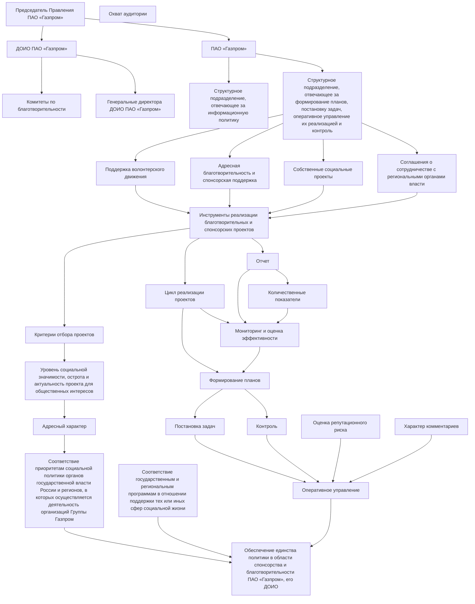

Решение об участии организаций Группы Газпром в том или ином проекте принимается с учетом его важности для местных сообществ, востребованности и способности оказать положительный эффект на развитие территории и улучшение качества жизни ее населения.

Принятие решений об участии в проектах и мероприятиях в области социальных инвестиций относится к компетенции Председателя Правления ПАО «Газпром».

Решение о поддержке социальных проектов принимают руководители организаций, входящих в Группу Газпром.

За формирование планов, постановку задач и управление их реализацией, контроль и предоставление заинтересованным пользователям информации по вопросам благотворительности отвечает профильный Департамент. Отдельные проекты и программы в области социальных инвестиций находятся в компетенции Департамента, отвечающего за реализацию информационной политики.

В 2023 г. на заседании Совета директоров ПАО «Газпром»1 была рассмотрена информация по вопросу «О реализации социальных программ, спонсорской и благотворительной деятельности Группы Газпром в 2022 году». По результатам рассмотрения Совет директоров принял к сведению предоставленную информацию, а также поручил Председателю Правления ПАО «Газпром» обеспечить продолжение работы Группы Газпром по реализации социальных программ, деятельности в области спонсорства и благотворительности.

icon: МЭР 34 icon: РСПП 1.7

## **54,88 млрд руб.**
**затраты ПАО «Газпром» на благотворительность в 2023 г.**

### **Количество профинансированных Группой Газпром благотворительных и спонсорских мероприятий**

| 2023 | > 4 500 |
| ---- | ------- |
| 2022 | > 3 900 |
| 2021 | > 3 500 |

icon: МЭР 34 icon: РСПП 1.7

### **Структура затрат ПАО «Газпром» по направлениям благотворительной поддержки, %**

| Вид затрат                                                                                               | 2021  | 2022  | 2023  | Изменение 2023/2022, п. п. |
| -------------------------------------------------------------------------------------------------------- | ----- | ----- | ----- | -------------------------- |
| Поддержка развития спорта (включая строительство спортивных объектов в рамках проекта «Газпром — детям») | 44,68 | 52,67 | 30,86 | -21,81                     |
| Благоустройство городской инфраструктуры регионов присутствия ПАО «Газпром»                              | 35,05 | 18,04 | 37,68 | +19,64                     |
| Поддержка культуры                                                                                       | 1,54  | 2,91  | 3,74  | +0,83                      |
| Поддержка образования                                                                                    | 8,00  | 5,59  | 15,68 | +10,09                     |
| Поддержка духовных ценностей                                                                             | 4,52  | 2,99  | 2,20  | -0,79                      |
| Прочее (поддержка здравоохранения, науки, социально незащищенных слоев населения и прочие направления)   | 6,20  | 17,80 | 9,84  | -7,96                      |

icon: arrow
**Подробнее с информацией о регулирующих документах в области благотворительности и спонсорской деятельности Группы Газпром можно ознакомиться в <u>Приложении 6.4</u>.**

icon: arrow
**Подробнее с информацией о взаимодействии Группы Газпром с местными сообществами можно ознакомиться в <u>Приложении 6.2</u>.**

<!-- pdf_page: 73 -->
## PDF-страница 73

## ДЕЛАЕМ СПОРТ ДОСТУПНЫМ

**ГАЗПРОМ СОДЕЙСТВУЕТ**
**ГАРМОНИЧНОМУ**
**ВОСПИТАНИЮ МОЛОДЕЖИ**
**И ПРОДВИЖЕНИЮ**
**ЗДОРОВОГО ОБРАЗА ЖИЗНИ.**
**СОЦИАЛЬНЫЙ ПРОЕКТ**
**«ГАЗПРОМ — ДЕТЕМ» —**
**ЭТО СВЫШЕ 2 ТЫС. ОБЪЕКТОВ**
**ДЛЯ ЮНЫХ СПОРТСМЕНОВ.**

photo: Alexey Kravchenko sitting in front of a Gazprom advertisement

**АЛЕКСЕЙ КРАВЧЕНКО**

Первый заместитель генерального
директора Фонда поддержки социальных
инициатив Газпрома

Реализует самый крупный социальный проект Группы — «Газпром — детям».
В 2023 г. в рамках проекта введены в эксплуатацию 116 объектов в семи федеральных округах. Среди них —
уникальный спортивный комплекс «Академия единоборств» на федеральной территории «Сириус», построенный
по поручению Президента России.

<!-- pdf_page: 74 -->
## PDF-страница 74

Отчет о социальной деятельности Группы Газпром за 2023 год

144–145

## **Проект «Газпром — детям»**

Группа Газпром придает большое значение тому, чтобы детям и подросткам в регионах России были предоставлены все возможности для гармоничного интеллектуального, духовного и физического развития. На достижение этой цели направлен крупнейший социальный проект Группы «Газпром — детям», который реализуется с 2007 г. Уникальный по своему масштабу проект нацелен на популяризацию спорта и здорового образа жизни. Он охватывает 74 из 89 субъектов Российской Федерации во всех федеральных округах.

Создавая спортивную инфраструктуру и формируя квалифицированный тренерский состав, Группа Газпром популяризирует спорт и делает его доступным. За время реализации проекта сотни тысяч детей и подростков получили возможность заниматься спортом в многофункциональных и специализированных комплексах, посещать современные бассейны, катки, соревноваться на новых стадионах и игровых площадках. Спортивные объекты появились как в крупных городах с сильными спортивными традициями, так и в отдаленных малонаселенных пунктах, где прежде не было достойных условий для занятий физической культурой.

Новые спортивные пространства создаются, в частности, с учетом потребностей детей и подростков, имеющих ограничения в мобильности, способствуют зарождению у подрастающего поколения любви к спорту и пониманию важности физической культуры для полноценной жизни, что является неотъемлемой составляющей будущих спортивных достижений.

### **Взаимодействие с органами власти**

ПАО «Газпром» руководствуется принципами социального партнерства при реализации проекта «Газпром — детям». Во взаимодействии с местными администрациями определяется концепция планируемого сооружения с учетом потребности конкретного населенного пункта в спортивных объектах, видов и уровней запланированных соревнований.

ПАО «Газпром» соблюдает интересы всех участников проекта, контролирует соблюдение сторонами достигнутых соглашений и принятых обязательств. Администрации регионов, местные администрации и госорганы оказывают содействие в успешной реализации проекта. Он реализуется за счет средств ПАО «Газпром» в рамках благотворительной деятельности.

### **Вклад в популяризацию спорта**

Благодаря тому, что проектом охвачены населенные пункты любой величины от поселков до мегаполисов, здоровый образ жизни становится доступным для всех поколений. Более 265 тыс. детей ежегодно могут заниматься различными видами спорта на спортивных объектах, построенных за период реализации проекта.

Группа Газпром обустраивает объекты «Газпром — детям» по лучшим стандартам. В рамках своих проектных решений они идеально подходят для проведения соревнований местного, федерального и международного уровней, что способствует укреплению региональной экономики.

Развитая спортивная инфраструктура делает города привлекательнее и комфортнее, препятствуя оттоку молодежи в мегаполисы.

**Количество объектов в рамках проекта «Газпром — детям» за 2007–2023 гг. (нарастающим итогом)**

| Год  | Количество объектов |
| ---- | ------------------- |
| 2023 | 2 131               |
| 2022 | 2 015               |
| 2021 | 1 945               |
| 2020 | 1 861               |
| 2019 | 1 822               |
| 2018 | 1 658               |
| 2017 | 1 607               |
| 2016 | 1 428               |
| 2015 | 1 251               |
| 2014 | 1 093               |
| 2013 | 991                 |
| 2012 | 726                 |
| 2011 | 642                 |
| 2010 | 614                 |
| 2009 | 547                 |
| 2008 | 446                 |
| 2007 | 206                 |

icon: information icon

#### **Место рождения звезд**

Группа Газпром создает объекты, где вырастают чемпионы. Ледовая арена в г. Санкт-Петербурге, построенная в рамках проекта «Газпром — детям», стала домом для спортивного клуба фигурного катания заслуженного мастера спорта СССР и легендарного тренера по фигурному катанию Т. Москвиной. Она воспитала четыре пары, ставшие победителями Олимпиад с 1984 по 2002 г., открыла спортивный клуб и готовила молодых фигуристов к Играм 2022 г. в г. Пекине.

На Ледовой арене среди других достойных фигуристов тренируются две звездные пары великого тренера: чемпионы мира 2021 г. А. Мишина — А. Галлямов, а также чемпионы Европы 2020 г. А. Бойкова — Д. Козловский.

icon: pen and paper icon

Самый большой стадион в России — «Лужники» — не смог бы вместить всех детей, которые посещают спортивные объекты, построенные в рамках проекта «Газпром — детям». Таких стадионов потребовалось бы как минимум три.

<!-- pdf_page: 75 -->
## PDF-страница 75

## **Основные направления и результаты за 2023 год**

**Ключевые спортивные направления, **поддержку которым оказывает Группа** в рамках проекта «Газпром — детям»**
* Баскетбол, волейбол, футбол, бадминтон
* Хоккей, фигурное катание, массовое катание на коньках
* Единоборства
* Плавание
* Физкультурно-оздоровительные занятия

В 2023 г. в Центральном, Северо-Западном, Южном, Северо-Кавказском, Приволжском, Сибирском и Дальневосточном федеральных округах введены в эксплуатацию 116 объектов:
* возведены 86 многофункциональных спортивных площадок и 11 школьных стадионов;
* 9 физкультурно-оздоровительных комплексов, доступных для детей, имеющих ограничения в своей мобильности;
* проведены ремонт, модернизация и реконструкция 9 спортивных объектов и 1 объекта культуры.

### **Создание новых рабочих мест**

Реализация столь масштабных проектов, связанных с созданием инфраструктуры, задействует большое количество человеческих ресурсов. Возводя спортивные комплексы и стадионы, Газпром способствует созданию рабочих мест в процессе строительства и после ввода новых объектов в эксплуатацию. Благодаря проекту «Газпром — детям» обеспечивается занятость широкого круга специалистов от строителей и инженеров до инструкторов, тренеров и обслуживающего персонала спортивных объектов.

### **Итоги работы над проектом «Газпром — детям» за 16 лет**

**189**
объектов спорта, образования и социально-культурного назначения построено

**1 859**
плоскостных сооружений (пришкольных стадионов и многофункциональных спортивных площадок) возведено

**> 24,5 тыс.**
**юных спортсменов** получили возможность заниматься спортом в 2023 г. в рамках проекта «Газпром — детям»

**116**
**объектов** введено в эксплуатацию

**~ 2,5 тыс.**
**рабочих мест** создано на объектах, построенных в 2022–2023 гг. в рамках проекта «Газпром — детям»1

**83**
социальных объекта реконструировано

**265 тыс.**
детей ежедневно могут заниматься различными видами спорта на спортивных объектах, построенных за период реализации проекта

#### **Проекты 2023 г.**

> **На Международной выставке-форуме «Россия» в павильоне ПАО «Газпром» проходят мероприятия в формате «вопрос — ответ» для популяризации проекта «Газпром — детям» и пропаганды здорового образа жизни и занятий физической культурой и спортом.**
>
> **Специальными гостями мероприятий стали такие звезды спорта, как Т. Москваина, В. Сидельников, А. Аверина и Д. Аверина, Н. Нагорный, а также спортивный журналист Г. Черданцев.**

----

#### **Краснодарский край**

##### **«Академия единоборств» для г. Сочи**

В январе на федеральной территории «Сириус» в Краснодарском крае введен в эксплуатацию уникальный спортивный комплекс «Академия единоборств» общей площадью более 63,5 тыс. м2, который стал самым большим в России и предназначен для тренировок сборных России по дзюдо и самбо. Объект построен за 2,5 года и является самым крупным в проекте «Газпром — детям».

В ходе создания комплекса олимпийская арена для керлинга «Ледяной куб» была реконструирована в Центр проведения соревнований общей площадью 17,5 тыс. м2. Кроме того, построен новый универсальный спортивно-тренировочный комплекс общей площадью 46 тыс. м2. В комплексе создан один из самых больших залов для дзюдо в мире размерами 53 × 48 м. Пол в этом зале оборудован 12 «плавающими» татами, чтобы минимизировать возможность получения травм. Еще один зал аналогичного размера может трансформироваться для соревнований по различным видам спорта.

Площадь территории «Академии единоборств» **в 2,5 раза** превышает площадь стадиона «Локомотив» в г. Москве

**2 тыс. зрителей** могут разместиться на трибунах во время соревнований

----

#### **Республика Татарстан**

##### **Реконструкция конноспортивного комплекса для поселка Богатые Сабы**

В августе в Сабинском районе Республики Татарстан после реконструкции открыт конноспортивный комплекс спортивной школы «Сабантуй».

Комплекс, построенный в 2015 г., нуждался в расширении. В ходе обновления, которое началось в 2022 г., в составе комплекса появились новые здания: предмезончик, соединенный с существующей конюшней новым теплым переходом, а также дополнительная конюшня площадью более 650 м2 с денницами2 на 26 лошадей. Кроме того, возведен двухэтажный хозяйственный блок. Все новые объекты объединены с существующим зданием конноспортивного комплекса.

**> 650 м2**
площадь дополнительной конюшни конноспортивного комплекса

----

#### **Белгородская область**

##### **Физкультурно-оздоровительный комплекс с ледовым полем для поселка Майский**

В марте завершено строительство физкультурно-оздоровительного комплекса с ледовым полем в поселке Майский Белгородской области, по решению местных жителей получившего название «Победа». Трехэтажное здание общей площадью более 6,5 тыс. м2 и ледовым полем площадью 1,8 тыс. м2 включает универсальный спортивный зал, зал для занятий единоборствами, аэробикой и хореографией и тренажерный зал. Кроме тренировок по фигурному катанию, хоккею, аэробике, борьбе и командным видам спорта, здесь планируется проводить и различные соревнования.

**1,8 тыс. м2**
площадь ледового поля

----

#### **Новгородская область**

##### **Стадион для гимназии в г. Великом Новгороде**

В г. Великом Новгороде построен новый пришкольный стадион с современной системой освещения. Он оснащен легкоатлетической зоной, которая включает три беговые дорожки, яму для прыжков в длину, а также зону воркаута. Кроме того, на стадионе есть поле для игры в мини-футбол, волейбол и баскетбол. Для безопасности спортсменов и болельщиков установлены защитные сетки.

**2 822 м2**
общая площадь стадиона

**До 240 человек**
в день способен вмещать пришкольный стадион

----

#### **Воронежская область**

##### **Стадион «Динамо» для г. Воронежа**

В июне завершены работы по капитальному ремонту стадиона «Динамо». Благодаря восстановлению стадиона возобновлены тренировки по футболу, легкой атлетике, велоспорту, спортивной гимнастике, вольной борьбе, дзюдо, а также проведение физкультурных и спортивно-массовых мероприятий для детей и подростков.

**6 тыс. м2**
площадь отремонтированных беговых дорожек

----

#### **Астраханская область**

##### **Новый корпус Православной гимназии для г. Астрахани**

В ноябре открыт новый корпус Православной гимназии имени священномученика Иосифа, митрополита Астраханского и благодетельницы Веры Жилкиной. Гимназия размещена в здании объекта культурного наследия — памятника федерального значения «Дом генерал-губернатора», реконструированного в рамках проекта «Газпром — детям».

**> 2,5 тыс. м2**
общая площадь объекта

**84 ученика**
5–11 классов смогут посещать новый корпус

----

#### **Ярославская область**

##### **Новый физкультурно-оздоровительный комплекс с бассейном для г. Переславля-Залесского**

В феврале открыт физкультурно-оздоровительный комплекс с бассейном и универсальным залом. В комплексе оборудованы спортивный зал с игровой площадкой, зал разминки и построены два бассейна — плавательный и учебный. Спортивный комплекс рассчитан на проведение занятий по настольному теннису, бадминтону, волейболу, баскетболу, мини-футболу и плаванию. Комплекс адаптирован для посещения маломобильными группами населения.

**> 4 тыс. м2**
площадь нового спортивного комплекса

----

<!-- pdf_page: 76 -->
## PDF-страница 76

## **Количество построенных объектов за период реализации проекта «Газпром — детям»**

map: Map of Russia with circular markers indicating federal districts

**Всего построен**
**2131**
**объект**

**Проекты в 2023 г.**
**116**
**объектов**

**9**
**объектов капитального строительства**

**97**
**плоскостных сооружений**

**10**
**объектов реконструкции**

----

#### **Северо-Кавказский федеральный округ**

**Всего за 16 лет**
**134**
**объекта**

**Проекты в 2023 г.**
**15**
**объектов**

**15**
**плоскостных сооружений**

| Всего за 16 лет   | Кабардино-Балкарская Республика     | 3  | 0   |
| ----------------- | ----------------------------------- | -- | --- |
| Проекты в 2023 г. | Карачаево-Черкесская Республика     | 13 | 0   |
|                   | Республика Дагестан                 | 24 | 15² |
|                   | Республика Ингушетия                | 13 | 0   |
|                   | Республика Северная Осетия — Алания | 9  | 0   |
|                   | Ставропольский край                 | 66 | 0   |
|                   | Чеченская Республика                | 6  | 0   |

----

#### **Южный федеральный округ**

**Всего за 16 лет**
**258**
**объектов**

**Проекты в 2023 г.**
**3**
**объекта**

**2**
**объекта капитального строительства**

**1**
**объект реконструкции**

| Всего за 16 лет   | Астраханская область  | 68 | 1³ |
| ----------------- | --------------------- | -- | -- |
|                   | Волгоградская область | 68 | 0  |
|                   | Краснодарский край    | 20 | 2¹ |
|                   | Республика Адыгея     | 11 | 0  |
| Проекты в 2023 г. | Республика Калмыкия   | 12 | 0  |
|                   | Ростовская область    | 79 | 0  |

----

#### **Уральский федеральный округ**

**Всего за 16 лет**
**96**
**объектов**

| Всего за 16 лет | Курганская область                       | 11 | 0 |
| --------------- | ---------------------------------------- | -- | - |
|                 | Свердловская область                     | 15 | 0 |
|                 | Тюменская область                        | 8  | 0 |
|                 | Ханты-Мансийский автономный округ — Югра | 18 | 0 |
|                 | Челябинская область                      | 13 | 0 |
|                 | Ямало-Ненецкий автономный округ          | 31 | 0 |

----

#### **Приволжский федеральный округ**

**Всего за 16 лет**
**300**
**объектов**

**Проекты в 2023 г.**
**46**
**объектов**

**2**
**объекта капитального строительства**

**40**
**плоскостных сооружений**

**4**
**объекта реконструкции**

| Всего за 16 лет   | Кировская область       | 53 | 0   |
| ----------------- | ----------------------- | -- | --- |
|                   | Нижегородская область   | 21 | 2³  |
|                   | Оренбургская область    | 57 | 1¹  |
|                   | Пензенская область      | 58 | 40² |
| Проекты в 2023 г. | Пермский край           | 2  | 0   |
|                   | Республика Башкортостан | 22 | 1¹  |
|                   | Республика Марий Эл     | 8  | 0   |
|                   | Республика Мордовия     | 9  | 1³  |
|                   | Республика Татарстан    | 12 | 1³  |
|                   | Самарская область       | 17 | 0   |
|                   | Саратовская область     | 21 | 0   |
|                   | Удмуртская Республика   | 6  | 0   |
|                   | Ульяновская область     | 4  | 0   |
|                   | Чувашская Республика    | 10 | 0   |

----

#### **Северо-Западный федеральный округ**

**Всего за 16 лет**
**368**
**объектов**

**Проекты в 2023 г.**
**14**
**объектов**

**2**
**объекта капитального строительства**

**12**
**плоскостных сооружений**

| Всего за 16 лет   | Архангельская область   | 20 | 0       |
| ----------------- | ----------------------- | -- | ------- |
|                   | Вологодская область     | 9  | 0       |
|                   | Калининградская область | 71 | 0       |
|                   | Ленинградская область   | 98 | 0       |
| Проекты в 2023 г. | Новгородская область    | 43 | 1¹; 11² |
|                   | Псковская область       | 38 | 0       |
|                   | Республика Карелия      | 25 | 0       |
|                   | Республика Коми         | 21 | 0       |
|                   | Санкт-Петербург         | 43 | 1¹; 1²  |

----

#### **Дальневосточный федеральный округ**

**Всего за 16 лет**
**127**
**объектов**

**Проекты в 2023 г.**
**3**
**объекта**

**3**
**объекта реконструкции**

| Всего за 16 лет | Амурская область             | 37 | 3³ |
| --------------- | ---------------------------- | -- | -- |
|                 | Еврейская автономная область | 1  | 0  |
|                 | Приморский край              | 13 | 0  |
|                 | Республика Саха (Якутия)     | 4  | 0  |
|                 | Сахалинская область          | 19 | 0  |
|                 | Хабаровский край             | 53 | 0  |

----

#### **Сибирский федеральный округ**

**Всего за 16 лет**
**157**
**объектов**

**Проекты в 2023 г.**
**16**
**объектов**

**15**
**плоскостных сооружений**

**1**
**объект реконструкции**

| Всего за 16 лет   | Алтайский край        | 5  | 0       |
| ----------------- | --------------------- | -- | ------- |
|                   | Иркутская область     | 25 | 0       |
|                   | Кемеровская область   | 2  | 0       |
|                   | Красноярский край     | 1  | 0       |
|                   | Новосибирская область | 6  | 0       |
| Проекты в 2023 г. | Омская область        | 90 | 0       |
|                   | Республика Алтай      | 1  | 0       |
|                   | Томская область       | 27 | 15²; 1³ |

----

Количество построенных объектов за период реализации проекта

Количество построенных объектов в 2023 г. (с разбивкой по типу объектов)

1 Объект капитального строительства.
2 Плоскостное сооружение.
3 Объект реконструкции.

<!-- pdf_page: 77 -->
## PDF-страница 77

## **Крупнейшие благотворительные проекты 2023 года**

### **Благоустройство инфраструктуры регионов присутствия Группы Газпром**

В отчетном году Группа Газпром продолжила стратегическую и практическую работу по благоустройству населенных пунктов и развитию городской инфраструктуры. Так, ПАО «Газпром» участвовало в подготовке предложений по развитию дальневосточных городов и реализации Стратегии социально-экономического развития Сибирского федерального округа на период до 2035 г. ДО на регулярной основе продолжают помогать местным администрациям в сохранении объектов культурного наследия, памятников, мемориалов, в уборкелично-дорожной сети и территорий, прилегающих к социальным учреждениям, от мусора, снега.

* АО «Пермгазтехнология» поддержало проект по созданию скульптурного ансамбля «Газовые фонари и парковая скульптура профессора П.Г. Соболевского» в центре города к 300-летию г. Перми, направленный на развитие исторической грамотности граждан.
* АО «Востокгазпром» поддержало проект благоустройства береговой линии и сквера на набережной реки Обь в селе Каргасок Каргасокского района Томской области. Теперь в селе появилось новое общественное пространство для проведения культурных мероприятий общей площадью 3,2 тыс. м2.
* В 2023 г. продолжались проектныезыискательские работы с целью строительства двух жилых домов в поселке Жигалово Иркутской области. Строительство социальных объектов ведется в рамках реализации проекта по обустройству и полному развитию Ковыктинского месторождения.

#### **180 проектов по благоустройству реализовано в 2023 г.**

#### **Место для активного отдыха**

В 2023 г. ООО «Газпром добыча Надым» приступило к проектным работам по благоустройству береговой озера Янтарное в г. Надыме (ЯНАО). Проект предусматривает восстановление гидрологического режима и экосистемы озера, расчистку вод от донных отложений и строительство очистных сооружений для изменения экологической обстановки в акватории озера. Архитектурная концепция новой береговой — зоны отдыха, спортивные и игровые площадки, лодочная станция — даст местному населению возможность активно проводить свободное время на открытом воздухе в любое время года.

### **Поддержка культуры**

Группа Газпром придает большое значение культурному просвещению людей всех поколений. Организации Группы Газпром также поддерживают деятелей искусства — музыкантов, актеров, художников, в том числе молодые таланты, давая им возможность принимать участие в выставках, гастролировать и знакомиться со своим творчеством граждан всей страны.

* ООО «Газпром добыча Иркутск» ежегодно поддерживает Международный фестиваль оперной музыки «Дыхание Байкала», который проводится в г. Иркутске с 2011 г. с участием звездных гостей из Монголии, а также городов Москвы, Санкт-Петербурга, Екатеринбурга и Иркутска. Фестиваль одновременно является отборочным туром одного из самых известных и престижных международных конкурсов вокалистов — Международного конкурса оперных певцов им. Ганса Габора «Бельведер». Он также направлен на развитие творческих способностей молодых исполнителей Иркутской области благодаря мастер-классам именитых вокалистов и педагогов.
* В августе 2023 г. при поддержке ООО «Газпром трансгаз Москва» в г. Рязани прошел II Международный фестиваль визуальных искусств «Узорная нить». На фестивальной площадке состоялись иммерсивная выставка, премьера спектакля, творческие мероприятия для детей и молодежи, шоу, концерты, мастер-классы.
* Для жителей сельских поселений и малых городов Самарской, Ульяновской и Оренбургской областей ООО «Газпром трансгаз Самара» организовало гастроляльный тур Самарского художественного театра. Актеры представили детские спектакли и постановки для взрослых по рассказам В. Шукшина, которые увидели в общей сложности более 9 тыс. зрителей.
* ООО «Сахалинская Энергия» формирует социокультурную среду на территории Сахалинской области. С 2021 г. компания реализует проект «Сахалин-2» совместно с художниками, кураторами искусства и учреждениями культуры при поддержке правительства региона. Проект направлен на объединение и развитие локального арт-сообщества. В 2023 г. в рамках проекта в Сахалинском областном художественном музее открылась выставка «Сила энергий», участниками которой стали более 30 деятелей искусства: художников, музыкантов, хореографов и танцоров. Позднее работы были представлены в г. Москве.
* В 2023 г. при поддержке ООО «Газпром нефтехим Салават» прошли мероприятия, приуроченные к празднованию 75-летия г. Салавата. В городском парке культуры и отдыха выступали профессиональные и самодеятельные художественные коллективы, Национальный симфонический оркестр.

#### **> 540 проектов по поддержке культуры реализовано в 2023 г.**

### **Поддержка образования и науки**

<u>**РСПП 3.3.2**</u>

Вклад в развитие учебных учреждений, поддержка мероприятий и инициатив в этой сфере — важная часть благотворительной деятельности Группы Газпром. Организации Группы Газпром помогают школам и детским садам развивать современное пространство для обучения, а новаторам дают возможность реализовать свои уникальные проекты.

* В Год педагога и наставника ООО «Газпром добыча Оренбург» оказало финансовую поддержку на проведение конкурса «Классная работа» среди школ Оренбургской области для развития творческого потенциала педагогов, развития патриотизма и повышения информированности детей о газодобывающей отрасли и рабочих профессиях.
* ООО «Газпром недра» в 2023 г. обустроило детские игровые и спортивные площадки на территории двух детских садов поселка Усть-Уда Иркутской области, а также профинансировало закупку оборудования для местной спортивной школы.
* В Амурской области детская образовательная среда совершенствуется благодаря усилиям ООО «Газпром переработка Благовещенск»: в 2023 г. компания профинансировала ремонт спортзала и библиотеки, закупку оснащения для местных школ и детского приюта, а также замену оборудования в Амурском техническом колледже. Кроме того, за счет компании организовано дополнительное образование в центре инклюзивного обучения: открыта «Профильная лагерная смена», медиацентр и психотерапевтическое пространство «Сенсорный сад» на площадке коррекционного детского дома для адаптации и реабилитации детей с ограниченными возможностями здоровья.
* При поддержке ПАО «Газпром» в поселке Жигалово возводится общеобразовательная школа на 520 мест. Строительство ведется в рамках реализации проекта по обустройству на полное развитие Ковыктинского месторождения.
* ООО «Газпром переработка» поддерживало вузы пяти регионов в городах Астрахани, Казани, Москве, Тюмени и Уфе: профинансирован ремонт учебных аудиторий, приобретено оборудование для кафедры «Химическая технология нефти и газа» Астраханского государственного технического университета, реализованы образовательные программы в рамках проекта «Школа главного технолога».
* В 2023 г. в рамках участия в мероприятиях Десятилетия науки и технологий в Российской Федерации и празднования 300-летия Российской академии наук1 ПАО «Газпром» профинансировано издание юбилейного двухтомного сборника «300 лет Российской академии наук». Тираж сборника составил 10 530 комплектов.

**880**
**проектов по поддержке образования реализовано в 2023 г.**

<!-- pdf_page: 78 -->
## PDF-страница 78

## **Поддержка духовных ценностей**

Сохранение объектов истории, духовного и культурного наследия многонационального и многоконфессионального сообщества России, формирование исторической памяти, знания и уважения духовных подвигов предков — вклад Группы Газпром в укрепление ценностных ориентиров и чувства единства со страной, ее богатой историей и культурой.

* ПАО «Газпром» профинансировало восстановление исторического интерьера храма во имя апостолов Петра и Павла в Здании Двенадцати коллегий в рамках празднования 300-летия Санкт-Петербургского государственного университета.
* ООО «Газпром межрегионгаз» профинансировало проектирование и строительно-монтажные работы по техническому перевооружению котельной для отопления и создания комфортных условий пребывания монахов, паломников и туристов на территории Рождество-Богородичного Санаксарского мужского монастыря, где покоятся мощи святого праведного воина Федора Ушакова. Проект направлен на развитие паломническо-туристического кластера Арзамас — Дивеево — Саров на территории Республики Мордовия.

icon: information

Совместно с Департаментом здравоохранения Томской области АО «Востокгазпром» организовало экспедицию плавучей поликлиники для обследования жителей северных поселков Томской области. Люди, находившиеся далеко от «большой земли», получили возможность пройти медицинский осмотр и обследование узкими специалистами. На выделенные компанией средства бригада медиков в течение 1,5 месяцев вела прием на специально арендованном теплоходе.

#### **Результаты экспедиции плавучей поликлиники в Томской области в 2023 г.**

**7 тыс.** лабораторных исследований проведено

**2 832** человека прошли обследование, в том числе 500 детей

**2** пациента отправлены на стационарное лечение в районные центры

## **Поддержка здравоохранения**

Организации Группы Газпром помогают населению в регионах присутствия сохранять и укреплять здоровье, поэтому уделяют большое внимание поддержке программ и мероприятий в области здравоохранения.

* ПАО «Газпром» поддерживает проекты Национального медицинского исследовательского центра детской гематологии, онкологии и иммунологии имени Дмитрия Рогачева в рамках финансирования инновационных клинических исследований для эффективного лечения детей. В 2023 г. на средства ПАО «Газпром» приобретен уникальный сканирующий конфокальный микроскоп, с помощью которого ученые смогут наблюдать за ранее неизвестными процессами в здоровых и патологических клетках, что в будущем позволит улучшить диагностику и лечение. Его новейшая оптическая система позволяет снимать фиксированные и живые клетки с максимально возможным на сегодняшний день разрешением.
* ОАО «Севернефтегазпром» поддержало проекты НКО «Благотворительный фонд поддержки детей Ямало-Ненецкого автономного округа «Ямине» для лечения и реабилитации тяжело больных детей и детей-инвалидов.

**350**
**проектов по поддержке духовных ценностей**
реализовано в 2023 г.

**> 120**
**проектов по поддержке здравоохранения**
реализовано в 2023 г.

----

icon: information

### **Долгий путь к победе**

С 2017 г. ООО «Газпром трансгаз Нижний Новгород» финансирует региональный этап Всемирных детских Игр победителей, который проходит в Нижегородской области. Это трехдневные спортивные соревнования для детей, которые несколько лет проходили стационарное лечение в онкологическом диспансере. Длительная борьба с онкологическими заболеваниями требует социальной, физической и психологической реабилитации детей.

Игры победителей — это ежегодная реабилитация для детей в праздничной и творческой атмосфере в форме спортивных состязаний. В них участвуют дети от 7 до 17 лет, находящиеся в ремиссии или на поддерживающем лечении. Вместе с детьми на соревнования приезжают и их родители, которые поддерживают команды.

Участников соревнований сопровождают медицинские работники, волонтеры и профессиональные спортсмены. В безопасных и контролируемых условиях и в окружении своих соратников по борьбе с болезнью дети получают навыки адаптации в социальной среде после долгой вынужденной изоляции.

#### **Пять дисциплин**

**Легкая атлетика** | **Шахматы** | **Стрельба**

**Плавание** | **Футбол**

Соревнование проводится на базе отдыха «Ласточка» в Нижегородской области — филиале компании — совместно с Негосударственным фондом «Нижегородский онкологический научный центр».

**> 300** человек приняли участие в Играх победителей в 2023 г.

<!-- pdf_page: 79 -->
## PDF-страница 79

## **Поддержка развития спорта**

Организации Группы Газпром нацелены на создание спортивной инфраструктуры во всех регионах присутствия, финансирование клубов и проведение запоминающихся событий.

* ПАО «Газпром» оказало спонсорскую помощь в проведении в 2023 г. Международного командного теннисного турнира «Трофеи Северной Пальмиры». Проект направлен на поддержку российских спортсменов и преодоление международной изоляции российского спорта: помимо российских теннисистов в нем приняли участие спортсмены из Сербии, Болгарии, Франции, Испании и других стран.
* В Республике Башкортостан развитие спорта и волейбола поддерживает ООО «Газпром трансгаз Уфа». Компания участвует в проведении лыжного марафона и турнира по волейболу среди юношей.
* ООО «Газпром трансгаз Санкт-Петербург» оказало финансовую поддержку Межрегиональной Санкт-Петербургской городской и Ленинградской областной общественной организации «Всероссийское общество спасения на водах» (ВОСВОД) с целью реализации программы «Развитие деятельности детей и молодежи в сфере безопасности на водах, охраны окружающей среды и пропаганды здорового образа жизни». В рамках данной программы были проведены 43 занятия в детских образовательных учреждениях, 85 мероприятий по обучению детей плаванию и приемам спасения в местах массового отдыха населения на водных объектах. Более 5 тыс. детей и молодых людей обучились приемам плавания и спасения на водах. Проведенные мероприятия расширили возможности ВОСВОД в развитии деятельности детей и молодежи в сфере безопасности на водах, охраны окружающей среды, пропаганды здорового образа жизни и в совершенствовании системы охраны жизни людей на водных объектах г. Санкт-Петербурга и Ленинградской области.
* В Ставрополе активно развиваются боевые искусства, в частности сетокан — один из стилей японского карате. ООО «Газпром трансгаз Ставрополь» поддерживает участие членов спортивного клуба «Сетокан трансгаз Ставрополь» в соревнованиях разных уровней, включая Чемпионат и Первенство России.

----

icon: information

С 2012 г. ООО «Газпром добыча Астрахань» поддерживает региональную Федерацию автомобильного спорта в организации бахи2 «Золото Кагана». В апреле 2023 г. при поддержке компании прошел ралли-рейд «Золото Кагана — 2023» (II этап Чемпионата России). В 2023 г. компания расширила сотрудничество, став партнером 5-го этапа Кубка России по ралли-рейдам «Астрахань-2023» и регионального соревнования по ралли-рейдам «Кубок губернатора».

#### **«Золото Кагана — 2023»**

**41 экипаж**
**в автоспортивных категориях**

**823 км** **скоростных участков в степях и песках**

**Более 1,0 тыс. км** **общая длина трассы**

**6,0 тыс. зрителей**

Поддерживая «Золото Кагана», Группа Газпром продвигает экологичное топливо: автомобиль, пилотируемый представителем ПАО «Газпром», оборудован гибридным двигателем, который работает на сжиженном газе.

----

## **890 проектов по поддержке спорта** реализовано в 2023 г.1

icon: information

#### **«Последняя игра» на Байкале**

При поддержке ООО «Газпром инвест» 8 марта 2023 г. состоялся товарищеский хоккейный матч на льду озера Байкал с участием звезд мирового уровня. Матч организован В. Фетисовым, который является послом доброй воли ООН по Арктике и Антарктиде. Целью мероприятия стало привлечение внимания к вопросам сохранения байкальской природы, а также внесение вклада в экологическое просвещение, популяризацию спорта и здорового образа жизни.

«Последняя игра» — серия соревнований по хоккею с участием известных спортсменов — поддержана Программой ООН по окружающей среде (ЮНЕП).

Для проведения матча была оборудована площадка в 100 км от г. Иркутска с ледовыми бортиками и трибунами на 400 мест.

В числе звезд хоккея на льду Байкала сразились олимпийские чемпионы и обладатели Кубка Стэнли А. Касатонов, В. Каменский, А. Якушев, А. Жамнов и А. Коваленко. Вместе с ними на Байкал прибыла также легенда фигурного катания И. Роднина. Звезды хоккея сразились на льду со сборной Иркутской области.

----

## **Поддержка социально незащищенных слоев населения**

Группа Газпром оказывает помощь социально незащищенным категориям населения: малообеспеченным и нуждающимся гражданам, а также людям с ограниченными возможностями здоровья. Особое внимание уделяется адресной поддержке детей с диагнозом ДЦП.

* ООО «Газпром добыча Краснодар» в 2023 г. приобрело реабилитационное оборудование по программе «Помощь детям-инвалидам» для детского сада в г. Краснодаре. Оно позволит адаптировать 165 детей с ограниченными возможностями здоровья к городской среде.
* Организации Группы Газпром помогают региональному благотворительному фонду «Иллюстрированные книжки для маленьких слепых детей» в издании комплектов для детей с нарушением зрения.
* ООО «Газпром трансгаз Саратов» в рамках проекта «Добрая лошадь» профинансировало закупку специального оборудования в Саратовской области для проведения занятий иппотерапией для детей с ограниченными возможностями здоровья.
* ООО «Газпром трансгаз Санкт-Петербург» оказало поддержку проекту, в рамках которого ведутся показы спектакля «Осторожно — улица!» для воспитанников детских домов и специализированных учреждений г. Санкт-Петербурга.

Организации Группы Газпром помогают взрослым вынужденным переселенцам обустраиваться на новом месте, а детям — расти и полноценно развиваться вместе с ровесниками из мирных регионов.

* При поддержке ООО «Газпром трансгаз Москва» 50 детей из Луганской Народной Республики провели майские каникулы в г. Москве. Для них была организована обширная культурная программа, включающая посещение знаковых мест столицы и Московской области и концерт Симфонического оркестра Министерства обороны Российской Федерации под управлением заслуженного артиста России С. Дурыгина.

----

icon: information

#### **Дорога в большой спорт**

В г. Перми ООО «Газпром трансгаз Чайковский» поддержало проведение XXI Фестиваля спорта детей-инвалидов Пермского края. Среди юных спортсменов — ребята с поражениями опорно-двигательного аппарата, нарушением слуха и зрения, синдромом Дауна, заболеваниями органов дыхания, пищеварения, почек, эндокринной системы. Дети участвовали в беге, прыжках в длину, игре в дартс, шашки и шахматы, стрельбе из лука и других соревнованиях. Для некоторых из них участие в соревнованиях — стартовый этап настоящей спортивной карьеры паралимпийца.

**350** детей-инвалидов и детей с ограниченными возможностями здоровья от 7 до 17 лет участвовали в фестивале в Перми

----

icon: arrow

Подобные проекты по поддержке социально незащищенных слоев населения реализованы в 2024 г.

**400**
**проектов поддержки социально незащищенных слоев населения**
реализовано в 2024 г.

<!-- pdf_page: 80 -->
## PDF-страница 80

## **Развитие Санкт-Петербурга**

Группа Газпром ведет масштабную работу по сохранению уникального историко-культурного наследия г. Санкт-Петербурга и развитию комфортной городской среды, возрождая традиции российского меценатства.

Санкт-Петербург и его шедевры являются достоянием всей страны, и задача Группы Газпром состоит в том, чтобы передать его будущим поколениям россиян. При этом важно делать город на Неве современным и комфортным мегаполисом, соответствующим тем идеям, которые воплощал его основатель — первый российский император Петр Великий.

Между ПАО «Газпром» и Правительством Санкт-Петербурга действует Соглашение о сотрудничестве, в развитие которого заключаются договоры о сотрудничестве.

В июне 2022 г. утверждена Программа («Дорожная карта») взаимодействия Правительства Санкт-Петербурга и ПАО «Газпром» при реализации объектов (проектов) социально-экономического развития Санкт-Петербурга. Она предусматривает реализацию 64 крупных проектов по десяти различным направлениям сотрудничества, которые планируется реализовать в г. Санкт-Петербурге при участии ПАО «Газпром» в среднесрочной и долгосрочной перспективе. В 2022–2023 гг. ПАО «Газпром» приступило дополнительно к реализации 11 социально значимых проектов.

Вниманием ПАО «Газпром» охвачены практически все сферы жизни местного населения от образования и медицины до сохранения историко-культурного наследия и создания новых символов страны. ПАО «Газпром» также поддерживает и организует фестивали, призванные объединять десятки тысяч людей со всей страны.

### **Благоустройство города**

С 2007 г. ПАО «Газпром» реализует масштабную программу по комплексному благоустройству г. Санкт-Петербурга, чтобы сохранить уникальное историко-культурное наследие города и сформировать современное комфортное городское пространство. Работы затрагивают Центральный, Адмиралтейский, Петроградский, Василеостровский и Московский районы города.

Проект реализуется в рамках программы взаимодействия с Правительством Санкт-Петербурга в части социально-экономического развития.

С 2007 г. в городе на Неве в ходе реализации проекта модернизируется подсветка архитектурных ансамблей и наружное освещение улично-дорожной сети с учетом экономической и энергетической эффективности объектов, устанавливаются современные фонари, выполненные в петербургской эстетике, освещение переводится на светодиодные матрицы. Для обновления улиц активно применяется долговечный и безопасный в эксплуатации гранит: обновляются тротуары и бордюры, обустраиваются пандусы и водоприемные чаши, устанавливаются газонные ограждения и скамьи. На улицах высаживаются деревья и кустарники, восстанавливаются газоны.

**> 100**
**улиц, скверов, набережных, площадей и архитектурных ансамблей реконструировано с 2007 г.**

**> 19 тыс.**
**светильников установлено**

**Программа комплексного благоустройства г. Санкт-Петербурга участвовала в Конкурсе реализованных проектов в области энергосбережения и повышения энергоэффективности 2023 г. и заняла 1-е место в номинации «Лучший проект по повышению энергоэффективности при строительстве и реконструкции».**

#### **Результаты 2023 г.**

##### **Благоустройство общественных пространств**

* Завершены благоустройство северной береговой линии Лахтинской гавани и южной набережной у МФК «Лахта Центр», а также отдельных участков Кронверкского проспекта, набережной реки Мойки, Английской набережной и проспекта Обуховской Обороны.
* Заменены светильники в историческом центре города — на улицах Малой Морской, Восстания, Пестеля, Кленовой, Думской; Суворовском, Московском и Лиговском проспектах; Манежной, Преображенской и Дворцовой площадях; Петровской, Петроградской, Кутузова, Воскресенской, Адмиралтейской, Дворцовой и Английской набережных и других объектах.
* Завершились работы по подсветке архитектурных ансамблей и наружному освещению улиц Декабристов и Большой Морской, Загородного проспекта, Воскресенской набережной, моста Бетанкура, Александровского сада, Нахимовского сквера, бульвара вдоль Петровской набережной, здания БДТ им. Г.А. Товстоногова, Домака Петра I, доходного дома Р.Г. Вере, храма Богоявления на Гутуевском острове и других объектов.
* Реализована художественная подсветка вантового моста через Петровский канал.
* Утверждена концепция «Экогалереи» — многофункционального общественного здания с атмосферой тропического леса возле МФК «Лахта Центр».

##### **Культурные проекты**

* При поддержке Группы Газпром в Государственном Эрмитаже открылись три новых зала экспозиции «Галерея Петра Великого»: коллекция дополнена произведениями живописи, искусства и утварства эпохи правления Анны Иоанновны и Елизаветы Петровны. Широкой публике представлены экспонаты эпохи преобразований Петра I и его последователей, внесших неоценимый вклад в создание новой России, процветания российской науки и искусства.
* 28 февраля 2023 г. при поддержке ПАО «Газпром» состоялось открытие памятной доски на историческом фасаде здания Зимнего дворца Петра I Государственного Эрмитажа, где император провел последние годы своей жизни.
* В Главном штабе Государственного Эрмитажа при поддержке ПАО «Газпром» открылась постоянная экспозиция, посвященная творчеству художника-фарфораиста, заслуженного художника России, члена-корреспондента Российской академии художеств И. Олевской.
* При поддержке ПАО «Газпром» специалисты Государственного Русского музея провели полномасштабную комплексную реставрацию картины К. Маковского «Народное гулянье во время масленицы на Адмиралтейской площади в Петербурге», а также исторической рамы к ней.
* В сентябре 2023 г. при поддержке ПАО «Газпром» в Государственном Русском музее началась комплексная реставрация произведений искусства из филиала Таганрогского художественного музея, пострадавших при взрыве ракеты. В общей сложности ущерб был нанесен 22 экспонатам. В их числе работы В. Борисова-Мусатова, В. Серова, К. Коровина, З. Серебряковой и других мастеров.

##### **Развитие городской инфраструктуры**

* Завершено строительство нового физкультурно-оздоровительного комплекса с 50-метровым бассейном олимпийского формата в Невском районе. Он является одним из наиболее крупных объектов программы «Газпром — детям» в городе и рассчитан на ежедневные занятия около 850 человек.
* Введена в эксплуатацию новая газовая заправка на ул. Ванеева в Невском районе. Сейчас сеть АГЗС включает 14 объектов.
* Стартовали работы по реконструкции станции метро «Чернышевская».

icon: information

#### **Поддержка социальной активности горожан**

В 2023 г. Газпром провел в г. Санкт-Петербурге множество крупных социальных мероприятий, в числе которых были:

* бесплатные катания и занятия с инструкторами для воспитанников детских домов и интернатов г. Санкт-Петербурга и Ленинградской области, детей из малообеспеченных и многодетных семей, детей с ограниченными возможностями здоровья (в частности, для подопечных центров содействия семейному воспитанию, центров социальной реабилитации инвалидов и детей-инвалидов, центров социальной помощи семье и детям);
* совместные мероприятия с благотворительным фондом «Хоккей для детей»;
* бесплатные еженедельные мастер-классы на льду «Мама, папа, я — спортивная семья»;
* регулярные бесплатные шоу и спектакли на льду для всех посетителей катка, находящегося в общественном пространстве «Флагшток»;
* совместные мероприятия с Комитетом по молодежной политике (День студента) и с Комитетом по труду и занятости населения («Трудовое лето»);
* фестиваль «Лето без интернета».

**> 215 тыс. человек**
**приняло участие в этих мероприятиях**

<!-- pdf_page: 81 -->
## PDF-страница 81

## **6. Приложения**

### 5. Окружающая среда и экологическая политика

### 4. Развитие регионов

### 3. Безопасность производства

### 2. Люди Группы Газпром

### 1. О Группе Газпром

----

icon: information

### **Большая Лахта**

При поддержке ПАО «Газпром» создается новый морской фасад города — район многофункционального комплекса «Лахта Центр», «Газпром Арены», общественное пространство «Флагшток», проводится комплексное благоустройство береговой линии Парка 300-летия Санкт-Петербурга.

#### **Общественное пространство «Флагшток»**

Газпром формирует и развивает новые центры притяжения для комфортного городского отдыха. Среди них — общественное пространство «Флагшток» у «Газпром Арены» на берегу Финского залива недалеко от «Лахта Центра».

С 2022 г. на нем был обустроен уличный ледовый каток площадью 2,9 тыс. м2, для организованных социальных сеансов катания предусмотрена малая ледовая площадка. В отчетном году площадь катка расширена в четыре раза — до 11,4 тыс. м2. В результате проводить время на коньках одновременно могут свыше 1,0 тыс. посетителей. В дальнейшем площадь ледовой арены увеличится до 28 тыс. м2 и каток станет самым большим в мире.

До 2023 г. самым высоким в России и Европе был расположенный именно здесь флагшток высотой 105 м, который позволяет поднимать флаг размером 20 × 30 м.

#### **Три флагштока на Базе водных видов спорта**

В 2023 г. в акватории Финского залива у Парка 300-летия Санкт-Петербурга построены три флагштока высотой 179,5 м, на которых подняты исторические флаги Российской империи, СССР и Государственный флаг Российской Федерации. Они сразу стали одной из главных городских достопримечательностей г. Санкт-Петербурга. Триединство флагов символизирует неразрывную связь истории России, преемственности силы и духа новыми поколениями.

Флагштоки, построенные в Финском заливе, не имеют аналогов в мире: никогда прежде столь высокие конструкции не возводились на воде. Разработка и реализация проекта потребовали сложных инженерно-конструкторских решений и инновационных строительных технологий.

Торжественная церемония подъема флагов на флагштоках прошла 17 июня 2023 г. при участии Президента России В.В. Путина. Событие было приурочено сразу к трем знаменательным датам: 165 лет флагу Российской империи, 100 лет Красному Знамени и 330 лет триколору Петра I.

**Книга рекордов России:**
* самая высокая группа трех флагштоков в мире;
* самая большая площадь полотна Государственного флага Российской Федерации, поднятого на флагштоке.

Проект предполагает благоустройство пляжной зоны и создание объектов спортивной и досуговой инфраструктуры. В основании флагштоков будет построена База водных видов спорта, где можно будет взять напрокат оборудование для занятий сапсерфингом, вейкбордингом и серфингом. Продолжается реконструкция пляжной линии для ГТО.

**179,5 м**
общая высота конструкции (вместе с основой) от уровня моря

**27 скамей**
**из гранита**, в том числе с беспроводными зарядными устройствами

**> 5 тыс. м2 гранитного мощения**

**~ 430 м берегоукрепления**

**60 × 40 м размер каждого флага**

**1 пост зарядки для электромобилей**

----

## **Проекты в сфере культуры и искусства**

code: QR-код

С 2022 г. Группа Газпром реализует крупнейший в регионе проект по продвижению современного искусства — <u>Санкт-Петербургская ярмарка искусства «1703» (ярмарка «1703»)</u>.

В июне 2023 г. Газпром провел второй сезон ярмарки «1703». Это масштабный культурный проект, направленный на популяризацию современного искусства, развитие практик коллекционирования и продвижение представителей художественного сообщества. Ярмарка знакомит широкую аудиторию с актуальными художественными практиками, позволяет посетить тематические дискуссии и лекции, познакомиться с экспертами, галеристами, художниками и кураторами.

Проект запущен в 2022 г. и включен в программу фестиваля культуры «Петербургские сезоны» Петербургского международного экономического форума. За два года ярмарка расширилась циклом мероприятий в течение всего года и трансформировалась в общедоступную бесплатную образовательную программу в сфере современного искусства.

Организатор проекта — ПАО «Газпром» при поддержке Комитета по культуре Санкт-Петербурга и ЦВЗ «Манеж».

В 2023 г. в ярмарке впервые приняла участие иностранная галерея — Ambidexter (г. Стамбул, Турция). Среди российских участников были представлены галереи из городов Москвы, Санкт-Петербурга, Нижнего Новгорода и Калуги.

> **Санкт-Петербургская ярмарка искусства стала первым событием подобного формата в регионе. По решению ПАО «Газпром» как инициатора проекта участие в ярмарке «1703» бесплатно для галерей.**

icon: information

### **Ярмарка «1703»**

**> 15 тыс. человек**
посетили ярмарку «1703» в ЦВЗ «Манеж» (+50 % к сезону 2022 г.)

**> 1,5 тыс. произведений искусства**
**200 художников**
выставлено

**38 участников**
представили ведущие галереи современного искусства

**> 150 работ**
продано

<!-- pdf_page: 82 -->
## PDF-страница 82

## **VK Fest 2023**

Летом 2023 г. ПАО «Газпром» второй год подряд выступило генеральным спонсором фестиваля VK Fest.

VK Fest — это самый масштабный городской фестиваль под открытым небом в России, который увеличивает туристический поток и создает единое пространство для общения молодых людей с общими интересами со всей страны. Значительное внимание при организации этого события уделяется спорту, образованию, благотворительности и здоровому отдыху.

#### **География фестиваля**

Санкт-Петербург (основная площадка фестиваля в г. Санкт-Петербурге в Парке 300-летия Петербурга)

Владивосток | Новосибирск | Сочи | Москва

Павильон Газпрома был посвящен социальному проекту «Друзья Петербурга» и разместился на самой высокой точке парка — видовом холме. Он представлял собой зеркальный куб из трех этажей с тематическими зонами и смотровой площадкой и символизировал «Отражение» — основную тему масштабного фестиваля «Друзья Петербурга», который прошел осенью 2023 г.

В павильоне прошли мастер-классы со специалистами Царскосельской янтарной мастерской, конкурсы по теме истории г. Санкт-Петербурга, а также трансляция уникального художественного фильма в формате VR «Китайский дворец. Наследие императрицы», созданного при поддержке ПАО «Газпром».

На втором этаже павильона любой желающий мог познакомиться с уникальной цифровой инсталляцией от медиахудожника А. Мороза «Рамы зеркалья». По сеансам для всех желающих транслировалось панорамное видео с видом на город, которое было снято со смотровой площадки «Лахта Центра» специально для VK Fest. Любой гость мог совершить не только визуальное путешествие по красочной городской панораме, но и путешествие сквозь время: от первых лучей утреннего солнца до хмурых облаков вечернего неба, — лишь дотронувшись до пульта ускорения времени.

В организации, проведении и освещении мероприятий павильона на VK Fest 2023 приняли участие представители различных направлений проекта «Друзья Петербурга»:
* 26 волонтеров «Друзей Петербурга» на протяжении двух дней фестиваля работали на площадке и помогали посетителям. Часть волонтеров была специально обучена для проведения арт-медиаций по инсталляции «Рамы зеркалья».
* Участники направления «Креативное бюро» освещали мероприятие на портале и в социальных сетях проекта.

**200** **тыс.**
**человек**
посетили фестиваль (+14 %)

**34 млн**
**просмотров**
собрали онлайн-трансляции (+48 %)

**400**
**тематических зон в пяти городах**
(+21 %)

**66** **часов**
общая продолжительность фестиваля

**26**
**волонтеров «Друзей Петербурга»**
помогали посетителям на площадке VK Fest

**> 50** **тыс.**
**гостей** побывали в павильоне Газпрома за два дня фестиваля

----

## **«Друзья Петербурга»**

code: QR-код проекта

С 2020 г. ПАО «Газпром» реализует многофункциональный социальный проект <u>«Друзья Петербурга»</u>, который является продолжением масштабной меценатской деятельности ПАО «Газпром» в городе на Неве.

Проект призван содействовать г. Санкт-Петербургу в сохранении культурного наследия и исторической идентичности города в современном мире и сформировать ценностные ориентиры у горожан, в первую очередь — у молодежи.

Реализуя проект, ПАО «Газпром» помогает создать в городе уникальную творческую среду, а также популяризировать профессии, связанные с реставрацией, урбанистикой и музейным делом. Кроме того, проект направлен на продолжение лучших традиций ленинградской школы реставрации, поддержку профессиональной подготовки студентов и молодых специалистов, а также вовлечение молодежи и всего населения города в волонтерское движение «Друзья Петербурга», направленное на сохранение историко-культурного облика города и его современное развитие.

Концепция проекта утверждается руководством ПАО «Газпром». Проект поддержан Комитетом по государственному контролю, использованию и охране памятников истории и культуры Санкт-Петербурга.

#### **Ключевые направления проекта**

##### **1** **Погружение**
Квесты, авторские экскурсии, познавательные программы и подкасты на исторические темы с участием ведущих экспертов в области реставрации, архитектуры, музейного дела, урбанистики

##### **2** **Наставничество**
Программа профессиональных мастер-классов и междисциплинарный курс для студентов профильных вузов на платформе крупнейших реставрационных организаций при поддержке Комитета по государственному контролю, использованию и охране памятников истории и культуры

##### **3** **Лаборатория**
Исследовательская практическая работа студентов и молодых специалистов в сфере архитектуры, урбанистики и смежных специальностей

##### **4** **Креативное бюро**
Медиапортал и социальные сети проекта, аналитический центр для проведения исследований общественного мнения в городской среде. Начинающие и профессиональные редакторы, обозреватели, журналисты, блогеры пишут о Санкт-Петербурге и культурно-исторических проектах

##### **5** **Волонтеры**
Волонтерское движение в сфере культуры. Добровольческая программа проекта — часть большой системной работы, которая ведется во взаимодействии со всеми участниками культурного пространства города

##### **6** **Фестиваль**
Ежегодный городской фестиваль творческих и образовательных проектов

#### **За время существования проекта:**

**> 2,5** **тыс.**
**активных участников**

**211**
**мастер-классов**

<!-- pdf_page: 83 -->
## PDF-страница 83

## **Результаты проекта «Друзья Петербурга» в 2023 г.**

### **«Погружение»**

В 2023 г. вышло три части программы «Погружение», посвященной крупнейшим культурным достопримечательностям города — Петропавловской крепости, Царскому Селу, где проходят реставрационные работы при поддержке ПАО «Газпром», и 54-пушечному линейному кораблю «Полтава», воссоздание которого в натуральную величину на верфи в г. Санкт-Петербурге также профинансировал Газпром.

### **«Лаборатория»**

В 2023 г. прошло беспрецедентное культурно-исследовательское мероприятие — лаборатория «Архитектурное освещение и световые инсталляции как способ работы с исторической средой».

Результатом большой и кропотливой работы молодых специалистов стал аудиовизуальный проект «Я — тень от чьей-то тени». Это уникальный маршрут по территории Михайловского замка с использованием световых и теневых проекций, неоновой графики и архитектурного освещения, в котором замок представлен сквозь призму русской литературы XIX–XX вв. Представление, звуковую инсталляцию для которого создал композитор О. Гудачев, стало масштабным городским событием и ключевым элементом фестиваля «Друзья Петербурга» в 2023 г.

### **«Наставничество»**

В течение 2023 г. проводились:
* мастер-классы экспертов Государственного Русского музея, в том числе в реставрационных мастерских музея;
* профессиональные мастер-классы в рамках проекта «Возрождение шедевров Таганрогского художественного музея», где студенты петербургских вузов могли участвовать в восстановлении произведений;
* трехмесячный междисциплинарный курс, участники которого получили возможность учиться на примере масштабного реставрационного проекта в Зубовском флигеле Екатерининского дворца, а также территории Треугольной площади в Царском Селе.

### **3 млн человек**
**суммарная аудитория трех программ интеллектуального квеста**

### **22 молодых специалиста**
**участвовали в работе «Лаборатории» в 2023 г.**

### **45 мероприятий**
**с участием более 400 человек проведено в 2023 г.**

### **«Волонтеры»**

Волонтерское движение «Друзья Петербурга» — одно из перспективных и динамично развивающихся направлений взаимодействия с учреждениями культуры, музеями, театрами, выставками и фестивалями. Работа волонтеров становится неотъемлемой частью культурной жизни г. Санкт-Петербурга. Помогая музеям и работая на мероприятиях культурных институций, в том числе в качестве медиаторов на выставках, волонтеры участвуют в сохранении и развитии культурного пространства города.

### **> 700 волонтеров**
**приняли участие в проекте «Волонтеры» в 2023 г.**

> В декабря 2023 г. на Международной выставке-форуме «Россия» было объявлено о запуске обучающего курса для волонтеров-медиаторов, которое вызвало большой интерес со стороны представителей региональных культурных институций.

----

### **«Креативное бюро»**

В 2023 г. совместно с Клиникой коммуникационных проектов СПбГУ запущена Школа новых медиа в сфере культуры для студентов санкт-петербургских вузов, обучающихся по направлениям «Журналистика» и «Связи с общественностью». Они приняли участие в серии мастер-классов с участием представителей авторитетных изданий и известных СМИ, а также подготовили более 60 статей и интервью, которые вышли на медиапортале проекта и в СМИ — партнерах проекта.

### **> 200 человек**
**участвуют в работе Школы новых медиа**

### **«Фестиваль»**

В октябре 2023 г. в г. Санкт-Петербурге прошел второй ежегодный городской фестиваль «Друзья Петербурга» под эгидой ПАО «Газпром». Тема фестиваля — «Отражение» — символизирует бережное и созидательное участие ПАО «Газпром» в сохранении уникального историко-культурного наследия города и создании новых центров притяжения.

Главная идея цифровой инсталляции медиахудожника А. Мороза «Рамы зеркалья» состояла в том, что внешнее — это отражение внутреннего. Инсталляция анонсировала фестиваль «Друзья Петербурга». Всем гостям в течение двух дней раздавались голографические открытки-приглашения на фестиваль «Друзья Петербурга».

Фестивальные мероприятия — выставки, концерты, мастер-классы, экскурсии и дискуссионные сессии с участием экспертов в сфере культуры, архитектуры и урбанистики — прошли на 38 площадках. В их число вошли знаковые места города — объекты меценатской деятельности ПАО «Газпром»: Царское Село и Петергоф, Государственный Эрмитаж, Петропавловская крепость и Кунсткамера. События можно было посетить бесплатно после регистрации на сайте фестиваля.

----

icon: decorative corner

#### **В 2023 г. проект «Друзья Петербурга» завоевал крупные премии и награды от лучших компаний индустрии коммуникаций.**

**Eventiada**
Победитель «Лучший культурный проект»

**Лучшие социальные проекты России**
Победитель в категории «Культура, искусство, религия»

**КонТЭКСТ**
Победитель номинации «Лучшие социальные проекты»

**КонТЭКСТ**
Диплом 2-й степени «Комплексное благоустройство Санкт-Петербурга»

**Серебряный лучник**
Победитель в номинации «Культурно-просветительские проекты»

**Proba Awards**
Шорт-лист в номинации «Просвещение и образование общества»

**Конкурс «Создавая будущее»**
Победитель в номинации «Команда лидеров» — Волонтерство в сфере культуры проекта «Друзья Петербурга»

**Премия журнала «Собака.ru» — «Петербург будущего»**
Фестиваль «Друзья Петербурга» — краеведческий фестиваль года

#### **> 250 мероприятий**
**состоялось в рамках фестиваля «Друзья Петербурга»**

#### **> 37 тыс. бесплатных билетов**
**зарегистрировано на мероприятия фестиваля**

<!-- pdf_page: 84 -->
## PDF-страница 84

Отчет о социальной деятельности Группы Газпром за 2023 год

164–165

## **Развитие корпоративного волонтерства**

В Группе Газпром работают неравнодушные люди, и для многих из них волонтерство — это значимая часть жизни. Работники Группы Газпром не только добросовестно выполняют свои трудовые обязанности, но и бескорыстно поддерживают тех, кто нуждается в помощи, укрепляют ценности патриотизма, участвуют в донорских акциях, заботятся о природе и животных.

#### <mark><u>РСПП 3.3.2</u></mark>

В 2023 г. волонтерство в Группе Газпром вышло на новый уровень и укрепило позиции благодаря принятию <u>Политики корпоративного добровольчества (волонтерства) Группы Газпром</u>1 (далее — Политика).

Политика направлена на содействие формированию культуры добровольного участия работников в решении социально значимых задач в регионах присутствия, а также на укрепление репутации организаций Группы Газпром как социально ориентированных работодателей.

### **Ключевые принципы волонтерства**

- Безвозмездность (участие в волонтерстве осуществляется в нерабочее время и не оплачивается)
- Добровольность (принуждение к волонтерству не допускается, волонтеры самостоятельно определяют категории благополучателей)
- Объективность и беспристрастность (участие в волонтерстве не должно влиять на оценку работника)

В 2023 г. в организациях Группы Газпром был проведен опрос активных волонтеров, который должен был выявить их запросы и потребности. В анкетировании приняли участие добровольцы из 64 ДОиО. Опрос помог определить первоочередные мероприятия для дальнейшего развития системы корпоративного добровольчества.

### **Основные направления добровольческой деятельности**

#### **Экологическое**

- Очистка природных территорий от мусора, посадка деревьев
- Участие в субботниках, сдача макулатуры
- Зооволонтерство

#### **Социальное**

- Помощь социально уязвимым категориям населения
- Проведение мероприятий по поддержке спорта и здорового образа жизни
- Донорство

#### **Патриотическое**

- Помощь ветеранам Великой Отечественной войны
- Благоустройство памятных мест
- Участие в акциях, посвященных историческим событиям

#### **Культурно-просветительское**

- Сохранение и восстановление культурно-исторического наследия

icon: hand holding pen

**В добровольческом движении **Группы Газпром более 50 тыс.** активных волонтеров2 — это свыше 10 % от общей численности персонала.**

<mark>Индикатор Группы Газпром 8</mark>

**155 656**
**работников Группы Газпром**3 приняли участие в различных волонтерских (добровольческих) акциях

**1 260**
**волонтерских акций и мероприятий**
**проведено в Группе Газпром в 2023 г.**

### **Волонтерские проекты 2023 года**

| Направление волонтерства   | % от общего количества участников акций |
| -------------------------- | --------------------------------------- |
| Социальное                 | 37,4                                    |
| Экологическое              | 34,9                                    |
| Патриотическое             | 27,6                                    |
| Культурно-просветительское | 0,1                                     |

| Направление волонтерства   | Численность (чел.) |
| -------------------------- | ------------------ |
| Экологическое              | 54 257             |
| в т. ч. зооволонтерство    | 1 969              |
| Социальное                 | 58 160             |
| в т. ч. донорство          | 3 030              |
| Патриотическое             | 43 028             |
| Культурно-просветительское | 211                |

### **Крупнейшие волонтерские проекты и акции 2023 года**

#### **Экологические**

Волонтеры Группы Газпром занимались очисткой водоемов и парковых территорий, убирали мусор на городских территориях, проводили уроки экологического поведения в школах.

**Результаты волонтерских экологических акций**

| Показатель                                                  | 2021  | 2022  | 2023  |
| ----------------------------------------------------------- | ----- | ----- | ----- |
| Количество проведенных субботников                          | 3 290 | 3 913 | 4 353 |
| Количество очищенных от мусора территорий                   | 2 820 | 4 230 | 4 051 |
| Площадь очищенных от мусора территорий, тыс. га             | > 7   | > 5,5 | > 10  |
| Количество высаженных саженцев деревьев и кустарников, тыс. | > 450 | > 185 | > 241 |

В 2023 г. в Группе Газпром силами работников ее организаций

**4 353**
**субботника**
**проведено**

**> 241,6**
**тыс. саженцев**
**деревьев и кустарников высажено**

**4 051**
**территория**
**площадью более 10,4 тыс. га очищена от мусора**

1 Утверждена приказом ПАО «Газпром» от 10 августа 2023 г. № 292.
2 По результатам анкетирования ДОиО — 50 050 человек.
3 Суммарная численность работников, принявших участие во всех волонтерских (добровольческих) акциях (например, если один человек принял участие в двух таких акциях, то он учитывается дважды, и т. д.).

<!-- pdf_page: 85 -->
## PDF-страница 85

### 6. Приложения

icon: information Работники Группы Газпром и члены их семей — активные участники Всероссийской экологической акции «Зеленая Весна», организованной Неправительственным экологическим фондом им. В.И. Вернадского при поддержке ПАО «Газпром», в рамках которой проводятся субботники, высадка деревьев и кустарников. В 2023 г. в субботниках «Зеленой Весны» приняли участие более 1 млн человек, в том числе работников из более чем 30 организаций ПАО «Газпром», а также членов их семей. По итогам акции очищено 66,5 тыс. га территорий, на дальнейшую переработку и утилизацию отправлено 415 тыс. т мусора и отходов. В число победителей акции вошли следующие ДО Группы Газпром:

* ОАО «Газпром трансгаз Беларусь»;
* ООО «Газпром трансгаз Екатеринбург»;
* ООО «Газпром трансгаз Томск»;
* ООО «Газпром трансгаз Казань»;
* ООО «Газпром трансгаз Нижний Новгород».

Самые креативные работы на творческий конкурс «Я — участник «Зеленой Весны» представили:

* ООО «Газпром трансгаз Екатеринбург» (номинация «Лучший видеоролик»);
* ООО «Газпром трансгаз Ухта» (номинации «В объективе — «Зеленая Весна» и «Лучший видеоролик»).

----

### 5. Окружающая среда и экологическая политика

icon: information **Чистая природная среда**

С 2020 г. ООО «Газпром трансгаз Санкт-Петербург» оказывает поддержку Фонду друзей балтийской нерпы, деятельность которого посвящена сохранению редких видов морских млекопитающих, в том числе балтийской и ладожской кольчатой нерпы. Его основная цель — оказание помощи детенышам ластоногих и их адаптация для жизни в естественной среде обитания. ООО «Газпром трансгаз Санкт-Петербург» финансирует реализацию проектов фонда.

В 2023 г. работники ООО «Газпром трансгаз Санкт-Петербург» и представители Фонда друзей балтийской нерпы очистили от мусора берег Финского залива в районе Конной Лахты. В ходе акции волонтеры собрали 19 мешков мусора — около 2 m3 отходов.

----

### 4. Развитие регионов

icon: information Волонтеры ООО «Газпром трансгаз Югорск» повышают экологическую сознательность местных жителей в игровой форме. В ходе соревнований команды за отведенное время собирают мусор и получают баллы. Почти 2 тыс. человек участвовали в экологических соревнованиях компании в 2023 г., из них 400 — участники не из числа работников компании.

----

### 3. Безопасность производства

## **Социальные**

Помощь в любой форме нуждающимся в ней людям — одно из самых востребованных направлений волонтерства среди работников Группы Газпром.

icon: information

* Работники Группы Газпром ежегодно принимают участие в корпоративном волонтерском проекте «День донора». Это инициатива, реализуемая на всей территории России. Проект формирует сознательное отношение и мотивацию работников к донорству.
* Волонтеры ООО «Газпром добыча Южно-Сахалинск» оказывали благотворительную помощь нуждающимся детям. Проект реализуется с 2016 г. В отчетном году письма от воспитанников социально-реабилитационного центра были размещены на елке в головном офисе компании в г. Южно-Сахалинске, а работники компании исполнили их желания. Волонтеры провели для детей развлекательную программу, прошли также соревнования и мастер-классы.
* Работники ООО «Газпром трансгаз Волгоград» в 2023 г. собрали более 100 кг подарков для детей, проходящих длительное лечение или сложные медицинские процедуры в Луганской области. В акции приняли участие более 200 работников компании.

**> 7,1**
**тыс.**
**доноров**
**из числа**
**членов**
**«Газпром**
**профсоюза»**
**приняли участие**
**в 150 акциях**
**по сдаче крови**
**в 2023 г.**

----

### 2. Люди Группы Газпром

## **Патриотические**

В 2023 г. в волонтерских патриотических мероприятиях приняли участие несколько тысяч газовиков-волонтеров.

Основные форматы мероприятий:

* работа в гуманитарных центрах Народного фронта и пунктах временного размещения беженцев;
* уход за ранеными;
* изготовление предметов первой необходимости.

icon: information **Вахта памяти**

В сентябре 2023 г. в Крымском районе Краснодарского края прошла патриотическая акция «Вахта памяти — 2023. Битва за Кавказ», ставшая самой масштабной за весь период проведения вахт «Газпром профсоюза». В ней приняли участие более 100 газовиков из 42 ДО Группы Газпром.

Цели акции:

* сохранение исторической памяти о Великой Отечественной войне;
* увековечивание подвига советских воинов;
* патриотическое воспитание членов профсоюза;
* развитие поискового движения.

Главным результатом работы стало обнаружение останков 16 советских воинов, которые в последующем будут захоронены с воинскими почестями.

----

## **Культурно-просветительские**

Волонтеры Группы Газпром проводят акции по восстановлению исторических зданий в своих городах, читают книги детям с нарушением зрения, способствуя просвещению и сохранению культурного наследия страны.

icon: information **Шефство, в котором нуждаются**

Работники ООО «Газпром трансгаз Ухта» ежегодно реализуют комплексную программу шефства, которая включает проориентационные мероприятия, занятия по энергосбережению и экологии, мероприятия патриотической направленности, а также спортивные и культурные события. В четырех регионах присутствия программой охвачены более 25 тыс. детей.

<!-- pdf_page: 86 -->
## PDF-страница 86

## **5. ОХРАНА ОКРУЖАЮЩЕЙ СРЕДЫ И ЭКОЛОГИЧЕСКАЯ ПОЛИТИКА**

В Группе Газпром уделяется особое внимание вопросам сохранения природы и планеты для будущих поколений. Для этого строго соблюдаются экологические нормы и требования, ведется системная работа по снижению воздействия на окружающую среду, рационально используются природные ресурсы.

**Нацпроект «Жилье и городская среда»**
**Нацпроект «Экология»**

### **Стратегия в области охраны окружающей среды**

Стратегия развития ПАО «Газпром» заключается в укреплении своего статуса лидера среди глобальных энергетических компаний. Ведущая роль ПАО «Газпром» в отрасли предусматривает высокий уровень ответственности в сфере сохранения благоприятной окружающей среды.

#### **Долгосрочные стратегические цели ПАО «Газпром» в области охраны окружающей среды (ООС)**

* Последовательное снижение негативного воздействия на окружающую среду, принятие всех возможных мер по ресурсосбережению, забота о поддержании биоразнообразия;
* повышение энергоэффективности производственных процессов и сокращение выбросов парниковых газов (ПГ);
* уважение интересов и прав КМН на ведение традиционного образа жизни и сохранение исконной среды обитания;
* наращивание компетентности работников ПАО «Газпром» в области ООС, повышение их вовлеченности в деятельность по уменьшению экологических рисков, непрерывное совершенствование Системы экологического менеджмента (СЭМ) и улучшение показателей в области ООС;
* обеспечение широкой доступности экологической информации для всех заинтересованных сторон.

----

**Существенная тема**

icon: building

7. Соответствие деятельности Группы Газпром нормам законодательства (социально-экономическим, экологическим, антимонопольным)

----

### **Экологическая политика**

В Группе Газпром определены ключевые обязательства в области ООС и механизмы их выполнения. Они закреплены в Экологической политике ПАО «Газпром» и нацелены на обеспечение экологической безопасности в ходе деятельности предприятий.

ПАО «Газпром» разделяет основные положения принципа предосторожности и, руководствуясь им, прилагает максимальные усилия для сокращения техногенного влияния на окружающую среду, сохранения редких и исчезающих видов растений и животных, уникальных природных территорий и комплексов. ПАО «Газпром» снижает риски негативного воздействия на окружающую среду при планировании инвестиционных проектов, например, в ходе освоения месторождений нефти и газа на континентальном шельфе и в Арктической зоне Российской Федерации. На стадии разработки инвестиционного проекта проводится оценка воздействия на окружающую среду: определяется фоновое состояние ключевых компонентов экосистем, выявляются наиболее уязвимые виды флоры и фауны, предусматриваются решения по предупреждению нарушения природного равновесия при строительстве и эксплуатации объектов, разрабатываются мероприятия по минимизации воздействия и защите окружающей среды. На постоянной основе ведется мониторинг состояния вечной мерзлоты, принимаются меры по обеспечению надежности и устойчивости объектов.

Группа Газпром выполняет принятые обязательства в области ООС и требует их выполнения от своих партнеров, подрядчиков и контрагентов. Такой подход позволяет Группе Газпром гарантировать соблюдение норм и требований по обеспечению экологической безопасности деятельности в России и за рубежом.

icon: arrow **Подробнее с информацией о регулирующих документах в области охраны окружающей среды в Группе Газпром можно ознакомиться в <u>Приложении 6.4</u>.**

### **Система экологического менеджмента**

Экологическая политика реализуется с помощью СЭМ ПАО «Газпром».

#### **Границы СЭМ**

* Структурные подразделения Администрации ПАО «Газпром»;
* 37 дочерних обществ со 100 % участием1;
* Экологическая инспекция ПАО «Газпром»;
* Корпоративный научно-технический центр экологической безопасности и энергоэффективности ООО «Газпром ВНИИГАЗ».

СЭМ охватывает все уровни управления ПАО «Газпром» — от Совета директоров до филиалов и производственных объектов ДО.

1 ДО, занятые в основных видах деятельности (разведка, добыча, транспортировка, хранение и переработка газа и газового конденсата), а также ДО, осуществляющие управление инвестиционными проектами строительства.

<!-- pdf_page: 87 -->
## PDF-страница 87

## **Структура управления СЭМ**

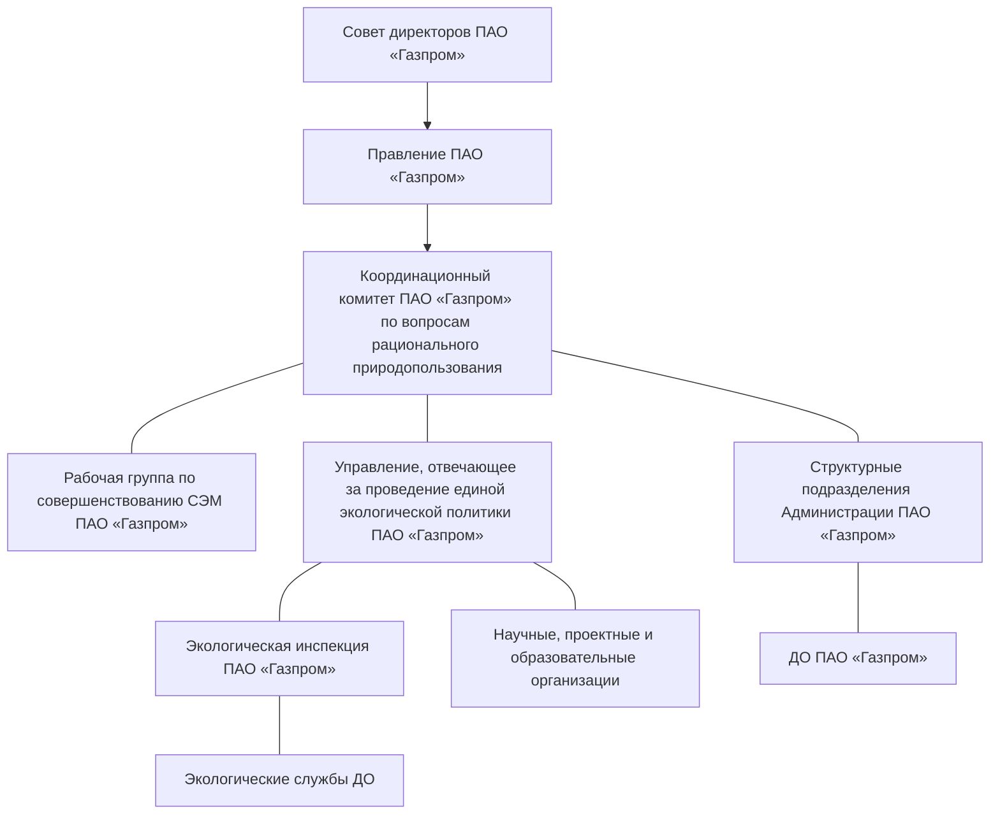

Общее руководство вопросами ООС осуществляет Правление ПАО «Газпром».

Координационный комитет ПАО «Газпром» по вопросам рационального природопользования отвечает за обеспечение рациональных выбросов ПГ в результате хозяйственной деятельности ПАО «Газпром».

Комитет возглавляет представитель высшего руководства, курирующий вопросы функционирования систем энергетического и экологического менеджмента ПАО «Газпром».

В 2023 г. СЭМ ПАО «Газпром» прошла аудит и была признана соответствующей требованиям стандарта ГОСТ Р ИСО 14001-2016.

### **Как работает СЭМ**

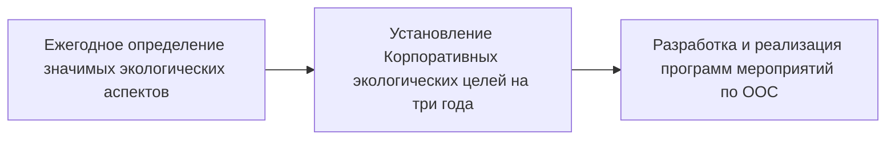

### **Достижение Корпоративных экологических целей ПАО «Газпром»**, %

| Корпоративная экологическая цель                                                                       | Организации из области применения СЭМ                             | Базовый показатель 2018 г. | Показатель 2022 г. | Достижение цели | Показатель 2023 г. | Достижение цели | Комментарий                                                                                                                                                                                                                                                                                                                                                                                                 |
| ------------------------------------------------------------------------------------------------------ | ----------------------------------------------------------------- | -------------------------- | ------------------ | --------------- | ------------------ | --------------- | ----------------------------------------------------------------------------------------------------------------------------------------------------------------------------------------------------------------------------------------------------------------------------------------------------------------------------------------------------------------------------------------------------------- |
| Снижение выбросов ПГ при транспортировке природного газа, т СО₂-экв. / млрд м³ • км                    | Все ДО по транспортировке природного газа                         | 56,70¹                     | 44,80              | 18,99 % ↓       | 46,62              | 17,8 % ↓        | Масса выбросов ПГ сократилась благодаря реализации мероприятий по энергосбережению, внедрению инноваций, расширению использования ресурсосберегающих технологий, а также из-за снижения расхода природного газа на топливные нужды и объема товаротранспортной работы в результате снижения объемов поставок газа.                                                                                          |
| Снижение выбросов оксидов азота в атмосферный воздух при транспортировке природного газа, т / млн м³   | Все ДО по транспортировке природного газа                         | 4,23                       | 4,03               | 4,73 % ↓        | 4,06               | 4,01 % ↓        | Снижение выбросов оксидов азота обусловлено как сокращением объема производства, так и выполнением комплекса энергосберегающих мероприятий.                                                                                                                                                                                                                                                                 |
| Снижение сверхнормативного сброса загрязняющих веществ в поверхностные водные объекты, %               | Все ДО, осуществляющие негативное воздействие на окружающую среду | 5,26¹                      | 0,01               | 5,28 п. п. ↓    | 1,47               | 3,79 п. п. ↓    | Снижение произошло за счет проведения мероприятий, направленных на повышение эффективности использования воды для производственных и хозяйственно-бытовых нужд, а также для повышения степени очистки отводимых сточных вод.                                                                                                                                                                                |
| Снижение доли отходов, направляемых на захоронение, от общей массы отходов, находящихся в обращении, % | Все ДО, осуществляющие негативное воздействие на окружающую среду | 37,53¹                     | 13,44              | 24,84 п. п. ↓   | 16,27              | 21,26 п. п. ↓   | Сокращение образования отходов произошло во всех сегментах деятельности и было обусловлено сокращением количества объектов строительства скважин и выполнением программ по ремонту основных фондов, в том числе проведением ремонтных работ на МГ. Сокращение массы отходов, направляемых на захоронение, обеспечивалось эффективным обращением с отходами производства и потребления с использованием НДТ. |
| Снижение доли ДО, превысивших 5 % уровень платы за сверхнормативное воздействие на окружающую среду, % | Все ДО, осуществляющие негативное воздействие на окружающую среду | 35                         | 5,41               | 29,59 п. п. ↓   | 10,81              | 24,19 п. п. ↓   | Снижение доли сверхнормативных платежей обеспечивалось своевременным обеспечением разрешительной документацией.                                                                                                                                                                                                                                                                                             |

1 Базовый показатель изменен по причине изменения границ СЭМ относительно 2018 г. (показатели 2018 г. всех ДО из границ системы по состоянию на 2023 г.).

**В отчетном году были достигнуты все целевые показатели, установленные Корпоративными экологическими целями ПАО «Газпром» на 2023 г.**

<!-- pdf_page: 88 -->
## PDF-страница 88

## **Расходы на ООС**

**МЭР 21** | **РСПП 2.12** | **Индикатор Группы Газпром 23**

Размер инвестиций Группы Газпром в основной капитал, направляемых на ООС и рациональное использование природных ресурсов, составил в 2023 г. 52,07 млрд руб. Объем текущих затрат достиг 43,5 млрд руб.

| Показатель                                                                                         | 2021      | 2022      | 2023      | Изменение 2023/2022, % |
| -------------------------------------------------------------------------------------------------- | --------- | --------- | --------- | ---------------------- |
| Инвестиции в основной капитал, направленные на ООС и рациональное использование природных ресурсов | 60 529,57 | 47 971,71 | 52 068,48 | +8,5                   |
| Текущие затраты на ООС                                                                             | 36 303,25 | 40 419,70 | 43 517,90 | +7,7                   |
| Плата за негативное воздействие на окружающую среду                                                | 710,64    | 747,34    | 646,23    | -13,5                  |
| Итого по Группе Газпром                                                                            | 97 543,46 | 89 138,75 | 96 232,61 | +8,0                   |

#### **Структура инвестиций Группы Газпром в основной капитал, направленных на ООС и рациональное использование природных ресурсов в 2023 г., %**

| Категория                                                                                                                                                                         | Показатель |
| --------------------------------------------------------------------------------------------------------------------------------------------------------------------------------- | ---------- |
| Охрана атмосферного воздуха                                                                                                                                                       | 58         |
| Охрана и рациональное использование водных ресурсов                                                                                                                               | 26         |
| Охрана и рациональное использование земель                                                                                                                                        | 10         |
| Охрана и рациональное использование лесных ресурсов, охрана и воспроизводство рыбных запасов, предприятия и полигоны по утилизации, обезвреживанию и захоронению отходов и прочее | 6          |

#### **Структура текущих затрат Группы Газпром на ООС в 2023 г., %**

| Категория                                                      | Показатель |
| -------------------------------------------------------------- | ---------- |
| Сбор и очистка сточных вод                                     | 39         |
| Защита и реабилитация земель, поверхностных и подземных вод    | 20         |
| Обращение с отходами                                           | 17         |
| Охрана атмосферного воздуха и предотвращение изменения климата | 16         |
| Сохранение биоразнообразия                                     | 2          |
| Другие направления деятельности в сфере ООС                    | 6          |

В отчетном году инвестиции в основной капитал, направленные на ООС и рациональное использование природных ресурсов, увеличились на 8,5 % в связи со строительством объектов в Группе Газпром нефть и Газпром нефтехим Салавате, ориентированных на охрану атмосферного воздуха. Текущие затраты на ООС выросли на 7,7 % из-за увеличения эксплуатационных затрат на ООС и оплаты услуг природоохрannного назначения, связанных с защитой и реабилитацией земель, поверхностных и подземных вод, сбором и очисткой сточных вод, а также охраной атмосферного воздуха и предотвращением изменения климата (в Группе Газпром вырос объем работ по эвакуации газа с использованием МКС, благодаря которым сокращаются выбросы загрязняющих веществ в атмосферу). Плата за негативное воздействие на окружающую среду в Группе Газпром уменьшилась на 13,5 %

**385,25 млрд руб.**
Группа Газпром направила на ООС за период 2019–2023 гг.

в связи со своевременным получением разрешительной документации. Общие расходы на ООС выросли на 8 % в равной степени в секторе инвестиций в основной капитал, направленных на ООС и рациональное использование природных ресурсов, и в текущих затратах на ООС.

#### **Меры по управлению рисками в области ООС**

Группа Газпром работает над снижением природно-климатических и экологических рисков с помощью следующих мер:

- разработка и внедрение программ энергоэффективности и энергосбережения;
- применение эффективных технологических процессов для различных климатических условий;
- реализация программ повышения эффективности работы системы добычи, транспортировки и эксплуатации газотранспортной сети;
- анализ возможных негативных воздействий на окружающую среду и последствий в результате идентифицированных аварийных и чрезвычайных ситуаций, предотвращение, локализация, снижение таких воздействий и ликвидация последствий;
- оценка экологического ущерба в случае аварий и ЧС;
- комплексные мероприятия по повышению надежности трубопроводных систем, стабилизации ландшафтов и восстановлению почвенно-растительного покрова.

### **Экологическое обучение персонала**

Чтобы помочь работникам лучше понимать важность вопросов защиты окружающей среды, Группа Газпром организует образовательные проекты для персонала.

Среди таких программ были тренинги для руководителей и специалистов экологических служб. Слушатели обучались работе в информационной системе «Экология. 1С-КСУ. Охрана окружающей среды», а также повышали свою квалификацию в области проведения экологической экспертизы. Для работников ПАО «Газпром» были организованы курсы обучения по темам экологического менеджмента на предприятиях газового комплекса, во время которых участники изучали функционирование СЭМ, а также разбирали вопросы, связанные с оценкой результативности этой системы. Кроме того, работники получили возможность пройти дистанционное обучение по вопросам экологического образования.

**8 755**
**работников** организаций Группы Газпром прошли обучение по экологическим программам в 2023 г.

| Наименование показателя                                 | 2021  | 2022  | 2023  | Изменение 2023/2022, % |
| ------------------------------------------------------- | ----- | ----- | ----- | ---------------------- |
| Количество работников, прошедших экологическое обучение | 7 429 | 8 055 | 8 755 | +8,7                   |
| Из них по СЭМ                                           | 1 957 | 1 680 | 1 235 | -26,5                  |

Для поддержания и совершенствования СЭМ ПАО «Газпром» на ежегодной основе проводятся консультационные семинары и тренинги.

<!-- pdf_page: 89 -->
## PDF-страница 89

## СОХРАНЯЕМ ЗДОРОВЬЕ ПЛАНЕТЫ

**ГАЗПРОМ ДОБЫВАЕТ САМЫЙ ЧИСТЫЙ, ЭКОНОМИЧНЫЙ И УДОБНЫЙ В ИСПОЛЬЗОВАНИИ ВИД ИСКОПАЕМОГО ТОПЛИВА. УСТОЙЧИВЫЕ ЭКОСИСТЕМЫ ДЛЯ НОВЫХ ПОКОЛЕНИЙ — НАШ БЕЗУСЛОВНЫЙ ПРИОРИТЕТ.**

photo: Sergey Konyev standing in front of digital screens showing nature scenes

**СЕРГЕЙ КОНЯЕВ**
Заместитель начальника Управления —
начальник отдела ПАО «Газпром», к. геогр. н.

Обеспечивает развитие системы экологического менеджмента Газпрома в соответствии с российскими и международными стандартами. Внедряет единый подход к управлению природоохранной деятельностью и организует контроль и аудит данной работы в дочерних обществах и организациях Газпрома. Награжден Почетной грамотой Министерства природных ресурсов и экологии России.

<!-- pdf_page: 90 -->
## PDF-страница 90

## **НИЗКОУГЛЕРОДНЫЙ ВЕКТОР РАЗВИТИЯ**

Группа Газпром внедряет инновационные решения, повышающие потребление природного газа как низкоуглеродного топлива, а также наращивает уровень энергоэффективности во всех сферах производства.

### **Климатическая стратегия Группы Газпром**

В октябре 2023 г. Президент Российской Федерации В.В. Путин утвердил Климатическую доктрину Российской Федерации. Доктрина является основой для выработки и реализации климатической политики России.

В октябре 2023 г. Совет директоров ПАО «Газпром» утвердил Климатическую стратегию ПАО «Газпром» до 2050 года1 (далее — Стратегия). Стратегия разработана в целях снижения углеродоемкости процессов добычи, транспортировки, хранения и переработки природного газа и создания максимально благоприятных условий для увеличения доли использования природного газа в энергетике, промышленности и транспорте.

Климатическая стратегия интегрирована в систему корпоративного планирования ПАО «Газпром». Она определяет плановые значения по сокращению выбросов ПГ, которые отражаются в формате стратегических целевых показателей и ключевых показателей эффективности в корпоративных программных документах в области долгосрочного и инновационного развития.

Основные положения Стратегии определены с учетом результатов научных исследований, экспертного анализа, прогнозов и сценарного анализа на базе комплекса экономико-математических моделей. В Стратегии сформированы приоритеты в области сохранения климата с учетом специфики и условий национальной экономики, первостепенных задач, которые возложены на ПАО «Газпром», а также трендов низкоуглеродного развития на целевых международных рынках.

#### **Приоритеты ПАО «Газпром» на период до 2050 г. в области низкоуглеродного развития**

* Газификация регионов и перевод транспорта на природный газ;
* сокращение прямых (охват 1) и косвенных (охваты 2 и 3) выбросов ПГ по всей технологической цепочке;
* повышение энергоэффективности производственной деятельности, максимально возможное предотвращение выбросов метана в соответствии с наилучшими практиками, утилизация ПНГ;
* развитие системы управления климатическими рисками, реализация мероприятий по адаптации к возможным изменениям климата;
* совершенствование учета и мониторинга выбросов ПГ, в том числе с применением космических технологий;
* внедрение инноваций и НДТ в области низкоуглеродного развития;
* ответственный выбор поставщиков и подрядчиков, работа с производителями и потребителями продукции, вовлечение в хозяйственную деятельность ПАО «Газпром» других заинтересованных сторон в целях снижения углеродного следа;
* участие в климатических инициативах, направленных на уменьшение углеродного следа, использование ВИЭ и вторичных энергетических ресурсов, реализация климатических проектов;
* расширение взаимодействия с заинтересованными сторонами, развитие партнерства в области низкоуглеродного развития, участие в климатических рейтингах;

----

#### **Существенная тема**

icon: CO2 cloud

17. Управление выбросами в Группе Газпром

**69**
**млн т CO2-экв.**
**планируемое сокращение выбросов ПГ за счет новых проектов в области газификации и перевода транспорта на природный газ в период 2023–2035 гг.**

* цифровизация и оптимизация систем управления технологическими процессами, развитие информационно-управляющих систем в области низкоуглеродного развития;
* поддержка научных исследований в области климата и адаптации к его изменениям, использование и популяризация современных методов расчета углеродного следа, в том числе на основе потенциала изменения глобальной температуры, в целях объективной оценки роли метана;
* реализация просветительских и образовательных проектов по вопросам климата и адаптации к его изменениям;
* реализация мероприятий по компенсации выбросов ПГ (лесовосстановление, поддержание естественных экосистем, улавливание, захоронение и полезное использование углекислого газа, участие в развитии рынка углеродных единиц);
* формирование новых направлений деятельности на основе природного газа, в том числе в области водородной энергетики, неэнергетического использования природного газа.

### **Управление вопросами изменения климата**

Совет директоров ПАО «Газпром» рассматривает риски, связанные с изменением климата, и утверждает климатические цели.

Общее руководство деятельностью Группы Газпром в области изменения климата и определение приоритетов развития с учетом климатических аспектов осуществляет Председатель Правления ПАО «Газпром». Правление ПАО «Газпром» рассматривает риски, связанные с изменением климата, согласовывает климатические цели, одобряет меры для сокращения выбросов ПГ.

Группа Газпром проводит регулярную оценку климатических рисков по двум основным направлениям:
* физические риски — риски, связанные с физическими изменениями в окружающей среде, с наступлением неблагоприятных метеорологических условий и стихийных бедствий, вызванных изменением климата;
* переходные риски — риски, связанные с переходом к низкоуглеродной экономике, в том числе с реакцией общества, государств и инвесторов на изменение климата.

Группа Газпром оценивает влияние каждого риска на свою деятельность и разрабатывает меры по предотвращению реализации риска или минимизации негативных последствий его возможной реализации.

----

icon: information

В декабре 2023 г. делегация ПАО «Газпром» во главе с заместителем Председателя Правления — начальником Департамента О.Е. Аксютиным приняла участие в 28-й сессии Конференции сторон (КС-28) Рамочной конвенции об изменении климата (РКИК) ООН, ставшей главным событием для мировой климатической политики. На КС-28 впервые была дана оценка промежуточных результатов Парижского соглашения. Важнейшим результатом итогового решения стали тезисы, впервые сформулированные в документах РКИК ООН: признание роли переходного топлива, в том числе природного газа, как инструмента декарбонизации.

<!-- pdf_page: 91 -->
## PDF-страница 91

## **Сокращение выбросов парниковых газов**

### **Управление выбросами ПГ**

Группа Газпром осуществляет контроль и учет выбросов ПГ во всех своих организациях по единому алгоритму, основанному на Методике количественного определения объема выбросов парниковых газов организациями, осуществляющими хозяйственную и иную деятельность в Российской Федерации1.

**12,9 %**
**плановые показатели сокращения удельных выбросов ПГ к 2033 г.**

**5,45 %**
**сокращение удельных выбросов ПГ в ПАО «Газпром» по отношению к базовому 2018 г.**

icon: МЭР 20 icon: РСПП 2.5

#### **Выбросы ПГ организаций Группы Газпром (охват 1), млн т CO2-экв.**

| Наименование показателя                                | 2021   | 2022   | 2023   | Изменение 2023/2022, % |
| ------------------------------------------------------ | ------ | ------ | ------ | ---------------------- |
| Выбросы ПГ (охват 1) всего по Группе Газпром, в т. ч.: | 243,28 | 213,53 | 209,55 | -1,86                  |
| ПАО «Газпром», в т. ч.:                                | 119,87 | 91,02  | 85,06  | -6,55                  |
| • добыча                                               | 17,95  | 15,63  | 14,12  | -9,66                  |
| • транспортировка                                      | 93,09  | 66,03  | 60,10  | -8,98                  |
| • переработка                                          | 5,90   | 6,82   | 7,74   | +13,49                 |
| • подземное хранение                                   | 1,66   | 1,22   | 1,19   | -2,46                  |
| • прочие виды деятельности                             | 1,27   | 1,32   | 1,91   | +44,7                  |

В 2023 г. объем переработки природного и попутного газа и газового конденсата увеличился почти на 30 % относительно 2022 г., в связи с чем выросли все показатели воздействия на окружающую среду по сегменту переработки. Увеличение выбросов в прочих видах деятельности связано с увеличением расхода топлива на транспорте.

#### **Выбросы ПГ организаций Группы Газпром (охват 2), млн т CO2-экв.**

| Наименование показателя                                | 2021 | 2022  | 2023  | Изменение 2023/2022, % |
| ------------------------------------------------------ | ---- | ----- | ----- | ---------------------- |
| Выбросы ПГ (охват 2) всего по Группе Газпром, в т. ч.: | 13,8 | 11,11 | 11,33 | +2,0                   |
| ПАО «Газпром» по основным видам деятельности, в т. ч.: | 6,08 | 4,02  | 4,17  | +3,7                   |
| • добыча                                               | 0,35 | 0,31  | 0,34  | +9,7                   |
| • транспортировка                                      | 3,33 | 1,84  | 1,90  | +3,3                   |
| • переработка                                          | 2,34 | 1,83  | 1,90  | +3,8                   |
| • подземное хранение                                   | 0,06 | 0,04  | 0,03  | -0,25                  |

Объем выбросов ПГ в области охвата 2 в отчетном году возрос в результате изменения методики расчета выбросов от закупленной электроэнергии. Изменение связано с применением коэффициентов выбросов с учетом территориальной принадлежности ДО к различным ценовым зонам энергосистемы Российской Федерации.

----

1 Утверждена приказом Министерства природных ресурсов и экологии Российской Федерации от 27 мая 2022 г. № 371.

----

#### **Удельные выбросы ПГ (охват 1), ПАО «Газпром»**, кг CO2-экв. / т у. т.

| Производственный сегмент | 2021    | 2022    | 2023   | Изменение 2023/2022, % |
| ------------------------ | ------- | ------- | ------ | ---------------------- |
| Добыча                   | 32,564  | 35,964  | 37,445 | -9,68                  |
| Транспортировка          | 114,724 | 95,893  | 92,301 | -8,98                  |
| Переработка              | 93,645  | 106,730 | 92,481 | +13,40                 |

Удельные показатели выбросов ПГ в 2023 г. выросли за счет того, что динамика снижения объема добычи газа (–13,4 % относительно 2022 г.) была значительно, чем динамика снижения выбросов ПГ (–9,7 % относительно 2022 г.).

#### **Выбросы ПГ в ПАО «Газпром» по категориям источников выбросов (охват 1) в 2023 г.**, млн т CO2-экв.

| Категория выбросов                                | Всего | CO₂   | CH₄   |
| ------------------------------------------------- | ----- | ----- | ----- |
| Выбросы ПГ, всего                                 | 85,06 | 62,55 | 22,51 |
| Стационарное сжигание топлива                     | 53,96 | 53,96 | 0,00  |
| Сжигание в факелах                                | 3,35  | 3,20  | 0,15  |
| Фугитивные выбросы                                | 26,98 | 4,63  | 22,35 |
| Прочие промышленные процессы                      | 0,00  | 0,00  | 0,00  |
| Сжигание топлива в транспорте                     | 0,74  | 0,74  | 0,00  |
| Обработка, сжигание и захоронение твердых отходов | 0,03  | 0,02  | 0,01  |

icon: МЭР 21

**4,76 млрд руб.**
объем текущих затрат ПАО «Газпром» на реализацию мероприятий, связанных с предотвращением изменений климата, в 2023 г.

#### **Способы полезной утилизации CO2**

Внедрение технологий полезного использования CO2 позволяет снизить объем выбросов ПГ. Специалисты Группы Газпром изучают возможности утилизации дымовых газов и диоксида углерода на ГПА ЕСГ, а также на объектах добычи и подготовки природного газа.

Специалисты Группы Газпром анализируют возможности создания и применения топливной ячейки на основе расплавленных карбонатов. Высокотемпературные топливные элементы на основе расплавленного карбоната позволяют рассматривать варианты производства электрической, тепловой энергии и улавливания диоксида углерода от объектов газовой инфраструктуры с высокими показателями эффективности.

<!-- pdf_page: 92 -->
## PDF-страница 92

## **Окружающая среда и экологическая политика**

### **Развитие регионов**

Группа Газпром разрабатывает новые технологии в области добычи, транспортировки, подземного хранения газа, газопереработки и газораспределения. Данные технологии в основном сфокусированы на повышении энергоэффективности использования ТЭР.

В результате реализации запланированных мероприятий с использованием таких технологий в 2025 г. ожидается предотвращение выбросов ПГ в объеме 32,185 млн т СО2-экв., в том числе:
* в добыче — на 2,942 млн т СО2-экв.;
* в транспортировке — на 28,911 млн т СО2-экв.;
* в подземном хранении — на 0,183 млн т СО2-экв.;
* в переработке — на 0,059 млн т СО2-экв.;
* в газораспределении — 0,043 млн т СО2-экв.

icon: arrow **Подоболее с информацией об энергоэффективных технологиях и проектах Группы Газпром можно ознакомиться в подразделе <u>«Технологии энергосбережения»</u>.**

### **Сокращение выбросов метана**

В целях сокращения выбросов метана Группа Газпром внедряет инновации и проводит ресурсосберегающие мероприятия, разрабатывает и применяет технологии, направленные на сохранение газа при проведении ремонтных работ. Среди них метод выработки газа на потребителя через ГРС, перепуск природного газа из ремонтируемого участка в действующий газопровод, использование газа из технологической обвязки компрессорного цеха на собственные нужды.

В дополнение к этому Группа Газпром реализует проект внедрения МКС, который предотвращает стравливание метана в атмосферу при проведении ремонтных работ на МГ.

Кроме того, для определения метана в атмосферном воздухе Группа Газпром использует системы круглосуточного мониторинга, которые снабжены дистанционными лазерными детекторами метана и способны автоматически предупреждать о превышении концентрации газа.

Также задачи обнаружения метана на объектах Группы Газпром решаются с использованием детекторов, устанавливаемых на вертолетах или БПЛА. Газпром ведет работы по организации современных методов мониторинга выбросов метана с использованием космических спутников.

**765 млн м3**
**природного газа сохранено благодаря использованию МКС**

Все эти меры позволяют Группе Газпром минимизировать выбросы метана по всей производственной цепочке поставок природного газа. Выбросы метана от объектов ПАО «Газпром» являются крайне низкими: при добыче — 0,04 % от объема добываемого газа, при транспортировке трубопроводами — 0,21 % от объема транспортируемого газа, при подземном хранении — 0,03 % от объема хранения газа.

**На 2 млрд м3**
**сокращены затраты природного газа на технологические нужды**

В 2023 г. ПАО «Газпром» сократило затраты природного газа на технологические нужды со стравливанием более чем на 2 млрд м3 газа. Это стало возможно, в частности, в результате сохранения газа с помощью МКС (764,75 млн м3 газа), выработки газа на потребителя при помощи ГРС (654,5 млн м3 газа) и перепуска газа из ремонтируемого участка в смежный газопровод (450 млн м3 газа). С учетом проведенных мероприятий в сегменте транспортировки газа в 2023 г. количество предотвращенных выбросов метана в пересчете на СО2-эквивалент составило 34,4 млн т.

#### **Расширение парка МКС, используемых при ремонтах МГ**

Применение МКС — одна из наиболее эффективных современных технологий предотвращения выбросов природного газа, свойственных традиционным методам ремонта. При подготовке к таким работам с помощью МКС основной объем газа из отключенного участка газопровода перекачивается в действующий участок или в параллельную нитку. Таким образом, исключается попадание в атмосферу до 80 % метана.

----

## **Люди Группы Газпром**

### **Безопасность производства**

### **Приложения**

### **Выбросы метана1 по видам деятельности, производственным процессам ПАО «Газпром», тыс. т**

| Производственный сегмент | 2021   | 2022   | 2023   | Изменение 2023/2022, % |
| ------------------------ | ------ | ------ | ------ | ---------------------- |
| Добыча                   | 59,84  | 82,09  | 71,58  | -12,8                  |
| Транспортировка          | 897,34 | 706,11 | 782,02 | +10,75                 |
| Переработка              | 1,10   | 2,84   | 7,28   | +156,33                |
| Подземное хранение       | 19,98  | 14,95  | 16,93  | +13,24                 |
| Прочие виды деятельности | 2,80   | 4,17   | 22,62  | +442,45                |

Увеличение объема выбросов метана в переработке газа вызвано выходом на производственную мощность Амурского ГПЗ и завода по сжижению газа ООО «Газпром СПГ Портовая». Рост объема выбросов метана в прочих видах деятельности связан с вводом в эксплуатацию новых объектов ООО «Газпром газомоторное топливо» (41 объект).

icon: information **Пилотный проект Группы Газпром на рынке углеродных единиц2**

В 2023 г. в Реестре углеродных единиц Российской Федерации был зарегистрирован климатический проект ООО «Газпром МКС» «Предотвращение выбросов парниковых газов (метана) с использованием мобильных компрессорных станций при подготовке участков магистральных трубопроводов к проведению ремонтных работ».

Сроки реализации климатического проекта: 1 октября 2019 г. — 31 декабря 2029 г.

Проект будет реализовываться по всем запланированным ремонтируемым участкам МГ в пределах ЕСГ России, начиная с полуострова Ямал на северо-востоке европейской части Российской Федерации и до границы с Казахстаном на юге.

Это самый крупный проект, зарегистрированный в Реестре углеродных единиц Российской Федерации в отчетном году.

**49,9 млн ед.** — планируемая величина сокращения выбросов ПГ

### **Развитие рынка ГМТ**

<u>**Индикатор Группы Газпром 28**</u>

**1,4 млрд м3**
объем потребления КПГ в Российской Федерации в 2023 г.

**В 70 регионах России**
работают АГНКС Группы Газпром

**1 млн т СО2-экв.**
сокращение объема выбросов ПГ за счет продажи КПГ в качестве моторного топлива

Группа Газпром принимает активное участие в развитии рынка ГМТ в России и ведет работу по расширению использования природного газа в качестве топлива.

----

1 В соответствии с Методикой количественного определения объема выбросов парниковых газов организациями, утвержденной приказом Министерства природных ресурсов и экологии Российской Федерации от 27 мая 2022 г. № 371.
2 Один из механизмов сокращения выбросов ПГ компаний в рамках Стратегии социально-экономического развития Российской Федерации с низким уровнем выбросов парниковых газов до 2050 года, утвержденной распоряжением Правительства Российской Федерации от 29 октября 2021 г. № 3052-р.

<!-- pdf_page: 93 -->
## PDF-страница 93

Использование природного газа в качестве ГМТ обеспечивает сохранение здоровья населения, позволяет сокращать расходы автовладельцев при заправке автомобилей топливом по привлекательной цене, а также способствует сокращению негативного воздействия на окружающую среду в результате использования экологически чистого газового топлива.

В качестве моторного топлива природный газ используется в двух видах: сжиженном (сжатом) и сжиженном.

### **ГМТ (газомоторное топливо)**

#### **КПГ (компримированный природный газ)**
**Технология производства**
КПГ реализуется через автомобильные газонаполнительные компрессорные станции (АГНКС), где он очищается, осушается, сжимается в компрессоре и подается в баллон транспортного средства под давлением 200 атм.

**Ключевые потребители КПГ**
Пассажирский, легкий грузовой, легковой транспорт и коммунальная техника.

#### **СПГ (сжиженный природный газ)**
**Технология производства**
СПГ — это природный газ, охлажденный до температуры –161,5 °C. При охлаждении он переходит в жидкое состояние и его объем уменьшается в 600 раз. СПГ транспортируется и хранится в криоёмкостях и реализуется потребителям через криоАЗС или АГНКС с криогенным оборудованием.

**Ключевые потребители СПГ**
Магистральный автомобильный, железнодорожный, водный транспорт, карьерная и сельскохозяйственная техника.

----

### **Преимущества ГМТ перед традиционным автомобильным топливом**

#### **Экологичность**
Удельные выбросы ПГ от ГМТ в 1,7 раза меньше, чем у дизельного топлива, и в 2 раза меньше, чем у бензина, на всём жизненном цикле топлива (от добычи до производства). Выбросы токсичных веществ от ГМТ в окружающую среду намного ниже: например, выбросы оксида углерода на 30 % ниже в сравнении с дизелем. При использовании ГМТ вместо нефтяного топлива сокращаются выбросы оксида азота и углеводорода, снижается задымленность, отсутствует образование сажи, свойственное дизельным двигателям.

**~ 2 раза ниже**
**стоимость 1 км пробега транспорта на метане, чем на традиционных видах топлива**

#### **Экономичность**
Цены на природный газ в качестве моторного топлива выдерживаются на уровне менее 50 % от цены реализуемого в регионе дизельного топлива.

### **Экологический эффект от использования ГМТ для заправки автомобилей на всём жизненном цикле топлива (от добычи до производства) в России**

| Наименование          | 2021  | 2022  | 2023  |
| --------------------- | ----- | ----- | ----- |
| Сокращение выбросов   |       |       |       |
| • ПГ, тыс. т CO₂-экв. | 2 545 | 2 853 | 2 774 |
| • ЗВ, тыс. т          | 41,7  | 46,7  | 45,4  |

В 2023 г. объем продаж природного газа в качестве моторного топлива составил 1 444 млн м3, что позволило сократить выбросы ПГ на 2 774 тыс. т CO2-экв. Всего за последние три года с использованием метана выбросы ПГ снизились почти на 8 172 тыс. т CO2-экв.

Единым оператором по развитию рынка ГМТ России определено ООО «Газпром газомоторное топливо». Эта организация ведет деятельность по реализации газа в качестве моторного топлива и развивает на территории Российской Федерации розничную сеть АГНКС под брендами «Газпром» и EcoGas.

### **464**
**АГНКС на балансе организаций Группы Газпром и ООО «Газпром газомоторное топливо»**

### **3,3 млрд м3**
**в год общая производительность АГНКС**

Группа Газпром продолжает реализацию проектов по ускоренному развитию газозаправочной сети. К концу 2023 г. количество АГНКС Группы Газпром выросло на 9,7 % за счет ввода в эксплуатацию новых объектов. По состоянию на 31 декабря 2023 г. коммерческую реализацию и отгрузку КПГ осуществляли 452 объекта. Кроме того, в отчетном периоде производственную деятельность осуществляли еще 22 АГНКС сторонних организаций по договорам франчайзинга, 12 станций осуществляли заправку собственного транспорта Группы Газпром.

<u>**Индикатор Группы Газпром 27**</u>

### **Количество АГНКС на балансе организаций Группы Газпром и ООО «Газпром газомоторное топливо» в России по состоянию на 31 декабря, ед.**

| Год  | Количество АГНКС |
| ---- | ---------------- |
| 2023 | 464              |
| 2022 | 423              |
| 2021 | 386              |

В отчетном году объем реализации КПГ организациями Группы Газпром и ООО «Газпром газомоторное топливо» через собственную сеть АГНКС на территории Российской Федерации достиг 919,0 млн м3, а с учетом реализации через партнерские станции — 1 023 млн м3.

**44 АГНКС действуют в городах — **участниках федерального проекта** «Чистый воздух».**
**В 2023 г. в эксплуатацию были введены 4 станции.**

### **71 %**
**от общего объема продаж ГМТ в стране осуществляют организации Группы Газпром и ООО «Газпром газомоторное топливо»**

### **8 172**
**тыс. т CO2-экв.**
**снижение выбросов ПГ за три года**

### **Объем реализации КПГ с АГНКС организаций Группы Газпром и ООО «Газпром газомоторное топливо» в России, млн м3**

| Год  | Объем реализации КПГ с АГНКС (млн м³) |
| ---- | ------------------------------------- |
| 2023 | 919,0                                 |
| 2022 | 979,2                                 |
| 2021 | 947,8                                 |

### **10 070**
**транспортных средств**
**переоборудовало ООО «Газпром газомоторное топливо» в отчетном году с использованием маркетинговых программ**

ООО «Газпром газомоторное топливо» продолжило активную работу, направленную на увеличение количества газомоторного транспорта в России. Она велась в рамках проекта «Народное топливо», который позволяет формировать необходимые условия для перевода автомобилей на метан без дополнительных вложений со стороны потребителей — автовладельцы получают возможность снизить свои затраты на переоборудование до нуля и дополнительно экономить средства на покупку топлива. Для реализации проекта «Народное топливо» была утверждена Дорожная карта на уровне ПАО «Газпром» и изменены программы стимулирования ПАО «Газпром», направленные на увеличение темпов переоборудования, а именно: участникам проекта была обеспечена возможность переоборудовать транспортное средство без вложений и использовать любое сертифицированное газобаллонное оборудование.

<!-- pdf_page: 94 -->
## PDF-страница 94

## **Развитие водородной энергетики**

Водород — это эффективный и экологически чистый источник энергии, который может способствовать сокращению выбросов ПГ. Получение низкоуглеродных водородных энергоносителей из природного газа без образования выбросов ПГ способно повысить роль природного газа в новой энергетической модели на основе водорода.

ПАО «Газпром» — лидер по развитию водородной энергетики в стране. В 2023 г. Правительство Российской Федерации и ПАО «Газпром» подписали соглашение о намерениях в области развития водородной отрасли. Группа Газпром работает над созданием конкурентоспособных отечественных технологий и разрабатывает пилотные проекты в сфере водородной энергетики.

Группа Газпром осуществляет взаимодействие с отечественными компаниями, выявляя приоритетные направления развития водородных технологий и реализует совместные проекты. Организовано научно-техническое сотрудничество с российскими и международными организациями по вопросам организации совместных пилотных проектов в сфере водородной энергетики. Ведутся технические диалоги с ведущими российскими академическими и прикладными институтами, в том числе в рамках научно-технического сотрудничества с ГК «Росатом».

В сфере международного сотрудничества Группа Газпром продолжает работу по выстраиванию отношений с дружественными странами — производителями и потребителями водорода, в также ведет диалоги в рамках научно-технического сотрудничества.

### **Молодые эксперты по водородным технологиям**

В 2023 г. ПАО «Газпром» вместе с ФГБОУ ВО «Санкт-Петербургский государственный экономический университет» и Неправительственным экологическим фондом им. В.И. Вернадского провели Водородный чемпионат молодых специалистов и студентов.

73 студента из 28 российских вузов, изучающих такие науки, как геология, водородная энергетика, нефтегазовое дело, физика, химия, материаловедение, приняли участие в чемпионате.

Студенты выполнили задание по разработке концепции водородного кластера на территории Российской Федерации, предложив свои идеи по организации производства и использованию водорода.

15 декабря в рамках VIII Международной конференции «Экологическая безопасность в газовой промышленности» состоялся финал Водородного чемпионата. В него прошли шесть команд, авторы лучших решений приглашены для прохождения стажировки в ООО «Газпром ВНИИГАЗ» и в ООО «Газпром водород» в 2024 г. Они будут искать решения для развития инновационных исследовательских проектов в области водородных технологий в рамках бизнес-инкубатора.

В 2024 г. Группа Газпром продолжит реализовывать дорожную карту развития высокотехнологичного направления «Развитие водородной энергетики» на период до 2030 г. в части поднаправления «Развитие водородной энергетики и декарбонизация промышленности и транспорта на основе природного газа». В планах Группы Газпром — работа по различным направлениям НИОКР, в том числе развитие технологии получения водорода из сероводорода с ограниченными выбросами ПГ, создание технологического экспериментально-демонстрационного комплекса для развития технологий производства водорода из природного газа. Группа Газпром планирует провести комплексную оценку воздействия водорода на целостность и устойчивость системы газоснабжения с целью возможной транспортировки и хранения метано-водородных смесей, а также оценку разработки материалов для хранения и транспортировки водорода в виде металлгидридов. Специалисты Группы Газпром будут работать над проектом использования ПХГ для хранения различных газообразных водородосодержащих смесей в пористой среде, оценивать возможности создания и применения топливной ячейки на основе расплавленных карбонатов, разрабатывать научно-технические решения в области мембранных технологий и добычи природного водорода.

----

В отчетном году ПАО «Газпром» и Минсельхоз России заключили соглашение о сотрудничестве в области применения природного газа в качестве моторного топлива в отечественном агропромышленном комплексе, установлении долгосрочного взаимовыгодного делового партнерства для создания мер государственной поддержки сельхозпроизделителей, производителей газомоторной сельскохозяйственной техники, передвижных автомобильных газовых заправщиков, а также расширения линейки газомоторной сельскохозяйственной техники и мобильной газозаправочной инфраструктуры.

Газпром продолжает сотрудничать с ведущими автопроизводителями для увеличения количества моделей автомобилей и техники на газе. В 2023 г. был налажен серийный выпуск более 230 моделей автомобилей, автобусов и техники специального назначения на природном газе. Одновременно Газпром изучает перспективы применения газа на других видах транспорта, например железнодорожном и водном. По заказу Группы Газпром был разработан первый в России маневровый локомотив ТЭМГ1 на СПГ, а также создаются модели пассажирских судов на СПГ, которые планируется использовать в акватории г. Санкт-Петербург.

#### **63 %**
**доля газомоторного транспорта от количества автомобилей парка основных ДО ПАО «Газпром», пригодного к переводу на газ**

> В 2023 г. Газпром достиг договоренности о сотрудничестве с ППК «Российский экологический оператор» — компанией, которая отвечает за обращение с ТКО в стране. Региональные операторы, входящие в это предприятие, эксплуатируют в общей сложности около 17,5 тыс. мусоровозов, из которых только 3 % работают на ГМТ. Группа Газпром начала работу по анализу техники региональных операторов на предмет ее перевода на ГМТ.

Группа Газпром продолжает перевозить автопарк ДО основного вида деятельности на ГМТ. На 31 декабря 2023 г. 14,7 тыс. автомобилей основных ДО ПАО «Газпром» использовало газ в качестве топлива. Кроме того, в отчетном году Группа Газпром приобрела 1 501 газомоторное транспортное средство.

**85,8 млн м3**
**объем потребления природного газа (метана) в качестве моторного топлива транспортом Группы Газпром в 2023 г.**

**14,7 тыс.**
**автомобилей основных ДО ПАО «Газпром» использовало газ в качестве топлива на 31 декабря 2023 г.**

#### **Результаты работы по переводу транспорта Группы Газпром на ГМТ за 2014–2023 гг.**

| Показатель                                                                            | Результат |
| ------------------------------------------------------------------------------------- | --------- |
| Суммарный объем потребления природного газа в качестве топлива, млн м³                | 510       |
| Экономия, связанная с замещением жидкого моторного топлива природным газом, млрд руб. | 12,069    |
| Снижение выбросов загрязняющих веществ в атмосферу, тыс. т                            | 241       |

Чтобы решить задачу автономной газификации населенных пунктов, значительно удаленных от МГ, Газпром развивает производство малотоннажного СПГ. В 2023 г. Группа Газпром запустила два новых малотоннажных КСПГ, каждый производительностью 12,6 тыс. т в год, в Свободненском районе Амурской области и в Волгоградской области. Кроме того, в отчетном году были завершены строительно-монтажные работы по проектам ЛСПГ «Конаково» и КСПГ «Тобольск».

**Объем реализации произведенного в России малотоннажного СПГ организациями Группы Газпром и ООО «Газпром газомоторное топливо», тыс. т**

| Год  | Объем реализации произведенного в России малотоннажного СПГ (тыс. т) |
| ---- | -------------------------------------------------------------------- |
| 2023 | 23,2                                                                 |
| 2022 | 24,2                                                                 |
| 2021 | 22,3                                                                 |

**Детали**

icon: arrow
**Подробнее с информацией о вкладе Группы Газпром в развитие рынка ГМТ можно ознакомиться в <u>Годовом отчете Группы Газпром за 2023 г.</u>**

icon: arrow
**Подробнее с информацией о регулирующих документах в области развития рынка ГМТ в Группе Газпром можно ознакомиться в <u>Приложении 6.4.</u>**

<!-- pdf_page: 95 -->
## PDF-страница 95

## **Энергосбережение и энергоэффективность**

Группа Газпром стремится бережно использовать энергетические ресурсы и повышать энергетическую эффективность своей деятельности.

Основополагающим документом для установления корпоративных целей и формирования мероприятий по энергосбережению и повышению энергетической эффективности является Политика ПАО «Газпром» в области энергетической эффективности и энергосбережения1 (далее — Политика). Политика выражает официальную позицию руководства ПАО «Газпром» в отношении принятых обязательств в области бережного отношения к энергетическим ресурсам, повышения энергетической результативности деятельности ПАО «Газпром» и снижения влияния на окружающую среду, а также демонстрирует его приверженность реализации системных решений в области управления энергоэффективностью и применения энергосберегающих технологий.

Для достижения стратегических обязательств, определенных Политикой, ПАО «Газпром» разрабатывает программы энергосбережения и повышения энергетической эффективности ПАО «Газпром», которые устанавливают Корпоративные энергетические цели для организаций, входящих в границы системы управления энергоэффективностью ПАО «Газпром» и оказывают существенное влияние на величину потребления ТЭР.

Программа разрабатывается на три года и охватывает все основные виды деятельности Группы Газпром, включая добычу и транспортировку углеводородов, подземное хранение, переработку и распределение природного газа, энерговодоснабжение и эксплуатацию энергетического оборудования объектов ЕСГ.

Текущая редакция Программы2 была утверждена в 2023 г. Она сохранила целевые приоритеты программ предыдущих периодов,

icon: hand holding a pen

**4,5**
**млн т у. т.**
**фактическая**
**экономия ТЭР**
**в 2023 г. — этого**
**хватило бы**
**для обогрева**
**г. Москвы**
**в течение**
**четырех месяцев**
**в 2023 г.**

> **По итогам 2023 г. Корпоративные энергетические цели ПАО «Газпром» были полностью достигнуты.**

**Достижение Корпоративных энергетических целей ПАО «Газпром» в 2023 г.**

| Наименование цели                                                                                                     | Базовый уровень 2018 г. | 2021 г.                                                                                                          | 2022 г.                                                                                                          | План 2023 г.                                                                                                           | Факт 2023 г.                                                                                                                                                                                                                                                                                                                 | Причины изменений                                                                                                                                                                                                                                                                                                           | План 2024 г.                                                                                                                                                                                                                                                                                                                |
| --------------------------------------------------------------------------------------------------------------------- | ----------------------- | ---------------------------------------------------------------------------------------------------------------- | ---------------------------------------------------------------------------------------------------------------- | ---------------------------------------------------------------------------------------------------------------------- | ---------------------------------------------------------------------------------------------------------------------------------------------------------------------------------------------------------------------------------------------------------------------------------------------------------------------------- | --------------------------------------------------------------------------------------------------------------------------------------------------------------------------------------------------------------------------------------------------------------------------------------------------------------------------- | --------------------------------------------------------------------------------------------------------------------------------------------------------------------------------------------------------------------------------------------------------------------------------------------------------------------------- |
| Снижение удельного расхода ТЭР при транспортировке                                                                    | 100 %                   | +1,8                                                                                                             | -13,5                                                                                                            | -1,2 %                                                                                                                 | -13,9                                                                                                                                                                                                                                                                                                                        | Существенное сокращение показателя обусловлено снижением товаротранспортной работы на 24,6 % относительно уровня 2018 г., а также успешной реализацией энергосберегающих мероприятий.                                                                                                                                       | -12 %                                                                                                                                                                                                                                                                                                                       |
| Экономия природного газа, млн м³                                                                                      | 2 951,9³                | 4 009,0                                                                                                          | 4 015,5                                                                                                          | 3 550,2                                                                                                                | 3 719,7                                                                                                                                                                                                                                                                                                                      | Превышение фактической экономии ТЭР над плановыми значениями достигнуто благодаря результативности мероприятий по экономии ТЭР.                                                                                                                                                                                             | 3 027,4                                                                                                                                                                                                                                                                                                                     |
| Экономия электроэнергии, млн кВт • ч                                                                                  | 364,2                   | 377,8                                                                                                            | 407,2                                                                                                            | 367,9                                                                                                                  | 389,3                                                                                                                                                                                                                                                                                                                        |                                                                                                                                                                                                                                                                                                                             | 383,3                                                                                                                                                                                                                                                                                                                       |
| Экономия тепловой энергии, тыс. Гкал                                                                                  | 235,9                   | 185,8                                                                                                            | 227,9                                                                                                            | 339,2                                                                                                                  | 346,0                                                                                                                                                                                                                                                                                                                        |                                                                                                                                                                                                                                                                                                                             | 328,1                                                                                                                                                                                                                                                                                                                       |
| Подтверждение соответствия в рамках области применения и границ системы управления энергоэффективностью ПАО «Газпром» | Сертификат отсутствует. | Сертификат подтвержден в соответствии с областью применения и границами системы управления энергоэффективностью. | Сертификат подтвержден в соответствии с областью применения и границами системы управления энергоэффективностью. | Подтверждение соответствия в рамках области применения и границ системы управления энергоэффективностью ПАО «Газпром». | Система управления энергоэффективностью соответствует требованиям ГОСТ Р ИСО 50001-2023 (ISO 50001:2018), принятым обязательствам, нормативным и организационно-распорядительным документам ПАО «Газпром» в области энергоэффективности подтверждено в ходе внутренних аудитов ПАО «Газпром». Поставленные задачи выполнены. | Соответствие системы управления энергоэффективностью требованиям ГОСТ Р ИСО 50001-2023 (ISO 50001:2023), принятым обязательствам, нормативным и организационно-распорядительным документам ПАО «Газпром» в области энергоэффективности подтверждено в ходе внутренних аудитов ПАО «Газпром». Поставленные задачи выполнены. | Соответствие системы управления энергоэффективностью требованиям ГОСТ Р ИСО 50001-2023 (ISO 50001:2023), принятым обязательствам, нормативным и организационно-распорядительным документам ПАО «Газпром» в области энергоэффективности подтверждено в ходе внутренних аудитов ПАО «Газпром». Поставленные задачи выполнены. |

1 Утверждена постановлением Правления ПАО «Газпром» от 11 октября 2018 г. № 39.
2 Программа энергосбережения и повышения энергетической эффективности ПАО «Газпром» на 2023–2025 гг. Утверждена распоряжением ПАО «Газпром» от 16 марта 2023 г. № 89.
3 Показатель скорректирован в соответствии с корпоративными документами, которые предусматривают корректировку первоначальных плановых показателей. Необходимость корректировки обусловлена изменениями в течение года плановых производственных показателей, планов капитального ремонта объектов ЕСГ и, следовательно, количества объектов, на которых реализуются мероприятия по экономии ресурсов, реализацией дополнительных мероприятий по экономии энергоресурсов, а также изменением их стоимости, применяемой для расчета экономического эффекта при планировании Программы.

<!-- pdf_page: 96 -->
## PDF-страница 96

## **Приложения**

Группа Газпром разработала ряд энергетических целей на 2024–2026 гг.:
* повышение энергоэффективности деятельности ПАО «Газпром»;
* экономия ТЭР при осуществлении производственной деятельности по добыче, транспортировке, подземному хранению, переработке и распределению природного газа;
* совершенствование системы управления энергоэффективностью ПАО «Газпром».

icon: hand holding pen

## **3 719,7 млн м3 —**
**это объем природного газа, сэкономленного в 2023 г. за счет Программы энергосбережения и повышения энергетической эффективности. Это сопоставимо с объемом поставок газа в течение двух дней по ЕСГ в аномальные морозы в январе 2023 г.**

icon: arrow
Подоболее с информацией о регулирующих документах в области энергосбережения в Группе Газпром можно ознакомиться в <u>Приложении 6.4</u>.

<u>РСПП 2.2</u>

### **Потребление энергии в Группе Газпром**, млн ГДж

| Показатель                                                                                           | 2021    | 2022    | 2023    | Изменение 2023/2022, % |
| ---------------------------------------------------------------------------------------------------- | ------- | ------- | ------- | ---------------------- |
| Общее потребление энергии внутри Группы Газпром¹                                                     | 3 102,5 | 2 495,8 | 2 448,2 | -1,9                   |
| Общее потребление топлива по Группе Газпром из невозобновляемых источников²                          | 3 917,0 | 3 357,8 | 3 299,2 | -1,7                   |
| Общее потребление энергии по Группе Газпром из ВИЭ                                                   | 47,3    | 47,3    | 45,7    | -3,3                   |
| Электроэнергия, отопление, охлаждение и пар, закупаемые для потребления организациями Группы Газпром | 197,7   | 197,2   | 204,7   | +3,8                   |
| Объем собственного производства электроэнергии, отопления, охлаждения и пара³                        | 123,2   | 130,6   | 128,7   | -1,5                   |
| Объем проданной электроэнергии, отопления, охлаждения и пара                                         | 1 059,5 | 1 106,5 | 1 101,4 | -0,5                   |

В 2023 г. большинство показателей в области потребления энергии в Группе Газпром снизились. Увеличение потребления покупаемой электроэнергии, отопления, охлаждения и пара на 3,8 % было вызвано ростом производственных показателей ООО «Газпром переработка Благовещенск» и Группы Газпром нефть. Общее потребление энергии из ВИЭ сократилось на 3,3 % по причине снижения выработки электроэнергии на гидроэлектростанциях Газпром энергохолдинга.

<u>МЭР 22</u>

### **Потребление возобновляемой энергии**

|                                                                                 | 2021 | 2022 | 2023 | Изменение 2023/2022, п. п. |
| ------------------------------------------------------------------------------- | ---- | ---- | ---- | -------------------------- |
| Доля потребления возобновляемой энергии от общего объема потребления энергии, % | 1,53 | 1,90 | 1,87 | -0,03                      |

1 Сумма строк, кроме строки с собственной выработкой («Объем собственного производства электроэнергии, отопления, охлаждения и пара») за вычетом объема проданной электроэнергии, отопления, охлаждения и пара.
2 Более подробная информация представлена в таблице далее.
3 Объем собственной выработки для собственных нужд.

----

## **Развитие регионов**

### **Общее потребление тепловой и электрической энергии в Группе Газпром на собственные технологические нужды**

| Вид энергии                  | 2021          | 2022          | 2023          | Изменение 2023/2022, % |
| ---------------------------- | ------------- | ------------- | ------------- | ---------------------- |
| Электроэнергия, тыс. кВт • ч | 38 422 954,3  | 38 459 094,3  | 39 425 232,0  | +2,51                  |
| Тепло, ГДж                   | 182 596 941,9 | 188 930 725,9 | 187 879 201,8 | -0,6                   |

### **Общее потребление топлива по Группе Газпром из невозобновляемых источников**, млн ГДж

| Вид энергоресурса                          | 2021    | 2022    | 2023    | Изменение 2023/2022, % |
| ------------------------------------------ | ------- | ------- | ------- | ---------------------- |
| Нефтетопливо (бензин, керосин, мазут, СПГ) | 407,4   | 294,1   | 294,4   | +0,1                   |
| Газ природный                              | 3 409,3 | 3 014,6 | 2 883,0 | -4,4                   |
| Уголь                                      | 100,3   | 49,1    | 63,2    | +28,8                  |
| Другие ТЭР                                 | 0,0     | 0       | 0,0     | 0,0                    |
| Всего из невозобновляемых источников       | 3 917,0 | 3 357,8 | 3 240,6 | -3,5                   |

Общее потребление энергии из невозобновляемых источников сократилось на 3,5 %, что обусловлено изменением производственных показателей в основных видах деятельности. Увеличение потребления энергии из угля связано с ростом доли его сжигания в топливном балансе электростанций ПАО «ОГК-2» (Новочеркасская ГРЭС, Рязанская ГРЭС).

**3,5 %**
**сокращение общего потребления энергии из невозобновляемых источников**

<u>БР Экологические аспекты деятельности Общества, с. 27</u> <u>РСПП 2.2.1</u>

### **Энергоемкость в основных видах деятельности ПАО «Газпром»**

| Показатель                                    | 2021  | 2022  | 2023  | Изменение 2023/2022, % |
| --------------------------------------------- | ----- | ----- | ----- | ---------------------- |
| Добыча газа⁴, кг у. т. / тыс. м³              | 23,13 | 25,12 | 27,41 | +9,1                   |
| Транспортировка газа⁵, кг у. т. / млн м³ • км | 28,34 | 24,08 | 23,96 | -0,5                   |
| Подземное хранение газа⁶, кг у. т. / тыс. м³  | 7,74  | 7,47  | 7,13  | -4,5                   |
| Переработка газа⁷, кг у. т. / т у. т.         | 49,75 | 48,21 | 50,12 | +4,0                   |

Рост энергоемкости в газодобыче стал следствием роста потребления ТЭР на компримирование газа для компенсации снижения пластовых давлений на ряде месторождений. Энергоемкость в транспортировке газа снизилась в результате повышения результативности энергосберегающих мероприятий, уменьшения объема товаротранспортной работы (на 10,7 %) и потребления ТЭР (на 11,1 %) в сравнении с 2022 г. В секторе подземного хранения газа удельный расход ТЭР уменьшился в результате принятия мер по энергосбережению, а также из-за снижения объемов потребления ТЭР на 8,6 % и объемов закачного-отобранного газа на 4,2 %. Энергоемкость газопереработки повысилась на 4 % по причине роста потребления природного газа (+8,1 %) и электроэнергии (+2 %) в связи с увеличением объемов переработки природного газа (+2,5 %).

4 Для расчета показателя учитывается природный газ и электрическая энергия, потребленные на собственные технологические нужды добычи.
5 Для расчета показателя учитывается природный газ и электрическая энергия, потребленные на собственные технологические нужды магистрального транспорта газа.
6 Для расчета показателя учитывается природный газ и электрическая энергия, потребленные на собственные технологические нужды при закачке и отборе природного газа в ПХГ.
7 Для расчета показателя учитывается природный газ, электрическая энергия и тепловая энергия, потребленные на собственные технологические нужды при переработке природного газа.

<!-- pdf_page: 97 -->
## PDF-страница 97

## ОТВЕТСТВЕННО ИСПОЛЬЗУЕМ РЕСУРСЫ

**ГАЗПРОМ ПОВЫШАЕТ ЭНЕРГОЭФФЕКТИВНОСТЬ ПРОИЗВОДСТВА ЗА СЧЕТ ВНЕДРЕНИЯ СОВРЕМЕННЫХ ИННОВАЦИОННЫХ ТЕХНОЛОГИЙ. В 2023 Г. ГРУППА СЭКОНОМИЛА ТОПЛИВНО-ЭНЕРГЕТИЧЕСКИЕ РЕСУРСЫ НА ОБЩУЮ СУММУ 20,3 МЛРД РУБ.**

photo: Дмитрий Яхонтов standing in front of a digital display showing an industrial facility and a lightbulb with a sprout

**ДМИТРИЙ ЯХОНТОВ**
Начальник технического отдела ООО «Газпром добыча Ямбург»

Более 20 лет разрабатывает и внедряет энергоэффективные технологии и оборудование на Крайнем Севере, формирует мероприятия, включаемые в Программу энергосбережения ДО. Внедрил (в том числе в соавторстве) 118 рационализаторских предложений с экономическим эффектом около 50 млн руб. Лауреат премии ПАО «Газпром» в области науки и техники за 2023 г.

<!-- pdf_page: 98 -->
## PDF-страница 98

## **Технологии энергосбережения**

В Программе энергосбережения и повышения энергетической эффективности ПАО «Газпром» предусмотрена реализация более 2 тыс. мероприятий, направленных на повышение эффективности использования и экономии энергетических ресурсов. В 2023 г. Группа Газпром начала шире привлекать инвестиции энергосервисных компаний для финансирования актуальных и перспективных энергосберегающих проектов и увеличила портфель таких проектов.

Суммарные инвестиции в наиболее масштабные и востребованные энергосберегающие проекты в 2023 г. составили 7,06 млрд руб. Ожидаемый экономический эффект от реализации этих проектов превышает 20 млрд руб.

### **Энергосберегающие проекты Группы Газпром**

#### **Внедрение эжекторов на компрессорных станциях для минимизации стравления газа в атмосферу при проведении ремонтов**

Эжектирование газа — перспективный метод сохранения газа в технологических коммуникациях и контуре нагнетателя ГПА. Группа Газпром планирует инвестировать 211,4 млн руб. в реализацию проекта внедрения этой технологии в четырех пилотных газотранспортных ДО. Общая экономия за период жизненного цикла оборудования, установленного в рамках проекта, составит 961,2 млн руб.

#### **Модернизация аппаратов воздушного охлаждения (АВО) газа**

Группа Газпром намерена вложить 827 млн руб. в обновление АВО на КС, что позволит существенно снизить потребление электроэнергии. Рабочие колеса вентиляторных блоков АВО будут заменены на композитные. В дополнение к этому будут установлены коллекторы главного входа воздуха с более совершенной аэродинамической формой. Ожидаемая экономия за период жизненного цикла оборудования, установленного в пяти газотранспортных ДО, участвующих в проекте, составит 5,3 млрд руб.

#### **Внедрение часто-регулируемого привода на тягодутьевых механизмах котельных**

Для оптимизации потребления электроэнергии Газпром планирует реконструировать две котельные, оснастив их тягодутьевые механизмы часто-регулируемым приводом. Инвестиции в реконструкцию составят 17,6 млн руб., а экономия за счет снижения затрат на потребление электроэнергии за период жизненного цикла оборудования составит 20,3 млн руб.

#### **Создание комплекса утилизации тепла отходящих газов на базе ОЦР-технологии1 для выработки электрической энергии на собственные нужды компрессорной станции**

Суммарные инвестиции исполнителя составят 1,0 млрд руб., а ожидаемая экономия за период жизненного цикла оборудования — 14,9 млрд руб.

#### **Замена сменных проточных частей (СПЧ) центробежных компрессоров**

В результате замены СПЧ обеспечиваются оптимальные режимы работы ГПА, КПД их работы повышается, а потребление топливного газа уменьшается. В 2023 г. экономия средств в результате эксплуатации уже установленных СПЧ составила 461,5 млн руб.

icon: information icon

ГРС предназначена для снижения высокого давления газа, поступающего из МГ, до требуемых параметров перед подачей потребителю. Обычно в ходе работы ГРС потенциальная энергия сжатого газа теряется безвозвратно, но Группа Газпром нашла способ использовать ее для покрытия нужд собственных объектов.

На ГРС «Добрянка-2» в Добрянском районе Пермского края Группа Газпром построит турбодетандерную энергетическую установку (ТДЭУ). При снижении давления природный газ, проходя через установку, будет вращать ее лопатки, прикрепленные к валу с генераторной установкой, и вырабатывать электроэнергию. При этом газ будет поступать потребителям, а объекты Группы Газпром в Пермском крае будут работать на электроэнергии, вырабатанной с помощью ТДЭУ.

**> 2,3 млрд руб.**
**общие инвестиции в проект**

**18,9 млрд руб.**
**суммарная экономия Группы Газпром**

**> 2 тыс. мероприятий**
**предусмотрено в Программе энергосбережения и повышения энергетической эффективности ПАО «Газпром»**

**7,06 млрд руб.**
**суммарные инвестиции в энергосберегающие проекты в 2023 г.**

**20 млрд руб.**
**ожидаемый экономический эффект от реализации энергосберегающих проектов**

----

1 ОЦР-технология (органический цикл Ренкина, Organic Rankine Cycle) — это альтернатива традиционной паротурбинной технологии. В ОЦР-технологии в качестве рабочего тела используется не пар, а органические или синтетические вещества с низкой температурой кипения.

Более половины эффекта экономии природного газа (2,21 млрд м3, или 59 %) обеспечено в 2023 г. за счет предотвращения стравления газа при проведении ремонтных работ на объектах ЕСГ. Высокую результативность по сохранению природного газа при выполнении ремонтных работ на ЛЧ МГ показал ряд мероприятий, представленных на диаграмме справа.

В результате системной работы по данному направлению по итогам 2023 г. доля сохраненного при ремонтных работах газа сохранила положительную динамику.

Показатель экономии ТЭР в результате реализации программ энергосбережения Группы Газпром сохранился на уровне предыдущего года. Перераспределение экономии по видам ТЭР связано с изменениями производственных показателей работы организаций Группы Газпром.

#### **Эффект экономии газа от применения технологий сохранения природного газа при проведении ремонтных работ на объектах ЕСГ в 2023 г., млн м3**

| Категория                                                                                   | Эффект экономии газа (млн м³) |
| ------------------------------------------------------------------------------------------- | ----------------------------- |
| Применение МКС                                                                              | 764,7                         |
| Выработка газа на потребителя при помощи ГРС                                                | 563,9                         |
| Перепуск газа из ремонтируемого участка в смежный газопровод                                | 345,5                         |
| Сохранение газа из технологической обвязки КЦ и ремонтируемых участков на собственные нужды | 188,4                         |
| Снижение потерь на скважинах и сохранение газа при технологических операциях                | 130,1                         |
| Применение технологии врезки под давлением и установка усиливающих муфт                     | 82,9                          |

#### <u>**Индикатор Группы Газпром 24**</u>

### **Экономия ТЭР в результате реализации программ энергосбережения Группы Газпром**

| Наименование                | 2021    | 2022    | 2023    | Изменение 2023/2022 |
| --------------------------- | ------- | ------- | ------- | ------------------- |
| Природный газ, млн м³       | 4 778,6 | 4 791,4 | 4 623,5 | -3,5 %              |
| Природный газ, млн ГДж      | 161,7   | 162,2   | 156,5   |                     |
| Электроэнергия, млн кВт • ч | 653,0   | 714,3   | 737,2   | +3,2 %              |
| Электроэнергия, млн ГДж     | 2,4     | 2,6     | 2,7     |                     |
| Тепловая энергия, тыс. Гкал | 786,5   | 631,7   | 714,3   | +13,1 %             |
| Тепловая энергия, млн ГДж   | 3,3     | 2,6     | 3,0     |                     |
| ТЭР, млн ГДж                | 167,4   | 167,4   | 162,1   | -3,2 %              |
| Коэффициент сокращения², %  | 5,4     | 6,7     | 6,6     | -0,1 п. п.          |

### **Объем производства электроэнергии из ВИЭ и вторичных энергоресурсов (ВЭР) в Группе Газпром**

| Показатель                                                             | 2021 | 2022 | 2023 | Изменение 2023/2022, % |
| ---------------------------------------------------------------------- | ---- | ---- | ---- | ---------------------- |
| Производство электроэнергии из ВИЭ и ВЭР в Группе Газпром, млн МВт • ч | 13,2 | 13,2 | 12,7 | -3,8                   |

В отчетном году производство электроэнергии из ВИЭ несколько сократилось по причине снижения гидрогенерации Газпром энергохолдинга.

icon: information icon

В 2023 г. ПАО «ТГК-1» (входит в Газпром энергохолдинг), ГУП «Мосгортранс», Сбербанк и Фонд «Транспортные инновации Москвы» заключили соглашение о партнерстве в области использования электроэнергии, вырабатанной на ГЭС ПАО «ТГК-1». В рамках соглашения ГУП «Мосгортранс» подписало договор с ПАО «ТГК-1» о приобретении «зеленых» сертификатов, выпущенных в системе добровольной сертификации низкоуглеродной энергии Сбера. Эти сертификаты подтверждают, что московские электробусы используют электроэнергию, которая была произведена на ГЭС ПАО «ТГК-1» без выбросов ПГ.

<!-- pdf_page: 99 -->
## PDF-страница 99

## ОХРАНА АТМОСФЕРНОГО ВОЗДУХА

### Управление выбросами загрязняющих веществ

Группа Газпром прилагает максимум усилий для снижения выбросов ЗВ, которые образуются в ходе добычи, переработки и транспортировки углеводородов. Управление такими выбросами — часть корпоративной стратегии в области ООС и заботы об экологии, которая учитывает положения Энергетической стратегии России на период до 2030 г. и Экологической доктрины Российской Федерации.

Плановые/целевые показатели устанавливаются для каждого вида деятельности ПАО «Газпром» на основании значимых экологических аспектов. В отчетном году ПАО «Газпром» идентифицировало значимые экологические аспекты.

Группа Газпром сокращает выбросы ЗВ, реализуя мероприятия по перекачке газа с использованием МКС. В дополнение к этому применяются технологии врезки под давлением, перепуск части газа из ремонтируемых участков газопровода в соседние участки. В газодобывающих ДО проводят технологические исследования скважин без сраивания природного газа в атмосферу, внедряют применение многокомпонентных составов поверхностно-активных веществ (ПАВ), улучшающих условия удаления пластовой жидкости из забоя скважин и, таким образом, сокращающих выбросы газа в атмосферу. Чтобы сократить объемы выбросов оксидов азота, Газпром применяет систему селективного каталитического восстановления оксидов азота отходящих газов.

#### **Значимые экологические аспекты для ПАО «Газпром» в области управления выбросами**

* Выбросы метана в атмосферный воздух при ремонте МГ;
* выбросы оксидов азота в атмосферный воздух при работе КС.

Выбросы ЗВ в атмосферу контролируются посредством Системы производственного экологического контроля и мониторинга (ПЭКиМ). Она позволяет отслеживать параметры окружающей среды: качество атмосферного воздуха в населенных пунктах и на границе санитарно-защитных зон; шумовое воздействие; радиационный фон; качество поверхностных и подземных вод, донных отложений; состояние геологической среды, почвенного и снегового покрова; отходы и сточные воды. Работники Группы Газпром с помощью ПЭКиМ анализируют полученные результаты, планируют и принимают меры по минимизации негативного воздействия на окружающую среду.

#### **Существенная тема**

icon: CO2 cloud icon

17. Управление выбросами в Группе Газпром

#### **Структура системы ПЭКиМ**

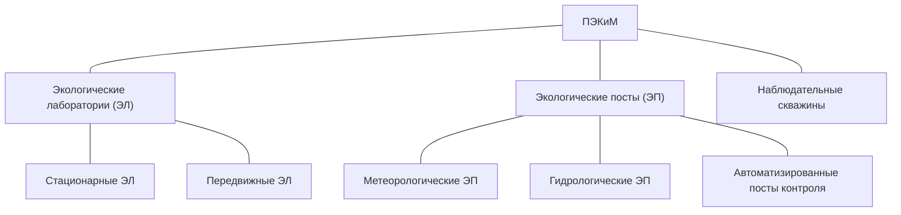

В Группе Газпром на регулярной основе ведется мониторинг выбросов метана и контроль за утечками газа, который проводится специализированной Экологической инспекцией ПАО «Газпром».

Газпром широко использует передвижные экологические лаборатории, оснащенные современным аналитическим оборудованием для контроля атмосферного воздуха, физических факторов окружающей среды, метеопараметров, а также промышленных выбросов в атмосферу от различных источников. Работники передвижных экологических лабораторий проводят визуальные обследования территорий, на которых расположены производственные объекты Группы Газпром, с помощью БПЛА. Фото- и видеоматериалы, полученные с использованием БПЛА, повышают эффективность и скорость мониторинга, а также позволяют вести контроль в условиях труднопроходимой местности.

icon: arrow icon

**Подобные с информацией о деятельности Группы Газпром в сфере контроля за утечками метана можно ознакомиться в подразделе <u>«Сокращение выбросов метана»</u>.**

<!-- pdf_page: 100 -->
## PDF-страница 100

## ОХРАНА ВОДНЫХ РЕСУРСОВ

### Управление водными ресурсами

Группа Газпром понимает высокую ценность водных ресурсов для здоровья и благополучия жителей России и для развития ее экономики. Группа Газпром эффективно управляет водными ресурсами в рамках реализации Экологической политики ПАО «Газпром».

Система управления водными ресурсами действует на всех объектах Группы Газпром, расположенных в различных регионах страны, на суше и на море, использующих различные виды источников воды, пресную и морскую воду. На всех производственных объектах Группы Газпром оценивается значимость экологических аспектов, связанных с водопользованием (водопотребление и водоотведение): количество воды, изымаемой из природных источников, количество и качество сточных вод, отводимых в природные водоемы, типы водоисточников и водоприемников. Кроме того, при проектировании и строительстве объектов проводится оценка рисков, связанных с использованием воды. На действующих объектах осуществляется ремонт, модернизация и замена оборудования очистных сооружений. В программы производственного экологического мониторинга включены наблюдения за качеством сточных вод и природных вод (водоисточников и водоприемников). На объектах строительства и эксплуатации постоянно проводится производственный экологический контроль соблюдения требований природоохранного, земельного и водного законодательства. После выявления проблем и долгосрочных рисков в области водопользования разрабатываются и принимаются меры по их устранению.

> **На период 2023–2025 гг. установлена Корпоративная экологическая **цель по снижению сверхнормативного сброса ЗВ в поверхностные** **водные объекты на 5,26 % по сравнению с базовым значением. Оценка** достижения Корпоративной экологической цели проводится ежегодно.**

### Сокращение негативного воздействия на водные ресурсы

Ежегодно Группа Газпром проводит мероприятия по реконструкции и модернизации систем водоснабжения и водоотведения объектов, направленные на повышение эффективности использования воды для производственных и хозяйственно-бытовых нужд. Для улучшения степени очистки сточных вод и объектов окружающей среды от углеводородных загрязнений Группа Газпром разрабатывает и применяет новые технологии. Одной из них стала очистка сточных вод на основе гранулированного аэробного активного ила и препаратов «Собиратель» и «Биосорб». Она дает возможность существенно ускорить процесс ликвидации углеводородных загрязнений и уменьшить негативное воздействие на окружающую среду.

Организации Группы Газпром регулярно измеряют и контролируют общий объем водоотведения на всех производственных и административных объектах, анализируют его воздействие на экосистемы. В соответствии с требованиями законодательства, регулирующего сброс сточных вод, организации Группы Газпром измеряют и контролируют качество сточных вод, включая их температуру, и оценивают его соответствие нормативным требованиям.

----

#### Существенная тема

icon: water drop in hand

18. Меры Группы Газпром по сохранению удовлетворительного состояния воды в регионах присутствия

----

#### Сокращение факельного сжигания ПНГ

Факельное сжигание ПНГ сопровождается высоким объемом выбросов ПГ и ЗВ. Минимизация использования факельного сжигания всё еще остается актуальной экологической задачей в нефтегазовой отрасли. Группа Газпром продолжает вести работу по сокращению сжигания ПНГ на факелах, постепенно приближаясь к своей корпоративной цели в этой сфере — 95 % уровню рационального использования ПНГ. Инвестиционные проекты Группы Газпром, способствующие достижению этой цели, включают транспортировку и сдачу ПНГ на ГПЗ и в ЕСГ Российской Федерации, переработку ПНГ, генерацию тепловой и электроэнергии для обеспечения собственных нужд, а также закачку ПНГ в газовую шапку для поддержания пластового давления. В 2023 г. показатель полезного использования ПНГ по Группе Газпром составил 94,7 %, увеличившись на 0,5 п. п.

**12 %**
сокращение выбросов ЗВ в атмосферный воздух за период 2021–2023 гг. в Группе Газпром

**94,7 %**
показатель полезного использования ПНГ по Группе Газпром в 2023 г.

**Индикатор <u>Группы Газпром 25**</u>

| Показатель                            | 2021     | 2022     | 2023     | Изменение 2023/2022, % |
| ------------------------------------- | -------- | -------- | -------- | ---------------------- |
| Углеводороды (включая метан)          | 1 193,49 | 1 048,24 | 1 125,77 | +7,4                   |
| Оксид углерода                        | 642,07   | 540,64   | 556,03   | +2,8                   |
| Оксиды азота                          | 341,60   | 270,02   | 262,85   | -2,7                   |
| Диоксид серы                          | 169,72   | 150,45   | 125,12   | -16,8                  |
| Летучие органические соединения       | 107,82   | 109,90   | 99,19    | -9,7                   |
| Твердые вещества                      | 50,05    | 34,16    | 42,38    | +24,1                  |
| Прочие газообразные и жидкие вещества | 1,56     | 1,84     | 2,11     | -13,6                  |
| Всего                                 | 2 506,31 | 2 155,25 | 2 213,45 | +2,7                   |

Незначительный рост выбросов ЗВ в атмосферу в отчетном году связан с увеличением генерации энергии в ПАО «ОГК-2», а также расширением периметра отчетности Группы Газпром нефть.

| Показатель                                               | 2021    | 2022    | 2023    | Изменение 2023/2022 |
| -------------------------------------------------------- | ------- | ------- | ------- | ------------------- |
| Полезное использование ПНГ, %                            | 90,1    | 94,2    | 94,7    | +0,5 п. п.          |
| Сожжено ПНГ на факелах в целом по Группе Газпром, млн м³ | 2 338,4 | 1 498,6 | 1 588,2 | +6,0 %              |

1 С учетом объемов добычи по объектам месторождений, лицензии на право пользования которыми принадлежат ПАО «Газпром» или его основным ДО, а разработка осуществляется ООО «Газпромнефть-Заполярье» в соответствии с условиями заключенных в 2018–2020 гг. долгосрочных рисковых операторских договоров.

----

#### Существенная тема

icon: water drop in hand

18. Меры Группы Газпром по сохранению удовлетворительного состояния воды в регионах присутствия

----

icon: arrow

**Подобнее с информацией о регулирующих документах в области управления водными ресурсами в Группе Газпром можно ознакомиться в <u>Приложении 6.4</u>.**

<!-- pdf_page: 101 -->
## PDF-страница 101

## **Снижение водопотребления**

Группа Газпром активно взаимодействует с заинтересованными сторонами в отношении водных ресурсов и делает всё возможное, чтобы гарантировать высокое качество воды в регионах присутствия. Значимые проекты Группы Газпром перед представлением на государственную экспертизу проходят общественные обсуждения. Группа Газпром анализирует ожидания заинтересованных сторон, связанные с водными ресурсами, и делает всё необходимое, чтобы оправдать их. Интересы заинтересованных сторон учитываются также при раскрытии информации о водопользовании.

Группа Газпром является поставщиком воды в некоторых регионах России и выполняет обязательства по обеспечению чистой водой местных сообществ и других водопользователей. В некоторых случаях она является законконтрактанным получателем сточных вод третьих организаций, что также налагает на нее ответственность за сбросы сточных вод, не связанных с производственными операциями.

Группа Газпром обеспечивает своевременное получение разрешений на водопользование и соблюдение предъявляемых требований, ведет учет и отчетность в области водопользования, а также соблюдает санитарно-гигиенические требования на всех производственных объектах.

Забор воды из поверхностных и подземных источников осуществляется исключительно в рамках действующего законодательства на основании договоров водопользования и лицензий и не оказывает существенного влияния на окружающую среду. Газпром не работает в регионах с острым дефицитом водных ресурсов.

### **Структура потребления водных ресурсов в Группе Газпром по видам источников**, млн м3

| Показатель                                                 | 2021     | 2022     | 2023     | Изменение 2023/2022, % |
| ---------------------------------------------------------- | -------- | -------- | -------- | ---------------------- |
| Из поверхностных источников, в т. ч.:                      | 3 440,01 | 3 193,42 | 3 743,39 | +17,2                  |
| • пресной                                                  | 3 405,83 | 3 156,76 | 3 710,38 | +17,5                  |
| • непрессной                                               | 34,18    | 36,66    | 33,01    | -10,0                  |
| Из подземных источников (пресной)                          | 80,58    | 91,85    | 128,00   | +39,4                  |
| Из систем водоснабжения коммунального назначения (пресной) | 133,97   | 142,46   | 143,29   | +0,6                   |
| Из прочих систем водоснабжения (пресной)                   | 243,68   | 288,28   | 417,53   | +44,8                  |
| Всего                                                      | 3 898,24 | 3 716,01 | 4 432,21 | +19,3                  |

### **Структура потребления водных ресурсов в Группе Газпром**, млн м3

| Показатель                          | 2021     | 2022     | 2023     | Изменение 2023/2022, % |
| ----------------------------------- | -------- | -------- | -------- | ---------------------- |
| Использовано воды, в т. ч.:         | 3 836,75 | 3 648,06 | 4 330,36 | +18,7                  |
| • на производственные нужды         | 3 518,42 | 3 274,92 | 3 864,22 | +17,8                  |
| • на хозяйственно-питательные нужды | 32,83    | 31,64    | 31,24    | -1,3                   |
| • на прочие нужды                   | 285,50   | 341,50   | 434,90   | +27,3                  |

Основной вклад в объемы водопотребления и соответственно водоотведения на поверхностные водные объекты вносит Газпром энергохолдинг, что обусловлено выработкой энергии на гидроэлектростанциях с прямоточной системой охлаждения.

Увеличение потребления воды в Группе Газпром в отчетном году связано с ростом выработки электроэнергии на станциях Газпром энергохолдинга1.

----

1 Производство электроэнергии ГРЭС и теплоэлектростанций (ТЭС) включает использование технической воды в системах охлаждения для конденсации пара, а также для охлаждения и очистки оборудования. Рост выработки электроэнергии неизбежно приводит к увеличению потребления воды для указанных выше целей и росту объема сброшенной воды.

----

icon: МЭР 15 icon: РСПП 2.7

### **Объем водоотведения в Группе Газпром**, млн м3

| Показатель                               | 2021     | 2022     | 2023     | Изменение 2023/2022, % |
| ---------------------------------------- | -------- | -------- | -------- | ---------------------- |
| Всего, в т. ч.:                          | 3 336,66 | 3 060,35 | 3 682,07 | +20,3                  |
| • пресной                                | 3 301,89 | 3 027,53 | 3 652,62 | +20,6                  |
| • непрессной                             | 34,77    | 32,82    | 29,45    | -10,3                  |
| В поверхностные водные объекты, в т. ч.: | 3 225,44 | 2 937,95 | 3 523,75 | +19,9                  |
| • пресной                                | 3 190,67 | 2 905,13 | 3 494,30 | +20,3                  |
| • непрессной                             | 34,77    | 32,82    | 29,45    | -10,3                  |
| На рельеф²                               | 0,99     | 1,01     | 0,82     | -18,5                  |
| В подземные горизонты                    | 23,24    | 26,87    | 65,75    | +144,7                 |
| На поля орошения                         | 6,45     | 8,89     | 7,06     | -20,6                  |
| На поля фильтрации                       | 0,46     | 0,59     | 0,48     | -18,6                  |
| В накопители                             | 0,57     | 0,61     | 0,87     | +42,6                  |
| В системы коммунального назначения       | 69,61    | 74,06    | 72,69    | -1,8                   |
| В прочие системы                         | 9,90     | 10,37    | 10,64    | +2,7                   |

Водоотведение в поверхностные водные объекты составляет 98,3 % от общего объема водоотведения Группы Газпром.

### **Доля нормативно чистой без очистки и нормативно очищенной на очистных сооружениях сточной воды в общем объеме водоотведения в поверхностные водные объекты организациями Группы Газпром**, %

| Показатель                                                                                                                  | 2021 | 2022 | 2023 | Изменение 2023/2022, % |
| --------------------------------------------------------------------------------------------------------------------------- | ---- | ---- | ---- | ---------------------- |
| Доля нормативно чистой без очистки и нормативно очищенной на очистных сооружениях сточной воды в общем объеме водоотведения | 97   | 97   | 97   | 0                      |

icon: МЭР 14 icon: РСПП 2.4

### **Рециркуляция и повторное использование воды в Группе Газпром**

| Показатель                                                            | 2021      | 2022      | 2023      | Изменение 2023/2022 |
| --------------------------------------------------------------------- | --------- | --------- | --------- | ------------------- |
| Объем оборотной и повторно используемой воды в Группе Газпром, млн м³ | 11 851,75 | 11 888,10 | 12 060,44 | +1,45 %             |
| Доля рециклинга воды по Группе Газпром³, %                            | 304       | 320       | 272       | -48 п. п.           |

Повышение объема оборотной воды в 2023 г. вызвано увеличением выработки электроэнергии Рязанской ГРЭС (ПАО «ОГК-2», ООО «Газпром энергохолдинг»). Объем повторно используемой воды в отчетном году снизился в связи с уменьшением сжигания на объектах ПАО «Мосэнерго» резервного топлива (мазута) и, как следствие, сокращением образования на ТЭЦ замасленных и замазученных вод, направляемых на очистные сооружения и впоследствии в очищенном виде на повторное использование для подпитки теплосети или циркуляционной системы охлаждения оборудования.

----

2 В этой строке и далее показатель объема водоотведения непрессной воды отсутствует.
3 Доля рециклинга воды определяется как отношение объема оборотной и повторно используемой воды к общему объему потребления водных ресурсов, выраженное в процентах.

<!-- pdf_page: 102 -->
## PDF-страница 102

## **УПРАВЛЕНИЕ ОТХОДАМИ**

Группа Газпром уделяет особое внимание сокращению количества образующихся в ходе деятельности отходов, а также отходов, направляемых на захоронение. Это закреплено в Комплексной экологической программе ПАО «Газпром» на период 2020–20241 гг. и Корпоративных экологических целях ПАО «Газпром» на 2023–2025 гг.

Группа Газпром обеспечивает экологически безопасное обращение с отходами производства и потребления и прилагает максимум усилий для повышения доли утилизировемых и обезвреживаемых отходов.

### **Генеральная схема обращения с отходами производства и потребления для объектов ПАО «Газпром», расположенных в различных регионах России**

flow_chart: flowchart of the gas and oil industry process

```mermaid
flowchart TD
    subgraph "Закупка сырья"
        A["Добыча угля"]
        B["Уголь"]
    end
    subgraph "Деятельность Компании"
        C["Геологоразведка"]
        D["Отходы"]
        E["Отходы"]
        F["Обезвреживание"]
        G["Утилизация"]
        H["Размещение"]
        I["Добыча нефти, газа"]
        J["Производство тепловой и электрической энергии"]
        K["Транспортировка, подземное хранение газа"]
        L["Переработка нефти, газа"]
        M["Отходы"]
        N["Обработка"]
        O["Обезвреживание"]
        P["Утилизация"]
        Q["Размещение"]
        R["Тепловая и электрическая энергия"]
        S["Газ"]
        T["Нефтепродукты, продукты переработки газа"]
        U["Отходы"]
        V["Обезвреживание"]
        W["Утилизация"]
        X["Размещение"]
    end
    subgraph "Сбыт и распределение"
        Y["Потребители"]
        Z["Отходы"]
        AA["Обработка"]
        AB["Обезвреживание"]
        AC["Утилизация"]
        AD["Размещение"]
        AE["Обработка"]
        AF["Обезвреживание"]
        AG["Утилизация"]
        AH["Размещение"]
        AI["Обработка"]
        AJ["Обезвреживание"]
        AK["Утилизация"]
        AL["Размещение"]
        AM["Обработка"]
        AN["Обезвреживание"]
        AO["Утилизация"]
        AP["Размещение"]
    end
    A --> B
    B --> J
    C --> I
    C --> D
    I --> K
    I --> L
    J --> R
    K --> S
    L --> T
    L --> M
    M --> N
    M --> O
    M --> P
    M --> Q
    R --> Y
    S --> Y
    T --> Y
    R --> Z
    S --> Z
    T --> Z
    Y --> AA
    Y --> AB
    Y --> AC
    Y --> AD
    Y --> AE
    Y --> AF
    Y --> AG
    Y --> AH
    Y --> AI
    Y --> AJ
    Y --> AK
    Y --> AL
    Y --> AM
    Y --> AN
    Y --> AO
    Y --> AP
    A -.-> E
    E -.-> F
    E -.-> G
    E -.-> H
```

1 Утверждена заместителем Председателя Правления — начальником Департамента О.Е. Аксютиным 26 ноября 2019 г.

### **Образование отходов**

#### **Структура образования отходов Группы Газпром по видам, %**

| Вид отходов           | 2021 | 2022 | 2023 | Изменение 2023/2022, п. п. |
| --------------------- | ---- | ---- | ---- | -------------------------- |
| Золотошлаковые отходы | 38   | 16   | 14   | -2                         |
| Отходы бурения        | 34   | 53   | 63   | +10                        |
| Нефтешламы            | 5    | 3    | 2    | -1                         |
| Прочие виды отходов   | 23   | 28   | 21   | -7                         |

Основная масса отходов Группы Газпром представлена отходами бурения Газпром нефти, золотошлаковыми отходами Газпром энергохолдинга (твердые продукты сгорания углей, образующиеся на теплоэлектростанциях), и нефтешламами, которые по большей части образуются на объектах добычи и переработки нефти и газа.

#### **Структура отходов Группы Газпром, переданных для утилизации и обезвреживания, утилизированных и обезвреженных на собственных объектах, по видам, %**

| Вид отходов           | 2021  | 2022  | 2023  | Изменение 2023/2022, п. п. |
| --------------------- | ----- | ----- | ----- | -------------------------- |
| Золотошлаковые отходы | 98,02 | 1,83  | 1,23  | -0,60                      |
| Отходы бурения        | 1,03  | 62,55 | 71,92 | +9,37                      |
| Нефтешламы            | 0,16  | 3,76  | 3,02  | -0,74                      |
| Прочие виды отходов   | 0,79  | 31,86 | 23,83 | -8,03                      |

Изменение структуры отходов, переданных для утилизации и обезвреживания, утилизированных и обезвреженных на собственных объектах, обусловлено утилизацией в 2023 г. отходов бурения (увеличение проходки бурения скважин), расширением периметра отчетности Группы Газпром нефть, а также утилизацией отходов песка от расчистки русла подводящего канала Новочеркасской ГРЭС.

#### **Структура отходов Группы Газпром, переданных для захоронения и захороненных на собственных объектах, по видам, %**

| Вид отходов           | 2021  | 2022  | 2023  | Изменение 2023/2022, п. п. |
| --------------------- | ----- | ----- | ----- | -------------------------- |
| Золотошлаковые отходы | 57,69 | 41,03 | 36,33 | -4,70                      |
| Отходы бурения        | 6,17  | 5,65  | 5,81  | +0,16                      |
| Нефтешламы            | 1,82  | 2,12  | 0,49  | -1,63                      |
| Прочие виды отходов   | 34,32 | 51,20 | 57,37 | +6,17                      |

icon: МЭР 17 icon: РСПП 2.8

Структура отходов, размещаемых на собственных объектах Группы Газпром и передаваемых для захоронения, в основном представлена золотошлаками и отходами IV–V класса опасности.

#### **Образование отходов в организациях Группы Газпром по классам опасности**

| Показатель                                                                    | 2021     | 2022     | 2023     | Изменение 2023/2022, % |
| ----------------------------------------------------------------------------- | -------- | -------- | -------- | ---------------------- |
| I класс опасности, тыс. т                                                     | 0,21     | 0,13     | 0,11     | -15,38                 |
| II класс опасности, тыс. т                                                    | 0,95     | 0,61     | 0,77     | +26,23                 |
| III класс опасности, тыс. т                                                   | 99,10    | 108,14   | 104,23   | -3,62                  |
| IV класс опасности, тыс. т                                                    | 1 417,81 | 1 804,29 | 2 568,12 | +42,33                 |
| V класс (практически безопасные), тыс. т                                      | 1 528,51 | 675,42   | 817,75   | +21,07                 |
| Всего, тыс. т                                                                 | 3 046,59 | 2 588,59 | 3 490,98 | +34,86                 |
| Доля отходов I и II классов опасности от общего объема образования отходов, % | 0,04     | 0,03     | 0,03     | 0 п. п.                |

Изменения в образовании отходов обусловлены расширением периметра отчетности Группы Газпром нефть.

<!-- pdf_page: 103 -->
## PDF-страница 103

## **Обращение с отходами**

Группа Газпром внедряет в производство самые современные практики наилучших доступных и инновационных технологий по минимизации образования и утилизации отходов, а также применяет такие технологии на своих объектах по обращению с отходами.

Группа Газпром продолжает двигаться в направлении максимально полезного использования образующихся отходов, их регенерации и рециклинга для дальнейшего применения в технологическом процессе.

Во всех организациях Группы Газпром ведется раздельное накопление отходов I–V классов опасности. С помощью такого способа количество отходов, направляемых на утилизацию, увеличивается. Кроме того, ведется работа по снижению уровня опасности отходов: Группа Газпром соблюдает запрет на захоронение отходов, содержащих полезные компоненты, подлежащие утилизации, а также отходов, которые могут быть использованы в качестве вторичного сырья. Отходы, запрещенные к захоронению, передаются на утилизацию.

Особое внимание уделяется отходам, образующимся при бурении. При строительстве скважин разрабатываются и используются рецептуры малотоксичных буровых растворов и безамбарный способ бурения. Расширяется практика применения технологий утилизации буровых отходов с получением минеральных строительных материалов, используемых для общестроительных работ при обустройстве месторождений.

> Все объекты размещения отходов Группы Газпром внесены в государственный реестр объектов размещения отходов. На территориях таких объектов и в пределах их воздействия на окружающую среду ведется мониторинг состояния и загрязнения окружающей среды. Группа Газпром строго соблюдает природоохранные требования к обращению с отходами с учетом нормативов образования отходов и лимитов на их размещение.

icon: 9 **9 т отходов** вывезено на утилизацию в ходе акции «Наш чистый **Новый Уренгой**» — столько весит гоночный КАМАЗ на природном газе.

#### **Борьба с пластиковым загрязнением**

Группа Газпром стремится сократить объемы отходов пластиковой продукции, которые наносят серьезный ущерб окружающей среде. С этой целью в отчетном году Газпром принял План мероприятий по отказу от одноразовой пластиковой продукции в офисной деятельности, по результатам которого в 28 ДО ПАО «Газпром» были разработаны собственные планы по отказу от использования одноразовой пластиковой продукции.

Кроме того, в организациях Группы Газпром созданы условия для раздельного накопления пластиковых отходов: в офисах установлены специальные контейнеры, отходы из которых будут вывозиться и утилизироваться специализированными организациями.

| Показатель                                                       | 2021     | 2022     | 2023     | Изменение 2023/2022, % |
| ---------------------------------------------------------------- | -------- | -------- | -------- | ---------------------- |
| Всего, в т. ч.:                                                  | 1 405,75 | 1 628,93 | 2 617,28 | +60,67                 |
| • утилизировано отходов на предприятии                           | 285,01   | 418,59   | 750,11   | +79,20                 |
| • передано отходов другим хозяйствующим субъектам для утилизации | 1 120,74 | 1 210,34 | 1 867,17 | +54,27                 |

Значительное увеличение массы отходов, направленных на утилизацию в отчетном году, обусловлено увеличением объемов работ по проходке бурения (начало добычи природного газа и газового конденсата на Уренгойском и Бованенковском месторождениях и ввод инфраструктуры Песцового месторождения (ООО «Газпромнефть – Заполярье»)), изменением периметра отчетности Группы Газпром нефть, а также утилизацией отходов песка от расчистки русла подводящего канала Новочеркасской ГРЭС.

**В 2023 г. Группа Газпром приняла решение организовать пилотный проект обустройства месторождения без захоронения отходов на примере Верхневилючанского НГКМ и Тас-Юряхского НГКМ.**

----

#### **Масса отходов, направленных на обезвреживание, хранение и подвергшихся иным способом обращения, тыс. т**

| Показатель                                                              | 2021      | 2022      | 2023       | Изменение 2023/2022, % |
| ----------------------------------------------------------------------- | --------- | --------- | ---------- | ---------------------- |
| Всего отходов в обращении, в т. ч.:                                     | 128 814,0 | 116 022,5 | 109 151,54 | -5,9                   |
| • наличие отходов на начало отчетного года                              | 125 661,5 | 113 321,5 | 105 544,64 | -6,9                   |
| • образовано отходов за отчетный год                                    | 3 046,6   | 2 588,6   | 3 491,0    | +34,9                  |
| • поступило отходов из других хозяйствующих субъектов                   | 105,9     | 112,4     | 115,9      | +3,1                   |
| Обработано отходов на предприятии                                       | 0,0       | 5,8       | 5,1        | -12,1                  |
| Утилизировано отходов на предприятии                                    | 285,0     | 418,6     | 750,1      | +73,2                  |
| Обезврежено отходов на предприятии                                      | 102,9     | 109,7     | 114,2      | +4,1                   |
| Передано отходов другим хозяйствующим субъектам:                        |           |           |            |                        |
| • для обработки                                                         | 15,6      | 22,9      | 58,0       | +153,3                 |
| • для утилизации                                                        | 1 120,7   | 1 210,3   | 1 867,2    | +54,3                  |
| • для обезвреживания                                                    | 196,1     | 250,9     | 195,7      | -22,0                  |
| • для хранения                                                          | 13 250,4  | 0,7       | 14,8       | +2 014,3               |
| • для захоронения                                                       | 186,7     | 167,7     | 142,4      | -15,1                  |
| Размещено отходов на эксплуатируемых (собственных) объектах хранения    | 902,3     | 279,3     | 369,3      | +32,2                  |
| Размещено отходов на эксплуатируемых (собственных) объектах захоронения | 344,2     | 156,3     | 150,7      | -3,6                   |
| Наличие отходов на конец отчетного года                                 | 113 312,3 | 113 685,4 | 105 858,5  | -6,9                   |

#### **Структура обращения с нефтесодержащими отходами Группы Газпром, %**

| Вид деятельности                                                                | 2021 | 2022 | 2023 | Изменение 2023/2022, п.п. |
| ------------------------------------------------------------------------------- | ---- | ---- | ---- | ------------------------- |
| Передано отходов другим хозяйствующим субъектам для утилизации и обезвреживания | 57   | 45   | 75   | +30                       |
| Передано отходов другим хозяйствующим субъектам для размещения                  | 5    | 4    | 3    | -1                        |
| Наличие на предприятии на конец отчетного года, в т. ч. в объектах хранения     | 38   | 51   | 21   | -30                       |
| Утилизировано и обезврежено на собственном предприятии                          | 0    | 0    | 1    | +1                        |

#### **Объем отходов бурения и структура обращения с отходами бурения Группы Газпром**

| Показатель                                                                         | 2021     | 2022     | 2023     | Изменение 2023/2022 |
| ---------------------------------------------------------------------------------- | -------- | -------- | -------- | ------------------- |
| Общий объем отходов бурения в обращении, тыс. т                                    | 1 348,73 | 1 750,28 | 2 755,86 | +57,5 %             |
| Передано отходов другим хозяйствующим субъектам для утилизации и обезвреживания, % | 54       | 49       | 53       | +4 п. п.            |
| Наличие на предприятии на конец отчетного года, в т. ч. в объектах хранения, %     | 27       | 28       | 23       | -5 п. п.            |
| Утилизировано на предприятии, %                                                    | 17       | 22       | 23       | +1 п. п.            |
| Размещено на собственных объектах хранения, захоронения, %                         | 2        | 1        | 1        | 0 п. п.             |

Увеличение объема обращения отходов бурения в 2023 г. связано с изменением периметра отчетности Группы Газпром нефть.

icon: pen and paper

В 2023 г. в Группе Газпром был организован сбор отработанных элементов питания. Общий вес собранных и утилизированных батареек составил 621 кг. Если бы эти батарейки были не утилизированы, а просто выброшены, они могли бы загрязнить почву, площадь которой была бы равна площади почти 70 футбольных полей.

<!-- pdf_page: 104 -->
## PDF-страница 104

## СОХРАНЕНИЕ БИОРАЗНООБРАЗИЯ

### **Управление деятельностью по сохранению биоразнообразия**

Газовая промышленность не относится к числу наиболее значительных источников воздействия на биоразнообразие. Тем не менее Группа Газпром осознает значимость проблемы сохранения растительного и животного мира, в связи с чем приняла на себя обязательства способствовать сохранению биологического равновесия и компенсировать возможный ущерб окружающей среде.

Управление деятельностью ПАО «Газпром» в области сохранения биоразнообразия находится в ведении Координационного комитета ПАО «Газпром» по вопросам рационального природопользования. Он курирует деятельность структурных подразделений Администрации ПАО «Газпром», дочерних и зависимых обществ Группы Газпром в контексте сохранения биоразнообразия.

Все проекты Группы Газпром планируются с учетом необходимости предотвращения негативного воздействия на морские и наземные экосистемы, а в ходе реализации проектов Группа Газпром постоянно отслеживает и минимизирует риски негативного воздействия на природные объекты с повышенной уязвимостью и объекты, защита и сохранение которых имеет особое значение.

> **Существенная тема**
>
> icon: elephant
>
14. Меры
Группы Газпром по сохранению биоразнообразия и земельных ресурсов

В Группе Газпром ведется мониторинг состояния особо охраняемых природных территорий (ООПТ) или объектов особого экологического статуса, которые располагаются в зоне ее возможного влияния. В 2023 г. объекты Группы Газпром работали на следующих ООПТ (или вблизи них):

* национальные парки «Ануйский», «Кисловодский», «Лосиный остров», «Марий Чодра», «Мещера», «Нечинский», «Нижняя Кама», «Орловское поле», «Плещеево озеро», «Припышминские боры», «Русский север», «Самарская Лука», «Сенгилеевские горы», «Сочинский», «Угра», «Хвалынский»;
* государственные природные заказники и заповедники федерального значения «Клязьминский», «Муромский», «Окский», «Приазовский», «Рязанский», «Саратовский», «Северо-Осетинский», «Таруса» «Курганский», «Утриш», «Хекцирский»;
* ряд ООПТ регионального значения.

Группа Газпром выполняет все требования национального законодательства в части ООС и условий землепользования на той или иной ООПТ.

Группы Газпром на уязвимые экосистемы и биоразнообразие не отмечалось.

**Расходы Группы Газпром на сохранение биоразнообразия и охрану природных территорий, млн руб.**

| Наименование показателя                                  | 2021   | 2022   | 2023     | Изменение 2023/2022, % |
| -------------------------------------------------------- | ------ | ------ | -------- | ---------------------- |
| Всего, в т. ч.:                                          | 702,70 | 991,44 | 2 545,20 | +156,7                 |
| • на охрану и воспроизводство рыбных запасов             | 183,82 | 415,87 | 1 562,28 | +275,7                 |
| • на охрану и рациональное использование лесных ресурсов | 248,96 | 202,35 | 686,41   | +239,2                 |

Увеличение расходов на сохранение биоразнообразия и охрану природных территорий в 2023 г. связано с проведением большого количества добровольных и компенсационных мероприятий после строительства объектов.

## Программы по сохранению биоразнообразия

Группа Газпром применяет современные технологические решения, позволяющие минимизировать влияние производственной деятельности на природу: ведутся наблюдения за состоянием ООПТ или объектов особого экологического статуса, которые располагаются в зоне возможного влияния организаций Группы Газпром.

**95 млн особей** различных видов рыб выпустили в водоемы организации Группы Газпром в 2023 г.

#### **Ключевые проекты Группы Газпром в области сохранения биоразнообразия**

##### **Сохранение популяций редких животных**
В сотрудничестве с АНО «Центр по изучению и сохранению популяции амурского тигра» Группа Газпром работает над сохранением на территории России популяции редкого вида хищников — амурских тигров.

##### **Пополнение рыбных запасов**
ДО Группы Газпром продолжают реализацию экологических проектов, направленных на восстановление популяций рыб. В 2023 г. организации Группы Газпром выпустили в водоемы России 95 млн особей различных видов рыб, в том числе особо ценных.

##### **Защита популяций птиц**
Группа Газпром применяет различные технологии, чтобы не нарушить разнообразие видов птиц, живущих на территориях, где работают ее организации. Используются птицезащитные устройства. Во время гнездования хищных птиц и подъема птенцов на крыло создаются буферные зоны, в которых запрещено проведение работ и движение транспорта. Эти же зоны действуют и при проведении ремонтных работ на объектах. Маршруты для вертолетов Группы Газпром проложены так, чтобы исключить воздействие на гнездовые участки. Сохранению популяции птиц помогают и биотехнические мероприятия: создание искусственных присадов и принятие мер по защите гнездовых деревьев.

##### **Поддержка научных проектов**
ДО Группы Газпром финансируют проекты, реализуемые при участии Русского географического общества в Арктике. В числе этих проектов мониторинг островных экосистем, сохранение популяций редких видов морских млекопитающих и белого медведя на ООПТ северо-востoka Баренцева моря.

#### **Программа сохранения биоразнообразия в Арктике**

Группа Газпром понимает высокую биологическую ценность Арктического региона и стремится сохранить чистоту природы Севера. Чтобы защитить природное равновесие в этом регионе, в начале 2024 г. Группа Газпром утвердила Программу сохранения биологического разнообразия при добыче и разработке месторождений в районах деятельности ПАО «Газпром» на континентальном шельфе Российской Федерации в Арктике1 (далее — Программа).

##### **Ключевые задачи Программы:**

* мониторинг состояния биоразнообразия в районах деятельности ПАО «Газпром» на континентальном шельфе Российской Федерации в Арктике, территориальном море, внутренних морских водах и примыкающих береговых зонах;
* предотвращение и сокращение негативного воздействия на состояние биоразнообразия, а также планирование и реализация компенсационных мероприятий, направленных на возмещение вреда, нанесенного окружающей среде;
* создание эффективной системы управления вопросами сохранения, устойчивого использования и восстановления биоразнообразия;
* повышение эффективности и результативности мероприятий по сохранению и восстановлению биоразнообразия в районах деятельности ПАО «Газпром» на континентальном шельфе Российской Федерации в Арктике, территориальном море, внутренних морских водах и примыкающих береговых зонах;
* содействие формированию экологической культуры в обществе, развитию экологического образования, воспитанию бережного отношения к природе, рациональному использованию природных ресурсов.

В 2024 г. Группа Газпром приступит к реализации Программы, в том числе к разработке нормативно-методических документов и установке целевых показателей в области сохранения биоразнообразия, интеграции требований в этой сфере в бизнес-процессы организаций Группы Газпром, а также к информированию их работников и их вовлечению в деятельность по сохранению биоразнообразия.

<!-- pdf_page: 105 -->
## PDF-страница 105

## **Рекультивация нарушенных земель и восстановление природных ландшафтов**

В ходе геологоразведки, добычи и транспортировки нефти и газа земли могут подвергнуться загрязнению, а их плодородие может быть снижено. Группа Газпром принимает все необходимые меры по рекультивации и реабилитации земель для их последующего возвращения в хозяйственный оборот.

Воздействие на земельные ресурсы не является для Группы Газпром значимым экологическим аспектом. Группа Газпром повышает надежность трубопроводных систем, что положительно влияет на сохранение почв и других компонентов природной среды. Загрязненные земли восстанавливаются с помощью механической очистки, использования препаратов гуминовых веществ, ионитных субстратов, штаммов ризосферных бактерий, почвенных водорослей. Кроме того, используются технологии очистки от углеводородных загрязнений с применением микробиологических препаратов.

Применяемые Группой Газпром способы рекультивации предотвращают развитие эрозии почвы, способствуют стабилизации ландшафтов и восстановлению растительности. Для этого в Группе Газпром используются доступные материалы (например, переработанные буровые отходы), биоматы и стимуляторы роста растений. Специально подобранные штами почвенных микроорганизмов позволяют обеспечить закрепление верхнего слоя почвы, включая откосы насыпей сооружений, повысить скорость и интенсивность корнеобразования и роста растений. В период строительства и реконструкции объектов проводятся проверки соответствия рекультивированных почв экологическим нормативам: почвенные, геоботанические, агрохимические и иные обследования.

Рекультивация ведется в необходимом объеме и в установленные сроки. Накопления экологического ущерба земельным ресурсам не наблюдается.

icon: information

ПАО «МОЭК» в ходе благоустройства территорий после выполнения работ по ремонту или прокладке тепловых сетей в 2023 г. было высажено более 4,2 тыс. деревьев и 2 тыс. кустарников. Это сопоставимо с количеством зеленых насаждений Воронцовского парка на Юго-Западе г. Москвы. Кроме того, были проведены работы по новому и повторному благоустройству на территории 1 270 тыс. м2, что примерно равняется площади Парка Победы.

Программы строительства и ремонта тепловых сетей в обязательном порядке предусматривают благоустройство территории (укладку асфальтового покрытия, восстановление бордюрного камня, высадку деревьев и кустарников, восстановление травяного покрытия газонов и пр.). Кроме того, компенсационные высадки деревьев и кустарников проводятся в объемах, превышающих количество растений, попадающих в зону строительства.

**4,2 тыс. деревьев**
**и 2 тыс. кустарников**
**высажено в ходе благоустройства территорий после выполнения работ по ремонту или прокладке тепловых сетей**

<u>БР Экологические аспекты деятельности Общества, с. 26</u>

| Наименование показателя                           | 2021      | 2022      | 2023      | Изменение 2023/2022, % |
| ------------------------------------------------- | --------- | --------- | --------- | ---------------------- |
| Площадь нарушенных земель в течение года          | 19 809,45 | 35 597,15 | 33 683,61 | -5,4                   |
| • в т. ч. загрязненных                            | 65,79     | 75,94     | 50,2      | -33,9                  |
| Рекультивировано нарушенных земель в течение года | 17 199,40 | 15 053,12 | 33 447,84 | +122,2                 |
| • в т. ч. загрязненных                            | 78,08     | 77,19     | 59,21     | -23,3                  |

Объемы рекультивации земель в 2023 г. увеличились более чем в два раза, что связано со своевременной отработкой и рекультивацией ранее нарушенных земель при капитальных ремонтах, инвестиционном строительстве и изыскательских работах.

----

icon: information

### **Наш чистый Новый Уренгой**

Работники ООО «Газпром добыча Ямбург» стали активными участниками экологического марафона по уборке и озеленению г. Нового Уренгоя. Проект стартовал в 2021 г. и длился три года. Он предусматривал уборку и озеленение города, ликвидацию несанкционированных свалок в лесотундре, рекультивацию и восстановление почвенного покрова, утилизацию отработанных шин. К акции присоединились более сотни городских предприятий. ООО «Газпром добыча Ямбург» поддерживало инициативу с момента ее объявления.

В 2023 г. компания провела восемь мероприятий по уборке тундры в окрестностях г. Нового Уренгоя. Было вывезено на утилизацию 9 т отходов. Уборку выполняли работники филиала «Управление по эксплуатации вахтовых поселков». Кроме того, работники компании также принимали участие в городских субботниках.

В течение трех лет реализации проекта было проведено более 20 мероприятий по ликвидации несанкционированных свалок. За период проведения акции с прилегающих к городу территорий было вывезено 105 т отходов.

**8 мероприятий**
по уборке тундры в окрестностях г. Нового Уренгоя проведено в 2023 г.

**105 т отходов**
вывезено в течение трех лет проведения акции с прилегающих к городу территорий

### **Благотворительные экологические проекты**

* ПАО «Газпром» поддерживает проекты по сохранению природы донских степей и воспроизводству исчезающих и краснокнижных животных. На средства ПАО «Газпром» созданы дополнительные волнеры для полуводного содержания диких и исчезающих животных, проведена экологическая реставрация степной экосистемы долины Западного Маньча в Ростовской области.
* ООО «Газпром трансгаз Ухта» финансирует создание заказчика на территории уникального памятника природы «Параськины озера» и обустройство экологической тропы совместно с Минприроды России и Министерством природных ресурсов и охраны окружающей среды Республики Коми. Проект заключается в создании специальных маршрутов, организации туристического пространства и обучении населения бережному отношению к природе.
* ООО «Газпром добыча Уренгой» профинансировало экологическую очистку территорий в районе полярной метеорологической станции Марре-Сале, открытие общественного пространства «ЯмалЭкоДом», а также проект «Открытый зоопарк» детской экологической станции в г. Новом Уренгое. Компания помогла Государственному природному заповеднику «Верхне-Тазовский» улучшить материально-техническую базу.
* ПАО «Газпром» профинансированы работы по созданию туристического приюта в национальном парке «Бикин» в с. Красный Яр Пожарского района Приморского края в рамках природоохрannой программы «Сохранение популяции амурского тигра в естественной среде обитания», продолжена реализация постоянно действующих программ по поддержке служб охотничьего надзора в регионах ареала обитания тигра и ежегодная поддержка охотничьих хозяйств по формированию резервного фонда кормов.

**> 120 экологических проектов реализовано в 2023 г.**

<!-- pdf_page: 106 -->
## PDF-страница 106

## 6. ПРИЛОЖЕНИЯ

### 6.1. ОБ ОТЧЕТЕ

#### Общая информация

Отчет о социальной деятельности Группы Газпром (далее — Отчет) за 2023 год — 12-й отчет Группы Газпром об устойчивом развитии.

Предыдущий Отчет был опубликован в июне 2023 г.

| Наименование Отчета                                    | Отчет о социальной деятельности Группы Газпром за 2023 г.                                                                                                                                                                                                           |
| ------------------------------------------------------ | ------------------------------------------------------------------------------------------------------------------------------------------------------------------------------------------------------------------------------------------------------------------- |
| Отчетный период                                        | С 1 января по 31 декабря 2023 г. (календарный год)                                                                                                                                                                                                                  |
| Цикл отчетности                                        | Ежегодный                                                                                                                                                                                                                                                           |
| Основные документы, используемые при подготовке Отчета | Целевые показатели, характеризующие достижение национальных целей развития Российской Федерации, национальных и федеральных проектов (программ)¹                                                                                                                    |
|                                                        | С информацией о вкладе Группы Газпром в достижение национальных целей развития Российской Федерации можно ознакомиться в разделе *01. «О Группе Газпром»*.                                                                                                          |
|                                                        | Методические рекомендации Министерства экономического развития Российской Федерации по подготовке отчетности об устойчивом развитии²                                                                                                                                |
|                                                        | С указателем учета стандартов и рекомендаций в области устойчивого развития можно ознакомиться в интерактивной версии Отчета: www\.sustainability.gazpromreport.ru/2023                                                                                             |
|                                                        | Рекомендации Банка России по раскрытию публичными акционерными обществами нефинансовой информации, связанной с деятельностью таких обществ³                                                                                                                         |
|                                                        | С информацией о прошедших независимую проверку ключевых показателях можно ознакомиться в Приложение 6.7.                                                                                                                                                            |
|                                                        | Рекомендации Банка России по учету советом директоров публичного акционерного общества ESG-факторов, а также вопросам устойчивого развития⁴                                                                                                                         |
|                                                        | Рекомендации Банка России по учету советом директоров публичного акционерного общества ESG-факторов, а также вопросам устойчивого развития (Информационное письмо Банка России от 16 декабря 2021 г. № ИН-06-28/96) https\://www\.cbr.ru/Crosscut/LawActs/File/5757 |
|                                                        | Базовые индикаторы результативности Российского союза промышленников и предпринимателей (РСПП)⁵                                                                                                                                                                     |
|                                                        | С указателем учета стандартов и рекомендаций в области устойчивого развития можно ознакомиться в интерактивной версии Отчета: www\.sustainability.gazpromreport.ru/2023                                                                                             |

1 Указ Президента Российской Федерации от 21 июля 2020 г. № 474 «О национальных целях развития Российской Федерации на период до 2030 года». Приказ Минэкономразвития России от 1 ноября 2023 г. № 764 «Об утверждении методических рекомендаций по подготовке отчетности об устойчивом развитии».
2 Приказ Минэкономразвития России от 1 ноября 2023 г. № 764 «Об утверждении методических рекомендаций по подготовке отчетности об устойчивом развитии».
3 Информационное письмо Банка России от 12 июля 2021 г. № ИН-06-28/49.
4 Информационное письмо Банка России от 16 декабря 2021 г. № ИН-06-28/96.
5 Базовые индикаторы результативности. Рекомендации по использованию в практике управления и корпоративной нефинансовой отчетности / Ф. Прокопов, Е. Феоктистова и др.; Под общей редакцией А. Шохина. — М.: РСПП, 2008. — 68 с.

Руководство для эмитента: как соответствовать лучшим практикам устойчивого развития, ПАО Московская Биржа6

ГОСТ Р ИСО 26000–2012 Руководство по социальной ответственности7

С информацией о самооценке соблюдения Группой Газпром рекомендаций ГОСТ Р ИСО 26000–2012 «Руководство по социальной ответственности» применительно к выпуску Отчета можно ознакомиться в интерактивной версии Отчета: <u>www.sustainability.gazpromreport.ru/2023</u>

ГОСТ Р 71198–2023 Индекс деловой репутации субъектов предпринимательской деятельности (ЭКГ-рейтинг)8

Рекомендованные национальными регуляторами международные стандарты, в том числе универсальные стандарты для отчетности в области устойчивого развития Глобальной инициативы по отчетности, отраслевой стандарт для нефти и газа для отчетности в области устойчивого развития Глобальной инициативы по отчетности, ЮНКТАД, Стандарты Совета по стандартам отчетности в области устойчивого развития

С указателем учета стандартов и рекомендаций в области устойчивого развития можно ознакомиться в интерактивной версии Отчета: <u>www.sustainability.gazpromreport.ru/2023</u>

| Независимое профессиональное аудиторское подтверждение | Общество с ограниченной ответственностью «Финансовые и бухгалтерские консультанты» (ООО «ФБК»)                                                                                                                                                                                                                                                                                          |
| ------------------------------------------------------ | --------------------------------------------------------------------------------------------------------------------------------------------------------------------------------------------------------------------------------------------------------------------------------------------------------------------------------------------------------------------------------------- |
| Общественное заверение                                 | Совет РСПП по нефинансовой отчетности, ESG-индексам и рейтингам устойчивого развития С Отчетом о соблюдении рекомендаций РСПП можно ознакомиться в интерактивной версии Отчета: www\.sustainability.gazpromreport.ru/2023                                                                                                                                                               |
| Общественные консультации                              | Представители групп заинтересованных сторон В ходе подготовки Отчета за 2023 г. проведены Общественные консультации в дистанционном формате для раскрытия актуальной для заинтересованных сторон информации. В консультациях приняли участие 11 представителей групп заинтересованных сторон. С информацией об итогах Общественных консультаций можно ознакомиться в *Приложении 6.10*. |

6 <u>https://fs.moex.com/f/16010/mosbirzha-esg-rus-book-1012.pdf</u>
7 Утвержден и введен в действие Приказом Федерального агентства по техническому регулированию и метрологии от 29 ноября 2012 г. № 1611-ст.
8 Утвержден и введен в действие Приказом Федерального агентства по техническому регулированию и метрологии от 29 декабря 2023 г. № 1765-ст.

<!-- pdf_page: 107 -->
## PDF-страница 107

## **Отчетность об устойчивом развитии**

С 2021 г. Отчет входит в состав документов, представленных участникам годового Общего собрания акционеров ПАО «Газпром» (до 2022 г. Отчет именовался Отчетом об устойчивом развитии).

В ПАО «Газпром» действует **Рабочая группа по подготовке Отчета о социальной деятельности Группы Газпром**. Результаты ее работы ежегодно рассматриваются Председателем Правления.

Отчет проходит согласование в профильных структурных подразделениях и Председателем Правления ПАО «Газпром», после чего поступает на рассмотрение в Комитет Совета директоров ПАО «Газпром» по устойчивому развитию и на Совет директоров ПАО «Газпром».

Для повышения качества публикуемой информации и доверия заинтересованных сторон Отчеты проходят внешнее подтверждение1 в отношении ключевых показателей устойчивого развития и независимое общественное заверение РСПП, предметом которого является определение полноты2 и значимости3 раскрываемой информации. Также проводятся общественные консультации по проектам Отчетов.

Регулярная и своевременная публикация Отчетов позволяет Группе Газпром:
* подтвердить прозрачный, системный подход к деятельности в сфере социальной ответственности, ООС, корпоративного управления;
* актуализировать раскрываемую информацию согласно запросам аудитории;

### **Существенные темы**

#### **Процесс определения существенных тем**

В ПАО «Газпром» функционирует Рабочая группа по подготовке Отчета о социальной деятельности Группы Газпром, состоящая из представителей структурных подразделений и ДО ПАО «Газпром», координирующих работу по основным направлениям устойчивого развития и участвующих во взаимодействии с заинтересованными сторонами. В задачи Рабочей группы входит совершенствование процесса подготовки Отчета с целью оптимального раскрытия в нем существенных тем.

* укрепить доверие заинтересованных сторон;
* обеспечить возможность внешней оценки и анализа существенных нефинансовых данных (в частности, представителями органов государственной власти, инвестиционного сообщества, рейтинговых агентств, СМИ);
* повысить привлекательность Группы Газпром как ответственного работодателя, природопользователя, партнера и налогоплательщика.

### **Подход к представлению показателя**

Для сопоставимости данных большинство ключевых показателей представлены в динамике за три года (2021–2023 гг.). В связи с округлениями сумма детализированных данных может незначительно отличаться от аналогичных показателей, опубликованных в других видах отчетности.

### **Публикация и распространение Отчета**

Русская и английская версии Отчета публикуются на корпоративном сайте ПАО «Газпром». Доступна также интерактивная версия Отчета: code: QR-код

Существенные темы — это темы, отражающие наиболее существенные воздействия Группы Газпром, которые она оказывает или может оказать на экономику, окружающую среду, людей.

Определение существенных тем осуществлялось в несколько этапов.

1. По итогам консультаций с экспертами и анализа деятельности ПАО «Газпром» Рабочая группа сформировала перечень фактических и возможных воздействий Группы Газпром. Ввиду большого числа и разнообразия данных воздействий они были сгруппированы по темам. Таким образом, был составлен список потенциально существенных тем.
2. В целях определения фактического перечня существенных тем для последующего раскрытия в Отчете было проведено онлайн-анкетирование, участие в котором приняли 3 114 представителей заинтересованных сторон (10 групп, за исключением зарубежных регуляторов энергетических рынков), а также 23 члена Рабочей группы.

Респондентам предлагалось оценить значимость воздействий, охватываемых каждой отдельной темой, по шкале от 1 до 3 баллов (от наименее до наиболее значимых).

Итоги анкетирования заинтересованных сторон и Рабочей группы стали основой для формирования ранжированного перечня воздействий и соответствующих им тем. Приоритетными для раскрытия (существенными) были признаны те темы, средний балл которых превысил 2,4.

### **Перечень существенных тем**

| Порядковый номер темы (по убыванию значимости) | Наименование существенной темы                                                                                             |
| ---------------------------------------------- | -------------------------------------------------------------------------------------------------------------------------- |
| 1.                                             | Реализация Группой Газпром программ развития газоснабжения и газификации субъектов Российской Федерации                    |
| 2.                                             | Экономическая результативность Группы Газпром                                                                              |
| 3.                                             | Социальные проекты Группы Газпром                                                                                          |
| 4.                                             | Охрана здоровья и производственная безопасность в Группе Газпром и организациях-контрагентах                               |
| 5.                                             | Социальное обеспечение и нематериальная мотивация персонала в Группе Газпром                                               |
| 6.                                             | Присутствие Группы Газпром на рынке труда и влияние на занятость населения                                                 |
| 7.                                             | Соответствие деятельности Группы Газпром нормам законодательства (социально-экономическим, экологическим, антимонопольным) |
| 8.                                             | Инновации в Группе Газпром                                                                                                 |
| 9.                                             | Обучение и образование персонала и потенциальных кадров в Группе Газпром                                                   |
| 10.                                            | Система закупок в Группе Газпром и их локализация                                                                          |
| 11.                                            | Взаимодействие Группы Газпром с местными сообществами в регионах присутствия                                               |
| 12.                                            | Равные возможности для всех работников Группы Газпром                                                                      |
| 13.                                            | Управление качеством в Группе Газпром                                                                                      |
| 14.                                            | Меры Группы Газпром по сохранению биоразнообразия и земельных ресурсов                                                     |
| 15.                                            | Противодействие коррупции в Группе Газпром                                                                                 |
| 16.                                            | Участие Группы Газпром в государственных, общественных, международных инициативах                                          |
| 17.                                            | Управление выбросами в Группе Газпром                                                                                      |
| 18.                                            | Меры Группы Газпром по сохранению удовлетворительного состояния воды в регионах присутствия                                |

### **Перечень тем, не преодолевших пороговое значение**

| Порядковый номер темы (по убыванию значимости) | Наименование темы                                                      |
| ---------------------------------------------- | ---------------------------------------------------------------------- |
| 19.                                            | Обращение с отходами в Группе Газпром                                  |
| 20.                                            | Свобода ассоциации и ведение коллективных переговоров в Группе Газпром |

<!-- pdf_page: 108 -->
## PDF-страница 108

## **6.2. ПРАКТИКА ВЗАИМОДЕЙСТВИЯ С ЗАИНТЕРЕСОВАННЫМИ СТОРОНАМИ**

**Принцип 1**
<u>**Открытость**</u>

**Принцип 2**
<u>**Опора на предпринимательские свободы**</u>

| Заинтересованная сторона (ЗС)              | Значимость ЗС для Группы Газпром                                                                                                                                                                                                                                   | Интересы ЗС                                                                                                                                                                          | Ключевые механизмы взаимодействия                                                                                                                                                                                                                                                                                                                                                                                          | Описание запросов и предложений ЗС, поступивших в Группу Газпром в 2023 г.                                                                                                                                                                                                                                                              | Описание ответных мер Группы Газпром на запросы и предложения ЗС, принятых или разработанных в 2023 г.                                                                                                                                                                                                                                                                                                                                                                                                                                                                                   | Результаты взаимодействия с ЗС в 2023 г.                                                                                                                                                                                                                                                                                                                                                                                                                                                                                                                                                                                                                                                                                                                                                                                                                                                                                                                                                                                                                                                           |
| ------------------------------------------ | ------------------------------------------------------------------------------------------------------------------------------------------------------------------------------------------------------------------------------------------------------------------ | ------------------------------------------------------------------------------------------------------------------------------------------------------------------------------------ | -------------------------------------------------------------------------------------------------------------------------------------------------------------------------------------------------------------------------------------------------------------------------------------------------------------------------------------------------------------------------------------------------------------------------- | --------------------------------------------------------------------------------------------------------------------------------------------------------------------------------------------------------------------------------------------------------------------------------------------------------------------------------------- | ---------------------------------------------------------------------------------------------------------------------------------------------------------------------------------------------------------------------------------------------------------------------------------------------------------------------------------------------------------------------------------------------------------------------------------------------------------------------------------------------------------------------------------------------------------------------------------------- | -------------------------------------------------------------------------------------------------------------------------------------------------------------------------------------------------------------------------------------------------------------------------------------------------------------------------------------------------------------------------------------------------------------------------------------------------------------------------------------------------------------------------------------------------------------------------------------------------------------------------------------------------------------------------------------------------------------------------------------------------------------------------------------------------------------------------------------------------------------------------------------------------------------------------------------------------------------------------------------------------------------------------------------------------------------------------------------------------- |
| icon: people \*\*Акционеры и инвесторы\*\* | Стремясь привлекать средства российских институциональных и частных инвесторов, ПАО «Газпром» уделяет существенное внимание повышению эффективности системы корпоративного управления, соблюдению в своей деятельности требований правил листинга российских бирж. | • Развитие бизнеса и рост капитализации Группы Газпром • Регулярное получение высоких дивидендов • Соблюдение прав акционеров • Прозрачность и открытость Группы Газпром | • Проведение Общих собраний акционеров • Возможность коммуникации с корпоративным секретарем • Развитие официального сайта ПАО «Газпром» на трех языках • Ответы на письменные обращения акционеров • Горячая телефонная линия для акционеров • Интернет-страницы, посвященные конвертации АДР и обмену еврооблигаций • Профили ПАО «Газпром» в социальных сетях и сообществах                     | В 2023 г. запросы, полученные от акционеров и инвесторов, касались: • вопросов замещения еврооблигаций российскими облигациями; • получения купонных выплат по еврооблигациям через иностранные клиринговые системы; • получения пропущенных дивидендов; • конвертации АДР; • финансовых результатов ПАО «Газпром». | • Информационная поддержка российских инвесторов по продолжающемуся процессу замещения еврооблигаций • Работа с запросами инвесторов о пропущенных дивидендах • Информационная поддержка инвесторов по вопросу конвертации АДР • Публикация отчетности по МСФО за 2022 г., раскрытой промежуточной сокращенной финансовой отчетности за 6 месяцев 2023 г. и Отчета эмитента за 6 месяцев 2023 г. • Рассмотрение вопроса «О результатах реализации мер по совершенствованию работы с акционерами и инвесторами ПАО «Газпром» на заседании Совета директоров ПАО «Газпром» | Значительная часть инвестиционных компаний и банков возобновила аналитическое покрытие акций ПАО «Газпром». Канал ПАО «Газпром» в самой крупной социальной сети для инвесторов «Пульс» вошел в пятерку самых популярных по количеству подписчиков (58 тыс. человек). В ноябре 2023 г. семь выпусков облигаций ООО «Газпром капитал» были переведены из третьего во второй уровень Списка ценных бумаг, допущенных к торгам. Это привело к снятию ограничений некоторых российских институциональных инвесторов на участие в приобретении таких облигаций на первичном и вторичном рынке. ПАО «Газпром» признано лауреатом премии Cbonds Awards 2023 г. в номинации «Эмитент года». \*\*Результаты мероприятий ПАО «Газпром» по защите прав и интересов акционеров и инвесторов:\*\* • 0 случаев нарушений прав инвесторов; • 0 конфликтов интересов; • 0 фактов использования инсайдерской информации; • более 97 % от объема еврооблигаций, учет прав на которые осуществляется российскими депозитариями, замещено на облигации ПАО «Газпром», выпущенные по российскому праву¹. |
| icon: computer monitor \*\*СМИ\*\*         | Группа Газпром обеспечивает широкую общественность актуальной и достоверной информацией о своей деятельности. СМИ играют важную роль в этом процессе, и Газпром постоянно сотрудничает с ними.                                                                     | • Быстрое получение достоверной и разносторонней информации о деятельности Группы Газпром                                                                                            | • Пресс-релизы и информационные сообщения • Брифинги, пресс-подходы, интервью руководства • Пресс-туры на производственные объекты Группы Газпром • Разъяснения, комментарии и ответы на вопросы журналистов • Участие в совместных проектах со СМИ • Проведение мероприятий для представителей блогерского сообщества • Реализация собственных специальных проектов о деятельности Группы Газпром | В 2023 г. ключевыми темами запросов СМИ были текущие производственные и финансовые результаты деятельности ПАО «Газпром» и перспективные планы, реализация крупных инвестиционных проектов, участие в социально-экономическом развитии регионов присутствия, включая программы газификации и догазификации российских регионов.         | В отчетном году взаимодействие со СМИ велось на регулярной основе специальными подразделениями ПАО «Газпром» и организацией Группы Газпром. Запросы, поступающие по удобным для журналистов каналам коммуникаций, оперативно обрабатывались. В процессе подготовки ответов и комментариев участвовали специалисты профильных структурных подразделений и представители высшего руководства Группы Газпром.                                                                                                                                                                               | Выпущено около 400 официальных пресс-релизов и сообщений в телеграм-канале ПАО «Газпром». Опубликовано 12 интервью руководителей организаций Группы Газпром. Организовано более 50 поездок журналистов на производственные предприятия и другие объекты Группы Газпром. Отправлено около 900 разъяснений, комментариев и ответов на вопросы журналистов. Проведено 56 мероприятий с участием СМИ и представителей блогерского сообщества. Вышло 5,4 тыс. публикаций в СМИ о деятельности ПАО «Газпром».                                                                                                                                                                                                                                                                                                                                                                                                                                                                                                                                                                                            |

<!-- pdf_page: 109 -->
## PDF-страница 109

## **Приложения**

| Заинтересованная сторона (ЗС)                                     | Значимость ЗС для Группы Газпром                                                                                                                                                                                                                                             | Интересы ЗС                                                                                                                                                                                                                                                           | Ключевые механизмы взаимодействия                                                                                                                                                                                                                                                                               | Описание запросов и предложений ЗС, поступивших в Группу Газпром в 2023 г.                                                                                                                                                                                                                                                                                                                                                                                                                                                                  | Описание ответных мер Группы Газпром на запросы и предложения ЗС, принятых или разработанных в 2023 г.                                             | Результаты взаимодействия с ЗС в 2023 г.                                                                                                                                                                                                                                                                                                                                                                                                                                                                                                                                                                                                                                                                                                                                                                                                                                                                                                                                                                                                                                                                                                                                                                                                                                                                                                                                                                                                                            |
| ----------------------------------------------------------------- | ---------------------------------------------------------------------------------------------------------------------------------------------------------------------------------------------------------------------------------------------------------------------------- | --------------------------------------------------------------------------------------------------------------------------------------------------------------------------------------------------------------------------------------------------------------------- | --------------------------------------------------------------------------------------------------------------------------------------------------------------------------------------------------------------------------------------------------------------------------------------------------------------- | ------------------------------------------------------------------------------------------------------------------------------------------------------------------------------------------------------------------------------------------------------------------------------------------------------------------------------------------------------------------------------------------------------------------------------------------------------------------------------------------------------------------------------------------- | -------------------------------------------------------------------------------------------------------------------------------------------------- | ------------------------------------------------------------------------------------------------------------------------------------------------------------------------------------------------------------------------------------------------------------------------------------------------------------------------------------------------------------------------------------------------------------------------------------------------------------------------------------------------------------------------------------------------------------------------------------------------------------------------------------------------------------------------------------------------------------------------------------------------------------------------------------------------------------------------------------------------------------------------------------------------------------------------------------------------------------------------------------------------------------------------------------------------------------------------------------------------------------------------------------------------------------------------------------------------------------------------------------------------------------------------------------------------------------------------------------------------------------------------------------------------------------------------------------------------------------------- |
| **Местные сообщества, в том числе коренные малочисленные народы** | Группа Газпром уделяет особое внимание диалогу с представителями местных сообществ, в том числе коренных малочисленных народов. Местные жители работают в организациях Группы Газпром, локальный бизнес поставляет продукцию и оказывает услуги организациям Группы Газпром. | • Развитие региональной инфраструктуры • Новые рабочие места • Развитие местного бизнеса • Социальные инвестиции и благотворительные программы • Высокий уровень промышленной и экологической безопасности производства в организациях Группы Газпром | • Участие в программах развития городов и регионов • Проведение открытых общественных слушаний (в том числе по вопросам оценки воздействия на окружающую среду) • Оказание благотворительной поддержки • Волонтерская деятельность на территориях присутствия • Поддержка местных сообществ КМН | В 2023 г. запросы от местных сообществ касались: • благоустройства городской среды, строительства спортивных и культурных объектов, поддержки инициатив местных жителей, помощи социально незащищенным группам; • организации и финансовой поддержки проектов развития культуры и традиций КМН; • оказания финансовой помощи религиозным организациям; • поддержки социально незащищенных слоев населения путем оказания финансовой помощи на лечение, реабилитацию, приобретение медицинского оборудования и другие нужды. | Все полученные запросы были рассмотрены представителями профильных структурных подразделений и представителями высшего руководства Группы Газпром. | 461,1 млн руб. составило финансирование благотворительной деятельности по поддержке КМН. Более 265 тыс. человек могут заниматься на спортивных объектах, построенных в рамках проекта «Газпром — детям». С территорий традиционного проживания КМН Севера на полуострове Ямал вывезено 500 т металлолома и 504 т мусора, оставшегося со времен первых геолого-разведочных экспедиций. Открыто три выставочных зала экспозиции «Галерея Петра Великого» в Государственном Эрмитаже. Продолжались работы по реставрации Китайского дворца в Ораниенбауме ГМЗ «Петергоф». Организована реставрация картин К. Брюллова, В. Борисова-Мусатова, В. Серова, К. Коровина, З. Серебряковой и других художников в Государственном Русском музее. Организованы Крещенские катания на катке в социальном пространстве «Флагшток» для 250 воспитанников детских домов и школ-интернатов, а также детей, находящихся под опекой. **Результаты мероприятий ПАО «Газпром» по защите прав и интересов местных сообществ (включая КМН) :** 0 случаев нарушений, затрагивающих права коренных и малочисленных народов, было выявлено на территориях присутствия Группы Газпром. 74 проекта поддержки КМН реализовано Группой Газпром в 2023 г. Более 2,5 тыс. рабочих мест было создано на объектах, реализованных в 2022–2023 гг. в рамках проекта «Газпром — детям». Проведены традиционные соревнования оленеводов и Дни рыбака в ЯНАО. |

<!-- pdf_page: 110 -->
## PDF-страница 110

| Заинтересованная сторона (ЗС)                                           | Значимость ЗС для Группы Газпром                                                                                                                                                                                                                                                                                            | Интересы ЗС                                                                                                                                                                                                                               | Ключевые механизмы взаимодействия                                                                                                                                                                                                                                                                                                                                                                                                                                                                                                                                                                         | Описание запросов и предложений ЗС, поступивших в Группу Газпром в 2023 г.                                                                                                                                                                                                                                                                                                                                                                                             | Описание ответных мер Группы Газпром на запросы и предложения ЗС, принятых или разработанных в 2023 г.                                             | Результаты взаимодействия с ЗС в 2023 г.                                                                                                                                                                                                                                                                                                                                                                                                                                                                                                                                                                                                                                                                                                                                                                                                                                                                                                                                                                                                                                                                              |
| ----------------------------------------------------------------------- | --------------------------------------------------------------------------------------------------------------------------------------------------------------------------------------------------------------------------------------------------------------------------------------------------------------------------- | ----------------------------------------------------------------------------------------------------------------------------------------------------------------------------------------------------------------------------------------- | --------------------------------------------------------------------------------------------------------------------------------------------------------------------------------------------------------------------------------------------------------------------------------------------------------------------------------------------------------------------------------------------------------------------------------------------------------------------------------------------------------------------------------------------------------------------------------------------------------- | ---------------------------------------------------------------------------------------------------------------------------------------------------------------------------------------------------------------------------------------------------------------------------------------------------------------------------------------------------------------------------------------------------------------------------------------------------------------------- | -------------------------------------------------------------------------------------------------------------------------------------------------- | --------------------------------------------------------------------------------------------------------------------------------------------------------------------------------------------------------------------------------------------------------------------------------------------------------------------------------------------------------------------------------------------------------------------------------------------------------------------------------------------------------------------------------------------------------------------------------------------------------------------------------------------------------------------------------------------------------------------------------------------------------------------------------------------------------------------------------------------------------------------------------------------------------------------------------------------------------------------------------------------------------------------------------------------------------------------------------------------------------------------- |
| **Образовательные и научные организации**  icon: graduation cap | Для сохранения лидерства в области технологий и развития научно-технического потенциала России Группа Газпром инвестирует в науку и образование, сотрудничает с вузами и научными учреждениями.                                                                                                                             | • Получение финансовой и других видов поддержки для научных исследований и разработок • Организация практики и стажировок студентов и педагогов в организациях Группы Газпром • Организация совместных образовательных программ   | • Участие в отраслевых мероприятиях для молодых ученых, специалистов и студентов российских и зарубежных вузов, школьников • Реализация проекта «Газпром-классы» в школах, открытие базовых кафедр в российских образовательных организациях высшего образования • Организация производственной практики студентов образовательных организаций среднего профессионального и высшего образования в организациях Группы Газпром • Организация стажировок научно-педагогических работников на производственных объектах • Поддержка научных организаций в области медицины и здравоохранения | В 2023 г. запросы от образовательных и научных организаций касались: • финансовой поддержки; • организации практики и стажировок; • совместных образовательных проектов.                                                                                                                                                                                                                                                                                   | Все полученные запросы были рассмотрены представителями профильных структурных подразделений и представителями высшего руководства Группы Газпром. | На средства пожертвования ПАО «Газпром» для Национального медицинского исследовательского центра детской гематологии, онкологии и иммунологии имени Дмитрия Рогачева закуплен уникальный сканирующий конфокальный микроскоп с максимально возможным на сегодняшний день разрешением, а также профинансированы следующие научные проекты: • «Разработка инновационных подходов в терапии приобретенной апластической анемии у детей»; • «Оценка роли молекулярно-генетических изменений в клиническом течении наследственных синдромов предрасположенности к ОМЛ/МДС у детей».  Более 500 студентов из 21 российского вуза приняли участие в Первом чемпионате по теплоэнергетике.  Три НИР включены в Программу НИОКР РГУ нефти и газа (НИУ) им. И.М. Губкина.  Продолжилось сотрудничество Группы Газпром с 18 вузами-партнерами.  11 229 студентов вузов прошли производственную практику в организациях Группы Газпром.  3 623 выпускника образовательных организаций среднего профессионального и высшего образования трудоустроены в организации Группы Газпром. |
| **Общественные организации**  icon: gears                       | Общественные организации и благотворительные фонды реализуют программы в области охраны природы и сохранения биоразнообразия, организуют культурно-просветительские инициативы, оказывают поддержку незащищенным группам населения. Группа Газпром разделила эти цели и поддерживает деятельность общественных организаций. | • Получение благотворительной поддержки от организаций Группы Газпром • Учет мнения жителей регионов, в том числе КМН, относительно новых проектов Группы Газпром • Организация совместных благотворительных и волонтерских акций | • Финансовая поддержка благотворительных, природоохранных и иных инициатив общественных организаций • Открытые общественные слушания • Участие работников Группы Газпром и членов их семей в совместных волонтерских акциях и мероприятиях                                                                                                                                                                                                                                                                                                                                                        | В 2023 г. запросы от общественных организаций касались: • финансирования благотворительных программ, направленных на охрану окружающей среды; • организации и финансовой поддержки проектов развития культуры и традиций КМН; • финансирования патриотических и спортивных проектов, программ популяризации русского языка и сохранения культурного наследия; • поддержки инициатив местных жителей и помощи социально незащищенным группам населения. | Все полученные запросы были рассмотрены представителями высшего руководства Группы Газпром.                                                        | Более 4,5 тыс. благотворительных и спонсорских проектов профинансировано Группой Газпром.  Оказана поддержка природоохранный программе «Сохранение популяции амурского тигра в естественной среде обитания».  Группа Газпром поддержала проекты НКО «Благотворительный фонд поддержки детей Ямало-Ненецкого автономного округа «Ямине» для лечения и реабилитации тяжело больных детей и детей-инвалидов.                                                                                                                                                                                                                                                                                                                                                                                                                                                                                                                                                                                                                                                                                             |

<!-- pdf_page: 111 -->
## PDF-страница 111

| Заинтересованная сторона (ЗС)                                                                      | Значимость ЗС для Группы Газпром                                                                                                                                                                                 | Интересы ЗС                                                                                                                                                                                                                                    | Ключевые механизмы взаимодействия                                                                                                                                                                                                                                                                                                                                                                                                                                                                                                             | Описание запросов и предложений ЗС, поступивших в Группу Газпром в 2023 г.                                                                                                                                                                                                                            | Описание ответных мер Группы Газпром на запросы и предложения ЗС, принятых или разработанных в 2023 г.                                                                                                                                                                                                                                       | Результаты взаимодействия с ЗС в 2023 г.                                                                                                                                                                                                                                                                                                                                                                                                                                                                                                                                                                                                                                                                                                                                                                                                                                                                                                                                                                                                                                                                                                                                                                                                                        |
| -------------------------------------------------------------------------------------------------- | ---------------------------------------------------------------------------------------------------------------------------------------------------------------------------------------------------------------- | ---------------------------------------------------------------------------------------------------------------------------------------------------------------------------------------------------------------------------------------------- | --------------------------------------------------------------------------------------------------------------------------------------------------------------------------------------------------------------------------------------------------------------------------------------------------------------------------------------------------------------------------------------------------------------------------------------------------------------------------------------------------------------------------------------------- | ----------------------------------------------------------------------------------------------------------------------------------------------------------------------------------------------------------------------------------------------------------------------------------------------------- | -------------------------------------------------------------------------------------------------------------------------------------------------------------------------------------------------------------------------------------------------------------------------------------------------------------------------------------------- | --------------------------------------------------------------------------------------------------------------------------------------------------------------------------------------------------------------------------------------------------------------------------------------------------------------------------------------------------------------------------------------------------------------------------------------------------------------------------------------------------------------------------------------------------------------------------------------------------------------------------------------------------------------------------------------------------------------------------------------------------------------------------------------------------------------------------------------------------------------------------------------------------------------------------------------------------------------------------------------------------------------------------------------------------------------------------------------------------------------------------------------------------------------------------------------------------------------------------------------------------------------- |
| **Органы государственной власти, в том числе регуляторы рынка**  icon: government building | Государство контролирует более 50 % акций ПАО «Газпром», являясь его крупнейшим акционером. Группа Газпром учитывает интересы государства и вносит существенный вклад в развитие страны.                         | • Обеспечение энергетической безопасности России • Газификация и развитие инфраструктуры российских регионов • Развитие нефтегазовой отрасли страны, импортозамещение • Участие Группы Газпром в межгосударственном сотрудничестве | • Подписание соглашений с регионами Российской Федерации • Межправительственные комиссии с зарубежными странами • Участие в мероприятиях государственных органов власти и профильных общественных и отраслевых организаций: парламентские слушания, совещания, заседания круглых столов и рабочих групп • Предоставление данных в федеральные государственные органы • Участие в разработке дорожных карт, экспертизе законопроектов и подготовке предложений, замечаний и поправок к ним • Совместные учения, тренировки | В 2023 г. запросы от государственных органов касались: • газификации и догазификации; • финансирования социальных, спортивных, инфраструктурных проектов и программ; • заключения соглашений, выполнения инвестиционных программ; • различных аспектов работы и регулирования рынков. | Все полученные запросы были рассмотрены представителями профильных структурных подразделений и представителями высшего руководства Группы Газпром.  Организации Группы Газпром совместно с представителями органов государственной власти проводили совещания по взаимодействию в рамках реализации планов и совместных мероприятий. | 2 131 объект проекта «Газпром — детям» построен к 2023 г.  Подписано четыре соглашения (договора) о сотрудничестве с субъектами Российской Федерации.  Подписаны дорожные карты с правительствами Пензенской и Саратовской областей.  Подготовлено 163 ответа на запросы от государственных органов по вопросам о реализации проекта «Амурский газоперерабатывающий завод».  Подготовлено 46 ответов на запросы государственных органов власти о газификации и догазификации субъектов Российской Федерации.  Подготовлено 8 ответов на запросы государственных органов о международном сотрудничестве, принято участие в актуализации и разработке профессиональных стандартов.  Группа Газпром приняла участие в работе 15 межправительственных комиссий с зарубежными странами.  Группа Газпром подготовила более 200 документов по вопросам международного сотрудничества в области поставок газа в дружественные страны, а также реализации зарубежных проектов в ответ на запросы органов государственной власти.  Подписано Соглашение о намерениях по взаимодействию и сотрудничеству в целях импортозамещения строительно-дорожной техники между ПАО «Газпром» и Минпромторгом России. |
| **Органы местного самоуправления**  icon: local government building                        | Группа Газпром уделяет особое внимание вопросам развития и безопасности населенных пунктов, в которых работают организации Группы Газпром, сотрудничает с местными органами власти и поддерживает их инициативы. | • Заключение соглашений о сотрудничестве с организациями Группы Газпром • Получение финансовой и организационной поддержки социальных и культурных инициатив                                                                               | • Презентация деятельности Группы Газпром для руководителей местных органов власти • Подписание контрактов, договоров и соглашений о сотрудничестве • Финансовая поддержка муниципальных инициатив • Совместные учения, тренировки                                                                                                                                                                                                                                                                                                | В 2023 г. запросы от органов местного самоуправления касались соглашений о сотрудничестве с муниципальными образованиями в регионах производственной деятельности.                                                                                                                                    | Все полученные запросы были рассмотрены представителями профильных структурных подразделений и представителями высшего руководства Группы Газпром.                                                                                                                                                                                           | Подписано восемь соглашений о сотрудничестве с администрациями муниципальных образований субъектов Российской Федерации.                                                                                                                                                                                                                                                                                                                                                                                                                                                                                                                                                                                                                                                                                                                                                                                                                                                                                                                                                                                                                                                                                                                                        |

<!-- pdf_page: 112 -->
## PDF-страница 112

## **Приложения**

| Заинтересованная сторона (3С) | Значимость 3С для Группы Газпром                                                                                                                                                                          | Интересы 3С                                                                                                                                                                                                                                                                                                                                                                             | Ключевые механизмы взаимодействия                                                                                                     | Описание запросов и предложений 3С, поступивших в Группу Газпром в 2023 г.                                                                             | Описание ответных мер Группы Газпром на запросы и предложения 3С, принятых или разработанных в 2023 г.                                             | Результаты взаимодействия с 3С в 2023 г.                                                                                                                                                                                                                                                                                                                                                                                                                                                                                                                                                        |
| ----------------------------- | --------------------------------------------------------------------------------------------------------------------------------------------------------------------------------------------------------- | --------------------------------------------------------------------------------------------------------------------------------------------------------------------------------------------------------------------------------------------------------------------------------------------------------------------------------------------------------------------------------------- | ------------------------------------------------------------------------------------------------------------------------------------- | ------------------------------------------------------------------------------------------------------------------------------------------------------ | -------------------------------------------------------------------------------------------------------------------------------------------------- | ----------------------------------------------------------------------------------------------------------------------------------------------------------------------------------------------------------------------------------------------------------------------------------------------------------------------------------------------------------------------------------------------------------------------------------------------------------------------------------------------------------------------------------------------------------------------------------------------- |
| Персонал                      | Группа Газпром ориентирована на комплексную защиту работников и членов их семей, обеспечение их здоровья и благополучия, поддержку курса на сбережение народонаселения и развитие человеческого капитала. | • Достойная оплата труда и социальное обеспечение • Комфортные и безопасные условия труда • Обучение, развитие, карьерный рост • Равные права и возможности                                                                                                                                                                                                                             | • Конференции • Семинары-совещания • Программы повышения квалификации • Внутрикорпоративные мероприятия для работников Группы Газпром | В 2023 г. запросы, полученные от работников, касались: • участия персонала во внутрикорпоративных мероприятиях, соревнованиях, конкурсах и фестивалях. | Все полученные запросы были рассмотрены представителями профильных структурных подразделений и представителями высшего руководства Группы Газпром. | На 2 % была индексирована заработная плата в Группе Газпром в 2023 г. На 22,6 % увеличился охват диспансеризацией работников Группы Газпром (с внедрением профилактических программ). На 7 % повысились расходы на корпоративную медицину. 33,9 тыс. работников получили льготу по жилищному обеспечению в виде дотаций при ипотечном кредитовании в 2023 г. 137,5 тыс. человек отдохнули в санаториях Группы Газпром в 2023 г. 11 229 студентов вузов прошли практику в Группе Газпром.                                                                                                        |
|                               |                                                                                                                                                                                                           | Подход ПАО «Газпром» к защите прав и интересов персонала Группа Газпром привлекает лучший персонал и предоставляет своим работникам достойную заработную плату, социальное обеспечение, уделяет особое внимание программам обучения и развития, в том числе молодых кадров, а также ранней профессиональной ориентации потенциальных работников, обеспечивает безопасные условия труда. |                                                                                                                                       |                                                                                                                                                        |                                                                                                                                                    | Результаты мероприятий ПАО «Газпром» по защите прав и интересов персонала: • В 2023 г. в Группе Газпром не было зарегистрировано ни одного нарушения, связанного с гендерной, расовой, религиозной, политической и иными видами дискриминации; • 0 нарушений прав работников на свободу ассоциаций или на ведение коллективных переговоров в Группе Газпром; • 0 конфликтных ситуаций между работниками и работодателями, приводящих к забастовкам, приостановке работы, коллективным трудовым спорам; • 0 чрезвычайных ситуаций природного и техногенного характера на объектах ПАО «Газпром». |

<!-- pdf_page: 113 -->
## PDF-страница 113

| Заинтересованная сторона (3С)                                                                                        | Значимость 3С для Группы Газпром                                                                                                                                                                                                                                          | Интересы 3С                                                                                                                                                                                                            | Ключевые механизмы взаимодействия                                                                                                                                                                                                                                                                                                                            | Описание запросов и предложений 3С, поступивших в Группу Газпром в 2023 г.                                                                                                                                                                                                                                                           | Описание ответных мер Группы Газпром на запросы и предложения 3С, принятых или разработанных в 2023 г.                                                                                                                                                                                                                                                                                                                                                           | Результаты взаимодействия с 3С в 2023 г.                                                                                                                                                                                                                                                                                                                                                                                                                                                                                                                                |
| -------------------------------------------------------------------------------------------------------------------- | ------------------------------------------------------------------------------------------------------------------------------------------------------------------------------------------------------------------------------------------------------------------------- | ---------------------------------------------------------------------------------------------------------------------------------------------------------------------------------------------------------------------- | ------------------------------------------------------------------------------------------------------------------------------------------------------------------------------------------------------------------------------------------------------------------------------------------------------------------------------------------------------------ | ------------------------------------------------------------------------------------------------------------------------------------------------------------------------------------------------------------------------------------------------------------------------------------------------------------------------------------ | ---------------------------------------------------------------------------------------------------------------------------------------------------------------------------------------------------------------------------------------------------------------------------------------------------------------------------------------------------------------------------------------------------------------------------------------------------------------- | ----------------------------------------------------------------------------------------------------------------------------------------------------------------------------------------------------------------------------------------------------------------------------------------------------------------------------------------------------------------------------------------------------------------------------------------------------------------------------------------------------------------------------------------------------------------------- |
| **Деловые партнеры (в том числе поставщики, подрядчики, стратегические международные партнеры)** icon: handshake | Партнеры и контрагенты Группы Газпром играют важную роль в реализации ее проектов, которые расширяют потребительский доступ к экологически чистому энергоносителю, обеспечивают укрепление энергетической безопасности, социально-экономическое развитие регионов России. | • Прозрачность и открытость закупок и тендеров • Соблюдение договорных обязательств, принципов деловой этики, противодействие коррупции • Соблюдение антимонопольного законодательства и прозрачность тендеров | • Соглашения о сотрудничестве • Совместные координационные комитеты (СКК) и совместные рабочие группы (СРГ) ПАО «Газпром» с иностранными партнерами • Участие в конференциях, форумах • Взаимодействие с отраслевыми союзами и ассоциациями • Исполнение договоров купли-продажи природного газа                                             | В 2023 г. запросы, полученные от деловых партнеров и контрагентов касались: • сертификации СМК на соответствие требованиям ГОСТ Р ИСО 9001–2015; • заключения соглашений, совместных проектов с зарубежными партнерами, деятельности СКК и СРГ; • сотрудничества в области импортозамещения и технологического развития. | Все поступившие запросы от деловых партнеров и контрагентов были рассмотрены.  Все полученные запросы были рассмотрены представителями профильных структурных подразделений и представителями высшего руководства Группы Газпром.                                                                                                                                                                                                                        | 453 поставщика товаров, работ, услуг сертифицировали свои СМК на соответствие требованиям СТО Газпром 9001–2018.  Более 150 компаний приняли участие в мероприятии День поставщика ПАО «Газпром» в рамках Татарстанского нефтегазохимического форума в г. Казани.  Заключено 16 соглашений о сотрудничестве в области импортозамещения.  Утверждено 12 дорожных карт взаимодействия в целях импортозамещения и технологического развития.  Согласована дорожная карта государственной программы создания отечественных судов-газовозов. |
| **Потребители** icon: people                                                                                     | Группа Газпром отслеживает удовлетворенность потребителей, развивает новые продукты и услуги.                                                                                                                                                                             | • Безопасность и надежность • Налаженная система обратной связи и сервисного обслуживания                                                                                                                          | • Мониторинг удовлетворенности потребителей качеством продукции и услуг • Развитие дистанционных сервисов, расширение каналов связи, создание новых каналов коммуникации • Система работы с претензиями • Организация очных встреч с потребителями • Маркетинговые программы, стимулирующие потребителей переводить технику на природный газ | В 2023 г. запросы, полученные от потребителей, касались качества обслуживания, выполнения программ газификации и догазификации, а также качества обслуживания на АЗС и АГНКС.                                                                                                                                                        | Проводился мониторинг качества услуг и консультационная поддержка потребителей.  Единым центром предоставления услуг ООО «Газпром газификация» обработано 30,5 тыс. обращений, 431,9 тыс. входящих звонков, выполнено операторами 7,5 тыс. исходящих звонков.  Отработано более 17 тыс. обращений на ресурсе «Консультационная поддержка Портала Единого оператора газификации» и «Техническая поддержка Портала Единого оператора газификации». | 265 тыс. домовладений подключено по программе догазификации в 2023 г.  482 тыс. домовладений подключено к газу за всё время реализации программы догазификации.  43 АГНКС введено в действие в 2023 г.  1 023 млн м³ КПГ реализовано в России в 2023 г.¹                                                                                                                                                                                                                                                                                        |
| **Зарубежные регуляторы энергетических рынков** icon: bar chart                                                  | Группа Газпром надежно выполняет экспортные обязательства, соблюдает требования регуляторов зарубежных рынков и участвует в отраслевых мероприятиях.                                                                                                                      | Получение необходимой отчетности                                                                                                                                                                                       | • Раскрытие информации • Участие в публичных консультациях • Участие в международных энергетических конференциях, форумах • Предоставление отчетности в электронном виде с использованием специализированных платформ                                                                                                                            |                                                                                                                                                                                                                                                                                                                                      |                                                                                                                                                                                                                                                                                                                                                                                                                                                                  | В 2023 г. представители Группы Газпром приняли участие в 44 российских и 10 зарубежных форумах и конференциях.                                                                                                                                                                                                                                                                                                                                                                                                                                                          |

<!-- pdf_page: 114 -->
## PDF-страница 114

## **6.3. ИНДИКАТОРЫ ОЦЕНКИ ДОСТИЖЕНИЙ ГРУППЫ ГАЗПРОМ В ОБЛАСТИ УСТОЙЧИВОГО РАЗВИТИЯ**

| Номер индикатора¹                                                                                                 | Наименование индикатора                                                                                                                                                                | 2022    | 2023    | Изменение (абсолютное/ относительное) | Факторный анализ изменений                                                                                                                                                       |
| ----------------------------------------------------------------------------------------------------------------- | -------------------------------------------------------------------------------------------------------------------------------------------------------------------------------------- | ------- | ------- | ------------------------------------- | -------------------------------------------------------------------------------------------------------------------------------------------------------------------------------- |
| Индикаторы оценки достижений в области содействия социально-экономическому развитию регионов Российской Федерации |                                                                                                                                                                                        |         |         |                                       |                                                                                                                                                                                  |
| 1                                                                                                                 | Доля Группы Газпром в валовом внутреннем продукте (ВВП) Российской Федерации²                                                                                                          | 5,1 %   | 2,9 %   | -2,2 п. п.                            | –                                                                                                                                                                                |
| 2                                                                                                                 | Количество населенных пунктов, подключенных к газопроводам ПАО «Газпром» в рамках программ развития газоснабжения и газификации субъектов Российской Федерации на период до 2025 года³ | 780     | 1 192   | +52,8 %                               | –                                                                                                                                                                                |
| 4                                                                                                                 | Совокупные обязательные платежи, млрд руб.                                                                                                                                             | 5 384   | 3 528   | -34,5 %                               | –                                                                                                                                                                                |
| 6                                                                                                                 | Количество объектов, построенных по проекту «Газпром — детям»⁴                                                                                                                         | 2 015   | 2 131   | +5,8 %                                | –                                                                                                                                                                                |
| 7                                                                                                                 | Количество соглашений о сотрудничестве с регионами Российской Федерации                                                                                                                | 81      | 81      | 0                                     | –                                                                                                                                                                                |
| 8                                                                                                                 | Количество работников, принявших участие в добровольческих (волонтерских) акциях                                                                                                       | 115 584 | 155 656 | +34,6 %                               | –                                                                                                                                                                                |
| 9                                                                                                                 | Доля субъектов малого и среднего предпринимательства от общего количества контрагентов                                                                                                 | 60,3 %  | 61,0 %  | +0,7 п. п.                            | –                                                                                                                                                                                |
| 10                                                                                                                | Доля электронных закупок в общем объеме конкурентных закупок и маркетинговых исследований                                                                                              | 99,3 %  | 99,2 %  | -0,1 п. п.                            | –                                                                                                                                                                                |
| 11                                                                                                                | Экономический эффект от импортозамещения, млрд руб.                                                                                                                                    | 24,7    | 35,6    | +44,1 %                               | Изменение показателей 2023 г. по отношению к 2022 г. обусловлено ростом эффекта от импортозамещения преимущественно за счет закупки отечественного оборудования для добычи газа. |
| 14                                                                                                                | Сокращение затрат организаций Группы Газпром за счет заключения договоров по итогам конкурентных закупок и маркетинговых исследований, млрд руб.                                       | 35,6    | 41,5    | +16,6 %                               | –                                                                                                                                                                                |
| 15                                                                                                                | Объем договоров с субъектами малого и среднего предпринимательства, млрд руб.                                                                                                          | 468,2   | 391,8   | -16,3 %                               | –                                                                                                                                                                                |

1 В соответствии с Перечнем индикаторов оценки достижений Группы Газпром в области устойчивого развития, утвержденным приказом ПАО «Газпром» от 21 сентября 2023 г. № 354.
2 Определяется как отношение добавленной стоимости Группы Газпром к ВВП Российской Федерации, рассчитываемому производственным методом как сумма добавленных стоимостей, создаваемых во всех отраслях экономики. Для расчета используется показатель «Валовой внутренний продукт» с официального сайта Федеральной службы государственной статистики (<u>https://rosstat.gov.ru/statistics/accounts</u>).
3 Раскрытие данного индикатора предполагает предоставление информации о количестве населенных пунктов, подключенных к газопроводам ПАО «Газпром», нарастающим итогом.
4 Раскрытие данного индикатора предполагает предоставление информации о количестве введенных в эксплуатацию объектов нарастающим итогом.

| Номер индикатора                                                                     | Наименование индикатора                                                                                                                                                                                                                | 2022     | 2023    | Изменение (абсолютное/ относительное) | Факторный анализ изменений                                                                                                                                                                                                          |
| ------------------------------------------------------------------------------------ | -------------------------------------------------------------------------------------------------------------------------------------------------------------------------------------------------------------------------------------- | -------- | ------- | ------------------------------------- | ----------------------------------------------------------------------------------------------------------------------------------------------------------------------------------------------------------------------------------- |
| 16                                                                                   | Доля закупок товаров, работ, услуг у российских организаций в общем объеме закупок товаров, работ, услуг⁵, %                                                                                                                           | 98,8 %   | 98,5 %  | -0,3 п. п.                            | –                                                                                                                                                                                                                                   |
| 17                                                                                   | Объем инвестиций в НИОКР, млрд руб.                                                                                                                                                                                                    | 30,01    | 31,7    | +5,6 %                                | –                                                                                                                                                                                                                                   |
| 18                                                                                   | Количество полученных патентов за календарный год                                                                                                                                                                                      | 327      | 400     | +22,3 %                               | –                                                                                                                                                                                                                                   |
| Индикаторы оценки достижений в области корпоративного управления                     |                                                                                                                                                                                                                                        |          |         |                                       |                                                                                                                                                                                                                                     |
| 19                                                                                   | Индикаторы из перечня целевых (плановых), а также пороговых и максимальных значений ключевых показателей эффективности (КПЭ) деятельности ПАО «Газпром» для применения в системе годового бонуса руководящих работников ПАО «Газпром»⁶ |          |         |                                       |                                                                                                                                                                                                                                     |
| 19.1                                                                                 | Рентабельность инвестиций акционеров                                                                                                                                                                                                   | -37,36 % | -1,60 % | +35,76 п. п.                          | Ситуация на рынке стабилизировалась по сравнению с 2022 г., однако неблагоприятные факторы не позволили в 2023 г. продемонстрировать положительную рентабельность инвестиций акционеров.                                            |
| 20                                                                                   | Индекс удовлетворенности потребителей (газовый бизнес)⁷                                                                                                                                                                                | 86,03 %  | 85,49 % | -0,54 п. п.                           | –                                                                                                                                                                                                                                   |
| 21                                                                                   | Индекс удовлетворенности потребителей для сегмента реализации газового топлива (газовый бизнес)⁷                                                                                                                                       | 89,94 %  | 91,59 % | +1,65 п. п.                           | –                                                                                                                                                                                                                                   |
| 22                                                                                   | Индекс удовлетворенности потребителей (электроэнергетический бизнес)⁷                                                                                                                                                                  | 86,95 %  | 87,73 % | +0,78 п. п.                           | –                                                                                                                                                                                                                                   |
| Индикаторы оценки достижений в области охраны окружающей среды и энергоэффективности |                                                                                                                                                                                                                                        |          |         |                                       |                                                                                                                                                                                                                                     |
| 23                                                                                   | Снижение негативного воздействия на окружающую среду, млн руб.                                                                                                                                                                         | 747,34   | 646,23  | -101,11 / -13,5 %                     | Значительное снижение связано с получением разрешительной документации по объектам Группы Газпром.                                                                                                                                  |
| 24                                                                                   | Снижение потребления топливно-энергетических ресурсов за счет повышения энергоэффективности и энергосбережения, млн ГДж                                                                                                                | 167,4    | 162,1   | -3,2 %                                | На изменение показателя оказал влияние уровень целевых показателей по экономике природного газа в основных направлениях производственной деятельности ПАО «Газпром», достигнутый в 2023 г., который меньше уровня 2022 г. на 7,4 %. |
| 25                                                                                   | Коэффициент полезного использования попутного нефтяного газа (ПНГ)                                                                                                                                                                     | 94,2 %   | 94,7 %  | +0,5 п. п.                            | Показатель вырос в связи с запуском КС на Песцовом НГКМ.                                                                                                                                                                            |
| 27                                                                                   | Количество действующих газозаправочных объектов Группы Газпром и ООО «Газпром газомоторное топливо» в России                                                                                                                           | 423      | 464     | +9,7 %                                | –                                                                                                                                                                                                                                   |
| 28                                                                                   | Сокращение выбросов парниковых газов за счет продажи КПГ в качестве моторного топлива, млн т CO₂-экв.                                                                                                                                  | 0,53     | 1,00    | +88,7 %                               | –                                                                                                                                                                                                                                   |

5 Показатель рассчитан как отношение суммы осуществляемых Группой закупок товаров, работ, услуг у российских организаций к общей сумме закупок товаров, работ, услуг Группой за отчетный период.
6 Утверждены решением Совета директоров ПАО «Газпром» от 13 мая 2022 г. № 3756.
7 СЦП второго уровня; Паспорт СЦП утвержден распоряжением ПАО «Газпром» от 22 июля 2022 г. № 273.

<!-- pdf_page: 115 -->
## PDF-страница 115

| Номер индикатора                                                     | Наименование индикатора                                                                                                                   | 2022      | 2023       | Изменение (абсолютное/ относительное) | Факторный анализ изменений                                                             |
| -------------------------------------------------------------------- | ----------------------------------------------------------------------------------------------------------------------------------------- | --------- | ---------- | ------------------------------------- | -------------------------------------------------------------------------------------- |
| Индикаторы оценки достижений в области производственной безопасности |                                                                                                                                           |           |            |                                       |                                                                                        |
| 29                                                                   | Индикаторы, предусмотренные Стратегией развития системы управления производственной безопасностью ПАО «Газпром» на период 2021–2030 годов |           |            |                                       |                                                                                        |
| 29.1                                                                 | Коэффициент частоты травм с временной потерей трудоспособности (LTIFR)                                                                    |           |            |                                       |                                                                                        |
|                                                                      | • Компании газового бизнеса                                                                                                               | 0,08      | 0,102      | +27,5 %                               | Увеличение количества пострадавших с временной потерей трудоспособности.               |
|                                                                      | • Компании газового бизнеса (низкие сети)¹                                                                                                | –         | 0,204      | – –                                   |                                                                                        |
|                                                                      | • Компании газового бизнеса (сбыт нефтепродуктов)                                                                                         | –         | 0,369      | – –                                   |                                                                                        |
|                                                                      | • Компании нефтяного бизнеса²                                                                                                             | 0,338     | 0,323      | –4,4 %                                | –                                                                                      |
|                                                                      | • Компании электроэнергетического бизнеса³                                                                                                | 0,086     | 0,191      | +122,1 %                              | –                                                                                      |
| 29.2                                                                 | Коэффициент частоты смертельного травматизма (FAR)                                                                                        |           |            |                                       |                                                                                        |
|                                                                      | • Компании газового бизнеса                                                                                                               | 1,18      | 1,963      | +66,4 %                               | Групповые несчастные случаи со смертельным исходом.                                    |
|                                                                      | • Компании газового бизнеса (низкие сети)¹                                                                                                | –         | 1,927      | – –                                   |                                                                                        |
|                                                                      | • Компании газового бизнеса (сбыт нефтепродуктов)                                                                                         | –         | 12,309     | – –                                   |                                                                                        |
|                                                                      | • Компании нефтяного бизнеса²                                                                                                             | 0         | 0          | 0 %                                   | –                                                                                      |
|                                                                      | • Компании электроэнергетического бизнеса³                                                                                                | 1,23      | 0          | – –                                   |                                                                                        |
|                                                                      | • Газпром нефтехим Салават⁴                                                                                                               | 0         | 0          | 0 %                                   | –                                                                                      |
| 29.3                                                                 | Коэффициент выявленных профессиональных заболеваний (ODR)                                                                                 |           |            |                                       |                                                                                        |
|                                                                      | • Компании газового бизнеса                                                                                                               | 0,021     | 0,023      | +9,5 %                                | Увеличение количества впервые выявленных профессиональных заболеваний в отчетном году. |
|                                                                      | • Компании газового бизнеса (низкие сети)¹                                                                                                | –         | 0          | – –                                   |                                                                                        |
|                                                                      | • Компании газового бизнеса (сбыт нефтепродуктов)                                                                                         | –         | 0          | – –                                   |                                                                                        |
|                                                                      | • Компании нефтяного бизнеса²                                                                                                             | 0         | 0          | – –                                   |                                                                                        |
|                                                                      | • Компании электроэнергетического бизнеса³                                                                                                | 0,012     | 0          | – –                                   |                                                                                        |
|                                                                      | • Газпром нефтехим Салават                                                                                                                | 0,062     | 0,062      | – –                                   |                                                                                        |
| 30                                                                   | Расходы на охрану труда, млн руб.                                                                                                         | 23 472,46 | 26 882,57⁵ | +14,5 %                               | –                                                                                      |
| 31                                                                   | Расходы на промышленную безопасность, млн руб.                                                                                            | 8 851,96  | 17 806,48⁵ | +101,2 %                              | –                                                                                      |

1 Указано для Группы Газпром межрегионгаз.
2 Данные ПАО «Газпром нефть» указаны по дочерним обществам, а также совместным предприятиям под операционным управлением Газпром нефти в России и за рубежом.
3 Данные представлены с учетом показателей Газпром теплоэнерго.
4 Указано для ООО «Газпром нефтехим Салават».
5 Данные представлены по организациям, на которые распространяется ЕСУПБ.

| Номер индикатора                                          | Наименование индикатора                                                                                                                                              | 2022    | 2023     | Изменение (абсолютное/ относительное) | Факторный анализ изменений                                                                                                                                                                                                                                                                                               |
| --------------------------------------------------------- | -------------------------------------------------------------------------------------------------------------------------------------------------------------------- | ------- | -------- | ------------------------------------- | ------------------------------------------------------------------------------------------------------------------------------------------------------------------------------------------------------------------------------------------------------------------------------------------------------------------------ |
| Индикаторы оценки достижений в области развития персонала |                                                                                                                                                                      |         |          |                                       |                                                                                                                                                                                                                                                                                                                          |
| 32                                                        | Списочная численность                                                                                                                                                | 492,2   | 498,1    | +5,9 / +1,2 %                         | Увеличение численности персонала Группы Газпром в 2023 г. связано с реализацией стратегических проектов в переработке газа, реорганизацией структуры газораспределительных компаний в Группе Газпром межрегионгаз, а также вводом в эксплуатацию крупных проектов по добыче жидких углеводородов в Группе Газпром нефть. |
| 33                                                        | Текучность кадров                                                                                                                                                    | 5,9     | 6,7      | +0,8 п. п.                            | Причинами увеличения текучности кадров являются переезд дочерних организаций ПАО «Газпром» в г. Санкт-Петербург и реструктуризация в организациях Группы Газпром нефть.                                                                                                                                                  |
| 34                                                        | Численность работников, прошедших профессиональную подготовку (по рабочим), переподготовку и повышение квалификации (с разбивкой по категориям персонала), тыс. чел. | 559,2   | 594,7    | +6,0 %                                | Организация обязательного обучения, необходимого для допуска к работе на ОПО, в связи с увеличением численности работников. Принятие нормативных документов, регламентирующих обучение либо устанавливающих дополнительные требования по организации обязательного обучения.                                             |
| 35                                                        | Расходы на оплату труда                                                                                                                                              | 953,70  | 1 096,70 | +15,0 %                               |                                                                                                                                                                                                                                                                                                                          |
| 36                                                        | Социальные расходы                                                                                                                                                   | 38,80   | 50,90    | +31,2 %                               |                                                                                                                                                                                                                                                                                                                          |
| 37                                                        | Количество работников и пенсионеров, а также членов их семей, застрахованных по программам ДМС                                                                       | 592 043 | 598 494  | +1,1 %                                | –                                                                                                                                                                                                                                                                                                                        |
| 38                                                        | Расходы на личное страхование, млрд руб.                                                                                                                             | 16,9    | 17,8     | +5,3 %                                | –                                                                                                                                                                                                                                                                                                                        |
| 39                                                        | Количество школ, участвующих в проекте «Газпром-классы»⁶                                                                                                             | 26      | 29       | +11,5 %                               | Использование сетевой формы реализации проекта (этот формат позволяет объединить учащихся из разных регионов в один учебный класс и в последующем готовить молодые кадры одновременно для нескольких регионов). Увеличение количества регионов присутствия проекта «Газпром-классы» (Южный ФО).                          |

6 Приказ ОАО «Газпром» от 5 июня 2014 г. № 256 «Об утверждении Положения об организации и функционировании специализированных профильных классов «Газпром-классы» (с последующими изменениями).

<!-- pdf_page: 116 -->
## PDF-страница 116

| Номер индикатора | Наименование индикатора                                                                                                                           | 2022   | 2023   | Изменение (абсолютное/ относительное) | Факторный анализ изменений                                                                                                                                                                                                                         |
| ---------------- | ------------------------------------------------------------------------------------------------------------------------------------------------- | ------ | ------ | ------------------------------------- | -------------------------------------------------------------------------------------------------------------------------------------------------------------------------------------------------------------------------------------------------- |
| 40               | Численность студентов вузов, прошедших производственную практику в организациях Группы Газпром                                                    | 10 533 | 11 229 | +6,6 %                                | Увеличение численности студентов вузов, прошедших практику, произошло за счет увеличения практикантов опорных вузов ПАО «Газпром» (в основном за счет увеличения организации практики в Группе Газпром межрегионгаз и Группе Газпром переработка). |
| 41               | Численность трудоустроенных в организации Группы Газпром выпускников образовательных организаций среднего профессионального и высшего образования | 3 495  | 3 623  | +3,7 %                                | Увеличение трудоустройства выпускников со средним профессиональным образованием.                                                                                                                                                                   |
| 42               | Количество вузов-партнеров ПАО «Газпром»                                                                                                          | 18     | 18     | –                                     | –                                                                                                                                                                                                                                                  |
| 43               | Численность участников «Российских Студенческих Отрядов», занятых на производственных объектах ПАО «Газпром»                                      | 1 235  | 3 016  | +144 %                                | Увеличение количества проектов (строительное и сервисное направление).                                                                                                                                                                             |
| 44               | Численность учащейся молодежи (школьники/студенты), принявших участие:                                                                            |        |        |                                       |                                                                                                                                                                                                                                                    |
|                  | • в Отраслевой олимпиаде школьников¹                                                                                                              | 15 915 | 16 651 | +4,6 %                                | Увеличение численности участников (предусмотрена возможность решения олимпиадных заданий участниками из других стран).                                                                                                                             |
|                  | • в Студенческой олимпиаде «Газпром»²                                                                                                             | 3 949  | 4 888  | +23,8 %                               | Увеличение численности участников (включение в перечень профилей олимпиады нового направления «Техносферная безопасность»).                                                                                                                        |
| 45               | Численность работников, принявших участие в конкурсах профессионального мастерства                                                                | 3 787  | 4 221  | + 11,5 %                              | Увеличение количества профессий/специальностей, по которым проводятся конкурсы профессионального мастерства.                                                                                                                                       |

1 Порядок проведения определен <u>Положением об Отраслевой олимпиаде школьников «Газпром»</u>.
2 Порядок проведения определен <u>Положением о Студенческой олимпиаде «Газпром»</u> .

## **6.4. КЛЮЧЕВЫЕ ДОКУМЕНТЫ ПАО «ГАЗПРОМ», РЕГУЛИРУЮЩИЕ ВОПРОСЫ УСТОЙЧИВОГО РАЗВИТИЯ**

### **Вопросы стратегического развития**

| Наименование документа                                                           | Дата утверждения, номер протокола (решения) и орган управления                | Краткое описание документа, его целей и задач                                                                                                                                                                                                                                                                                                                                                                                                                                                                                                                                                                                                                                                                                                                                                                                                                                                   | Ключевые изменения в 2023 г. |
| -------------------------------------------------------------------------------- | ----------------------------------------------------------------------------- | ----------------------------------------------------------------------------------------------------------------------------------------------------------------------------------------------------------------------------------------------------------------------------------------------------------------------------------------------------------------------------------------------------------------------------------------------------------------------------------------------------------------------------------------------------------------------------------------------------------------------------------------------------------------------------------------------------------------------------------------------------------------------------------------------------------------------------------------------------------------------------------------------- | ---------------------------- |
| Долгосрочная программа развития ПАО «Газпром» (Группы Газпром) на 2024–2033 годы | Утверждена решением Совета директоров ПАО «Газпром» от 22 июня 2023 г. № 3955 | Является комплексным интегрированным планом развития Группы Газпром, включающим перечень приоритетных проектов и стратегических целевых показателей (СЦП) с детализацией по годам планирования. Целью ДПР на 2024–2033 гг. является достижение СЦП общекорпоративного уровня и СЦП первого уровня и максимизация системного экономического эффекта во всех ключевых видах бизнеса — газовом, нефтяном и электроэнергетическом. Программа направлена на определение перспективных направлений развития ПАО «Газпром», формирование вариантов развития по каждому виду бизнеса Группы Газпром и перечня приоритетных проектов ПАО «Газпром», финансово-экономическую оценку вариантов его развития, оценку стратегических рисков и возможностей ПАО «Газпром» (Группы Газпром), формирование рекомендаций и ряда мероприятий, направленных на достижение СЦП и устойчивое развитие ПАО «Газпром». | Новый документ               |

### **Вопросы реализации налоговой стратегии и налоговой политики**

| Наименование документа                             | Дата утверждения, номер протокола (решения) и орган управления           | Краткое описание документа, его целей и задач                                                                                                                                                                                                                                                                                                                       | Ключевые изменения в 2023 г. |
| -------------------------------------------------- | ------------------------------------------------------------------------ | ------------------------------------------------------------------------------------------------------------------------------------------------------------------------------------------------------------------------------------------------------------------------------------------------------------------------------------------------------------------- | ---------------------------- |
| Налоговая стратегия ПАО «Газпром» в новой редакции | Утверждена постановлением Правления ПАО «Газпром» 7 декабря 2017 г. № 48 | Определяет основополагающие подходы к формированию и реализации налоговой политики ПАО «Газпром». Устанавливает долгосрочные цели и задачи ПАО «Газпром» и организаций Группы Газпром в сфере налогообложения. Нацелена на реализацию корпоративной стратегии и направлена на становление ПАО «Газпром» в качестве лидера среди глобальных энергетических компаний. | –                            |

<!-- pdf_page: 117 -->
## PDF-страница 117

| Наименование документа                                                                                | Дата утверждения, номер протокола (решения) и орган управления            | Краткое описание документа, его целей и задач                                                                                                                                                                                                  | Ключевые изменения в 2023 г. |
| ----------------------------------------------------------------------------------------------------- | ------------------------------------------------------------------------- | ---------------------------------------------------------------------------------------------------------------------------------------------------------------------------------------------------------------------------------------------- | ---------------------------- |
| Основные направления налоговой политики ПАО «Газпром» на 2022 г. и на плановый период 2023–2024 годов | Утверждены постановлением Правления ПАО «Газпром» 28 декабря 2021 г. № 56 | Разработаны во исполнение Налоговой стратегии ПАО «Газпром». Призваны увеличить прозрачность и прогнозируемость налоговой политики ПАО «Газпром» в среднесрочной перспективе и задать основные ориентиры и приоритеты в сфере налогообложения. | –                            |

## **Вопросы импортозамещения**

| Наименование документа                                                                                                                                                             | Дата утверждения, номер протокола (решения) и орган управления                | Краткое описание документа, его целей и задач                                                                                                                                                                                                                                                                                                                                                                                                                                                                                                                                                                                                                                                                                                                                                  | Ключевые изменения в 2023 г. |
| ---------------------------------------------------------------------------------------------------------------------------------------------------------------------------------- | ----------------------------------------------------------------------------- | ---------------------------------------------------------------------------------------------------------------------------------------------------------------------------------------------------------------------------------------------------------------------------------------------------------------------------------------------------------------------------------------------------------------------------------------------------------------------------------------------------------------------------------------------------------------------------------------------------------------------------------------------------------------------------------------------------------------------------------------------------------------------------------------------- | ---------------------------- |
| Приказ ПАО «Газпром» «О единой технической политике в сфере использования МТР и их импортозамещения при осуществлении производственной и инвестиционной деятельности ПАО «Газпром» | Приказ ПАО «Газпром» от 24 августа 2015 г. № 495 (с последующими изменениями) | Приказ определяет структурное подразделение, ответственное за формирование единой технической политики в области импортозамещения в ПАО «Газпром». Приказом создается постоянно действующая Комиссия по замене материально-технических ресурсов, в том числе в целях импортозамещения, при создании/реконструкции объектов капитального строительства ПАО «Газпром» и рассмотрению предложений по закупке импортных товаров (работ, услуг), утверждается Положение о Комиссии, а также Порядок функционирования механизма размещения заказов на закупку импортного оборудования, работ и услуг за рубежом, осуществляемых в том числе в рамках реализации инвестиционных проектов и операционной деятельности при добыче, транспортировке, хранении и переработке газа и жидких углеводородов. | –                            |
| Приказ ПАО «Газпром» «О создании постоянно действующего Управляющего комитета по импортозамещению, локализации производства и управлению материально-техническими ресурсами»       | Приказ ПАО «Газпром» от 14 марта 2016 г. № 141 (с последующими изменениями)   | Приказом создается Управляющий комитет по импортозамещению, локализации производства для обеспечения согласованных действий структурных подразделений, ДОИО ПАО «Газпром» в целях реализации единой технической политики в сферах импортозамещения, снижения зависимости ПАО Газпром» от импорта, а также решения вопросов обеспечения создания условий для своевременного и полного удовлетворения потребностей ПАО Газпром» в импортозамещающей продукции при осуществлении производственной и инвестиционной деятельности.                                                                                                                                                                                                                                                                  | –                            |

| Наименование документа                                                                                                                                                      | Дата утверждения, номер протокола (решения) и орган управления                                                                | Краткое описание документа, его целей и задач                                                                                                                                                                                                                    | Ключевые изменения в 2023 г. |
| --------------------------------------------------------------------------------------------------------------------------------------------------------------------------- | ----------------------------------------------------------------------------------------------------------------------------- | ---------------------------------------------------------------------------------------------------------------------------------------------------------------------------------------------------------------------------------------------------------------- | ---------------------------- |
| Перечень наиболее важных видов продукции для импортозамещения и локализации производств с целью технологического развития ПАО «Газпром»                                     | Утвержден приказом ПАО «Газпром» от 15 декабря 2022 г. № 525                                                                  | Разработан в целях реализации мер, направленных на плановое и поэтапное замещение закупки иностранной продукции закупкой эквивалентной по техническим характеристикам и потребительским свойствам российской продукции.                                          | –                            |
| Протокол совещания по вопросам импортозамещения и технологического развития в области поиска, разведки и разработки нефтегазовых месторождений, включая цифровые технологии | Утвержден заместителем Председателя Правления — начальником Департамента ПАО «Газпром» О.Е. Аксютиным 1 марта 2023 г. № 06–13 | Протоколом утвержден перечень приоритетных для ПАО «Газпром» технологических проектов по разработке технологий, включая оборудование и материалы, для разведки и разработки нефтегазовых месторождений.                                                          | Новый документ               |
| Перечень проектов в сфере оперативного импортозамещения и технологического развития                                                                                         | Утвержден начальником Департамента ПАО «Газпром» В.Ю. Шарохиным 28 ноября 2023 г. № 06/56–1678                                | Включает проекты в сфере оперативного импортозамещения и технологического развития, реализация которых запланирована в рамках 15 инвестиционных проектов ПАО «Газпром».                                                                                          | Новый документ               |
| Приказ ПАО «Газпром» «Об организации работ в области импортозамещения»                                                                                                      | Приказ от 10 марта 2023 г. № 94                                                                                               | Приказом утверждено Положение об организации проектного управления по реализации приоритетных технологических проектов с целью импортозамещения и определен порядок создания и организации деятельности интегрированных проектных команд по реализации проектов. | Новый документ               |
| Распоряжение ПАО «Газпром» «О создании интегрированных проектных команд по реализации технологических проектов с целью импортозамещения»                                    | Распоряжение от 3 апреля 2023 г. № 126                                                                                        | На основе распоряжения сформировано девять интегрированных проектных команд для реализации технологических проектов с целью импортозамещения.                                                                                                                    | Новый документ               |
| Распоряжение ПАО «Газпром» «О создании интегрированных проектных команд по реализации технологических проектов с целью импортозамещения»                                    | Распоряжение от 3 мая 2023 г. № 185                                                                                           | На основе распоряжения сформировано 190 интегрированных проектных команд для реализации технологических проектов с целью импортозамещения.                                                                                                                       | Новый документ               |

## **Вопросы корпоративного управления**

| Наименование документа | Дата утверждения, номер протокола (решения) и орган управления                                                                     | Краткое описание документа, его целей и задач | Ключевые изменения в 2023 г. |
| ---------------------- | ---------------------------------------------------------------------------------------------------------------------------------- | --------------------------------------------- | ---------------------------- |
| Устав ПАО «Газпром»    | Утвержден решением годового Общего собрания акционеров ОАО «Газпром» от 26 июня 2015 г., протокол № 1 (с последующими изменениями) | Учредительный документ.                       | –                            |

<!-- pdf_page: 118 -->
## PDF-страница 118

| Наименование документа                                                                               | Дата утверждения, номер протокола (решения) и орган управления                                                                      | Краткое описание документа, его целей и задач                                                                                                                        | Ключевые изменения в 2023 г. |
| ---------------------------------------------------------------------------------------------------- | ----------------------------------------------------------------------------------------------------------------------------------- | -------------------------------------------------------------------------------------------------------------------------------------------------------------------- | ---------------------------- |
| Положение об Общем собрании акционеров ПАО «Газпром»                                                 | Утверждено решением годового Общего собрания акционеров ПАО «Газпром» от 30 июня 2016 г., протокол № 1 (с последующими изменениями) | Регулирует деятельность высшего органа управления.                                                                                                                   | –                            |
| Положение о Совете директоров ПАО «Газпром»                                                          | Утверждено решением годового Общего собрания акционеров ПАО «Газпром» от 30 июня 2016 г., протокол № 1 (с последующими изменениями) | Регулирует деятельность данного органа управления.                                                                                                                   | –                            |
| Положение о Правлении ПАО «Газпром»                                                                  | Утверждено решением годового Общего собрания акционеров ПАО «Газпром» от 30 июня 2016 г., протокол № 1 (с последующими изменениями) | Регулирует деятельность коллегиального исполнительного органа управления.                                                                                            | –                            |
| Положение о Председателе Правления ПАО «Газпром»                                                     | Утверждено решением годового Общего собрания акционеров ПАО «Газпром» от 30 июня 2016 г., протокол № 1 (с последующими изменениями) | Регулирует деятельность единоличного исполнительного органа управления.                                                                                              | –                            |
| Положение о Ревизионной комиссии ПАО «Газпром»                                                       | Утверждено решением годового Общего собрания акционеров ПАО «Газпром» от 26 июня 2020 г., протокол № 1                              | Регулирует деятельность данного органа контроля.                                                                                                                     | –                            |
| Положение о Комитете Совета директоров ПАО «Газпром» по аудиту                                       | Утверждено решением Совета директоров ОАО «Газпром» от 25 февраля 2014 г. № 2314 (с последующими изменениями)                       | Регулирует деятельность данного Комитета.                                                                                                                            | –                            |
| Положение о Комитете Совета директоров ПАО «Газпром» по назначению и вознаграждениям                 | Утверждено решением Совета директоров ПАО «Газпром» от 30 сентября 2016 г. № 2819 (с последующими изменениями)                      | Регулирует деятельность данного Комитета.                                                                                                                            | –                            |
| Положение о Комитете Совета директоров ПАО «Газпром» по устойчивому развитию                         | Утверждено решением Совета директоров ПАО «Газпром» от 13 июля 2021 г. № 3627                                                       | Регулирует деятельность данного Комитета.                                                                                                                            | –                            |
| Положение о Комитете Совета директоров ПАО «Газпром» по импортозамещению и технологическому развитию | Утверждено решением Совета директоров ПАО «Газпром» от 18 января 2022 г. № 3707                                                     | Регулирует деятельность данного Комитета.                                                                                                                            | –                            |
| Дивидендная политика ПАО «Газпром»                                                                   | Утверждена решением Совета директоров ПАО «Газпром» от 24 декабря 2019 г. № 3363                                                    | Содержит принципы и порядок расчета дивидендов.                                                                                                                      | –                            |
| Положение о старшем независимом директоре Совета директоров ПАО «Газпром»                            | Утверждено решением Совета директоров ПАО «Газпром» от 20 мая 2021 г. № 3582                                                        | Устанавливает порядок определения старшего независимого директора из числа избранных в Совет директоров ПАО «Газпром» независимых директоров и его основные функции. | –                            |
| Программа ввещения в должность впервые избранных членов Совета директоров ПАО «Газпром»              | Утверждена решением Совета директоров ПАО «Газпром» от 7 августа 2019 г. № 3304                                                     | Определяет порядок ввещения в должность и ознакомления с деятельностью ПАО «Газпром» впервые избранных членов Совета директоров.                                     | –                            |

| Наименование документа                                                                                                                                                   | Дата утверждения, номер протокола (решения) и орган управления                                               | Краткое описание документа, его целей и задач                                                                                                                                                                                                             | Ключевые изменения в 2023 г. |
| ------------------------------------------------------------------------------------------------------------------------------------------------------------------------ | ------------------------------------------------------------------------------------------------------------ | --------------------------------------------------------------------------------------------------------------------------------------------------------------------------------------------------------------------------------------------------------- | ---------------------------- |
| Порядок оформления предложений и требований акционеров, связанных с созывом Общего собрания акционеров ПАО «Газпром»                                                     | Утвержден решением Совета директоров ПАО «Газпром» от 22 декабря 2016 г. № 2872                              | Содержит требования к порядку оформления предложений и требований акционеров, связанных с созывом Общего собрания акционеров, в соответствии с Федеральным законом «Об акционерных обществах».                                                            | –                            |
| Порядок ознакомления акционеров с информацией о ПАО «Газпром»                                                                                                            | Утвержден постановлением Правления ПАО «Газпром» от 8 декабря 2016 г. № 47 (с последующими изменениями)      | Определяет правила предоставления доступа к документам ПАО Газпром по требованию акционеров в соответствии с действующим законодательством Российской Федерации.                                                                                          | –                            |
| Положение о раскрытии информации ПАО «Газпром»                                                                                                                           | Утверждено решением Совета директоров ПАО «Газпром» от 29 марта 2017 г. № 2921 (с последующими изменениями)  | Определяет принципы раскрытия информации, перечень информации и документов, подлежащих раскрытию, и процедуры раскрытия информации.                                                                                                                       | –                            |
| Политика Группы Газпром в области устойчивого развития                                                                                                                   | Утверждена решением Совета директоров ПАО «Газпром» от 30 апреля 2021 г. № 3576 (с последующими изменениями) | Основополагающий документ, определяющий приоритетные цели и направления деятельности Группы Газпром в области устойчивого развития.                                                                                                                       | –                            |
| Правила внутреннего контроля ПАО «Газпром» по предотвращению, выявлению и пресечению неправомерного использования инсайдерской информации и (или) манипулирования рынком | Утверждены приказом ПАО «Газпром» от 19 марта 2021 г. № 132 (с последующими изменениями)                     | Разработаны в соответствии с требованиями действующего законодательства с целью определения механизма внутреннего контроля по предотвращению, выявлению и пресечению неправомерного использования инсайдерской информации и (или) манипулирования рынком. | –                            |
| Положение о порядке определения размера вознаграждений членам Совета директоров ПАО «Газпром»                                                                            | Утверждено решением Совета директоров ОАО «Газпром» от 15 апреля 2015 г. № 2523 (с последующими изменениями) | Устанавливает порядок определения размера вознаграждений членов Совета директоров ПАО «Газпром».                                                                                                                                                          | –                            |
| Положение о вознаграждениях членам Ревизионной комиссии ПАО «Газпром»                                                                                                    | Утверждено решением Совета директоров ПАО «Газпром» от 9 декабря 2015 г. № 2641 (с последующими изменениями) | Устанавливает порядок расчета вознаграждений членов Ревизионной комиссии ПАО «Газпром».                                                                                                                                                                   | –                            |
| Антикоррупционная политика ПАО «Газпром»                                                                                                                                 | Утверждена решением Совета директоров ПАО «Газпром» от 15 ноября 2016 г. № 2846 (с последующими изменениями) | Основополагающий документ ПАО «Газпром» в области предупреждения и противодействия коррупции.                                                                                                                                                             | –                            |
| Кодекс корпоративного управления ПАО «Газпром»                                                                                                                           | Утвержден решением годового Общего собрания акционеров ПАО «Газпром» от 30 июня 2017 г., протокол № 1        | Содержит основные принципы корпоративного управления.                                                                                                                                                                                                     | –                            |
| Кодекс корпоративной этики ПАО «Газпром»                                                                                                                                 | Утвержден решением Совета директоров ОАО «Газпром» от 25 февраля 2014 г. № 2309 (с последующими изменениями) | Закрепляет корпоративные ценности ПАО «Газпром» в сфере этики.                                                                                                                                                                                            | –                            |

<!-- pdf_page: 119 -->
## PDF-страница 119

| Наименование документа                                                                                                                                                                                                    | Дата утверждения, номер протокола (решения) и орган управления                            | Краткое описание документа, его целей и задач                                                                                                                                                                      | Ключевые изменения в 2023 г. |
| ------------------------------------------------------------------------------------------------------------------------------------------------------------------------------------------------------------------------- | ----------------------------------------------------------------------------------------- | ------------------------------------------------------------------------------------------------------------------------------------------------------------------------------------------------------------------ | ---------------------------- |
| Положение о Комиссии по корпоративной этике ПАО «Газпром»                                                                                                                                                                 | Утверждено приказом ОАО «Газпром» от 11 февраля 2014 г. № 59 (с последующими изменениями) | Регулирует деятельность Комиссии по корпоративной этике.                                                                                                                                                           | –                            |
| Положение о «Горячей линии» по вопросам противодействия мошенничеству, коррупции и хищениям в Группе Газпром                                                                                                              | Утверждено приказом ОАО «Газпром» от 4 сентября 2014 г. № 423                             | Определяет порядок подачи и рассмотрения обращений на «Горячую линию» по вопросам противодействия мошенничеству, коррупции и хищениям.                                                                             | –                            |
| Порядок проведения процедуры информирования о возникновении конфликта интересов и процедуры урегулирования конфликта интересов                                                                                            | Утвержден распоряжением ПАО «Газпром» от 25 ноября 2016 г. № 368                          | Устанавливает процедуры информирования о возникновении конфликта интересов и процедуры урегулирования конфликта интересов.                                                                                         | –                            |
| Порядок проведения процедуры информирования о ставших известными работнику нарушениях, имеющих признаки коррупции, другими работниками, контрагентами организации или иными лицами и порядок рассмотрения таких сообщений | Утвержден распоряжением ПАО «Газпром» от 12 января 2017 г. № 2                            | Определяет процедуру информирования о ставших известными работнику нарушениях, имеющих признаки коррупции, другими работниками, контрагентами организации или иными лицами и порядок рассмотрения таких сообщений. | –                            |
| Порядок проведения процедуры информирования о случаях склонения работника к совершению коррупционных нарушений и порядок рассмотрения таких сообщений                                                                     | Утвержден распоряжением ПАО «Газпром» от 12 января 2017 г. № 3                            | Устанавливает процедуру информирования о случаях склонения работника к совершению коррупционных нарушений и порядок рассмотрения таких сообщений.                                                                  | –                            |
| Порядок проведения процедуры защиты работников, сообщивших о коррупционных нарушениях в деятельности Общества                                                                                                             | Утвержден распоряжением ПАО «Газпром» от 12 января 2017 г. № 4                            | Устанавливает процедуру защиты работников, сообщивших о коррупционных нарушениях в деятельности ПАО «Газпром».                                                                                                     | –                            |
| Перечень индикаторов оценки достижений Группы Газпром в области устойчивого развития                                                                                                                                      | Утвержден приказом ПАО «Газпром» от 21 сентября 2023 г. № 354                             | Включает индикаторы, на основании которых определяется комплексный вклад организаций Группы Газпром в социально-экономическое развитие Российской Федерации.                                                       |                              |
| План работы с акционерами и инвесторами ПАО «Газпром» на 2023 год                                                                                                                                                         | Утвержден приказом ПАО «Газпром» от 11 апреля 2023 г. № 147                               | Документ утверждается ежегодно и содержит список запланированных мероприятий в рамках работы с акционерами и инвесторами.                                                                                          | Новый документ               |

## **Вопросы управления рисками и внутреннего контроля**

В целях обеспечения реализации единой политики ПАО «Газпром» и организаций Группы Газпром в области управления рисками и внутреннего контроля, осуществления методологического обеспечения ее реализации, Управлением ПАО «Газпром» разработаны и утверждены следующие документы.

| Наименование документа                                                                            | Дата утверждения, номер протокола (решения) и орган управления                                 | Краткое описание документа, его целей и задач                                                                                                                                                                                                                                                                                                                                     | Ключевые изменения в 2023 г.                                                                                                                      |
| ------------------------------------------------------------------------------------------------- | ---------------------------------------------------------------------------------------------- | --------------------------------------------------------------------------------------------------------------------------------------------------------------------------------------------------------------------------------------------------------------------------------------------------------------------------------------------------------------------------------- | ------------------------------------------------------------------------------------------------------------------------------------------------- |
| Политика управления рисками и внутреннего контроля ПАО «Газпром»                                  | Утверждена решением Совета директоров ПАО «Газпром» от 25 декабря 2018 г. № 3195               | Определяет единые основные принципы и подходы к организации системы управления рисками и внутреннего контроля, устанавливает компоненты системы управления рисками и внутреннего контроля, ее цели и задачи, а также определяет основные задачи и распределение полномочий участников системы управления рисками и внутреннего контроля.                                          | –                                                                                                                                                 |
| Классификатор рисков ПАО «Газпром», его дочерних обществ и организаций                            | Утвержден приказом ПАО «Газпром» от 15 декабря 2017 г. № 848 (с последующими изменениями)      | Определяет порядок классификации и присвоения цифрового кода риску. Цель введения классификатора — обеспечение учета риска, обмена информацией и отчетностью в системе управления рисками и внутреннего контроля ПАО «Газпром», его дочерних обществ и организаций.                                                                                                               | Актуализирован список владельцев и совладельцев рисков из числа структурных подразделений ПАО «Газпром», внесены уточнения в классы, виды рисков. |
| Положение о системе управления кредитным риском ПАО «Газпром», его дочерних обществ и организаций | Утверждено приказом ПАО «Газпром» от 3 ноября 2016 г. № 687 (с последующими изменениями)       | Определяют цели, задачи и основные принципы управления каждым видом риска Группы Газпром, распределение функций, полномочий и ответственности между участниками процесса управления риском, основные подходы к его идентификации и оценке, реагированию и разработке мероприятий по управлению, мониторингу уровня риска, обмену информацией и представлению отчетности по риску. | –                                                                                                                                                 |
| Положение о системе управления операционными рисками Группы Газпром                               | Утверждено приказом ПАО «Газпром» от 11 июля 2019 г. № 291                                     |                                                                                                                                                                                                                                                                                                                                                                                   | –                                                                                                                                                 |
| Положение по управлению риском ликвидности Группы Газпром                                         | Утверждено приказом ПАО «Газпром» от 10 июля 2018 г. № 390                                     |                                                                                                                                                                                                                                                                                                                                                                                   | –                                                                                                                                                 |
| Положение по управлению валютным риском Группы Газпром                                            | Утверждено приказом ПАО «Газпром» от 10 июля 2018 г. № 390                                     |                                                                                                                                                                                                                                                                                                                                                                                   | –                                                                                                                                                 |
| Положение по управлению процентным риском Группы Газпром                                          | Утверждено приказом ПАО «Газпром» от 10 июля 2018 г. № 390                                     |                                                                                                                                                                                                                                                                                                                                                                                   | –                                                                                                                                                 |
| Методические рекомендации по управлению рисками с использованием качественных оценок              | Утверждены распоряжением ПАО «Газпром» от 28 ноября 2017 г. № 394 (с последующими изменениями) | Описывают применение стандартных качественных методов и подходов к оценке и управлению рисками по основным этапам процесса управления рисками, а также включают положения по формированию шкал для определения значимости уровня рисков, ранжированию рисков, документированию информации о рисках.                                                                               | –                                                                                                                                                 |

<!-- pdf_page: 120 -->
## PDF-страница 120

| Наименование документа                                                                                                                   | Дата утверждения, номер протокола (решения) и орган управления     | Краткое описание документа, его целей и задач                                                                                                                                                                                                                                                                                        | Ключевые изменения в 2023 г. |
| ---------------------------------------------------------------------------------------------------------------------------------------- | ------------------------------------------------------------------ | ------------------------------------------------------------------------------------------------------------------------------------------------------------------------------------------------------------------------------------------------------------------------------------------------------------------------------------ | ---------------------------- |
| Методические рекомендации по ранжированию рисков методом попарных сравнений                                                              | Утверждены распоряжением ПАО «Газпром» от 8 мая 2020 г. № 163      | Применяются в целях: • ранжирования и выделения приоритетных к управлению рисков в том числе в отношении рисков с одинаковыми рангами; • устранения разногласий между экспертами в отношении определения рангов и значимости уровней идентифицированных рисков; • проверки и уточнения ранжированного перечня рисков (групп рисков). | –                            |
| Методические рекомендации по проведению самооценки эффективности системы управления рисками организации Группы Газпром                   | Утверждены распоряжением ПАО «Газпром» от 8 мая 2020 г. № 164      | Применяются для проведения расчетов уровня развития системы управления рисками в организациях Группы Газпром на основе формализованного подхода и алгоритма расчета.                                                                                                                                                                 | –                            |
| Методические рекомендации по разработке ключевых индикаторов риска                                                                       | Утверждены распоряжением ПАО «Газпром» от 13 мая 2020 г. № 168     | Разработаны с целью предоставить структурным подразделениям и организациям Группы Газпром методологический подход по разработке инструмента контроля уровня рисков, позволяющего владельцам бизнес-процессов, владельцам рисков своевременно реагировать на возникновение угроз и предпринимать превентивные действия.               | –                            |
| Методические рекомендации по представлению руководству организаций Группы Газпром результатов управления рисками                         | Утверждены распоряжением ПАО «Газпром» от 19 мая 2020 г. № 176     | Содержат рекомендуемые формы представления руководству организаций Группы Газпром агрегированной ключевой информации о рисках для принятия решений в условиях неопределенности и риска, в том числе о способах реагирования и разработке мероприятий по управлению рисками.                                                          | –                            |
| Методические рекомендации по количественной оценке операционных рисков на основе статистического анализа данных о реализовавшихся рисках | Утверждены распоряжением ПАО «Газпром» от 10 декабря 2021 г. № 617 | Предназначены для применения владельцами бизнес-процессов, владельцами (совладельцами) рисков и риск-координаторами организаций Группы Газпром при количественной оценке операционных рисков на основе статистических данных о событиях реализации рисков.                                                                           | –                            |
| Методические рекомендации по количественной оценке риска с использованием метода исторического моделирования методологии VaR             | Утверждены распоряжением ПАО «Газпром» от 20 декабря 2021 г. № 658 | Методология используется при проведении количественной оценки кредитного, рыночного (ценового, процентного, фондового), операционного и других рисков на основе исторических данных.                                                                                                                                                 | –                            |
| Методика количественной оценки процентных рисков ПАО «Газпром»                                                                           | Утверждена распоряжением ПАО «Газпром» от 17 апреля 2020 г. № 139  | Устанавливает подходы к количественной оценке уровня процентного риска ПАО «Газпром».                                                                                                                                                                                                                                                | –                            |

| Наименование документа                                                                                                                    | Дата утверждения, номер протокола (решения) и орган управления    | Краткое описание документа, его целей и задач                                                                                 | Ключевые изменения в 2023 г. |
| ----------------------------------------------------------------------------------------------------------------------------------------- | ----------------------------------------------------------------- | ----------------------------------------------------------------------------------------------------------------------------- | ---------------------------- |
| Методологические подходы по управлению рисками Группы Газпром в области устойчивого развития и методические рекомендации по их применению | Утверждены распоряжением ПАО «Газпром» от 28 февраля 2024 г. № 61 | Разработаны в целях оказания методологической поддержки при управлении рисками Группы Газпром в области устойчивого развития. | Новый документ               |

## **Вопросы управления качеством**

| Наименование документа                                                                         | Дата утверждения, номер протокола (решения) и орган управления | Краткое описание документа, его целей и задач                                                                                                                                                                                                                                                                          | Ключевые изменения в 2023 г.                                                                                                                                                                           |
| ---------------------------------------------------------------------------------------------- | -------------------------------------------------------------- | ---------------------------------------------------------------------------------------------------------------------------------------------------------------------------------------------------------------------------------------------------------------------------------------------------------------------- | ------------------------------------------------------------------------------------------------------------------------------------------------------------------------------------------------------ |
| Политика ПАО «Газпром» в области качества                                                      | Утверждена приказом ПАО «Газпром» от 26 октября 2023 г. № 400  | Определяет стратегическую цель и приоритетные направления деятельности ПАО «Газпром» в области качества.                                                                                                                                                                                                               | Текущая редакция Политики ПАО «Газпром» в области качества принята в целях актуализации с учетом значительных изменений внутренних и внешних факторов, влияющих на функционирование СМК ПАО «Газпром». |
| Руководство по качеству                                                                        | Утверждено 2 июля 2018 г. № 03–1363                            | Практическое пособие по выполнению требований ГОСТ Р ИСО 9001–2015 в рамках СМК ПАО «Газпром».                                                                                                                                                                                                                         |                                                                                                                                                                                                        |
| Приказ ПАО «Газпром» «О назначении представителя высшего руководства ПАО «Газпром» по качеству | Приказ ПАО «Газпром» от 31 августа 2023 г. № 326               | Документ определяет представителя высшего руководства ПАО «Газпром» по качеству, область применения СМК ПАО «Газпром», перечень структурных подразделений и дочерних обществ ПАО «Газпром», входящих в границы СМК ПАО «Газпром», а также персональный состав постоянно действующего Совета по качеству ПАО «Газпром». | Новый документ                                                                                                                                                                                         |

<!-- pdf_page: 121 -->
## PDF-страница 121

## **Вопросы инновационной деятельности**

| Наименование документа                                                                                                        | Дата утверждения, номер протокола (решения) и орган управления                                                                                                                                                                                            | Краткое описание документа, его целей и задач                                                                                                                                                                                                 | Ключевые изменения в 2023 г.                                                                                                                                                                                                          |
| ----------------------------------------------------------------------------------------------------------------------------- | --------------------------------------------------------------------------------------------------------------------------------------------------------------------------------------------------------------------------------------------------------- | --------------------------------------------------------------------------------------------------------------------------------------------------------------------------------------------------------------------------------------------- | ------------------------------------------------------------------------------------------------------------------------------------------------------------------------------------------------------------------------------------- |
| Программа инновационного развития ПАО «Газпром» до 2025 г.                                                                    | Утверждена решением Совета директоров ПАО «Газпром» от 1 декабря 2020 г. № 3513                                                                                                                                                                           | Разработана с целью постоянного повышения уровня технологического и организационного развития ПАО «Газпром» для поддержания позиций глобальной энергетической компании и надежного поставщика энергоресурсов.                                 | –                                                                                                                                                                                                                                     |
| Программа научно-исследовательских, опытно-конструкторских и технологических работ ПАО «Газпром» и его дочерних обществ       | Утверждена приказом ПАО «Газпром» от 29 декабря 2022 г. № 570 (Программа НИОКР ПАО «Газпром» и его дочерних обществ 2023 г.) Утверждена приказом ПАО «Газпром» от 29 декабря 2023 г. № 524 (Программа НИОКР ПАО «Газпром» и его дочерних обществ 2024 г.) | Представляет собой структурированный перечень НИОКР, в отношении которых в установленном порядке принято решение о финансировании их выполнения в рамках установленных лимитов расходов по статье «НИОКР» на соответствующий плановый период. | В течение года утверждено три дополнения к Программе НИОКР ПАО «Газпром» и его ДО 2023 г. с целью обеспечения непрерывности и ритмичности процесса выполнения НИОКР и сокращения сроков от идеи до получения и внедрения результатов. |
| Порядок организации НИОКР в ПАО «Газпром» и его дочерних обществах                                                            | Утвержден приказом ПАО «Газпром» от 20 апреля 2017 г. № 254 (с последующими изменениями)                                                                                                                                                                  | Определяет основные принципы и этапы организации НИОКР в ПАО «Газпром» и его дочерних обществах.                                                                                                                                              | –                                                                                                                                                                                                                                     |
| Основные положения по управлению правами на результаты интеллектуальной деятельности в ПАО «Газпром» и его дочерних обществах | Утверждены решением Совета директоров ПАО «Газпром» от 11 июня 2020 г. № 3451                                                                                                                                                                             | Определяют основные направления деятельности в области управления правами на результаты интеллектуальной деятельности.                                                                                                                        | –                                                                                                                                                                                                                                     |
| Положение о научно-техническом сотрудничестве и партнерстве ПАО «Газпром»                                                     | Утверждено приказом ПАО «Газпром» от 15 февраля 2016 г. № 91                                                                                                                                                                                              | Определяет порядок организации и координации научно-технического взаимодействия ПАО «Газпром» (включая филиалы) с российскими и зарубежными партнерами.                                                                                       | –                                                                                                                                                                                                                                     |
| Положение о взаимодействии ОАО «Газпром» и его дочерних обществ с опорными вузами                                             | Утверждено приказом ОАО «Газпром» от 4 сентября 2014 г. № 422 (с последующими изменениями)                                                                                                                                                                | Разработано с целью систематизации и повышения эффективности взаимодействия ПАО «Газпром» и его дочерних обществ с образовательными организациями высшего образования, получившими статус «опорных» вузов ПАО «Газпром».                      | –                                                                                                                                                                                                                                     |

| Наименование документа                                                                                                                                          | Дата утверждения, номер протокола (решения) и орган управления                              | Краткое описание документа, его целей и задач                                                                                                                                                                               | Ключевые изменения в 2023 г.                                                                                                                                                                                                                                                       |
| --------------------------------------------------------------------------------------------------------------------------------------------------------------- | ------------------------------------------------------------------------------------------- | --------------------------------------------------------------------------------------------------------------------------------------------------------------------------------------------------------------------------- | ---------------------------------------------------------------------------------------------------------------------------------------------------------------------------------------------------------------------------------------------------------------------------------- |
| Положение о Научно-техническом совете ПАО «Газпром»                                                                                                             | Утверждено приказом ПАО «Газпром» от 16 ноября 2016 г. № 715 (с последующими изменениями)   | Регламентирует деятельность Научно-технического совета ПАО «Газпром».                                                                                                                                                       | Распоряжения от 17 января 2023 г. № 15, от 27 июля 2023 г. № 394, от 19 октября 2023 г. № 550 выпущены с целью актуализации состава НТС в связи с кадровыми и организационно-штатными изменениями.                                                                                 |
| Положение о премиях ПАО «Газпром» в области науки и техники                                                                                                     | Утверждено постановлением ОАО «Газпром» от 3 июля 2006 г. № 35 (с последующими изменениями) | Определяет порядок подготовки и предоставления материалов на соискание Премии ПАО «Газпром» в области науки и техники, а также регламент ее присуждения.                                                                    | Постановлением Правления ПАО «Газпром» от 25 декабря 2023 г. № 56 в рамках Премии введена дополнительная специальная номинация «За применение технологий ИИ» в целях стимулирования использования инновационных технологий искусственного интеллекта в деятельности ПАО «Газпром». |
| Положение о внедрении в ПАО «Газпром» инновационной продукции, в том числе результатов научно-исследовательских, опытно-конструкторских и технологических работ | Утверждено приказом ПАО «Газпром» от 2 марта 2018 г. № 102 (с последующими изменениями)     | Регламентирует процедуры внедрения инновационной продукции, в том числе результатов научно-исследовательских, опытно-конструкторских и технологических работ, с целью обеспечения расширения ее применения в ПАО «Газпром». | Приказ ПАО «Газпром» от 25 октября 2023 г. № 397, пункт 1 (совершенствование и расширение сферы деятельности по внедрению в ПАО «Газпром» инновационной продукции).                                                                                                                |
| Положение о создании постоянно действующей Комиссии по внедрению в ПАО «Газпром» инновационной продукции                                                        | Утверждено приказом ПАО «Газпром» от 29 мая 2018 г. № 291 (с последующими изменениями)      | Регламентирует деятельность Комиссии в целях реализации технической политики в части внедрения в ПАО «Газпром», его дочерние общества и организации инновационной продукции.                                                | Приказ ПАО «Газпром» от 25 октября 2023 г. № 397, пункт 2 (актуализация состава Комиссии в связи с организационно-штатными и кадровыми изменениями).                                                                                                                               |
| Положение о постоянно действующей комиссии ПАО «Газпром» по приему новых видов трубной продукции                                                                | Утверждено приказом ОАО «Газпром» от 21 июня 2005 г. № 101 (с последующими изменениями)     | Регламентирует деятельность Комиссии и реализацию технической политики в сфере обеспечения ПАО «Газпром», его дочерних обществ и организаций новыми видами трубной продукции.                                               | Распоряжения ПАО «Газпром» от 19 января 2023 г. № 17, от 4 мая 2023 г. № 189 (актуализация состава Комиссии в связи с организационно-штатными и кадровыми изменениями).                                                                                                            |

<!-- pdf_page: 122 -->
## PDF-страница 122

## **Вопросы цифровой трансформации**

| Наименование документа                                            | Дата утверждения, номер протокола (решения) и орган управления                   | Краткое описание документа, его целей и задач                                                                                                                                                                                        | Ключевые изменения в 2023 г. |
| ----------------------------------------------------------------- | -------------------------------------------------------------------------------- | ------------------------------------------------------------------------------------------------------------------------------------------------------------------------------------------------------------------------------------ | ---------------------------- |
| Стратегия цифровой трансфор- мации ПАО «Газпром» (Группы Газпром) | Утверждена реше- нием Совета директоров ПАО «Газпром» от 3 апреля 2024 г. № 4065 | Разработана в целях качествен- ного повышения эффективности производственных и управленче- ских процессов за счет широкого применения цифровых техноло- гий, а также формирования среды для создания новых направлений деятельности. | –                            |

## **Вопросы закупочной деятельности**

| Наименование документа                                                               | Дата утверждения, номер протокола (решения) и орган управления                                                  | Краткое описание документа, его целей и задач                                                                                                                                                                   | Ключевые изменения в 2023 г. |
| ------------------------------------------------------------------------------------ | --------------------------------------------------------------------------------------------------------------- | --------------------------------------------------------------------------------------------------------------------------------------------------------------------------------------------------------------- | ---------------------------- |
| Положение о закуп- ках товаров, работ, услуг ПАО «Газпром» и Компаний Группы Газпром | Утверждено решением Совета директоров ПАО «Газпром» от 19 октября 2018 г. № 3168 (с последующими измене- ниями) | Разработано в целях своевремен- ного и полного обеспечения потреб- ностей ПАО «Газпром» и компаний Группы Газпром в товарах, рабо- тах, услугах, совершенствования порядка и повышения эффективно- сти закупок. | –                            |

## **Вопросы управления человеческими ресурсами**

| Наименование документа                                                                                                                                               | Дата утверждения, номер протокола (решения) и орган управления               | Краткое описание документа, его целей и задач                                                                                                                                                                                                                                                                                                                                                                     | Ключевые изменения в 2023 г. |
| -------------------------------------------------------------------------------------------------------------------------------------------------------------------- | ---------------------------------------------------------------------------- | ----------------------------------------------------------------------------------------------------------------------------------------------------------------------------------------------------------------------------------------------------------------------------------------------------------------------------------------------------------------------------------------------------------------- | ---------------------------- |
| Политика управ- ления человече- скими ресурсами ПАО «Газпром», его дочерних обществ и организаций                                                                    | Утверждена поста- новлением Правления ОАО «Газпром» от 7 ноября 2006 г. № 49 | Разработана в целях эффективного управ- ления персоналом на основе принципов социального партнерства. Главная задача Политики — обеспе- чение максимальной отдачи от инвестиций в персонал.                                                                                                                                                                                                                       | –                            |
| Комплексная про- грамма повыше- ния эффективности управления человече- скими ресур- сами ПАО «Газпром», его дочерних обществ и органи- заций на период 2021–2025 гг. | Утверждена распоря- жением ПАО «Газпром» от 26 апреля 2021 г. № 201          | Представляет собой базовый документ, направленный на совершенствование работы в области управления персоналом в Группе Газпром. Программа нацелена на формирование высокопрофессионального, ответствен- ного и сплоченного персонала, мотиви- ванного на эффективное решение задач, стоящих перед Компанией, в современ- ных экономических условиях при рацио- нальном использовании бюджетов доходов и расходов. | –                            |

| Наименование документа                                                                                                                               | Дата утверждения, номер протокола (решения) и орган управления                           | Краткое описание документа, его целей и задач                                                                                                                                                                                                                                                                                                                                                                                                                                                                                                                                                                                                                                                                                                                                                                                                         | Ключевые изменения в 2023 г. |
| ---------------------------------------------------------------------------------------------------------------------------------------------------- | ---------------------------------------------------------------------------------------- | ----------------------------------------------------------------------------------------------------------------------------------------------------------------------------------------------------------------------------------------------------------------------------------------------------------------------------------------------------------------------------------------------------------------------------------------------------------------------------------------------------------------------------------------------------------------------------------------------------------------------------------------------------------------------------------------------------------------------------------------------------------------------------------------------------------------------------------------------------- | ---------------------------- |
| Генеральный коллективный договор ПАО «Газпром» и его дочер- них обществ                                                                              | Утвержден конференцией работников ОАО «Газпром» и его дочерних обществ 23 ноября 2012 г. | Регулирует социально-правовые отноше- ния между работниками ПАО «Газпром» и его дочерних обществ и ПАО «Газпром» и его дочерними обществами. Договор направлен, в частности, на формирова- ние единых подходов к защите интере- сов работников в сфере предоставления социальных льгот, гарантий и компен- саций. Документ гарантирует обеспече- ние работников комплексом медицинских мероприятий, направленных на оздо- ровление, профилактику заболеваемо- сти, направление на лечение работающих инвалидов, получивших трудовое увечье во время работы в организациях Группы Газпром, медицинское обеспече- ние, санаторно-курортное и восстанови- тельное лечение членов семей работников Группы Газпром, в том числе на основе договоров ДМС, а также добровольное страхование работников Группы Газпром от несчастных случаев на производстве. | –                            |
| Положение о добро- вольном медицин- ском страховании в ПАО «Газпром», филиалах, дочер- них обществах и орга- низациях инфраструк- туры ПАО «Газпром» | Утверждено приказом ПАО «Газпром» от 13 декабря 2019 г. № 562                            | Направлено на определение единых под- ходов к организации работы по ДМС в Группе Газпром. Основные задачи: • обеспечение непрерывной страхо- вой защитой работников, пенсионеров, работников профсоюзных организа- ций Группы Газпром, а также членов их семей; • определение принципов формирования списков лиц для договоров ДМС; • определение принципов формирования программ ДМС; • определение порядка организации меди- цинского обслуживания по договорам ДМС по видам медицинской помощи; • определение порядка планирования рас- ходов на ДМС.                                                                                                                                                                                                                                                                                              | –                            |
| Комплексный план мероприятий по раз- витию медицин- ского обеспечения в Группе Газпром на 2022–2025 годы                                             | Утвержден поста- новлением Правления ПАО «Газпром» от 20 октября 2022 г. № 39            | Разработан с целью реализации ком- плексного подхода к развитию меди- цинского обеспечения в Группе Газпром. Содержит мероприятия организационного и управленческого характера, которые направлены на создание единой интегри- рованной структуры управления меди- цинским обеспечением в ПАО «Газпром» и его дочерних обществах и повышение его эффективности.                                                                                                                                                                                                                                                                                                                                                                                                                                                                                       | –                            |
| Положение о добро- вольном страховании от несчастных случаев и болез- ней работников ПАО «Газпром» и организаций Группы Газпром                      | Утверждено приказом ПАО «Газпром» от 8 ноября 2021 г. № 470                              | Разработано с целью определить единые подходы к организации работы по добро- вольному страхованию от несчастных слу- чаев и болезней работников организаций Группы Газпром, входящих в систему бюд- жетирования ПАО «Газпром». Основными задачами являются обеспечение непре- прывной страховой защитой работников ПАО «Газпром», определение порядка фор- мирования списков лиц для включения в договоры страхования и планирования средств, определение страхового покры- тия и рисков, а также порядка осуществле- ния страховых выплат.                                                                                                                                                                                                                                                                                                           | –                            |

<!-- pdf_page: 123 -->
## PDF-страница 123

| Наименование документа                                                                                                                                                  | Дата утверждения, номер протокола (решения) и орган управления | Краткое описание документа, его целей и задач                                                                                                                                                                                                                                                       | Ключевые изменения в 2023 г.                                                                                                                                                                                                                                                      |
| ----------------------------------------------------------------------------------------------------------------------------------------------------------------------- | -------------------------------------------------------------- | --------------------------------------------------------------------------------------------------------------------------------------------------------------------------------------------------------------------------------------------------------------------------------------------------- | --------------------------------------------------------------------------------------------------------------------------------------------------------------------------------------------------------------------------------------------------------------------------------- |
| Положение о Системе непрерывного фирменного профессионального образования персонала ПАО «Газпром», его дочерних обществ и организаций                                   | Утверждено приказом ПАО «Газпром» от 1 декабря 2023 г. № 454   | Разработано в целях установления единых подходов к организации обучения и развития персонала, структуре и порядку реализации непрерывного фирменного профессионального образования персонала.                                                                                                       | Положение актуализировано с учетом новых государственных требований, применения единых подходов при организации электронного обучения и использовании дистанционных образовательных технологий, а также расширения перечня организаций, на которые распространяется его действие. |
| Отраслевое соглашение по организациям нефтяной, газовой отраслей промышленности и строительства объектов нефтегазового комплекса Российской Федерации на 2023–2025 годы | Утверждено 19 декабря 2022 г., регистрационный номер 23/23–25  | Представляет собой правовой акт, регулирующий социально-трудовые отношения и устанавливающий общие принципы регулирования связанных с ними экономических отношений по организациям нефтяной, газовой отраслей промышленности и строительства объектов нефтегазового комплекса Российской Федерации. | –                                                                                                                                                                                                                                                                                 |
| Программа развития корпоративного спорта в ПАО «Газпром», его дочерних обществах и организациях                                                                         | Утверждена приказом ПАО «Газпром» от 21 августа 2023 г. № 310  | Разработана в целях создания условий, направленных на поддержку и развитие физической культуры и спорта в ПАО «Газпром», его дочерних обществах и организациях. Программа определяет цель, задачи, приоритетные направления и механизмы развития корпоративного спорта.                             | Новый документ                                                                                                                                                                                                                                                                    |

## **Вопросы производственной безопасности**

| Наименование документа                                                                                     | Дата утверждения, номер протокола (решения) и орган управления | Краткое описание документа, его целей и задач                                                                                                                                                                                                                                                       | Ключевые изменения в 2023 г. |
| ---------------------------------------------------------------------------------------------------------- | -------------------------------------------------------------- | --------------------------------------------------------------------------------------------------------------------------------------------------------------------------------------------------------------------------------------------------------------------------------------------------- | ---------------------------- |
| Стратегия развития системы управления производственной безопасностью ПАО «Газпром» на период 2021–2030 гг. | Утверждена приказом ПАО «Газпром» от 9 сентября 2020 г. № 368  | Разработана в целях совершенствования ЕСУПБ для поддержания безопасной производственной среды, в которой минимизирован вред жизни и здоровью людей, оборудованию и окружающей среде, а также обеспечения устойчивого развития ПАО «Газпром» с заданными показателями производственной безопасности. | –                            |

| Наименование документа                                                                                                                                                                             | Дата утверждения, номер протокола (решения) и орган управления                        | Краткое описание документа, его целей и задач                                                                                                                                                                                                                   | Ключевые изменения в 2023 г. |
| -------------------------------------------------------------------------------------------------------------------------------------------------------------------------------------------------- | ------------------------------------------------------------------------------------- | --------------------------------------------------------------------------------------------------------------------------------------------------------------------------------------------------------------------------------------------------------------- | ---------------------------- |
| Целевая программа обеспечения производственной безопасности ПАО «Газпром» на 2022–2025 годы                                                                                                        | Утверждена приказом ПАО «Газпром» от 7 февраля 2022 г. № 50                           | Является основным механизмом реализации Стратегии развития системы управления производственной безопасностью ПАО «Газпром» на период 2021–2030 гг.                                                                                                              |                              |
| Политика ПАО «Газпром» в области охраны труда, промышленности и пожарной безопасности, безопасности дорожного движения                                                                             | Утверждена приказом ПАО «Газпром» от 17 сентября 2019 г. № 416                        | Устанавливает стратегические цели и обязательства ПАО «Газпром» в области производственной безопасности.                                                                                                                                                        | –                            |
| Ключевые правила безопасности ПАО «Газпром»                                                                                                                                                        | Утверждены распоряжением ПАО «Газпром» от 30 августа 2016 г. № 274                    | Устанавливают единые минимальные требования к безопасному поведению работников и направлены на предупреждение происшествий с участием работников, в том числе путем их информирования о недопустимости действий, которые могут привести к происшествиям.        | –                            |
| Положение по организации и осуществлению административно-производственного контроля за соблюдением требований производственной безопасности в ПАО «Газпром», его дочерних обществах и организациях | Утверждено приказом ПАО «Газпром» от 10 марта 2020 г. № 120                           | Определяет единый порядок организации и осуществления административно-производственного контроля за соблюдением требований производственной безопасности в ПАО «Газпром» с участием уполномоченных по охране труда профсоюза.                                   | –                            |
| СТО Газпром 18000.1–001-2021 «Единая система управления производственной безопасностью. Основные положения»                                                                                        | Утвержден приказом ПАО «Газпром» от 12 января 2021 г. № 2                             | Устанавливает единые требования к ЕСУПБ и ее функционированию.                                                                                                                                                                                                  | –                            |
| СТО Газпром 18000.1–002-2020 «Единая система управления производственной безопасностью. Идентификация опасностей и управление рисками в области производственной безопасности»                     | Утвержден приказом ПАО «Газпром» от 30 января 2020 г. № 37                            | Устанавливает порядок проведения идентификации опасностей и управления рисками в области производственной безопасности.                                                                                                                                         | –                            |
| СТО Газпром 18000.3–004-2020 «Единая система управления производственной безопасностью. Организация и проведение аудитов»                                                                          | Утвержден приказом ПАО «Газпром» от 2 марта 2020 г. № 94                              | Устанавливает порядок организации и проведения аудитов ЕСУПБ.                                                                                                                                                                                                   | –                            |
| СТО Газпром 18000.1–003-2020 «Единая система управления производственной безопасностью. Установление целей и разработка программ мероприятий, мониторинг их выполнения»                            | Утвержден приказом ПАО «Газпром» от 24 января 2020 г. № 26                            | Определяет порядок установления целей в области производственной безопасности и мониторинга их достижения, а также порядок разработки и мониторинга выполнения программ и планов мероприятий в области производственной безопасности для достижения этих целей. | –                            |
| СТО Газпром 18000.4–008-2019 «Единая система управления производственной безопасностью. Анализ коренных причин происшествий. Порядок их установления и разработки мероприятий по предупреждению»   | Утвержден приказом ПАО «Газпром» от 31 мая 2019 г. № 208 (с последующими изменениями) | Определяет единый порядок установления коренных причин происшествий, их анализа с целью разработки и реализации мероприятий по предупреждению происшествий в области производственной безопасности.                                                             | –                            |

<!-- pdf_page: 124 -->
## PDF-страница 124

| Наименование документа                                                                                                                                                                                                                                                                       | Дата утверждения, номер протокола (решения) и орган управления | Краткое описание документа, его целей и задач                                                                                                                                                                                                                                                                                                                                               | Ключевые изменения в 2023 г.                                                                                                                                       |
| -------------------------------------------------------------------------------------------------------------------------------------------------------------------------------------------------------------------------------------------------------------------------------------------- | -------------------------------------------------------------- | ------------------------------------------------------------------------------------------------------------------------------------------------------------------------------------------------------------------------------------------------------------------------------------------------------------------------------------------------------------------------------------------- | ------------------------------------------------------------------------------------------------------------------------------------------------------------------ |
| СТО Газпром 18000.2–010-2020 «Единая система управления производственной безопасностью. Обеспечение готовности к аварийным ситуациям в Группе Газпром»                                                                                                                                       | Утвержден приказом ПАО «Газпром» от 8 июня 2020 г. № 243       | Устанавливает требования по подготовке работников организаций Группы Газпром к реагированию на возможные аварийные ситуации на ОПО Группы.                                                                                                                                                                                                                                                  | –                                                                                                                                                                  |
| СТО Газпром 18000.2–015-2021 «Единая система управления производственной безопасностью. Требования к системе управления производственной безопасностью. Порядок взаимодействия с подрядными организациями по обеспечению на объектах ПАО «Газпром» требований производственной безопасности» | Утвержден распоряжением ПАО «Газпром» от 7 июня 2021 г. № 269  | Устанавливает требования к системе управления производственной безопасностью структурных подразделений, ДОиО с подрядными организациями по обеспечению требований производственной безопасности на объектах ПАО «Газпром».                                                                                                                                                                  | –                                                                                                                                                                  |
| СТО Газпром 18000.3–022-2022 «Единая система управления производственной безопасностью. Рабочая зона. Контроль воздуха. Порядок обеспечения производственной безопасностью»                                                                                                                  | Утвержден распоряжением ПАО «Газпром» от 17 мая 2022 г. № 189  | Устанавливает порядок обеспечения производственной безопасности на объектах, эксплуатируемых ПАО «Газпром» и его ДОиО, при контроле воздуха рабочей зоны.                                                                                                                                                                                                                                   | Изменение № 1 СТО Газпром 18000.3-022-2022 разработано по результатам апробации в ДОиО и предусматривает актуализацию терминологии, требований к газоанализаторам. |
| Р Газпром 18000.3–009-2019 «Единая система управления производственной безопасностью. Поведенческий аудит безопасности. Правила проведения»                                                                                                                                                  | Утверждены 23 декабря 2019 г.                                  | Устанавливают порядок проведения поведенческого аудита безопасности, направленного на выявление, предупреждение и предотвращение опасных действий и опасных условий, усиление мотивации и повышение приверженности руководителей и работников вопросам безопасности путем разъяснения в процессе аудита последствий поведения (опасных действий) и нахождения в опасных условиях работника. | –                                                                                                                                                                  |
| Р Газпром 18000.2–012-2020 «Единая система управления производственной безопасностью. Порядок работы по обращениям и жалобам, поступающим в организацию Группы Газпром»                                                                                                                      | Утверждены 30 октября 2020 г.                                  | Устанавливают единый порядок организации работы с поступающими на горячую линию заявлениями и жалобами о происшествиях и предпосылкам к ним, а также предположениями в области обеспечения производственной безопасности.                                                                                                                                                                   | –                                                                                                                                                                  |
| Р Газпром 18000.2–017-2021 «Единая система управления производственной безопасностью. Порядок информирования персонала о происшествиях»                                                                                                                                                      | Утверждены 18 августа 2021 г.                                  | Устанавливают единый порядок информирования персонала о происшествиях, произошедших в структурных подразделениях ДОиО, в том числе в их филиалах.                                                                                                                                                                                                                                           | –                                                                                                                                                                  |

| Наименование документа                                                                                                                                                                                               | Дата утверждения, номер протокола (решения) и орган управления                                                                      | Краткое описание документа, его целей и задач                                                                                                                                                                                                                                                                   | Ключевые изменения в 2023 г. |
| -------------------------------------------------------------------------------------------------------------------------------------------------------------------------------------------------------------------- | ----------------------------------------------------------------------------------------------------------------------------------- | --------------------------------------------------------------------------------------------------------------------------------------------------------------------------------------------------------------------------------------------------------------------------------------------------------------- | ---------------------------- |
| Методические указания ПАО «Газпром» «Безопасность на автомобильном транспорте. Технические требования обеспечения безопасности дорожного движения в дочерних обществах и организациях ПАО «Газпром»                  | Утверждены заместителем Председателя Правления — начальником Департамента ПАО «Газпром» В.А. Маркеловым 22 ноября 2022 г. № 03–3186 | Устанавливают требования по обеспечению соответствия технического состояния транспортных средств требованиям действующих норм в области безопасности дорожного движения и предупреждению дорожно-транспортных происшествий по причине неисправности узлов, агрегатов и элементов (систем) транспортных средств. | Новый документ               |
| Комплексный план основных мероприятий по предупреждению дорожно-транспортных происшествий и обеспечению безопасности дорожного движения в дочерних обществах и организациях ПАО «Газпром»                            | Утвержден заместителем Председателя Правления — начальником Департамента ПАО «Газпром» В.А. Маркеловым 20 ноября 2023 г. № 03–271   | Определяет перечень мероприятий по предупреждению дорожно-транспортных происшествий и обеспечению безопасности дорожного движения.                                                                                                                                                                              | Новый документ               |
| Положение о порядке подготовки и организации работ с территориально меняющимися рабочими зонами                                                                                                                      | Утверждено распоряжением ПАО «Газпром» от 9 января 2023 г. № 8                                                                      | Устанавливает единые требования к порядку подготовки и обеспечения безопасного проведения работ с территориально меняющимися рабочими зонами.                                                                                                                                                                   | Новый документ               |
| Типовые правила безопасности при организации и ведении газоопасных работ на объектах ПАО «Газпром»                                                                                                                   | Утверждены распоряжением ПАО «Газпром» от 26 августа 2022 г. № 315                                                                  | Устанавливают единые требования к разработке локальных нормативных актов (инструкций, стандартов, положений), уточняющих и конкретизирующих требования к организации и ведению газоопасных работ на объектах ПАО «Газпром» и его ДОиО.                                                                          | Новый документ               |
| Типовые правила безопасности при проведении земляных работ на объектах ПАО «Газпром» и его дочерних обществ                                                                                                          | Утверждены распоряжением ПАО «Газпром» от 11 июля 2023 г. № 315                                                                     | Устанавливают единые требования к разработке локальных нормативных актов (инструкций, стандартов, положений), уточняющих и конкретизирующих требования к организации и ведению земляных работ на всех производственных объектах ПАО «Газпром» и его ДОиО.                                                       | Новый документ               |
| Типовое положение о видеофиксации работ повышенной опасности в дочерних обществах и филиалах ПАО «Газпром»                                                                                                           | Утверждено распоряжением ПАО «Газпром» от 20 октября 2022 г. № 505                                                                  | Устанавливает порядок видеофиксации процессов производства работ повышенной опасности при проведении пусконаладочных работ «под нагрузкой», в процессе эксплуатации производственных объектов, а также при их реконструкции и ремонте ДОиО.                                                                     | Новый документ               |
| Р Газпром 18000.4–027-2023 «Единая система управления производственной безопасностью. Методические рекомендации по оценке прямых и косвенных внеплановых потерь, вызванных происшествиями на объектах ПАО «Газпром»» | Утверждены 11 мая 2023 г.                                                                                                           | Устанавливают методические подходы по оценке прямых и косвенных внеплановых потерь, вызванных происшествиями на объектах ПАО «Газпром».                                                                                                                                                                         | Новый документ               |

<!-- pdf_page: 125 -->
## PDF-страница 125

## **Вопросы ГО и ЧС**

| Наименование документа                                                                                                                                                                                                                                                                  | Дата утверждения, номер протокола (решения) и орган управления                         | Краткое описание документа, его целей и задач                                                                                                                                                                                                                                                                            | Ключевые изменения в 2023 г. |
| --------------------------------------------------------------------------------------------------------------------------------------------------------------------------------------------------------------------------------------------------------------------------------------- | -------------------------------------------------------------------------------------- | ------------------------------------------------------------------------------------------------------------------------------------------------------------------------------------------------------------------------------------------------------------------------------------------------------------------------ | ---------------------------- |
| Регламент действий при угрозе и возникновении чрезвычайных ситуаций (аварий, катастроф и стихийных бедствий) на объектах дочерних обществ и организаций ПАО «Газпром»                                                                                                                   | Утвержден распоряжением ПАО «Газпром» от 17 ноября 2015 г. № 340                       | Определяет перечень мероприятий по повышению эффективности управления при угрозе и возникновении чрезвычайных ситуаций (аварий, катастроф и стихийных бедствий) на объектах ДОИО ПАО «Газпром».                                                                                                                          | –                            |
| Положение о порядке подготовки работников дочерних обществ и организаций ПАО «Газпром» для проведения аварийно-спасательных работ                                                                                                                                                       | Утверждено приказом ПАО «Газпром» от 30 марта 2016 г. № 173                            | Определяет задачи в области подготовки работников ДОИО ПАО «Газпром» для проведения аварийно-спасательных работ в качестве спасателей аварийно-спасательных формирований с учетом специфики производственной деятельности, а также устанавливает порядок, принципы, виды подготовки и повышения квалификации спасателей. | –                            |
| Положение о Комиссии по предупреждению и ликвидации чрезвычайных ситуаций и обеспечению пожарной безопасности ПАО «Газпром»                                                                                                                                                             | Утверждено приказом ПАО «Газпром» от 9 июня 2016 г. № 394 (с последующими изменениями) | Определяет основные задачи, функции и права Комиссии по предупреждению и ликвидации чрезвычайных ситуаций и обеспечению пожарной безопасности ПАО «Газпром», ее структуру и порядок деятельности, а также права и обязанности председателя и членов Комиссии.                                                            | –                            |
| Приказ ПАО «Газпром» «Об утверждении Положения о корпоративной системе гражданской защиты ПАО «Газпром», Положения о корпоративной системе предупреждения и ликвидации чрезвычайных ситуаций ПАО «Газпром» и Порядка подготовки к ведению и ведению гражданской обороны в ПАО «Газпром» | Приказ ПАО «Газпром» от 7 июля 2016 г. № 436                                           | Утверждает Положение о корпоративной системе гражданской защиты ПАО «Газпром», Положение о корпоративной системе предупреждения и ликвидации чрезвычайных ситуаций ПАО «Газпром» («Газ ЧС»), Порядок подготовки к ведению и ведения гражданской обороны в ПАО «Газпром».                                                 | –                            |
| Основы политики ПАО «Газпром» в области гражданской обороны на период до 2030 года                                                                                                                                                                                                      | Утверждены приказом ПАО «Газпром» от 17 августа 2017 г. № 582                          | Определяют цель, задачи и приоритетные направления политики ПАО «Газпром» в области гражданской обороны на период до 2030 г., а также механизмы ее реализации.                                                                                                                                                           | –                            |
| Основы политики ПАО «Газпром» в области защиты работников и материальных ценностей Общества от чрезвычайных ситуаций на период до 2030 года                                                                                                                                             | Утверждены приказом ПАО «Газпром» от 18 октября 2018 г. № 601                          | Определяют цель, задачи и приоритетные направления политики ПАО «Газпром» в области защиты работников и материальных ценностей от чрезвычайных ситуаций природного и техногенного характера на период до 2030 г., а также механизмы ее реализации.                                                                       | –                            |

### **Вопросы региональной политики**

| Наименование документа                                                                                                                                                                                            | Дата утверждения, номер протокола (решения) и орган управления    | Краткое описание документа, его целей и задач                                                                                                                                                                                                                                                                          | Ключевые изменения в 2023 г. |
| ----------------------------------------------------------------------------------------------------------------------------------------------------------------------------------------------------------------- | ----------------------------------------------------------------- | ---------------------------------------------------------------------------------------------------------------------------------------------------------------------------------------------------------------------------------------------------------------------------------------------------------------------- | ---------------------------- |
| Целевая программа организации функционирования корпоративной системы гражданской защиты ПАО «Газпром» на 2023–2025 годы                                                                                           | Утверждена приказом ПАО «Газпром» от 13 марта 2023 г. № 91        | Определяет основные принципы организации функционирования корпоративной системы гражданской защиты, организацию финансирования мероприятий гражданской защиты на 2023–2025 гг. и ожидаемые результаты этих мероприятий.                                                                                                | Новый документ               |
| Стандарт организации «Корпоративная система гражданской защиты. Положение о нештатных аварийно-спасательных формированиях дочерних обществ и организаций ПАО «Газпром»                                            | Утвержден распоряжением ПАО «Газпром» от 28 августа 2023 г. № 446 | Устанавливает основные правила создания, организации функционирования и применения нештатных аварийно-спасательных формирований в ДОИО ПАО «Газпром».                                                                                                                                                                  | Новый документ               |
| Приказ ПАО «Газпром» «Об организации подготовки работников ПАО «Газпром», его дочерних обществ и организаций в области гражданской обороны и защиты от чрезвычайных ситуаций природного и техногенного характера» | Приказ ПАО «Газпром» от 29 августа 2023 г. № 320                  | Утверждает программу вводного инструктажа по гражданской обороне и инструктажа при приеме на работу по действиям в чрезвычайных ситуациях природного и техногенного характера, программу ежегодного инструктажа работников ПАО «Газпром», перечень должностных лиц Группы Газпром, проходящих обучение в этой области. | Новый документ               |

| Наименование документа          | Дата утверждения, номер протокола (решения) и орган управления           | Краткое описание документа, его целей и задач                                                                                                                                                                                                                                                                                                                                                                    | Ключевые изменения в 2023 г. |
| ------------------------------- | ------------------------------------------------------------------------ | ---------------------------------------------------------------------------------------------------------------------------------------------------------------------------------------------------------------------------------------------------------------------------------------------------------------------------------------------------------------------------------------------------------------- | ---------------------------- |
| Концепция региональной политики | Утверждена постановлением Правления ОАО «Газпром» от 22 мая 2003 г. № 32 | Разработана с целью создания экономических, правовых и организационных условий для успешной реализации основных направлений общей стратегии социально-экономического развития ПАО «Газпром» и его ДО в регионах Российской Федерации, в том числе условий для стабильного и перспективного функционирования ЕСГ на основе взаимовыгодного сотрудничества ПАО «Газпром», его ДО и субъектов Российской Федерации. | –                            |

<!-- pdf_page: 126 -->
## PDF-страница 126

| Наименование документа                                                                        | Дата утверждения, номер протокола (решения) и орган управления               | Краткое описание документа, его целей и задач                                                                                                                                                                                                                                                                                                                                                                                                           | Ключевые изменения в 2023 г. |
| --------------------------------------------------------------------------------------------- | ---------------------------------------------------------------------------- | ------------------------------------------------------------------------------------------------------------------------------------------------------------------------------------------------------------------------------------------------------------------------------------------------------------------------------------------------------------------------------------------------------------------------------------------------------- | ---------------------------- |
| Концепция участия ПАО «Газпром» в газификации субъектов Российской Федерации (новая редакция) | Утверждена постановлением Правления ПАО «Газпром» от 12 октября 2023 г. № 40 | Определяет основные цели, задачи, принципы и направления участия ПАО «Газпром» в газификации субъектов Российской Федерации для обеспечения наибольшей эффективности использования вовлекаемых ресурсов и достижения целевых показателей, установленных стратегическими документами в области государственного планирования, межрегиональными и региональными программами газификации жилищно-коммунального хозяйства, промышленных и иных организаций. | –                            |

## **Вопросы благотворительности и корпоративного добровольчества (волонтерства)**

| Наименование документа                                                 | Дата утверждения, номер протокола (решения) и орган управления                                             | Краткое описание документа, его целей и задач                                                                                                                                                                                                                              | Ключевые изменения в 2023 г. |
| ---------------------------------------------------------------------- | ---------------------------------------------------------------------------------------------------------- | -------------------------------------------------------------------------------------------------------------------------------------------------------------------------------------------------------------------------------------------------------------------------- | ---------------------------- |
| Положение о спонсорской и благотворительной деятельности ПАО «Газпром» | Утверждено решением Совета директоров ПАО «Газпром» от 12 июля 2016 г. № 2775 (с последующими изменениями) | Определяет основные цели и задачи Группы Газпром в области спонсорской и благотворительной деятельности, принципы и направления деятельности, а также компетенцию органов управления ПАО «Газпром» по принятию решений об оказании спонсорской и благотворительной помощи. | –                            |
| Политика корпоративного добровольчества (волонтерства) Группы Газпром  | Утверждена приказом ПАО «Газпром» от 10 августа 2023 г. № 292                                              | Определяет ключевые цели и задачи Группы Газпром в области корпоративного волонтерства, принципы и направления деятельности в этой сфере.                                                                                                                                  | Новый документ               |

## **Вопросы в области охраны окружающей среды**

| Наименование документа                                                    | Дата утверждения, номер протокола (решения) и орган управления                                             | Краткое описание документа, его целей и задач                                    | Ключевые изменения в 2023 г.                                                 |
| ------------------------------------------------------------------------- | ---------------------------------------------------------------------------------------------------------- | -------------------------------------------------------------------------------- | ---------------------------------------------------------------------------- |
| Экологическая политика ПАО «Газпром»                                      | Утверждена постановлением Правления ОАО «Газпром» от 25 мая 2015 г. № 21                                   | Определяет обязательства Группы Газпром в области ООС и механизмы их выполнения. | –                                                                            |
| Комплексная экологическая программа ПАО «Газпром» на период 2020–2024 гг. | Утверждена заместителем Председателя Правления — начальником Департамента О.Е. Аксютиным 26 ноября 2019 г. | Направлена на выполнение Корпоративных экологических целей.                      | Регулирует процесс перехода на технологическое нормирование и внедрение НДТ. |

| Наименование документа                                                                                                                                           | Дата утверждения, номер протокола (решения) и орган управления                   | Краткое описание документа, его целей и задач                                                                                                                                                                                                                                                                                                                                                                                                                                | Ключевые изменения в 2023 г. |
| ---------------------------------------------------------------------------------------------------------------------------------------------------------------- | -------------------------------------------------------------------------------- | ---------------------------------------------------------------------------------------------------------------------------------------------------------------------------------------------------------------------------------------------------------------------------------------------------------------------------------------------------------------------------------------------------------------------------------------------------------------------------- | ---------------------------- |
| Климатическая стратегия ПАО «Газпром» до 2050 года                                                                                                               | Утверждена решением Совета директоров ПАО «Газпром» от 24 октября 2023 г. № 3990 | Определяет приоритеты дальнейшей работы Группы Газпром в области низкоуглеродного развития.                                                                                                                                                                                                                                                                                                                                                                                  | Новый документ               |
| Программа сохранения биологического разнообразия в районах деятельности ПАО «Газпром» на континентальном шельфе Российской Федерации в Арктике                   | Утверждена приказом ПАО «Газпром» от 13 февраля 2024 г. № 53                     | Нацелена на повышение эффективности мероприятий по сохранению биологического разнообразия и разработку индикаторов устойчивого состояния биологического разнообразия в районах ведения работ по геологическому изучению, разведке и добыче нефти и газа, при строительстве или размещении объектов обустройства морских месторождений или иных объектов инфраструктуры морских месторождений, а также транспортировки углеводородного сырья.                                 | Новый документ               |
| СТО Газпром «Система экологического менеджмента. Требования и руководство по применению»                                                                         | Утвержден распоряжением ПАО «Газпром» от 28 августа 2017 г. № 273                | Устанавливает требования к элементам СЭМ ПАО «Газпром», включая требования к ее организационной структуре, основным процессам, процедурам, а также руководство по их применению.                                                                                                                                                                                                                                                                                             | –                            |
| СТО Газпром «Нормативные документы в области охраны окружающей среды. Система газоснабжения. Каталог экологических характеристик газотранспортного оборудования» | Утвержден распоряжением ПАО «Газпром» от 3 октября 2023 г. № 516                 | Разработаны новые и уточненные экологические характеристики — показатели выбросов ЗВ и шума газотранспортного оборудования предприятий ПАО «Газпром», которые следует применять при проектировании объектов, для установления нормативных показателей выбросов ЗВ и шума газотранспортного оборудования, оценки воздействия на атмосферный воздух проектируемых и эксплуатируемых производственных объектов, а также при планировании мероприятий по сокращению выбросов ЗВ. | Новый документ               |

## **Вопросы в области развития рынка ГМТ**

| Наименование документа                                                                                                                                                                                                                                           | Дата утверждения, номер протокола (решения) и орган управления | Краткое описание документа, его целей и задач                                                                                                                                                                                                                                               | Ключевые изменения в 2023 г. |
| ---------------------------------------------------------------------------------------------------------------------------------------------------------------------------------------------------------------------------------------------------------------- | -------------------------------------------------------------- | ------------------------------------------------------------------------------------------------------------------------------------------------------------------------------------------------------------------------------------------------------------------------------------------- | ---------------------------- |
| Приказ ОАО «Газпром» «О назначении ООО «Газпром газомоторное топливо» (ООО «ГГМТ») определено единым оператором по развитию рынка ГМТ, в том числе по реализации газа в качестве моторного топлива, в том числе по реализации газа в качестве моторного топлива» | Приказ ОАО «Газпром» от 9 апреля 2013 г. № 119                 | В этом документе ООО «Газпром газомоторное топливо» (ООО «ГГМТ») определено единым оператором по развитию рынка ГМТ, в том числе по реализации газа в качестве моторного топлива. ООО «ГГМТ» осуществляет деятельность по развитию розничной сети АГНКС на территории Российской Федерации. | –                            |

<!-- pdf_page: 127 -->
## PDF-страница 127

| Наименование документа                                                                                                                                    | Дата утверждения, номер протокола (решения) и орган управления | Краткое описание документа, его целей и задач                                                                                                               | Ключевые изменения в 2023 г. |
| --------------------------------------------------------------------------------------------------------------------------------------------------------- | -------------------------------------------------------------- | ----------------------------------------------------------------------------------------------------------------------------------------------------------- | ---------------------------- |
| Программа по развитию производственной и заправочной инфраструктуры КПГ/СПГ Группы Газпром на автомобильных дорогах федерального значения                 | Утверждена приказом ПАО «Газпром» от 28 октября 2020 г. № 447  | Направлена на развитие производственной и заправочной инфраструктуры КПГ/СПГ Группы Газпром на автомобильных дорогах федерального значения.                 | –                            |
| Программа по расширению использования природного газа в качестве моторного топлива на собственном транспорте организаций Группы Газпром на 2023–2025 годы | Утверждена приказом ПАО «Газпром» от 29 сентября 2022 г. № 388 | Направлена на расширение использования природного газа в качестве моторного топлива на собственном транспорте организаций Группы Газпром на 2023–2025 годы. | –                            |

## **Вопросы в области энергосбережения**

| Наименование документа                                                                              | Дата утверждения, номер протокола (решения) и орган управления               | Краткое описание документа, его целей и задач                                                                                                                                                                                                                                                              | Ключевые изменения в 2023 г. |
| --------------------------------------------------------------------------------------------------- | ---------------------------------------------------------------------------- | ---------------------------------------------------------------------------------------------------------------------------------------------------------------------------------------------------------------------------------------------------------------------------------------------------------- | ---------------------------- |
| Политика ПАО «Газпром» в области энергетической эффективности и энергосбережения                    | Утверждена постановлением Правления ПАО «Газпром» от 11 октября 2018 г. № 39 | Определяет повышение энергетической эффективности и экономии природных ресурсов как один из приоритетов ПАО «Газпром». Устанавливает подходы к использованию энергетических ресурсов и повышению энергетической результативности деятельности, сокращению выбросов ПГ на производственных объектах и т. д. | –                            |
| Программа энергосбережения и повышения энергетической эффективности ПАО «Газпром» на 2023–2025 годы | Утверждена распоряжением ПАО «Газпром» от 16 марта 2023 г. № 89              | Устанавливает целевые показатели энергетической эффективности и экономии ТЭР для ДО по добыче, транспортировке, подземному хранению, переработке и распределению природного газа, энерговодоснабжению и эксплуатации энергетического оборудования объектов ЕСГ.                                            | Новый документ               |

## **Вопросы в области управления водными ресурсами**

| Наименование документа                                             | Дата утверждения, номер протокола (решения) и орган управления                                             | Краткое описание документа, его целей и задач               | Ключевые изменения в 2023 г.                                                 |
| ------------------------------------------------------------------ | ---------------------------------------------------------------------------------------------------------- | ----------------------------------------------------------- | ---------------------------------------------------------------------------- |
| Комплексная экологическая программа ПАО «Газпром» на 2020–2024 гг. | Утверждена заместителем Председателя Правления — начальником Департамента О.Е. Аксютиным 26 ноября 2019 г. | Направлена на выполнение Корпоративных экологических целей. | Регулирует процесс перехода на технологическое нормирование и внедрение НДТ. |

| Наименование документа                                                                                                                                                                                                     | Дата утверждения, номер протокола (решения) и орган управления                         | Краткое описание документа, его целей и задач                                                                                                                                                                                                                                                                                                                                                                                                                                                                                                     | Ключевые изменения в 2023 г. |
| -------------------------------------------------------------------------------------------------------------------------------------------------------------------------------------------------------------------------- | -------------------------------------------------------------------------------------- | ------------------------------------------------------------------------------------------------------------------------------------------------------------------------------------------------------------------------------------------------------------------------------------------------------------------------------------------------------------------------------------------------------------------------------------------------------------------------------------------------------------------------------------------------- | ---------------------------- |
| СТО Газпром 12–2.1–024-2019 «Система газоснабжения. Производственный экологический контроль. Основные требования»                                                                                                          | Утвержден и введен в действие распоряжением ПАО «Газпром» от 30 сентября 2019 г. № 291 | Устанавливает порядок и методы контроля параметров негативного воздействия на окружающую среду и состояния ее компонентов для удостоверения соответствия требованиям, установленным законодательством в области ООС.                                                                                                                                                                                                                                                                                                                              | –                            |
| СТО Газпром 2–1.19–519-2010 «Требования по охране окружающей среды к системам канализации площадочных сооружений объектов ОАО «Газпром» и выбору очистных сооружений ливневых стоков»                                      | Утвержден и введен в действие распоряжением ОАО «Газпром» от 14 октября 2010 г. № 336  | Устанавливает требования к ООС при отведении поверхностных сточных вод с территорий площадочных сооружений объектов добычи, транспорта, хранения, переработки и использования газа ПАО «Газпром» и предназначен для повышения их экологической безопасности.                                                                                                                                                                                                                                                                                      | –                            |
| СТО Газпром 072–2009 «Классификатор источников сбросов загрязняющих веществ дочерних обществ и организаций ОАО «Газпром»                                                                                                   | Утвержден и введен в действие распоряжением ОАО «Газпром» от 13 октября 2009 г. № 342  | Устанавливает единый подход к кодированию пообъектных схем источников образования сточных вод ДОиО ПАО «Газпром», предназначенных для определения показателей экологической опасности и определения характера негативного воздействия сбросов ЗВ на окружающую среду. Предназначен: • для систематизации и разработки единой нормативной документации, регламентирующей систему природоохранный деятельности объектов ПАО «Газпром»; • совершенствования системы учета, нормирования и контроля водоохранный деятельности объектов ПАО «Газпром». | –                            |
| СТО Газпром 2–1.19–307-2009 «Инструкция по расчету объемов выбросов, сбросов и промышленных отходов на объектах транспорта и хранения газа»                                                                                | Утвержден и введен в действие распоряжением ОАО «Газпром» от 23 декабря 2008 г. № 514  | Устанавливает порядок и методику проведения расчетов объемов выбросов, сбросов ЗВ и промышленных отходов на объектах транспорта и хранения газа. Предназначен для расчета параметров выбросов, сбросов ЗВ, промышленных отходов от объектов транспорта и хранения газа.                                                                                                                                                                                                                                                                           | –                            |
| СТО Газпром 2–1.19–049-2006 «Подготовка сточных вод к закачке в поглощающий горизонт и экологический мониторинг при подземном захоронении сточных вод на нефтегазовых месторождениях ОАО «Газпром» севера Западной Сибири» | Утвержден и введен в действие распоряжением ОАО «Газпром» от 30 ноября 2005 г. № 391   | Распространяется на полигоны захоронения сточных вод нефтегазовых месторождений севера Западной Сибири и устанавливает нормативно-методические требования к подготовке стоков для их закачки в глубокие поглощающие горизонты, организации и ведению экологического мониторинга состояния недр на участках полигонов.                                                                                                                                                                                                                             | –                            |

<!-- pdf_page: 128 -->
## PDF-страница 128

| Наименование документа                                                                                                                        | Дата утверждения, номер протокола (решения) и орган управления                       | Краткое описание документа, его целей и задач                                                                                                                                                                                                                          | Ключевые изменения в 2023 г. |
| --------------------------------------------------------------------------------------------------------------------------------------------- | ------------------------------------------------------------------------------------ | ---------------------------------------------------------------------------------------------------------------------------------------------------------------------------------------------------------------------------------------------------------------------- | ---------------------------- |
| СТО Газпром 8–2005 «Регламент по расчету предельно допустимых сбросов веществ в поверхностные водные объекты со сточными водами»              | Утвержден и введен в действие распоряжением ОАО «Газпром» от 1 августа 2005 г. № 183 | Предназначен для расчета нормативов предельно допустимых и лимитов временно согласованных сбросов веществ со сточными водами в поверхностные водные объекты: водотоки и водоемы, за исключением прибрежных вод морей.                                                  | –                            |
| СТО Газпром 2–119–182–2007 «Руководство по составлению проектов утилизации промышленных сточных вод при эксплуатации ПХГ в пористых пластах»  | Утвержден распоряжением ОАО «Газпром» от 30 ноября 2007 г. № 425                     | Устанавливает требования к составлению проектов утилизации промышленных сточных вод (промстоков), образующихся при эксплуатации ПХГ в пористых пластах.                                                                                                                | –                            |
| СТО Газпром 6–2005 «Методическое руководство по определению компонентного состава природных и сточных вод на объектах газовой промышленности» | Утвержден распоряжением ОАО «Газпром» от 4 июля 2005 г. № 151                        | Предназначен для определения компонентного состава природных и сточных вод на газовых, газо-конденсатных месторождениях, объектах транспорта и хранения природного газа и устанавливает основные положения организации работ в лабораториях на объектах ПАО «Газпром». | –                            |

## **6.5. К РАЗДЕЛУ «ЛЮДИ ГРУППЫ ГАЗПРОМ»**

**Списочная численность на конец отчетного периода с разбивкой по типу трудового договора**, тыс. чел.

| 2021 Срочный | 2021 Бессрочный | 2022 Срочный | 2022 Бессрочный | 2023 Срочный | 2023 Бессрочный |
| ---------------- | ------------------- | ---------------- | ------------------- | ---------------- | ------------------- |
| 32,7             | 446,5               | 31,5             | 460,7               | 30,8             | 467,3               |

**Списочная численность на конец отчетного периода с разбивкой по типу трудового договора и по полу**, тыс. чел.

| 2021 Срочный Муж. | 2021 Срочный Жен. | 2021 Бессрочный Муж. | 2021 Бессрочный Жен. | 2022 Срочный Муж. | 2022 Срочный Жен. | 2022 Бессрочный Муж. | 2022 Бессрочный Жен. | 2023 Срочный Муж. | 2023 Срочный Жен. | 2023 Бессрочный Муж. | 2023 Бессрочный Жен. |
| ------------------------- | ------------------------- | ---------------------------- | ---------------------------- | ------------------------- | ------------------------- | ---------------------------- | ---------------------------- | ------------------------- | ------------------------- | ---------------------------- | ---------------------------- |
| 18,5                      | 14,2                      | 324,0                        | 122,5                        | 17,5                      | 14,0                      | 334,2                        | 126,5                        | 18,3                      | 12,5                      | 338,6                        | 128,7                        |

**РСПП 3.1.1** **Индикатор Группы Газпром 32**

**Списочная численность на конец отчетного периода по территориальному признаку**, тыс. чел.

| Федеральный округ / зарубежные страны | 2021  | 2022  | 2023  | Изменение 2023/2022 | Причины существенных изменений показателей 2023 г. в сравнении с показателями 2022 г.                                                                      |
| ------------------------------------- | ----- | ----- | ----- | ------------------- | ---------------------------------------------------------------------------------------------------------------------------------------------------------- |
| Дальневосточный                       | 10,2  | 12,2  | 13,6  | +1,4                | Увеличение численности обусловлено реализацией стратегических инвестиционных проектов в переработке газа.                                                  |
| Приволжский                           | 86,4  | 88,2  | 87,8  | -0,4                | –                                                                                                                                                          |
| Северо-Западный                       | 70,7  | 72,9  | 74,9  | +2,0                | Увеличение численности обусловлено переездом дочерних организаций ПАО «Газпром» в г. Санкт-Петербург и реструктуризацией в компаниях Группы Газпром нефть. |
| Северо-Кавказский                     | 12,1  | 12,2  | 12,1  | -0,1                | –                                                                                                                                                          |
| Сибирский                             | 26,0  | 27,9  | 28,7  | +0,8                | –                                                                                                                                                          |
| Уральский                             | 129,5 | 133,3 | 134,5 | +1,2                | –                                                                                                                                                          |
| Центральный                           | 72,1  | 73,7  | 72,5  | -1,2                | –                                                                                                                                                          |
| Южный                                 | 42,0  | 42,9  | 43,9  | +1,0                | –                                                                                                                                                          |
| Зарубежные страны                     | 30,2  | 28,9  | 30,1  | +1,2                | –                                                                                                                                                          |

<!-- pdf_page: 129 -->
## PDF-страница 129

**Списочная численность работников на конец отчетного периода с разбивкой по типу занятости и по полу, тыс. чел.**

|   | 2021   |       |          |      | 2022   |       |          |      | 2023   |       |          |      |
| - | ------ | ----- | -------- | ---- | ------ | ----- | -------- | ---- | ------ | ----- | -------- | ---- |
|   | Полная |       | Неполная |      | Полная |       | Неполная |      | Полная |       | Неполная |      |
|   | Муж.   | Жен.  | Муж.     | Жен. | Муж.   | Жен.  | Муж.     | Жен. | Муж.   | Жен.  | Муж.     | Жен. |
|   | 341,5  | 134,1 | 1,0      | 2,6  | 350,4  | 136,3 | 1,3      | 4,2  | 355,3  | 136,7 | 1,6      | 4,5  |

**Численность принятых работников, тыс. чел.**

| Показатель         | 2021 | 2022 | 2023 |
| ------------------ | ---- | ---- | ---- |
| Принятые работники | 79,8 | 81,4 | 80,1 |

**Численность принятых работников с разбивкой по возрастным группам**

| Возраст работников | 2021 Тыс. чел. | 2021 % | 2022 Тыс. чел. | 2022 % | 2023 Тыс. чел. | 2023 % |
| ------------------ | ------------------ | ---------- | ------------------ | ---------- | ------------------ | ---------- |
| До 30 лет          | 26,4               | 33,1       | 30,2               | 37,1       | 30,3               | 37,8       |
| От 30 до 40 лет    | 25,0               | 31,3       | 24,7               | 30,4       | 21,8               | 27,2       |
| От 40 до 50 лет    | 17,7               | 22,1       | 16,9               | 20,7       | 17,3               | 21,6       |
| 50 лет и старше    | 10,7               | 13,5       | 9,6                | 11,8       | 10,7               | 13,4       |

**Численность принятых работников с разбивкой по полу**

| Пол работников | 2021 Тыс. чел. | 2021 % | 2022 Тыс. чел. | 2022 % | 2023 Тыс. чел. | 2023 % | Изменение 2023/2022, п. п. |
| -------------- | ------------------ | ---------- | ------------------ | ---------- | ------------------ | ---------- | -------------------------- |
| Мужчины        | 50,2               | 62,9       | 53,0               | 65,1       | 52,0               | 64,9       | -0,2                       |
| Женщины        | 29,6               | 37,1       | 28,4               | 34,9       | 28,1               | 35,1       | +0,2                       |

**Численность принятых работников по территориальному признаку**

| Федеральный округ / зарубежные страны | 2021 Тыс. чел. | 2021 % | 2022 Тыс. чел. | 2022 % | 2023 Тыс. чел. | 2023 % |
| ------------------------------------- | ------------------ | ---------- | ------------------ | ---------- | ------------------ | ---------- |
| Дальневосточный ФО                    | 3,0                | 3,8        | 3,3                | 4,0        | 2,9                | 3,6        |
| Приволжский ФО                        | 12,7               | 15,9       | 13,2               | 16,2       | 12,5               | 15,6       |
| Северо-Западный ФО                    | 15,6               | 19,6       | 14,5               | 17,8       | 14,5               | 18,1       |
| Северо-Кавказский ФО                  | 1,1                | 1,4        | 1,3                | 1,6        | 1,2                | 1,5        |
| Сибирский ФО                          | 5,7                | 7,1        | 5,7                | 7,0        | 6,9                | 8,6        |
| Уральский ФО                          | 19,2               | 24,1       | 20,4               | 25,1       | 20,7               | 25,9       |
| Центральный ФО                        | 10,7               | 13,4       | 11,3               | 13,9       | 9,9                | 12,4       |
| Южный ФО                              | 6,1                | 7,6        | 6,4                | 7,9        | 7,0                | 8,7        |

| Федеральный округ / зарубежные страны | 2021 Тыс. чел. | 2021 % | 2022 Тыс. чел. | 2022 % | 2023 Тыс. чел. | 2023 % |
| ------------------------------------- | ------------------ | ---------- | ------------------ | ---------- | ------------------ | ---------- |
| Зарубежные страны                     | 5,7                | 7,1        | 5,3                | 6,5        | 4,5                | 5,6        |
| Всего                                 | 79,8               | 100,0      | 81,4               | 100,0      | 80,1               | 100,0      |

**Численность выбывших работников, тыс. чел.**

| Показатель         | 2021 | 2022 | 2023 | Изменение 2023/2022, % |
| ------------------ | ---- | ---- | ---- | ---------------------- |
| Выбывшие работники | 73,3 | 68,4 | 74,1 | +8,3                   |

Увеличение в 2023 г. численности выбывших работников обусловлено реструктуризацией в компаниях Группы Газпром нефть, переездом дочерних организаций ПАО «Газпром» в г. Санкт-Петербург и увеличением текучести кадров в компаниях Газпром энергохолдинга и Газпром нефтехим Салавата.

**Численность выбывших работников с разбивкой по полу**

| Пол работников | 2021 Тыс. чел. | 2021 % | 2022 Тыс. чел. | 2022 % | 2023 Тыс. чел. | 2023 % | Изменение 2023/2022, п. п. |
| -------------- | ------------------ | ---------- | ------------------ | ---------- | ------------------ | ---------- | -------------------------- |
| Мужчины        | 46,1               | 62,9       | 43,8               | 64,1       | 46,7               | 63,0       | -1,1                       |
| Женщины        | 27,2               | 37,1       | 24,6               | 35,9       | 27,4               | 37,0       | +1,1                       |

**Численность выбывших работников с разбивкой по возрастным группам**

| Возраст работников | 2021 Тыс. чел. | 2021 % | 2022 Тыс. чел. | 2022 % | 2023 Тыс. чел. | 2023 % |
| ------------------ | ------------------ | ---------- | ------------------ | ---------- | ------------------ | ---------- |
| До 30 лет          | 18,7               | 25,4       | 19,1               | 28,0       | 22,3               | 30,1       |
| От 30 до 40 лет    | 21,3               | 29,1       | 18,6               | 27,1       | 18,9               | 25,5       |
| От 40 до 50 лет    | 14,8               | 20,2       | 12,9               | 18,9       | 15,1               | 20,4       |
| 50 лет и старше    | 18,5               | 25,3       | 17,8               | 26,0       | 17,8               | 24,0       |

<!-- pdf_page: 130 -->
## PDF-страница 130

## **6.6. К РАЗДЕЛУ «ОКРУЖАЮЩАЯ СРЕДА И ЭКОЛОГИЧЕСКАЯ ПОЛИТИКА»**

### **Контур сбора информации по темам раздела «Охрана окружающей среды и экологическая политика» (если не указано иное)**

Используемые в Отчете термины ПАО «Газпром», Компания относятся к головной компании Группы Газпром — Публичному акционерному обществу «Газпром» и совокупности его 100 % дочерних обществ и организаций, занятых в деятельности по геологоразведке, добыче, транспортировке, подземному хранению, переработке углеводородов, обеспечению работы Единой системы газоснабжения (ЕСГ).

Под Группой Газпром, Газпромом или Группой подразумевается ПАО «Газпром» (со всеми перечисленными выше дочерними обществами и организациями со 100 % участием) и следующие компании: Группа Газпром нефть, Газпром энергохолдинг, Газпром нефтехим Салават, АО «Газпром добыча Томск», ООО «Газпром межрегионгаз», АО «Дальтрансгаз», ООО «Сахалинская Энергия», ОАО «Севернефтегазпром», ЗАО «Пургаз», А также дочерние общества ПАО «Газпром», осуществляющие свою деятельность за рубежом:

ОАО «Газпром трансгаз Беларусь», ЗАО «Газпром Армения», ОсОО «Газпром Кыргызстан», МКООО «Газпром Интернэшнл Лимитед».

Под Группой Газпром нефть и Газпром нефтью подразумевается ПАО «Газпром нефть», его дочерние общества и совместные предприятия, находящиеся в операционном управлении ПАО «Газпром нефть».

Под Газпром нефтехим Салаватом подразумевается ООО «Газпром нефтехим Салават» и его дочерние общества.

Под Газпром энергохолдингом подразумевается ООО «Газпром энергохолдинг» и его дочерние общества (ПАО «Мосэнерго», ПАО «МОЭК», ПАО «ОГК-2», ПАО «ТГК-1», АО «Газпром теплоэнерго»).

К компаниям газового бизнеса Группы Газпром относятся ПАО «Газпром» (совокупность его 100 % дочерних обществ и организаций, занятых в деятельности по добыче, транспортировке, подземному хранению и переработке углеводородов, а также в деятельности по обеспечению работы ЕСГ), ООО «Газпром межрегионгаз», АО «Газпром добыча Томск», АО «Дальтрансгаз», ООО «Сахалинская Энергия», ОАО «Севернефтегазпром», ЗАО «Пургаз».

----

#### **Приложения**

##### **Окружающая среда и экологическая политика**

##### **Развитие регионов**

##### **Безопасность производства**

##### **Люди Группы Газпром**

##### **О Группе Газпром**

| Федеральный округ / зарубежные страны | Всего выбыло, тыс. чел. 2021 | Всего выбыло, тыс. чел. 2022 | Всего выбыло, тыс. чел. 2023 | Из них по причинам текучести кадров, тыс. чел. 2021 | Из них по причинам текучести кадров, тыс. чел. 2022 | Из них по причинам текучести кадров, тыс. чел. 2023 | Текучесть кадров, % 2021 | Текучесть кадров, % 2022 | Текучесть кадров, % 2023 | Изменение 2023/2022, п. п. |
| ------------------------------------- | -------------------------------- | -------------------------------- | -------------------------------- | ------------------------------------------------------- | ------------------------------------------------------- | ------------------------------------------------------- | ---------------------------- | ---------------------------- | ---------------------------- | -------------------------- |
| Дальневосточный ФО                    | 1,4                              | 1,5                              | 1,6                              | 0,5                                                     | 0,6                                                     | 0,7                                                     | 4,7                          | 5,5                          | 5,9                          | +0,4                       |
| Приволжский ФО                        | 11,6                             | 11,3                             | 12,9                             | 3,6                                                     | 3,7                                                     | 4,3                                                     | 4,3                          | 4,3                          | 5,0                          | +0,7                       |
| Северо-Западный ФО                    | 12,2                             | 12,2                             | 12,6                             | 5,4                                                     | 5,7                                                     | 6,3                                                     | 8,0                          | 8,2                          | 8,8                          | +0,6                       |
| Северо-Кавказский ФО                  | 1,1                              | 1,1                              | 1,3                              | 0,4                                                     | 0,4                                                     | 0,5                                                     | 3,3                          | 3,4                          | 4,1                          | +0,7                       |
| Сибирский ФО                          | 5,1                              | 4,5                              | 5,3                              | 2,4                                                     | 2,3                                                     | 3,0                                                     | 9,8                          | 9,1                          | 10,9                         | +1,8                       |
| Уральский ФО                          | 17,9                             | 17,2                             | 18,7                             | 5,6                                                     | 5,2                                                     | 6,0                                                     | 4,4                          | 4,1                          | 4,6                          | +0,5                       |
| Центральный ФО                        | 11,6                             | 10,1                             | 11,4                             | 6,5                                                     | 5,6                                                     | 7,1                                                     | 9,1                          | 7,9                          | 9,8                          | +1,9                       |
| Южный ФО                              | 5,9                              | 5,5                              | 5,9                              | 2,5                                                     | 1,9                                                     | 2,1                                                     | 5,9                          | 4,5                          | 4,8                          | +0,3                       |
| Зарубежные страны                     | 6,5                              | 5,0                              | 4,4                              | 2,7                                                     | 2,6                                                     | 2,2                                                     | 9,3                          | 9,4                          | 7,9                          | -1,5                       |
| Всего                                 | 73,3                             | 68,4                             | 74,1                             | 29,6                                                    | 28,0                                                    | 32,2                                                    | 6,4                          | 5,9                          | 6,7                          | +0,8                       |

Причинами увеличения текучести кадров являются:
• переезд дочерних организаций ПАО «Газпром» в г. Санкт-Петербург;
• реструктуризация в компаниях Группы Газпром нефть.

Текучесть кадров в ПАО «Газпром» рассчитывается как доля работников, уволенных по собственному желанию (п. 3 ст. 77 Трудового кодекса Российской Федерации) и за прогулы и другие нарушения дисциплины (пункты ст. 81 Трудового кодекса Российской Федерации), выраженная в процентах от среднесписочной численности работников (с учетом внешних совместителей).

<!-- pdf_page: 131 -->
## PDF-страница 131

## **Приложения**

<u>БР Сведения о политиках и процедурах, с. 23; Сведения о результатах реализации политик и процедур, с. 24</u>

<u>РСПП 2.10</u>

### **Штрафы за нарушение природоохранного законодательства Группой Газпром (без учета совместных операций) в Российской Федерации, млн руб.**

| Наименование              | 2021  | 2022  | 2023 | Изменение 2023/2022, % |
| ------------------------- | ----- | ----- | ---- | ---------------------- |
| Сумма выплаченных штрафов | 23,86 | 13,71 | 4,65 | -66,1                  |

Снижение суммы штрафов в 2023 г. обусловлено активной работой Группы Газпром, направленной на выполнение требований законодательства в области ООС, соблюдение установленных нормативов воздействия на окружающую среду и обеспечение рационального использования природных ресурсов.

### **Структура выплаты штрафов за нарушение природоохранного законодательства по компаниям Группы Газпром, млн руб.**

| Наименование                   | 2021  | 2022  | 2023 |
| ------------------------------ | ----- | ----- | ---- |
| Группа Газпром нефть           | 13,59 | 7,81  | 3,49 |
| ПАО «Газпром»                  | 8,21  | 3,29  | 0,89 |
| Газпром энергохолдинг          | 0,79  | 1,83  | 0,26 |
| Другие компании Группы Газпром | 1,27  | 0,78  | 0,1  |
| Итого по Группе Газпром        | 23,86 | 13,71 | 4,65 |

#### **Для расчета экономики ТЭР использованы следующие нормативные документы:**

1. СТО Газпром 3.3–2–044–2016 «Система норм и нормативов расхода ресурсов, использования оборудования и формирования производственных запасов ПАО «Газпром». Методика нормирования расхода природного газа на собственные технологические нужды и технологические потери магистрального транспорта газа»;
2. СТО Газпром 2–1.20–601–2011 «Методика расчета эффекта энергосбережения топливно-энергетических ресурсов, расходуемых на собственные технологические нужды магистрального транспорта газа»;
3. СТО Газпром 2–1.9–191–2008 «Методика расчета норм расхода тепловой энергии на собственные нужды газотранспортных предприятий ОАО «Газпром»;
4. СТО Газпром 2–3.5–113–2007 «Методика оценки энергоэффективности газотранспортных объектов и систем»;
5. СТО Газпром 3.3–2–001–2006 «Методика нормирования электроэнергии на собственные технологические нужды транспорта газа»;
6. СТО Газпром 3.0–006 «Система норм и нормативов расхода ресурсов, использования оборудования и формирования производственных запасов ОАО «Газпром». Основные положения»;
7. СТО Газпром РД 1.19–126–2004 «Методика расчета удельных норм расхода газа на выработку тепловой энергии и расчета потерь в системах теплоснабжения (котельные и тепловые сети)»;
8. Р Газпром 2–1.20–819–2014 «Методика расчета величины экономики расхода топливно-энергетических ресурсов при внедрении энергосберегающих мероприятий в ДО»;
9. Р Газпром 2–1.20–742–2013 «Методика определения потенциала энергосбережения технологических объектов».

----

## **6.7. КЛЮЧЕВЫЕ ПОКАЗАТЕЛИ, ПРОШЕДШИЕ НЕЗАВИСИМУЮ ПРОВЕРКУ**

**Прошедшие независимую проверку ключевые показатели, раскрываемые в Отчете на основе «Рекомендаций по раскрытию публичными акционерными обществами нефинансовой информации, связанной с деятельностью таких обществ» (Информационное письмо Банка России от 12 июля 2021 г. № ИН-06-28/49)**

| Показатели                                                                                                                              | Методики расчета и раскрытия                                                                                                                                                                                                                                                                                                   | Страница в Отчете |
| --------------------------------------------------------------------------------------------------------------------------------------- | ------------------------------------------------------------------------------------------------------------------------------------------------------------------------------------------------------------------------------------------------------------------------------------------------------------------------------ | ----------------- |
| Показатели энергоемкости в основных видах деятельности                                                                                  | Энергоемкость в основных видах деятельности ПАО «Газпром»: • добыча газа, кг у. т. / тыс. М³ • транспортировка газа, кг у. т. / млн М³ км • подземное хранение газа, кг у. т. / тыс. М³ • переработка газа, кг у. т. / т у. т.                                                                                                 | 189               |
| Экономия топливно-энергетических ресурсов в результате реализации программ энергосбережения                                             | Экономия ТЭР в результате реализации программ энергосбережения Группы Газпром, млн ГДж: • природный газ • электроэнергия • тепловая энергия                                                                                                                                                                                    | 193               |
| Объем выбросов загрязняющих веществ в атмосферу                                                                                         | Объем выбросов ЗВ Группы Газпром в атмосферу, тыс. т: • углеродороды (включая метан) • оксид углерода • оксиды азота • диоксид серы • летучие органические соединения (ЛОС) • твердые вещества • прочие газообразные и жидкие вещества                                                                                         | 196               |
| Объем образования отходов, объем отходов, направленных на утилизацию, обезвреживание, хранение и подвергшихся иным способам обращения   | • Объем образования отходов в компаниях Группы Газпром по классам опасности, тыс. т • Объем отходов, направленных на утилизацию, тыс. т • Объем отходов, направленных на обезвреживание, хранение и подвергшихся иным способам обращения, тыс. т                                                                               | 200-203           |
| Структура потребления водных ресурсов                                                                                                   | Структура водопотребления Группы Газпром по видам источников, млн м³: • из поверхностных источников • из подземных источников • из систем водоснабжения коммунального назначения • из прочих систем водоснабжения Использовано воды, млн м³: • на производственные нужды • на хозяйственно-питательные нужды • на прочие нужды | 198-199           |
| Площадь нарушенных и рекультивированных земель                                                                                          | • Площадь нарушенных земель в течение года, га • Рекультивировано нарушенных земель в течение года, га                                                                                                                                                                                                                         | 206               |
| Для работников: численность пострадавших в результате несчастных случаев на производстве со смертельным исходом                         | Численность пострадавших в результате несчастных случаев на производстве со смертельным исходом, чел.                                                                                                                                                                                                                          | 110               |
| Количество несчастных случаев со смертельным исходом, связанных с работой независимых подрядчиков, работающих на объектах ПАО «Газпром» | Количество несчастных случаев со смертельным исходом, связанных с работой независимых подрядчиков, работающих на объектах организации                                                                                                                                                                                          | 110               |

<!-- pdf_page: 132 -->
## PDF-страница 132

## **6.8. ПОДТВЕРЖДЕНИЕ ООО «ФБК»**

logo: ФБК Аудит | Консалтинг | Право

### **ЗАКЛЮЧЕНИЕ НЕЗАВИСИМОГО ПРАКТИКУЮЩЕГО СПЕЦИАЛИСТА ПО ЗАДАНИЮ, ОБЕСПЕЧИВАЮЩЕМУ ОГРАНИЧЕННУЮ УВЕРЕННОСТЬ**

Публичному акционерному обществу «Газпром»

Мы выполняли задание, обеспечивающее ограниченную уверенность, в отношении ключевых показателей устойчивого развития, раскрытых в прилагаемом Отчете о социальной деятельности Группы Газпром за 2023 год (далее – Отчет), а именно в отношении следующих показателей, раскрытых в Отчете:
* Показатели энергоемкости в основных видах деятельности
* Экономия топливно-энергетических ресурсов в результате реализации программ энергосбережения
* Объем выбросов загрязняющих веществ в атмосферу
* Объем образования отходов, объем отходов, направленных на утилизацию, обезвреживание, хранение и подвергшихся иным способам обращения
* Структура потребления водных ресурсов
* Площадь нарушенных и рекультивированных земель
* Для работников: численность пострадавших в результате несчастных случаев на производстве со смертельным исходом
* Количество несчастных случаев со смертельным исходом, связанных с работой независимых подрядчиков, работающих на объектах ПАО «Газпром»

(далее совместно – Выбранная информация)

#### **Ответственность Публичного акционерного общества «Газпром»**

Публичное акционерное общество «Газпром» (далее – ПАО «Газпром») отвечает за подготовку Выбранной информации в соответствии с методиками, основанными на положениях Рекомендаций по раскрытию публичными акционерными обществами нефинансовой информации, связанной с деятельностью таких обществ (Информационное письмо Банка России от 12.07.2021 № ИН-06-28/49), описанными в таблице «Прошедшие независимую проверку ключевые показатели, раскрываемые в Отчете на основе «Рекомендаций по раскрытию публичными акционерными обществами нефинансовой информации, связанной с деятельностью таких обществ» (Информационное письмо Банка России от 12 июля 2021 г. № ИН-06-28/49) в Приложении 6.7 к Отчету (далее – Применимые критерии).

ПАО «Газпром отвечает также за выбор методик расчета и представления Выбранной информации, их соблюдение и раскрытие при подготовке Отчета. Эта ответственность включает в себя разработку, внедрение и поддержание системы внутреннего контроля, применимой к подготовке Выбранной информации, не содержащей существенных искажений вследствие недобросовестных действий или ошибок.

#### **Наша независимость и управление качеством**

Мы соблюдаем требования независимости и профессиональной этики, установленные Правилами независимости аудиторов и аудиторских организаций и Кодексом профессиональной этики аудиторов, а также Международным кодексом этики профессиональных бухгалтеров (включая международные стандарты независимости), принятым Советом по международным стандартам этики для бухгалтеров,

ПАО «Газпром»
Заключение независимого практикующего специалиста по заданию, обеспечивающему ограниченную уверенность 1 из 3

которые основаны на фундаментальных принципах честности, объективности, профессиональной компетентности и должной тщательности, конфиденциальности и профессионального поведения.

Наша организация применяет Международный стандарт управления качеством 1, который требует от нашей организации разработки, внедрения и обеспечения функционирования системы управления качеством, в том числе подтвержденной политикой или процедурами относительно соблюдения этических требований, профессиональных стандартов и применимых законодательных и нормативных требований.

#### **Наша ответственность**

Наша ответственность заключается в том, чтобы на основании выполненных нами процедур и полученных доказательств предоставить вывод по заданию, обеспечивающему ограниченную уверенность, относительно соответствия Выбранной информации Применимым критериям.

Мы выполняли наше задание, обеспечивающее ограниченную уверенность, в соответствии с Международным стандартом заданий, обеспечивающих уверенность 3000 (пересмотренным) «Задания, обеспечивающие уверенность, отличные от аудита и обзорной проверки финансовой информации прошедших периодов». Согласно этому стандарту, данное задание планировалось и проводилось таким образом, чтобы получить ограниченную уверенность в том, что Выбранная информация не содержит существенных искажений.

Задание, обеспечивающее ограниченную уверенность, выполняемое в соответствии с данным стандартом, предусматривает оценку целесообразности использования в обстоятельствах организации ПАО «Газпром» Применимых критериев в качестве основы для подготовки Выбранной информации, оценку рисков существенного искажения Выбранной информации вследствие недобросовестных действий или ошибок, выполнение действий, предпринятых в ответ на оцененные риски, как того требуют конкретные обстоятельства, и оценку общего представления Выбранной информации.

Задание, обеспечивающее ограниченную уверенность, предусматривает значительно меньший объем работ, чем задание, обеспечивающее разумную уверенность, в отношении как процедур оценки рисков, включая изучение системы внутреннего контроля, так и процедур, выполняемых в ответ на оцененные риски.

Проведенные нами процедуры основывались на нашем профессиональном суждении и включали направление запросов, инспектирование документов, аналитические процедуры, оценку надлежащего характера методов количественной оценки и политики по составлению отчетности, а также согласование или сверку с соответствующими данными.

Учитывая обстоятельства задания, при выполнении перечисленных выше процедур мы осуществили следующее:
* Проведение интервью и получение документальных подтверждений от представителей менеджмента и сотрудников ПАО «Газпром».
* Изучение информации, имеющейся на сайтах компаний, входящих в Группу Газпром, касающейся Выбранной информации.
* Изучение опубликованных заявлений третьих лиц, касающихся экологических и социальных аспектов деятельности Группы Газпром, с целью проверки обоснованности заявлений, сделанных в Отчете и относящихся к Выбранной информации.
* Анализ нефинансовой отчетности сопоставимых компаний в целях бенчмаркинга.
* Изучение действующих процессов сбора, обработки, документирования, верификации, анализа и отбора данных, относящихся к Выбранной информации и подлежащих включению в Отчет.
* Выборочное изучение документов и данных о результативности систем управления экологическими и социальными воздействиями, существующих в Группе Газпром и относящихся к Выбранной информации.
* Оценку соответствия Выбранной информации, ссылки на которую представлены в таблице «Прошедшие независимую проверку ключевые показатели, раскрываемые в Отчете на основе «Рекомендаций по раскрытию публичными акционерными нефинансовой информации, связанной с деятельностью таких обществ» (Информационное письмо Банка России от 12 июля 2021 г. № ИН-06-28/49) в Приложении 6.7 к Отчету, предоставленным нам документам, в том числе документам внешней и внутренней отчетности.
* Анализ Выбранной информации на соответствие Применимым критериям.

ПАО «Газпром»
Заключение независимого практикующего специалиста по заданию, обеспечивающему ограниченную уверенность 2 из 3

<!-- pdf_page: 133 -->
## PDF-страница 133

## **6.9. ЗАВЕРЕНИЕ РСПП**

Процедуры проводились исключительно в отношении данных за 2023 год, относящихся к Выбранной информации. Процедуры не проводились в отношении иной информации, содержащейся в Отчете, в том числе, заявлений о соблюдении требований, не относящихся к Применимым критериям.

Процедуры не проводились в отношении заявлений прогнозного характера; заявлений, выражающих мнения, убеждения или намерения ПАО «Газпром» как головной компании Группы Газпром предпринять какие-либо действия, относящиеся к будущему времени; а также в отношении заявлений, в качестве источников которых в Отчете указаны экспертные суждения.

Процедуры проводились в отношении версии Отчета на русском языке, которая согласована Председателем Правления и содержит информацию, подлежащую публикации.

Процедуры, выполняемые в рамках задания, обеспечивающего ограниченную уверенность, отличаются по характеру и меньше по объему, чем при выполнении задания, обеспечивающего разумную уверенность. Следовательно, уровень уверенности, полученный при выполнении задания, обеспечивающего ограниченную уверенность, значительно ниже, чем тот, который был бы получен при выполнении задания, обеспечивающего разумную уверенность. Следовательно, мы не выражаем мнения, обеспечивающего разумную уверенность, по соответствию Выбранной информации во всех существенных аспектах Применимым критериям.

### **Вывод по результатам задания, обеспечивающего ограниченную уверенность**

На основании осуществленных процедур и полученных доказательств наше внимание не привлекли никакие факты, которые заставили бы считать, что Выбранная информация не подготовлена во всех существенных аспектах в соответствии с Применимыми критериями.

### **Ограничение в отношении использования**

Выбранная информация предназначена исключительно для целей пользователей Отчета и, как следствие, может быть неприменима для какой-либо иной стороны или в каких-либо иных целях. Наше заключение предназначено для ПАО «Газпром».

Общество с ограниченной ответственностью «Финансовые и бухгалтерские консультанты»
Практикующий специалист
Партнер
на основании доверенности № 130/21 от 09 сентября 2021 года

28 мая 2024 года

Владимир Юлианович Скобарев
(ОРН3 21606080523)

Российская Федерация, 101000, г. Москва
ул. Мясницкая, д. 44, стр. 2

seal: Г.П. № 484683 г. МОСКВА

## **СВИДЕТЕЛЬСТВО**

### **об общественном заверении корпоративного нефинансового отчета**

#### **Отчет о социальной деятельности Группы Газпром за 2023 год**

**прошел процедуру общественного заверения в Совете РСПП по нефинансовой отчетности**

Развернутое заключение Совета РСПП об общественном заверении Отчета о социальной деятельности Группы Газпром за 2023 год направлено в Компанию, которая может публиковать его без каких-либо изменений и использовать как для внутрикорпоративных целей, так и в целях коммуникаций с заинтересованными сторонами.

**Регистрационный номер 251.01.05.01.23**

**Президент РСПП**

seal: РСПП

А.Шохин

Москва, 2024

<!-- pdf_page: 134 -->
## PDF-страница 134

## **6.10. ЗАКЛЮЧЕНИЕ ПО ИТОГАМ ОБЩЕСТВЕННЫХ КОНСУЛЬТАЦИЙ**

### **Вводная информация**

ПАО «Газпром» (далее — Компания) предложило нам оценить Отчет о социальной деятельности Группы Газпром за 2023 г. (далее — Отчет) с точки зрения соответствия раскрытой в нем информации ожиданиям заинтересованных сторон, а также оценить качество реагирования Компании на рекомендации и предложения заинтересованных сторон, полученные в процессе подготовки Отчета.

### **Процедура оценки Отчета**

Мы изучили предоставленный Компанией текст Отчета до его публикации, задали вопросы и дали комментарии в ходе Общественных консультаций по тексту Отчета, проведенных в дистанционном режиме. В процессе Общественных консультаций нам были предоставлены необходимые комментарии и таблица учета полученных от нас замечаний и предложений. Объектом нашей оценки является исключительно вышеуказанная информация.

Нам не известны какие-либо факты, ставящие под сомнение достоверность представленных в Отчете данных. Вместе с тем проверка системы сбора и анализа отчетной информации, а также ее достоверности не является предметом данной оценки. Подтверждение степени соответствия Отчета каким-либо стандартам отчетности и/или деятельности также не входит в задачу оценки.

При оценке отчета мы выражаем свое персональное экспертное мнение, а не мнение организаций, представителями которых являемся. Мы подтверждаем свою независимость и объективность оценок. Мы не получали от Компании вознаграждения за участие в Общественных консультациях.

Результаты нашей работы оформлены в виде настоящего Заключения по итогам Общественных консультаций, содержащего суждения, относительно которых мы пришли к общему согласию. Компания может использовать данное Заключение для внутрикорпоративных целей и коммуникаций с заинтересованными сторонами, публикуя его без каких-либо изменений.

### **Соответствие раскрытой в Отчете информации ожиданиям заинтересованных сторон**

В Отчете представлен перечень существенных тем, определенных совместными усилиями представителей Компании и широкого круга ее заинтересованных сторон. Мы считаем, что выбранные существенные темы охватывают основные интересы заинтересованных сторон.

По нашему мнению, вся существенная информация в Отчете представлена в объеме, достаточном для понимания заинтересованными сторонами текущего состояния и перспектив развития Группы Газпром.

Информация в Отчете изложена сбалансированно: описываются как положительные результаты деятельности, так и вызовы, с которыми Компания сталкивается и которые она преодолевает.

### **Реагирование Компании на рекомендации заинтересованных сторон в процессе подготовки Отчета**

Для обеспечения наиболее полного учета информационных запросов широкого круга заинтересованных сторон Компания провела анкетирование 3 114 представителей заинтересованных сторон, результаты которого легли в основу итогового перечня существенных тем, подлежащих отражению в Отчете.

Также Компания провела Общественные консультации по проекту Отчета, в ходе которых нам как представителям заинтересованных сторон была предоставлена возможность дать свои комментарии к содержанию Отчета. Компания зафиксировала предложения и рекомендации, высказанные в ходе Общественных консультаций, провела их анализ и представила информацию об их планируемом учете в практике подготовки отчетности, подтвердив тем самым конструктивность диалога.

### **Выводы**

Мы едины в положительной оценке Отчета — его формата и объема представленной в нем информации. Компания подготовила содержательный и структурированный документ, соответствующий нашим ожиданиям.

Мы высоко оцениваем инициативу Компании по расширению взаимодействия с заинтересованными сторонами в рамках подготовки Отчета о социальной деятельности и рекомендуем Компании продолжать сотрудничество по данному вопросу с представителями целевых аудиторий Отчета, непрерывно совершенствуя применяемые форматы и инструменты.

### **Подписи участников Общественных консультаций**

**Бессель Валерий Владимирович**
Профессор Российского государственного университета нефти и газа (НИУ) имени И.М. Губкина

[signature]

**Брилев Сергей Борисович**
Президент Ассоциации «Глобальная энергия»

[signature]

**Головнев Андрей Владимирович**
Член-корреспондент РАН, профессор, доктор исторических наук, директор Музея антропологии и этнографии имени Петра Великого (Кунсткамера) Российской академии наук

[signature]

**Завальный Павел Николаевич**
Депутат Государственной Думы Федерального Собрания Российской Федерации, Председатель Комитета Государственной Думы по энергетике

[signature]

**Есипова Ирина Феликсовна**
Генеральный директор Центра развития коммуникаций ТЭК

[signature]

**Книжников Алексей Юрьевич**
Эксперт по экологической ответственности бизнеса фонда «Природа и люди», член Совета РСПП по нефинансовой отчетности, ESG индексам и рейтингам устойчивого развития

[signature]

**Ковальчук Владимир Николаевич**
Председатель Межрегиональной профсоюзной организации «Газпром профсоюз»

[signature]

**Ремчуков Максим Константинович**
Директор по устойчивому развитию, СИБУР

[signature]

**Ткаченко Галина Валентиновна**
Председатель Общественного объединения Молодежный центр досуга «Визит» (г. Свободный Амурской области), Общественного совета Амурского ГПЗ

[signature]

**Тополя Иван Владимирович**
Руководитель Комитета по интегрированной отчетности, директор Департамента финансов ПАО «Сбербанк»

[signature]

**Худи Валерий Сойкович**
Председатель Правления Ямальского районного общественного движения коренных малочисленных народов Севера «Ямал»

[signature]

<!-- pdf_page: 135 -->
## PDF-страница 135

## **6.11. ГЛОССАРИЙ ОСНОВНЫХ СОКРАЩЕНИЙ И УСЛОВНЫХ НАИМЕНОВАНИЙ, ИСПОЛЬЗУЕМЫХ В ОТЧЕТЕ**

| АГЗС                                | Автомобильная газозаправочная станция                                                                                                 |
| ----------------------------------- | ------------------------------------------------------------------------------------------------------------------------------------- |
| АГНКС                               | Автомобильная газонаполнительная компрессорная станция                                                                                |
| АДР                                 | Американская депозитарная расписка                                                                                                    |
| АСЭЗ                                | Автоматизированная система электронных закупок ПАО «Газпром»                                                                          |
| бarr. н. э.                         | Баррель нефтяного эквивалента                                                                                                         |
| ВВП                                 | Валовой внутренний продукт                                                                                                            |
| ВИЭ                                 | Возобновляемые источники энергии                                                                                                      |
| ВЭД                                 | Внешнеэкономическая деятельность                                                                                                      |
| Газпром, Группа Газпром, Группа     | Совокупность компаний, состоящая из ПАО «Газпром» (головная компания), его ДО и организаций                                           |
| Газпром нефтехим Салават            | ООО «Газпром нефтехим Салават» и его ДО                                                                                               |
| Газпром энергохолдинг               | ООО «Газпром энергохолдинг» и консолидированные под его управлением общества (ПАО «Мосэнерго», ПАО «МОЭК», ПАО «ТГК-1» и ПАО «ОГК-2») |
| ГКД                                 | Генеральный коллективный договор ПАО «Газпром» и его дочерних обществ                                                                 |
| ГКМ                                 | Газоконденсатное месторождение                                                                                                        |
| ГМТ                                 | Газомоторное топливо                                                                                                                  |
| ГПА                                 | Газоперекачивающий агрегат                                                                                                            |
| ГПЗ                                 | Газо- или конденсатоперерабатывающий завод                                                                                            |
| ГПК                                 | Газоперерабатывающий комплекс                                                                                                         |
| ГРС                                 | Газораспределительная станция                                                                                                         |
| Группа Газпром нефть, Газпром нефть | ПАО «Газпром нефть» и его ДО                                                                                                          |
| ГТС                                 | Газотранспортная система                                                                                                              |
| ДМС                                 | Добровольное медицинское страхование                                                                                                  |
| ДО                                  | Дочернее общество                                                                                                                     |
| ДОИО                                | Дочерние общества и организации                                                                                                       |
| ДТП                                 | Дорожно-транспортное происшествие                                                                                                     |
| ЕСГ                                 | Единая система газоснабжения                                                                                                          |
| ЕСУПБ                               | Единая система управления производственной безопасностью                                                                              |
| ЗВ                                  | Загрязняющие вещества                                                                                                                 |
| ЗС                                  | Заинтересованная сторона                                                                                                              |
| ИБ                                  | Информационная безопасность                                                                                                           |
| ИТ                                  | Информационные технологии                                                                                                             |
| ИТС                                 | Информационно-технический справочник                                                                                                  |
| КМН                                 | Коренные малочисленные народы                                                                                                         |
| Компания                            | ПАО «Газпром»                                                                                                                         |
| КПГ                                 | Компримированный природный газ                                                                                                        |
| КПД                                 | Коэффициент полезного действия                                                                                                        |
| КПЭ                                 | Ключевой показатель эффективности                                                                                                     |
| КС                                  | Компрессорная станция                                                                                                                 |
| КСГЗ                                | Корпоративная система гражданской защиты                                                                                              |
| КСПГ                                | Комплекс по производству, хранению и отгрузке сжиженного природного газа                                                              |

| МГ                                             | Магистральный газопровод                                                                                       |
| ---------------------------------------------- | -------------------------------------------------------------------------------------------------------------- |
| МКС                                            | Мобильная компрессорная станция                                                                                |
| МСП                                            | Малое и среднее предпринимательство                                                                            |
| МСФО                                           | Международные стандарты финансовой отчетности                                                                  |
| МТР                                            | Материально-технические ресурсы                                                                                |
| НГКМ                                           | Нефтегазоконденсатное месторождение                                                                            |
| НДПИ                                           | Налог на добычу полезных ископаемых                                                                            |
| НДС                                            | Налог на добавленную стоимость                                                                                 |
| НДТ                                            | Наилучшие доступные технологии                                                                                 |
| НИОКР                                          | Научно-исследовательские и опытно-конструкторские работы                                                       |
| НИР                                            | Научно-исследовательская работа                                                                                |
| НКО                                            | Некоммерческая организация                                                                                     |
| НПЗ                                            | Нефтеперерабатывающий завод                                                                                    |
| НТС                                            | Научно-технический совет                                                                                       |
| ООПТ                                           | Особо охраняемая природная территория                                                                          |
| ООС                                            | Охрана окружающей среды                                                                                        |
| ОПО                                            | Опасный производственный объект                                                                                |
| Отчет                                          | Отчет о социальной деятельности Группы Газпром                                                                 |
| ПАО «Газпром» и его основные дочерние общества | ПАО «Газпром» и его ДО по добыче, транспортировке, переработке и подземному хранению газа                      |
| ПГ                                             | Парниковые газы                                                                                                |
| ПК                                             | Производственный контроль за условиями труда                                                                   |
| ПНГ                                            | Попутный нефтяной газ                                                                                          |
| ПХГ                                            | Подземное хранилище газа                                                                                       |
| РД                                             | Распорядительный документ                                                                                      |
| РСПП                                           | Российский союз промышленников и предпринимателей                                                              |
| СМИ                                            | Средства массовой информации                                                                                   |
| СМК                                            | Система менеджмента качества                                                                                   |
| СНФПО                                          | Специальная оценка условий труда                                                                               |
| СОУТ                                           | Система непрерывного фирменного профессионального образования персонала ПАО «Газпром»                          |
| СПГ                                            | Сжиженный природный газ                                                                                        |
| СТО                                            | Стандарт организации                                                                                           |
| Страны БСС                                     | Страны на территории бывшего СССР, кроме Российской Федерации                                                  |
| СУГ                                            | Сжиженные углеводородные газы                                                                                  |
| СУОТ                                           | Система управления охраной труда                                                                               |
| СУРИВК                                         | Система управления рисками и внутреннего контроля                                                              |
| СЦП                                            | Стратегический целевой показатель                                                                              |
| СЭМ                                            | Система экологического менеджмента                                                                             |
| т н. э.                                        | Тонна нефтяного эквивалента                                                                                    |
| т у. т.                                        | Тонна условного топлива (угольный эквивалент). Равна 877 м³ природного газа, 0,7 т нефти и газового конденсата |
| ТЭР                                            | Топливо-энергетические ресурсы                                                                                 |
| ФО                                             | Федеральный округ                                                                                              |
| ЧС                                             | Чрезвычайная ситуация                                                                                          |
| ESG (англ. Environmental, Social, Governance)  | Охрана окружающей среды. Социальная ответственность. Корпоративное управление                                  |
| VR (англ. virtual reality)                     | Виртуальная реальность                                                                                         |

<!-- pdf_page: 136 -->
## PDF-страница 136

## **6.12. КОНТАКТЫ И ОБРАТНАЯ СВЯЗЬ**

По вопросам, связанным с Отчетом о социальной деятельности Группы Газпром, можно обращаться в Управление ПАО «Газпром», отвечающее за организацию деятельности в области корпоративных коммуникаций и устойчивого развития.

Адрес электронной почты: <u>sustainability@gazprom.ru</u>.